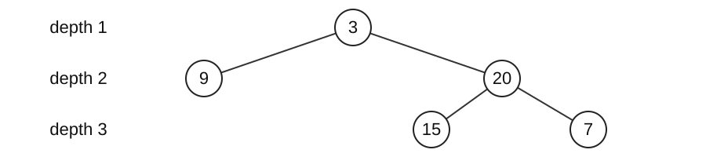

# Week 4 lab / 4주차 실습

## Set up and run

Extract the [lab code ZIP](https://sunboogermany.github.io/assets/courses/practical-algorithms/week-04-code.zip) and work in its code folder. Use Python 3.11+ and the standard library.

```text
python trace_lab.py --case max_depth
python verify.py
python verify.py --student
```

Predict the small example and its states on paper first. `trace_lab.py` traces the actual `solutions.py` implementation. `before L…` shows values immediately before that line executes: identify what the preceding executed line changed. Linked lists display a chain; tree nodes display their value and child values. Exclude tracing, copying, and printing overhead from the algorithm's complexity.

Implement the functions and methods in `student_week_04.py`, then run `verify.py --student`. An initial `NotImplementedError` identifies work still to implement. Without `--student`, the verifier checks the supplied solutions. Use `python trace_lab.py --case FUNCTION --student` to inspect your implementation.

For each task record the input/output meaning, state invariant, one state transition, final answer, time, auxiliary space, and output space. Passing one small example does not establish correctness for all inputs.

## This week’s problems

- [max_depth](#en-max_depth)
- [level_order](#en-level_order)
- [valid_bst](#en-valid_bst)
- [kth_smallest](#en-kth_smallest)

## Worked solutions

104 | 102 | 98 | 230

A task tree has at most two subtasks per node. What is its deepest level? We also need a report grouped by level and a check that a search tree preserves its ordering rules.

Each node can branch in two directions. Recursive return values, stacks, queues, and ancestor bounds carry the information needed for these questions.

## Tree height, width, and storage

A node stores a value and two child references. Missing children are None. Depth counts nodes from the root; height h is maximum depth, and width w is the largest number of nodes on one level.

```python
class TreeNode:
    def __init__(self, val=0, left=None, right=None):
        self.val, self.left, self.right = val, left, right
```



Here n=5, h=3, and w=2. DFS retains unfinished paths in a stack; BFS retains pending levels in a queue. Trees with equal node counts can therefore have different peak storage requirements.

## From list notation to a tree

`[4,2,7,None,3]` is level-order notation. Read the left and right child slots of each real node; None means that slot is empty. Do not read child slots for None itself.

| Values read | Connection | Nodes awaiting child slots |
| --- | --- | --- |
| 4 | create the root | [4] |
| 2,7 | 4.left=2, 4.right=7 | [2,7] |
| None,3 | 2.left=None, 2.right=3 | [7,3] |

Omitted trailing child slots are None. The path 4→2→3 has depth 3 and the levels are `[[4],[2,7],[3]]`. The depth function receives the connected TreeNode root, rather than this list directly.

In this notation for a sparse tree, children of list position i are not always at 2i+1 and 2i+2. In `[1,None,2,3]`, node 3 is the left child of node 2.

## What a recursive depth call returns

```python
def depth_recursive(root):
    if root is None:
        return 0
    return 1 + max(depth_recursive(root.left),
                   depth_recursive(root.right))
```

| Current node | Left return | Right return | Current return |
| --- | --- | --- | --- |
| Each leaf: 9,15,7 | 0 | 0 | 1 |
| 20 | 1 (from 15) | 1 (from 7) | 2 |
| 3 | 1 (from 9) | 2 (from 20) | 3 |

Each call has its own local root variable. A parent remains active while waiting for child results. Every node is visited once, giving O(n) time, but up to h calls wait simultaneously, giving O(h) auxiliary space.

Python limits recursion depth. The following implementation retains depth information in an explicit stack to handle long chains.

<a id="en-max_depth"></a>

## [LeetCode 104: Maximum Depth of Binary Tree](https://leetcode.com/problems/maximum-depth-of-binary-tree/) · Easy

Return the maximum root-to-leaf path length measured in nodes.

0..10^4 nodes; values -100..100.

### Predict before implementing

Store (node, depth) on a stack, starting at depth 1. Update best on every pop and push children at depth+1. A three-node chain and a three-node balanced tree have different depths; draw both.

```python
max_depth(tree([4, 2, 7, None, 3]),)
# 3
```

In Week 3, linked() builds linked nodes; in Week 4, tree() builds a tree from level-order notation. Both helpers are in structures.py.

### Idea and state transitions

#### 104 · Idea and execution trace

[LeetCode 104: Maximum Depth of Binary Tree](https://leetcode.com/problems/maximum-depth-of-binary-tree/) · Easy

Return the maximum root-to-leaf path length measured in nodes.

Depth counts nodes from the root to the current node. Store `(node, depth)` together so depth need not be reconstructed. Each child is one level deeper; the largest encountered depth is the answer.

Tree: root 3; children 9 and 20; children of 20 are 15 and 7. Stack top is on the right.

| Popped (value,depth) | Stack after child pushes | best |
| --- | --- | --- |
| (3,1) | [(9,2),(20,2)] | 1 |
| (20,2) | [(9,2),(15,3),(7,3)] | 2 |
| (7,3) | [(9,2),(15,3)] | 3 |
| (15,3) | [(9,2)] | 3 |
| (9,2) | [] | 3 |

#### 104 · Why it works; time and memory

Structural induction proves the recurrence. The explicit stack carries the true root depth to every node and records its maximum.

Every tree node is pushed once by its unique parent. There are n pushes and pops, plus two child checks per node, so time is O(n). The two if statements do not add another size-dependent loop.

For height h, at most one pending sibling branch per level accumulates, giving O(h) stack space, at worst O(n). A one-child chain keeps only one pending entry in this iterative version, whereas recursive calls accumulate to depth h.

Python recursion depth may be below a 10^4-node chain; distinguish the small-tree recursive demonstration from the full-contract iterative version.

`root=[4,2,7,None,3] → 3`

### Implement and execute

```python
from collections import deque

def max_depth(root):
    """Explicit stack supports skew trees within the official size limit."""
    if root is None:
        return 0
    stack, best = [(root, 1)], 0
    while stack:
        node, depth = stack.pop()
        best = max(best, depth)
        if node.left:
            stack.append((node.left, depth + 1))
        if node.right:
            stack.append((node.right, depth + 1))
    return best
```

```text
python trace_lab.py --case max_depth
```

Compare the trace return value with your prediction. Make the input change proposed above, find the first line where the state differs, and explain its effect on the answer.

<a id="en-level_order"></a>

## [LeetCode 102: Binary Tree Level Order Traversal](https://leetcode.com/problems/binary-tree-level-order-traversal/) · Medium

Return tree values grouped by depth, left to right.

0..2000 nodes; values -1000..1000.

### Predict before implementing

Use deque and freeze the queue length at the start of each level. Newly appended children belong to the next level. Predict queues [4], [2,7], [3] before execution.

```python
level_order(tree([4, 2, 7, None, 3]),)
# [[4], [2, 7], [3]]
```

In Week 3, linked() builds linked nodes; in Week 4, tree() builds a tree from level-order notation. Both helpers are in structures.py.

### Idea and state transitions

#### 102 · Idea and execution trace

[LeetCode 102: Binary Tree Level Order Traversal](https://leetcode.com/problems/binary-tree-level-order-traversal/) · Medium

Return tree values grouped by depth, left to right.

A first-in, first-out queue visits nodes by depth. Freeze its length at the start of each level so children appended during that level remain for the next one.

Use the preceding 3–9–20–15–7 tree. The queue’s left end is removed next.

| Queue at level start | Frozen length | Current level | Next queue |
| --- | --- | --- | --- |
| [3] | 1 | [3] | [9,20] |
| [9,20] | 2 | [9,20] | [15,7] |
| [15,7] | 2 | [15,7] | [] |

The result is `[[3],[9,20],[15,7]]`.

At the second level, queue=[9,20] fixes the loop count at two. Removing 9 leaves [20]; removing 20 and adding its children leaves [15,7]. Although the queue is nonempty, those two iterations are complete, so level=[9,20] is stored before the next level starts.

#### 102 · Why it works; time and memory

At each outer-loop entry the queue contains one level. Processing its initial size leaves only the next level; left-first insertion preserves order.

The outer loop counts levels, but the inner-loop counts sum to exactly n nodes across all levels. Constant-time queue insertion and removal give O(n) time. Using list.pop(0) on wide levels can instead cause O(<math xmlns="http://www.w3.org/1998/Math/MathML"><msup><mi>n</mi><mn>2</mn></msup></math>) total shifting.

If maximum level width is w, the queue holds the rest of one level plus part of the next, still O(w) entries. Queue workspace is O(w); returned level values occupy O(n). Including output, extra space is O(n).

list.pop(0) shifts the remaining entries; repeated use can reach O(<math xmlns="http://www.w3.org/1998/Math/MathML"><msup><mi>n</mi><mn>2</mn></msup></math>) on wide trees.

`root=[4,2,7,None,3] → [[4],[2,7],[3]]`

### Implement and execute

```python
from collections import deque

def level_order(root):
    if root is None:
        return []
    queue, result = deque([root]), []
    while queue:
        level = []
        for _ in range(len(queue)):
            node = queue.popleft()
            level.append(node.val)
            if node.left:
                queue.append(node.left)
            if node.right:
                queue.append(node.right)
        result.append(level)
    return result
```

```text
python trace_lab.py --case level_order
```

Compare the trace return value with your prediction. Make the input change proposed above, find the first line where the state differs, and explain its effect on the answer.

<a id="en-valid_bst"></a>

## [LeetCode 98: Validate Binary Search Tree](https://leetcode.com/problems/validate-binary-search-tree/) · Medium

Decide whether all descendants satisfy strict BST ordering.

1..10^4 nodes; signed 32-bit values; equal keys violate ordering.

### Predict before implementing

Carry strict lower and upper bounds from ancestors. Node 6 is less than parent 10 but lies in the right subtree of 8, so it violates (8,10). Replace 6 by 9 and predict True.

```python
valid_bst(tree([8, 3, 10, None, None, 6, 12]),)
# False
```

In Week 3, linked() builds linked nodes; in Week 4, tree() builds a tree from level-order notation. Both helpers are in structures.py.

### Idea and state transitions

#### 98 · Idea and execution trace

[LeetCode 98: Validate Binary Search Tree](https://leetcode.com/problems/validate-binary-search-tree/) · Medium

Decide whether all descendants satisfy strict BST ordering.

Comparing only parent and child misses constraints inherited from ancestors. With root 5, every value in the right subtree must exceed 5. Pass an allowed interval `(lower, upper)` to summarize all ancestral constraints.

Check a tree with root 5, right child 8, and 8’s left child 4.

| Node value | Allowed interval | Test result |
| --- | --- | --- |
| 5 | (-∞,∞) | Pass |
| 8 | (5,∞) | Pass |
| 4 | (5,8) | 5 < 4 is false → False |

Although 4 is smaller than its parent 8, it cannot lie to the right of root 5.

#### 98 · Why it works; time and memory

The interval is the intersection of all ancestor constraints. Tightening it preserves that meaning; any violation invalidates the whole tree.

A valid tree requires processing n nodes and a fixed number of empty-child entries per node. Two bound comparisons and stack operations per node give O(n) time. Early failure can shorten a run but does not change the worst-case bound.

Each stack entry contains a node reference and two bounds, a constant-size record. At most O(h) entries remain pending, so auxiliary space is O(h), at worst O(n). Adding bounds does not make each record grow with the tree.

The example’s 6 is below its parent 10 but lies right of root 8; parent-only checks miss it.

`root=[8,3,10,None,None,6,12] → False`

### Implement and execute

```python
from collections import deque

def valid_bst(root):
    stack = [(root, float("-inf"), float("inf"))]
    while stack:
        node, lower, upper = stack.pop()
        if node is None:
            continue
        if not lower < node.val < upper:
            return False
        stack.append((node.right, node.val, upper))
        stack.append((node.left, lower, node.val))
    return True
```

```text
python trace_lab.py --case valid_bst
```

Compare the trace return value with your prediction. Make the input change proposed above, find the first line where the state differs, and explain its effect on the answer.

<a id="en-kth_smallest"></a>

## [LeetCode 230: Kth Smallest Element in a BST](https://leetcode.com/problems/kth-smallest-element-in-a-bst/) · Medium

Return the kth smallest BST value.

1 <= k <= n <= 10^4; values 0..10^4.

### Predict before implementing

Follow left links while stacking nodes. Pop to visit the next smallest value, decrease k, then enter the right subtree. Record visits 1,2,3,4. Compare k=1 with k=7.

```python
kth_smallest(tree([4, 2, 6, 1, 3, 5, 7]), 4)
# 4
```

In Week 3, linked() builds linked nodes; in Week 4, tree() builds a tree from level-order notation. Both helpers are in structures.py.

### Idea and state transitions

#### 230 · Idea and execution trace

[LeetCode 230: Kth Smallest Element in a BST](https://leetcode.com/problems/kth-smallest-element-in-a-bst/) · Medium

Return the kth smallest BST value.

In a BST, visiting the left subtree, node, then right subtree yields increasing values. Stop at the kth visit rather than collecting and sorting every value.

Root 3, left child 1 with right child 2, and right child 4. k=2; stack top is on the right.

| Action | stack | Remaining k | Visited values |
| --- | --- | --- | --- |
| Push left path 3,1 | [3,1] | 2 | None |
| Pop 1; move to its right, 2 | [3] | 1 | 1 |
| Push 2 | [3,2] | 1 | 1 |
| Pop 2 | [3] | 0 | 1,2 → return 2 |

#### 230 · Why it works; time and memory

Every left value is smaller and every right value larger. Induction makes inorder sorted, so the kth visit gives the answer.

The initial left descent pushes at most h nodes. The algorithm pops k nodes; total pushes can be charged to popped nodes plus the at most h entries still pending. Time is O(h+k), becoming O(n) for k=n.

At most h ancestors occupy the stack, so auxiliary space is O(h). No full traversal array is stored. A balanced tree has h=O(log n), but a skew tree can have h=O(n).

If materializing inorder, index at k-1. That alternative uses O(n) auxiliary space and time.

`root=[5,2,8,1,3], k=3 → 3`

### Implement and execute

```python
from collections import deque

def kth_smallest(root, k):
    stack, node = [], root
    while stack or node:
        while node:
            stack.append(node)
            node = node.left
        node = stack.pop()
        k -= 1
        if k == 0:
            return node.val
        node = node.right
    raise ValueError("k exceeds tree size")
```

```text
python trace_lab.py --case kth_smallest
```

Compare the trace return value with your prediction. Make the input change proposed above, find the first line where the state differs, and explain its effect on the answer.

## Lab report

Include the small-input state table, completed code, your own boundary input and expected result, and verification results. Explain time by total operation counts and space by simultaneously live state. Include any input copying or sorting costs.

---

## 실행 준비

[실습 코드 ZIP](https://sunboogermany.github.io/assets/courses/practical-algorithms/week-04-code.zip)을 풀고 코드 폴더에서 실행합니다. Python 3.11 이상과 표준 라이브러리를 사용합니다.

```text
python trace_lab.py --case max_depth
python verify.py
python verify.py --student
```

먼저 작은 입력의 답과 상태 변화를 종이에 적고 실행 결과와 비교하세요. `trace_lab.py`는 `solutions.py`의 실제 실행을 추적합니다. `before L…`은 그 행을 실행하기 직전의 값이므로, 앞서 실행한 행이 무엇을 바꿨는지 읽습니다. 연결 리스트는 chain, 트리 노드는 값과 두 자식 값으로 표시합니다. 추적 출력의 복사·표시 비용은 알고리즘의 시간·공간 분석에 포함하지 않습니다.

`student_week_04.py`의 함수와 메서드를 구현한 뒤 `verify.py --student`로 검사합니다. 미구현 상태의 `NotImplementedError`는 해당 함수부터 채우라는 뜻입니다. `--student` 없이 실행하면 제공 풀이를 검사합니다. 특정 풀이의 동작은 `python trace_lab.py --case 함수명 --student`로 대조할 수 있습니다.

각 문제에서 입력·출력의 의미, 상태의 불변식, 한 단계의 변화, 최종 답, 시간·보조 공간·반환값 공간을 기록하세요. 아래 작은 예제 하나의 통과만으로 전체 정당성이 증명되지는 않습니다.

## 이 주의 문제

- [max_depth](#ko-max_depth)
- [level_order](#ko-level_order)
- [valid_bst](#ko-valid_bst)
- [kth_smallest](#ko-kth_smallest)

## 풀이와 실행 과정

104 | 102 | 98 | 230

하위 작업이 최대 두 개씩 연결된 작업 트리에서 가장 깊은 단계는 어디일까요? 단계별 현황을 출력하고, 검색용 트리가 정렬 규칙을 지키는지도 확인합니다.

한 줄로 저장한 기록과 달리 각 노드에서 두 갈래를 따라가야 합니다. 재귀 반환값, 스택·큐, 조상의 범위로 필요한 정보를 전달합니다.

## 트리의 높이·너비와 저장 공간

각 노드는 값과 두 자식 참조를 가집니다. 없는 자식은 None입니다. 깊이는 루트에서 현재 노드까지의 노드 수이며, 높이 h는 최대 깊이, 너비 w는 한 층의 최대 노드 수입니다.

```python
class TreeNode:
    def __init__(self, val=0, left=None, right=None):
        self.val, self.left, self.right = val, left, right
```


이 트리는 n=5, h=3, w=2입니다. DFS는 아직 끝내지 않은 경로를 스택으로, BFS는 다음에 처리할 층을 큐로 보관합니다. 따라서 같은 노드 수라도 트리 모양에 따라 최대 저장량이 달라집니다.

## 리스트 표기에서 실제 트리로

`[4,2,7,None,3]`은 레벨 순서 표기입니다. 실제 노드의 자식을 왼쪽·오른쪽 순서로 읽으며 None은 그 자리가 비었다는 뜻입니다. None 자체의 자식은 읽지 않습니다.

| 읽은 값 | 연결 | 다음에 자식을 읽을 노드 |
| --- | --- | --- |
| 4 | 루트 생성 | [4] |
| 2,7 | 4.left=2, 4.right=7 | [2,7] |
| None,3 | 2.left=None, 2.right=3 | [7,3] |

남은 자식 표기는 생략된 None입니다. 따라서 경로 4→2→3의 깊이는 3이고, 레벨은 `[[4],[2,7],[3]]`입니다. 최대 깊이 함수는 이 목록을 직접 받는 것이 아니라 연결된 TreeNode의 root를 받습니다.

임의의 희소 트리에서 목록 위치 i의 자식이 항상 2i+1,2i+2인 것은 아닙니다. 예를 들어 `[1,None,2,3]`의 3은 노드 2의 왼쪽 자식입니다.

## 재귀 호출이 돌려주는 깊이

```python
def depth_recursive(root):
    if root is None:
        return 0
    return 1 + max(depth_recursive(root.left),
                   depth_recursive(root.right))
```

| 현재 노드 | 왼쪽 반환값 | 오른쪽 반환값 | 현재 호출의 반환값 |
| --- | --- | --- | --- |
| 잎 9,15,7 각각 | 0 | 0 | 1 |
| 20 | 1 (15에서) | 1 (7에서) | 2 |
| 3 | 1 (9에서) | 2 (20에서) | 3 |

각 호출의 root는 서로 다른 지역 변수입니다. 부모 호출은 자식의 결과를 기다리며 남아 있습니다. 따라서 방문 작업은 노드당 한 번으로 O(n)이지만 동시에 기다리는 호출은 높이 h개여서 보조 공간 O(h)입니다.

Python의 재귀 깊이는 제한되어 있습니다. 다음 구현은 같은 깊이 정보를 명시적 스택에 넣어 긴 사슬도 처리합니다.

<a id="ko-max_depth"></a>

## [LeetCode 104: Maximum Depth of Binary Tree](https://leetcode.com/problems/maximum-depth-of-binary-tree/) · Easy

root에서 잎까지 가장 긴 경로의 노드 수를 반환합니다.

노드 0..10^4개; 값 -100..100.

### 구현 전 예측

stack에 (노드, 깊이)를 넣고 깊이 1에서 시작합니다. pop할 때 best를 갱신하고 자식을 깊이+1로 넣습니다. 노드 세 개의 사슬과 균형 트리를 그려 깊이가 다른 이유를 설명하세요.

```python
max_depth(tree([4, 2, 7, None, 3]),)
# 3
```

3주차 예제의 linked()는 list를 노드 연결로, 4주차의 tree()는 level-order 표기를 트리로 바꾸는 structures.py 함수입니다.

### 풀이 아이디어와 상태 변화

#### 104 · 풀이의 출발점과 실행 추적

[LeetCode 104: Maximum Depth of Binary Tree](https://leetcode.com/problems/maximum-depth-of-binary-tree/) · Easy

root에서 잎까지 가장 긴 경로의 노드 수를 반환합니다.

깊이는 루트에서 현재 노드까지 지나온 노드 수입니다. 노드만 저장하면 깊이를 다시 계산해야 하므로 `(node, depth)`를 함께 스택에 넣습니다. 자식은 부모보다 한 단계 깊고, 가장 큰 depth가 답입니다.

트리: 루트 3, 왼쪽 9, 오른쪽 20, 20의 자식 15·7. 스택 오른쪽이 top입니다.

| pop한 (값,깊이) | 자식 삽입 후 stack | best |
| --- | --- | --- |
| (3,1) | [(9,2),(20,2)] | 1 |
| (20,2) | [(9,2),(15,3),(7,3)] | 2 |
| (7,3) | [(9,2),(15,3)] | 3 |
| (15,3) | [(9,2)] | 3 |
| (9,2) | [] | 3 |

#### 104 · 정당성·시간·메모리의 근거

재귀는 자식 높이가 맞다고 가정하면 현재 높이를 정확히 결합합니다. 명시적 스택은 각 노드의 실제 root 깊이를 전달하며 최대를 기록하므로 같은 답입니다.

트리에서는 각 노드가 부모 하나에서 한 번만 스택에 들어갑니다. n번의 push·pop과 노드당 두 자식 검사이므로 총 시간은 O(n)입니다. 루프 안의 if 두 개는 n에 따라 늘어나지 않습니다.

깊이 h인 이진 트리에서 스택에는 현재 경로의 각 층에 남긴 형제 가지가 최대 하나씩 쌓여 O(h) 공간입니다. 최악에는 h=O(n)입니다. 이 반복 구현에서 자식이 하나뿐인 사슬은 스택 원소가 한 개뿐이지만 재귀 호출은 h개 쌓입니다.

Python 재귀 제한은 10^4 편향 트리보다 작을 수 있습니다. 작은 예제용 재귀 함수와 전체 제약용 반복 구현을 구분합니다.

`root=[4,2,7,None,3] → 3`

### 구현과 실행

```python
from collections import deque

def max_depth(root):
    """Explicit stack supports skew trees within the official size limit."""
    if root is None:
        return 0
    stack, best = [(root, 1)], 0
    while stack:
        node, depth = stack.pop()
        best = max(best, depth)
        if node.left:
            stack.append((node.left, depth + 1))
        if node.right:
            stack.append((node.right, depth + 1))
    return best
```

```text
python trace_lab.py --case max_depth
```

위 예측과 trace의 반환값을 대조하세요. 입력을 앞에서 제안한 대로 바꾸고, 처음으로 상태가 달라지는 행을 찾아 그 변화가 답에 미친 영향을 설명합니다.

<a id="ko-level_order"></a>

## [LeetCode 102: Binary Tree Level Order Traversal](https://leetcode.com/problems/binary-tree-level-order-traversal/) · Medium

트리 값을 깊이별 왼쪽부터 묶어 반환합니다.

노드 0..2000개; 값 -1000..1000.

### 구현 전 예측

deque를 사용하고 각 깊이를 시작할 때 queue 길이를 고정합니다. 새로 넣는 자식은 다음 깊이에 속합니다. 실행 전에 queue가 [4], [2,7], [3]이 되는 과정을 예측하세요.

```python
level_order(tree([4, 2, 7, None, 3]),)
# [[4], [2, 7], [3]]
```

3주차 예제의 linked()는 list를 노드 연결로, 4주차의 tree()는 level-order 표기를 트리로 바꾸는 structures.py 함수입니다.

### 풀이 아이디어와 상태 변화

#### 102 · 풀이의 출발점과 실행 추적

[LeetCode 102: Binary Tree Level Order Traversal](https://leetcode.com/problems/binary-tree-level-order-traversal/) · Medium

트리 값을 깊이별 왼쪽부터 묶어 반환합니다.

같은 깊이끼리 묶으려면 먼저 들어온 노드를 먼저 꺼내는 큐를 사용합니다. 한 층을 시작할 때 큐 길이를 고정하면, 처리 중 추가되는 자식은 다음 층으로 남습니다.

앞의 3–9–20–15–7 트리를 사용합니다. 큐 왼쪽이 다음에 꺼낼 위치입니다.

| 층 시작 queue | 고정한 길이 | 이번 level | 다음 queue |
| --- | --- | --- | --- |
| [3] | 1 | [3] | [9,20] |
| [9,20] | 2 | [9,20] | [15,7] |
| [15,7] | 2 | [15,7] | [] |

결과는 `[[3],[9,20],[15,7]]`입니다.

두 번째 층에서 처음 queue=[9,20]이면 반복 횟수는 2로 정해집니다. 9를 꺼내 [20], 20을 꺼내 자식들을 넣으면 [15,7]입니다. 아직 큐가 비지 않아도 두 번을 마쳤으므로 level=[9,20]을 저장하고 새 층을 시작합니다.

#### 102 · 정당성·시간·메모리의 근거

각 외부 반복 시작 때 큐에는 현재 레벨만 있습니다. 그 수만 꺼내면 새 자식은 다음 레벨 큐로 남습니다. 왼쪽 자식부터 추가하면 순서도 유지됩니다.

바깥 while의 반복 수는 층 수지만, 안쪽 for의 횟수를 모든 층에 걸쳐 합하면 정확히 n개 노드입니다. 각 노드의 큐 삽입·제거가 O(1)이므로 시간은 O(n)입니다. 넓은 층을 list.pop(0)으로 처리하면 총 이동량이 O(<math xmlns="http://www.w3.org/1998/Math/MathML"><msup><mi>n</mi><mn>2</mn></msup></math>)까지 커질 수 있습니다.

최대 층 너비를 w라 하면 큐에는 현재 층의 나머지와 다음 층 일부가 함께 있어도 O(w)개만 저장됩니다. 보조 큐는 O(w), 반환하는 모든 층의 값은 O(n)입니다. 결과를 포함한 전체 추가 공간은 O(n)입니다.

list.pop(0)는 남은 원소를 이동시킵니다. 넓은 트리에서는 반복하면 O(<math xmlns="http://www.w3.org/1998/Math/MathML"><msup><mi>n</mi><mn>2</mn></msup></math>)까지 갈 수 있습니다.

`root=[4,2,7,None,3] → [[4],[2,7],[3]]`

### 구현과 실행

```python
from collections import deque

def level_order(root):
    if root is None:
        return []
    queue, result = deque([root]), []
    while queue:
        level = []
        for _ in range(len(queue)):
            node = queue.popleft()
            level.append(node.val)
            if node.left:
                queue.append(node.left)
            if node.right:
                queue.append(node.right)
        result.append(level)
    return result
```

```text
python trace_lab.py --case level_order
```

위 예측과 trace의 반환값을 대조하세요. 입력을 앞에서 제안한 대로 바꾸고, 처음으로 상태가 달라지는 행을 찾아 그 변화가 답에 미친 영향을 설명합니다.

<a id="ko-valid_bst"></a>

## [LeetCode 98: Validate Binary Search Tree](https://leetcode.com/problems/validate-binary-search-tree/) · Medium

모든 왼쪽 후손이 작고 오른쪽 후손이 큰 BST인지 판정합니다.

1..10^4 노드; signed 32-bit 값; 같은 값은 허용되지 않음.

### 구현 전 예측

조상에서 내려온 엄격한 하한·상한을 함께 전달합니다. 6은 부모 10보다 작지만 8의 오른쪽 후손이라 (8,10)을 위반합니다. 6을 9로 바꾸고 True가 되는 이유를 적으세요.

```python
valid_bst(tree([8, 3, 10, None, None, 6, 12]),)
# False
```

3주차 예제의 linked()는 list를 노드 연결로, 4주차의 tree()는 level-order 표기를 트리로 바꾸는 structures.py 함수입니다.

### 풀이 아이디어와 상태 변화

#### 98 · 풀이의 출발점과 실행 추적

[LeetCode 98: Validate Binary Search Tree](https://leetcode.com/problems/validate-binary-search-tree/) · Medium

모든 왼쪽 후손이 작고 오른쪽 후손이 큰 BST인지 판정합니다.

부모와 자식만 비교하면 조상에게서 내려온 조건을 놓칩니다. 루트가 5이면 오른쪽 부분 트리의 모든 값이 5보다 커야 합니다. 각 노드에 허용 구간 `(lower, upper)`을 전달하면 모든 조상의 제약을 두 경계로 요약할 수 있습니다.

루트 5, 오른쪽 자식 8, 그 왼쪽 자식 4인 트리를 검사합니다.

| 노드 값 | 허용 구간 | 검사 결과 |
| --- | --- | --- |
| 5 | (-∞,∞) | 통과 |
| 8 | (5,∞) | 통과 |
| 4 | (5,8) | 5 < 4가 거짓 → False |

4는 부모 8보다 작지만 루트 5의 오른쪽에 올 수 없습니다.

#### 98 · 정당성·시간·메모리의 근거

범위는 모든 조상에서 온 제약의 교집합입니다. 범위를 만족하면 조상 관계를 모두 만족하고, 자식 범위를 줄여 같은 성질을 유지합니다. 한 위반이라도 전체가 False입니다.

유효한 트리에서는 n개 노드와 각 노드의 고정 개수 빈 자식을 처리합니다. 노드당 두 경계 비교와 스택 조작만 하므로 시간은 O(n)입니다. 잘못된 노드를 빨리 만나면 조기 종료할 수 있지만 최악 비용은 그대로입니다.

각 스택 항목은 노드 참조와 숫자 두 개입니다. 항목 크기는 O(1)이고 동시에 남는 항목 수가 O(h)이므로 보조 공간은 O(h), 최악 O(n)입니다. 경계값을 추가해도 항목당 고정 크기라는 점은 바뀌지 않습니다.

예시의 6은 10보다 작지만 root 8의 오른쪽에 있으므로 실패합니다. 부모만 비교하는 검사는 이를 놓칩니다.

`root=[8,3,10,None,None,6,12] → False`

### 구현과 실행

```python
from collections import deque

def valid_bst(root):
    stack = [(root, float("-inf"), float("inf"))]
    while stack:
        node, lower, upper = stack.pop()
        if node is None:
            continue
        if not lower < node.val < upper:
            return False
        stack.append((node.right, node.val, upper))
        stack.append((node.left, lower, node.val))
    return True
```

```text
python trace_lab.py --case valid_bst
```

위 예측과 trace의 반환값을 대조하세요. 입력을 앞에서 제안한 대로 바꾸고, 처음으로 상태가 달라지는 행을 찾아 그 변화가 답에 미친 영향을 설명합니다.

<a id="ko-kth_smallest"></a>

## [LeetCode 230: Kth Smallest Element in a BST](https://leetcode.com/problems/kth-smallest-element-in-a-bst/) · Medium

BST에서 작은 순서로 k번째 값을 반환합니다.

1 <= k <= n <= 10^4; 값 0..10^4.

### 구현 전 예측

왼쪽 연결을 따라 노드를 stack에 넣습니다. pop으로 다음 작은 값을 방문하고 k를 줄인 뒤 오른쪽으로 갑니다. 방문 값 1,2,3,4를 기록하고 k=1과 k=7을 비교하세요.

```python
kth_smallest(tree([4, 2, 6, 1, 3, 5, 7]), 4)
# 4
```

3주차 예제의 linked()는 list를 노드 연결로, 4주차의 tree()는 level-order 표기를 트리로 바꾸는 structures.py 함수입니다.

### 풀이 아이디어와 상태 변화

#### 230 · 풀이의 출발점과 실행 추적

[LeetCode 230: Kth Smallest Element in a BST](https://leetcode.com/problems/kth-smallest-element-in-a-bst/) · Medium

BST에서 작은 순서로 k번째 값을 반환합니다.

BST에서는 왼쪽 부분 트리, 현재 노드, 오른쪽 부분 트리 순으로 읽으면 값이 오름차순입니다. 모든 값을 배열에 저장한 뒤 정렬할 필요 없이, 이 순서대로 k번째 값을 만나는 순간 멈춥니다.

루트 3, 왼쪽 1(오른쪽 자식 2), 오른쪽 4. k=2이며 스택 오른쪽이 top입니다.

| 동작 | stack | 남은 k | 방문 값 |
| --- | --- | --- | --- |
| 왼쪽으로 3,1 저장 | [3,1] | 2 | 없음 |
| 1 pop, 오른쪽 2로 | [3] | 1 | 1 |
| 2 저장 | [3,2] | 1 | 1 |
| 2 pop | [3] | 0 | 1,2 → 2 반환 |

#### 230 · 정당성·시간·메모리의 근거

BST의 왼쪽 전체는 현재보다 작고 오른쪽 전체는 큽니다. 귀납적으로 inorder는 정렬 순서이므로 k번째 방문 값이 답입니다.

초기 왼쪽 경로를 내려가는 데 최대 h번 push하고 k개 노드를 pop합니다. 방문 중의 push는 이미 pop한 노드들과 아직 남은 최대 h개 경로 항목으로 계산할 수 있어 시간은 O(h+k)입니다. k가 n이면 전체 O(n)입니다.

동시에 저장하는 것은 조상 경로 최대 h개이므로 보조 공간은 O(h)입니다. 전체 순회 결과 배열을 만들지 않습니다. 균형 트리는 h=O(log n)이지만 편향 트리는 h=O(n)이므로 항상 로그 공간이라고 말할 수는 없습니다.

inorder 배열을 만들었다면 k-1로 접근합니다. 배열 전체 생성은 시간·출력 아닌 보조 공간 O(n)입니다.

`root=[5,2,8,1,3], k=3 → 3`

### 구현과 실행

```python
from collections import deque

def kth_smallest(root, k):
    stack, node = [], root
    while stack or node:
        while node:
            stack.append(node)
            node = node.left
        node = stack.pop()
        k -= 1
        if k == 0:
            return node.val
        node = node.right
    raise ValueError("k exceeds tree size")
```

```text
python trace_lab.py --case kth_smallest
```

위 예측과 trace의 반환값을 대조하세요. 입력을 앞에서 제안한 대로 바꾸고, 처음으로 상태가 달라지는 행을 찾아 그 변화가 답에 미친 영향을 설명합니다.

## 실습 보고서

작은 입력의 상태표, 완성 코드, 직접 만든 경계 입력과 예상값, 검증 결과를 함께 기록합니다. 시간 복잡도는 총 연산 횟수로, 공간 복잡도는 동시에 살아 있는 상태로 설명하세요. 입력을 복사하거나 정렬한다면 그 비용도 포함합니다.
