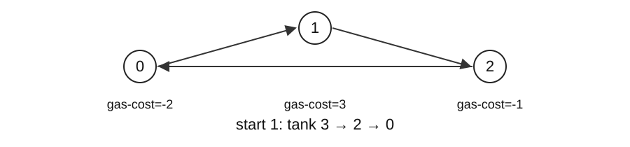

# Week 8 lab / 8주차 실습

## Set up and run

Extract the [lab code ZIP](https://sunboogermany.github.io/assets/courses/practical-algorithms/week-08-code.zip) and work in its code folder. Use Python 3.11+ and the standard library.

```text
python trace_lab.py --case can_jump
python verify.py
python verify.py --student
```

Predict the small example and its states on paper first. `trace_lab.py` traces the actual `solutions.py` implementation. `before L…` shows values immediately before that line executes: identify what the preceding executed line changed. Linked lists display a chain; tree nodes display their value and child values. Exclude tracing, copying, and printing overhead from the algorithm's complexity.

Implement the functions and methods in `student_week_08.py`, then run `verify.py --student`. An initial `NotImplementedError` identifies work still to implement. Without `--student`, the verifier checks the supplied solutions. Use `python trace_lab.py --case FUNCTION --student` to inspect your implementation.

For each task record the input/output meaning, state invariant, one state transition, final answer, time, auxiliary space, and output space. Passing one small example does not establish correctness for all inputs.

## This week’s problems

- [can_jump](#en-can_jump)
- [min_jumps](#en-min_jumps)
- [gas_start](#en-gas_start)
- [islands](#en-islands)

## Worked solutions

55 | 45 | 134 | 200

When each position allows a different travel distance, determine reachability and the fewest moves. On a circular route, find a starting point that never runs out of fuel.

Solving these tasks without storing every choice requires a reason that discarded candidates cannot be needed. Reachable ranges and prefix sums provide that reason.

## Why discarded candidates stay unnecessary

A greedy algorithm eliminates alternatives before storing all choices. It needs a reason why a discarded choice cannot later improve the answer. Merely choosing a large value does not establish that reason.



| Problem | Summary retained | Reason for elimination |
| --- | --- | --- |
| Reachability | Interval 0..farthest | Earlier positions cover a continuous prefix |
| Minimum jumps | Current end, next farthest | Inspect every position with fewer jumps first |
| Fuel circuit | Candidate start and tank | Every start inside a failed segment also fails |

The pictured total balance is zero. Start 0 fails immediately, whereas start 1 completes the circuit with balances 3,2,0. Testing total fuel and selecting a starting point serve different roles.

<a id="en-can_jump"></a>

## [LeetCode 55: Jump Game](https://leetcode.com/problems/jump-game/) · Medium

Decide whether maximum forward jump lengths permit reaching the last index.

1 <= n <= <math xmlns="http://www.w3.org/1998/Math/MathML"><msup><mn>10</mn><mn>4</mn></msup></math>; values 0..<math xmlns="http://www.w3.org/1998/Math/MathML"><msup><mn>10</mn><mn>5</mn></msup></math>.

### Predict before implementing

Maintain the farthest reachable index. Only positions at or below that boundary can extend it. The boundary stays at 3, so index 4 cannot supply a jump. Change the zero to 1 and explain the difference.

```python
can_jump([3, 2, 1, 0, 4],)
# False
```

### Idea and state transitions

#### 55 · Idea and execution trace

[LeetCode 55: Jump Game](https://leetcode.com/problems/jump-game/) · Medium

Decide whether maximum forward jump lengths permit reaching the last index.

Each value is a maximum jump length, not a mandatory jump. Reachable intervals therefore form a continuous prefix starting at zero. Keep only its farthest endpoint to decide whether the current index can be visited.

`nums=[2,0,1,0]`. Test reachability using the old farthest before updating it.

| index | step | Old farthest | New farthest |
| --- | --- | --- | --- |
| 0 | 2 | 0 | max(0,0+2)=2 |
| 1 | 0 | 2 | max(2,1+0)=2 |
| 2 | 1 | 2 | max(2,2+1)=3 |
| 3 | 0 | 3 | max(3,3+0)=3 |

Index 3 is reachable, so return True.

#### 55 · Why it works; time and memory

Reachable positions form the interval 0..farthest. Allowed jumps include every shorter distance, preserving an interval; an index beyond it cannot be crossed.

Read n elements once, using only comparison, addition, and max at each step. Paths are not enumerated, so time is O(n); early failure may shorten a run.

Instead of storing every reachable position in a set, retain one endpoint of a continuous interval. A fixed number of variables gives O(1) auxiliary space. Allowing all smaller jump lengths is what makes this interval summary valid.

In [2,3,0,0,0], taking the longest first jump stops at the zero at index 2. Exploring reachable index 1 also exposes a path to the last index. The algorithm maintains the range reachable from all eligible positions.

`nums=[2,0,1,0] → True`

### Implement and execute

```python
from collections import deque
import heapq

def can_jump(nums):
    farthest = 0
    for index, step in enumerate(nums):
        if index > farthest:
            return False
        farthest = max(farthest, index + step)
    return True
```

```text
python trace_lab.py --case can_jump
```

Compare the trace return value with your prediction. Make the input change proposed above, find the first line where the state differs, and explain its effect on the answer.

<a id="en-min_jumps"></a>

## [LeetCode 45: Jump Game II](https://leetcode.com/problems/jump-game-ii/) · Medium

Return the minimum jumps needed to reach the last index.

1 <= n <= <math xmlns="http://www.w3.org/1998/Math/MathML"><msup><mn>10</mn><mn>4</mn></msup></math>; values 0..1000; last index guaranteed reachable.

### Predict before implementing

Track the end reachable with the current jump count and the farthest endpoint found within it. Increment jumps only when the current interval ends. Intervals end at 0,2,4; two jumps reach the last index.

```python
min_jumps([2, 3, 1, 1, 4],)
# 2
```

### Idea and state transitions

#### 45 · Idea and execution trace

[LeetCode 45: Jump Game II](https://leetcode.com/problems/jump-game-ii/) · Medium

Return the minimum jumps needed to reach the last index.

Treat all positions reachable with one more jump as a layer. Inspect the whole current layer before fixing the next farthest endpoint. The first layer covering the destination gives the minimum jump count; no single longest jump is chosen in advance.

`nums=[2,3,0,1,0]`. end marks the layer boundary for the current jump count.

| index | Updated farthest | Old end | Updated jumps,end |
| --- | --- | --- | --- |
| 0 | 2 | 0 | 1,2 |
| 1 | 4 | 2 | 1,2 |
| 2 | 4 | 2 | 2,4 |
| 3 | 4 | 4 | 2,4 |

Route 0 → 1 → 4 needs two jumps; committing to 0 → 2 gets stuck.

#### 45 · Why it works; time and memory

Scan every reachable position in the current level before fixing the next frontier. These are BFS levels in an implicit unweighted graph, so the jump count is minimal.

Explicitly constructing all possible jump edges could create many edges per position. This implementation summarizes each continuous layer with endpoints and scans only n-1 indices, taking O(n) time. Expanding farthest never restarts earlier scans.

Only end, farthest, jumps, and loop variables are stored, giving O(1) auxiliary space. It uses BFS layers conceptually without building a queue. Length one executes zero iterations and returns zero jumps.

The target is n-1. Processing the last index overcounts; [0] gives zero. Unreachable inputs are outside this contract.

`nums=[2,3,0,1,0] → 2`

In the example, layer 0 is {0}, the positions newly reached with one jump are {1,2}, and the next layer is {3,4}. Even after index=1 discovers endpoint 4, the scan finishes the current layer through index=2 before committing jumps=2. end is the last index to examine in a layer, not a chosen landing position.

### Implement and execute

```python
from collections import deque
import heapq

def min_jumps(nums):
    end = farthest = jumps = 0
    for index in range(len(nums) - 1):
        farthest = max(farthest, index + nums[index])
        if index == end:
            jumps += 1
            end = farthest
    return jumps
```

```text
python trace_lab.py --case min_jumps
```

Compare the trace return value with your prediction. Make the input change proposed above, find the first line where the state differs, and explain its effect on the answer.

<a id="en-gas_start"></a>

## [LeetCode 134: Gas Station](https://leetcode.com/problems/gas-station/) · Medium

Return a start completing a circular route from an empty tank, or -1.

1 <= n <= <math xmlns="http://www.w3.org/1998/Math/MathML"><msup><mn>10</mn><mn>5</mn></msup></math>; equal gas/cost lengths; values 0..<math xmlns="http://www.w3.org/1998/Math/MathML"><msup><mn>10</mn><mn>4</mn></msup></math>; solution unique if present.

### Predict before implementing

Accumulate total surplus and the balance since the current start. A negative segment balance discards every start in that segment. Surpluses are -2,-2,-2,3,3; restart at 3, then verify one full circular lap.

```python
gas_start([1, 2, 3, 4, 5], [3, 4, 5, 1, 2])
# 3
```

### Idea and state transitions

#### 134 · Idea and execution trace

[LeetCode 134: Gas Station](https://leetcode.com/problems/gas-station/) · Medium

Return a start completing a circular route from an empty tank, or -1.

When a segment first runs out of fuel, every intermediate starting point also fails by that endpoint. The original start accumulated a nonnegative balance before reaching each intermediate point; starting there with no balance cannot improve the failed suffix. Discard the whole failed segment at once.

`gas=[1,4,2], cost=[3,1,3]`. total is the global balance; tank is the current candidate’s balance.

| index | gas-cost | total | tank after failure check | start |
| --- | --- | --- | --- | --- |
| 0 | -2 | -2 | 0 (reset) | 1 |
| 1 | +3 | 1 | 3 | 1 |
| 2 | -1 | 0 | 2 | 1 |

Starting at 1, balances along 1 → 2 → 0 are 3 → 2 → 0.

#### 134 · Why it works; time and memory

At the first failure over s..i, each earlier prefix s..j-1 is nonnegative. Removing such a prefix leaves j..i negative too, eliminating all intermediate starts. If total is nonnegative, the final candidate also has enough surplus to wrap through the eliminated prefixes.

Trying n steps independently from each start would cost O(<math xmlns="http://www.w3.org/1998/Math/MathML"><msup><mi>n</mi><mn>2</mn></msup></math>). Eliminating every start in a failed segment lets index advance without restarting, so there are n constant-cost updates: O(n) time.

zip reads one pair at a time without constructing a difference array. A fixed number of counters gives O(1) auxiliary space. Check both the size of the returned index and the absence of growing intermediate storage.

Choosing the largest gas supply is unjustified: gas=[5,0,4],cost=[6,1,2] fails at station 0; station 2 is the unique valid start.

`gas=[1,4,2], cost=[3,1,3] → 1`

#### Removing a failed segment and wrapping around

For differences [2,−1,−3,3], starting at 0 gives fuel 2→1→−2. The first failure at 2 eliminates starts 0,1,2. Start 1 would also fail with −1−3=−4; start 2 fails with −3.

Prefix sum P[k] is the sum of the first k differences. Here P=[0,2,1,−2,1] has its minimum at 3, which is also the algorithm's new start.

| Station visited from start 3 | Calculation | Fuel |
| --- | --- | --- |
| 3 | 3 | 3 |
| 0 | 3+2 | 5 |
| 1 | 3+2−1 | 4 |
| 2 | 3+2−1−3 | 1 |

In general, fuel after a minimum-prefix position s is P[k]−P[s]≥0. After wrapping, fuel is the full sum P[n] plus P[k]−P[s]. If the full sum is nonnegative, this is also nonnegative, proving that the final candidate completes the wrapped portion too.

### Implement and execute

```python
from collections import deque
import heapq

def gas_start(gas, cost):
    total = tank = start = 0
    for index, (supply, use) in enumerate(zip(gas, cost)):
        total += supply - use
        tank += supply - use
        if tank < 0:
            start, tank = index + 1, 0
    return start if total >= 0 else -1
```

```text
python trace_lab.py --case gas_start
```

Compare the trace return value with your prediction. Make the input change proposed above, find the first line where the state differs, and explain its effect on the answer.

<a id="en-islands"></a>

## [LeetCode 200: Number of Islands](https://leetcode.com/problems/number-of-islands/) · Medium

Repeat

Count land components connected horizontally or vertically in a character grid.

1 <= R,C <= 300; cells are strings "0" or "1".

### Predict before implementing

Choose connected-component search rather than a greedy frontier. Draw the region (0,0),(0,1),(1,1) and the separate cell (2,2). Explain why diagonal contact is not an edge, then test an all-water grid.

```python
islands([list('110'), list('010'), list('001')],)
# 2
```

### Idea and state transitions

#### 200 · Idea and execution trace

[LeetCode 200: Number of Islands](https://leetcode.com/problems/number-of-islands/) · Medium

Count land components connected horizontally or vertically in a character grid.

Starting from one land cell and following all four-directional connections reaches its whole island. Start a traversal and increase the count only at unvisited land, preventing duplicate counting. Diagonals do not connect cells.

Grid: `[["1","1","0"],["0","1","0"],["1","0","1"]]`. Coordinates start at zero; stack top is on the right.

| Action | stack | Newly added to seen | count |
| --- | --- | --- | --- |
| Start (0,0) | [(0,0)] | (0,0) | 1 |
| Pop (0,0) | [(0,1)] | (0,1) | 1 |
| Pop (0,1) | [(1,1)] | (1,1) | 1 |
| Pop (1,1) | [] | None | 1 |
| Traverse (2,0), (2,2) separately | [] | (2,0), (2,2) | 3 |

#### 200 · Why it works; time and memory

A traversal reaches exactly its starting component. Marked components cannot restart; the number of starts equals the component count.

The outer scan reads R·C cells. Each land cell is pushed and popped once because of seen, and each pop checks four neighbors. Four is independent of input size, giving expected O(RC) time under expected hash-set costs. The inner traversal is not restarted fully for every cell.

Both seen and the pending stack can hold up to RC coordinates, so auxiliary space is O(RC). Marking the grid itself could replace seen, but would mutate the input and would not eliminate stack storage.

Use == for values; is tests identity. Diagonal land in a 2x2 grid forms two components.

`grid=[["1","0","1"],["1","0","0"]] → 2`

### Implement and execute

```python
from collections import deque
import heapq

def islands(grid):
    rows, cols = len(grid), len(grid[0])
    seen, count = set(), 0
    for row in range(rows):
        for col in range(cols):
            if grid[row][col] != "1" or (row, col) in seen:
                continue
            count += 1
            stack = [(row, col)]
            seen.add((row, col))
            while stack:
                r, c = stack.pop()
                for nr, nc in ((r-1,c),(r+1,c),(r,c-1),(r,c+1)):
                    if (0 <= nr < rows and 0 <= nc < cols
                            and grid[nr][nc] == "1" and (nr,nc) not in seen):
                        seen.add((nr,nc))
                        stack.append((nr,nc))
    return count
```

```text
python trace_lab.py --case islands
```

Compare the trace return value with your prediction. Make the input change proposed above, find the first line where the state differs, and explain its effect on the answer.

## Lab report

Include the small-input state table, completed code, your own boundary input and expected result, and verification results. Explain time by total operation counts and space by simultaneously live state. Include any input copying or sorting costs.

---

## 실행 준비

[실습 코드 ZIP](https://sunboogermany.github.io/assets/courses/practical-algorithms/week-08-code.zip)을 풀고 코드 폴더에서 실행합니다. Python 3.11 이상과 표준 라이브러리를 사용합니다.

```text
python trace_lab.py --case can_jump
python verify.py
python verify.py --student
```

먼저 작은 입력의 답과 상태 변화를 종이에 적고 실행 결과와 비교하세요. `trace_lab.py`는 `solutions.py`의 실제 실행을 추적합니다. `before L…`은 그 행을 실행하기 직전의 값이므로, 앞서 실행한 행이 무엇을 바꿨는지 읽습니다. 연결 리스트는 chain, 트리 노드는 값과 두 자식 값으로 표시합니다. 추적 출력의 복사·표시 비용은 알고리즘의 시간·공간 분석에 포함하지 않습니다.

`student_week_08.py`의 함수와 메서드를 구현한 뒤 `verify.py --student`로 검사합니다. 미구현 상태의 `NotImplementedError`는 해당 함수부터 채우라는 뜻입니다. `--student` 없이 실행하면 제공 풀이를 검사합니다. 특정 풀이의 동작은 `python trace_lab.py --case 함수명 --student`로 대조할 수 있습니다.

각 문제에서 입력·출력의 의미, 상태의 불변식, 한 단계의 변화, 최종 답, 시간·보조 공간·반환값 공간을 기록하세요. 아래 작은 예제 하나의 통과만으로 전체 정당성이 증명되지는 않습니다.

## 이 주의 문제

- [can_jump](#ko-can_jump)
- [min_jumps](#ko-min_jumps)
- [gas_start](#ko-gas_start)
- [islands](#ko-islands)

## 풀이와 실행 과정

55 | 45 | 134 | 200

위치마다 이동 가능한 거리가 다를 때 목적지 도달 여부와 최소 이동 횟수를 구합니다. 순환 경로에서는 연료가 바닥나지 않는 출발점을 찾습니다.

모든 선택을 저장하지 않고도 답을 구하려면 버린 후보가 답이 될 수 없다는 근거가 필요합니다. 도달 범위와 누적합으로 그 근거를 확인합니다.

## 버린 후보가 다시 필요하지 않은 이유

그리디 알고리즘은 여러 선택을 저장하기 전에 일부를 제외합니다. 제외한 선택이 나중에 더 좋은 답이 되지 않는 근거가 있어야 합니다. 큰 값부터 고르는 규칙만으로는 그 근거가 생기지 않습니다.


| 문제 | 요약하는 정보 | 후보 제외의 근거 |
| --- | --- | --- |
| 도달 가능성 | 0부터 farthest까지 | 이전 위치가 만드는 연속 구간 |
| 최소 점프 | 현재 층 end, 다음 층 farthest | 적은 점프의 모든 위치를 먼저 조사 |
| 순환 연료 경로 | 현재 start와 tank | 실패한 구간 안의 출발점도 모두 실패 |

그림에서 전체 차이 합은 0입니다. 출발점 0은 즉시 실패하지만 출발점 1은 잔량 3,2,0으로 완주합니다. 전체 합 검사와 출발점 선택은 서로 다른 역할입니다.

<a id="ko-can_jump"></a>

## [LeetCode 55: Jump Game](https://leetcode.com/problems/jump-game/) · Medium

각 위치의 최대 전진 거리로 마지막 인덱스에 도달할 수 있는지 판정합니다.

1 <= n <= <math xmlns="http://www.w3.org/1998/Math/MathML"><msup><mn>10</mn><mn>4</mn></msup></math>; 값 0..<math xmlns="http://www.w3.org/1998/Math/MathML"><msup><mn>10</mn><mn>5</mn></msup></math>.

### 구현 전 예측

도달 가능한 가장 먼 인덱스를 유지합니다. 그 경계 안에 있는 위치만 경계를 늘릴 수 있습니다. 경계가 3에 멈추므로 인덱스 4의 점프는 사용할 수 없습니다. 0을 1로 바꾸고 결과 차이를 설명하세요.

```python
can_jump([3, 2, 1, 0, 4],)
# False
```

### 풀이 아이디어와 상태 변화

#### 55 · 풀이의 출발점과 실행 추적

[LeetCode 55: Jump Game](https://leetcode.com/problems/jump-game/) · Medium

각 위치의 최대 전진 거리로 마지막 인덱스에 도달할 수 있는지 판정합니다.

현재 위치의 숫자는 반드시 그만큼 뛰라는 뜻이 아니라 최대 점프 길이입니다. 그래서 도달한 위치가 만드는 구간들이 0부터 연속으로 이어집니다. 그 구간의 가장 먼 끝 farthest만 기억하면 현재 인덱스를 밟을 수 있는지 판단할 수 있습니다.

`nums=[2,0,1,0]`. 갱신 전에 index가 이전 farthest 이내인지 확인합니다.

| index | step | 이전 farthest | 새 farthest |
| --- | --- | --- | --- |
| 0 | 2 | 0 | max(0,0+2)=2 |
| 1 | 0 | 2 | max(2,1+0)=2 |
| 2 | 1 | 2 | max(2,2+1)=3 |
| 3 | 0 | 3 | max(3,3+0)=3 |

마지막 인덱스 3까지 도달하므로 True입니다.

#### 55 · 정당성·시간·메모리의 근거

이전 도달 집합은 0..farthest의 연속 구간입니다. 도달한 위치에서 최대 step 이내의 모든 거리가 허용되어 같은 형태를 유지합니다. index>farthest면 건널 방법이 없습니다.

n개 원소를 한 번씩 읽으며 각 단계에서 비교·덧셈·max만 수행합니다. 실제 경로를 모두 열거하지 않아 시간은 O(n)입니다. 조기 실패 시 더 짧게 끝나지만 최악에는 끝까지 읽습니다.

경로별 도달 위치를 집합으로 저장하지 않고 연속 구간의 끝 하나만 보관합니다. index, step, farthest 등 고정 개수 변수이므로 보조 공간 O(1)입니다. 모든 작은 점프 길이가 허용된다는 조건이 이 구간 요약을 가능하게 합니다.

[2,3,0,0,0]에서 처음부터 최대 거리로 점프하면 위치 2의 0에서 멈춥니다. 도달 가능한 위치 1도 탐색하면 마지막 위치까지 갈 수 있습니다. 알고리즘은 가능한 위치들의 도달 범위를 유지합니다.

`nums=[2,0,1,0] → True`

### 구현과 실행

```python
from collections import deque
import heapq

def can_jump(nums):
    farthest = 0
    for index, step in enumerate(nums):
        if index > farthest:
            return False
        farthest = max(farthest, index + step)
    return True
```

```text
python trace_lab.py --case can_jump
```

위 예측과 trace의 반환값을 대조하세요. 입력을 앞에서 제안한 대로 바꾸고, 처음으로 상태가 달라지는 행을 찾아 그 변화가 답에 미친 영향을 설명합니다.

<a id="ko-min_jumps"></a>

## [LeetCode 45: Jump Game II](https://leetcode.com/problems/jump-game-ii/) · Medium

마지막 위치까지 필요한 최소 점프 수를 반환합니다.

1 <= n <= <math xmlns="http://www.w3.org/1998/Math/MathML"><msup><mn>10</mn><mn>4</mn></msup></math>; 값 0..1000; 마지막 위치 도달 가능 보장.

### 구현 전 예측

현재 점프 횟수로 갈 수 있는 끝과 그 구간에서 새로 찾은 가장 먼 끝을 둡니다. 현재 구간을 다 읽을 때만 점프 수를 늘립니다. 구간 끝은 0,2,4가 되므로 두 번이면 마지막에 도착합니다.

```python
min_jumps([2, 3, 1, 1, 4],)
# 2
```

### 풀이 아이디어와 상태 변화

#### 45 · 풀이의 출발점과 실행 추적

[LeetCode 45: Jump Game II](https://leetcode.com/problems/jump-game-ii/) · Medium

마지막 위치까지 필요한 최소 점프 수를 반환합니다.

한 번의 점프로 갈 수 있는 모든 위치를 같은 층으로 생각합니다. 그 층의 위치들을 모두 조사한 뒤 다음 층의 가장 먼 끝을 확정하면, 처음 마지막 위치를 덮는 층 번호가 최소 점프 수입니다. 가장 멀리 한 번 뛰는 경로를 미리 고르지 않습니다.

`nums=[2,3,0,1,0]`. end는 현재 점프 수로 처리할 층의 끝입니다.

| index | 갱신 farthest | 이전 end | 갱신 후 jumps,end |
| --- | --- | --- | --- |
| 0 | 2 | 0 | 1,2 |
| 1 | 4 | 2 | 1,2 |
| 2 | 4 | 2 | 2,4 |
| 3 | 4 | 4 | 2,4 |

경로 0 → 1 → 4는 두 번입니다. 0 → 2로만 뛰면 0에 막힙니다.

#### 45 · 정당성·시간·메모리의 근거

현재 레벨의 모든 도달 위치를 스캔한 뒤 다음 최대 범위를 확정합니다. 이는 암묵적 무가중 그래프의 BFS 레벨 확장이므로 더 적은 점프로 끝을 넘을 수 없습니다.

그래프의 모든 점프 간선을 만들면 한 위치에서 많은 간선이 나올 수 있습니다. 이 구현은 각 층의 연속 구간을 두 끝값으로 요약하고 인덱스 n-1개만 훑으므로 O(n) 시간입니다. farthest를 확장해도 이미 지난 위치를 다시 검사하지 않습니다.

end, farthest, jumps와 반복 변수만 저장하여 보조 공간은 O(1)입니다. BFS의 층 개념을 사용하지만 큐를 만들지는 않습니다. 길이 1이면 반복 횟수 0, 반환 점프 수 0입니다.

목표는 n-1입니다. 마지막 위치까지 반복하면 점프를 한 번 더 셉니다. [0]의 답은 0입니다. 비도달 입력은 공식 보장 밖입니다.

`nums=[2,3,0,1,0] → 2`

예시에서 0번 층은 {0}, 한 번 점프로 새로 도달하는 1번 층은 {1,2}, 두 번이면 {3,4}입니다. index=1에서 다음 끝 4를 알아도 index=2까지 현재 층을 마친 뒤 jumps를 2로 확정합니다. end는 실제로 착지할 한 위치가 아니라 이 층에서 조사할 마지막 인덱스입니다.

### 구현과 실행

```python
from collections import deque
import heapq

def min_jumps(nums):
    end = farthest = jumps = 0
    for index in range(len(nums) - 1):
        farthest = max(farthest, index + nums[index])
        if index == end:
            jumps += 1
            end = farthest
    return jumps
```

```text
python trace_lab.py --case min_jumps
```

위 예측과 trace의 반환값을 대조하세요. 입력을 앞에서 제안한 대로 바꾸고, 처음으로 상태가 달라지는 행을 찾아 그 변화가 답에 미친 영향을 설명합니다.

<a id="ko-gas_start"></a>

## [LeetCode 134: Gas Station](https://leetcode.com/problems/gas-station/) · Medium

빈 탱크로 출발해 원형 경로를 한 바퀴 도는 시작점을 반환하고 없으면 -1입니다.

1 <= n <= <math xmlns="http://www.w3.org/1998/Math/MathML"><msup><mn>10</mn><mn>5</mn></msup></math>; gas/cost 길이 같음; 값 0..<math xmlns="http://www.w3.org/1998/Math/MathML"><msup><mn>10</mn><mn>4</mn></msup></math>; 해가 있으면 유일.

### 구현 전 예측

전체 잉여량과 현재 출발점 이후 잔량을 누적합니다. 구간 잔량이 음수면 그 구간의 모든 출발점을 버립니다. 잉여량은 -2,-2,-2,3,3이므로 3에서 다시 시작한 뒤 한 바퀴의 잔량을 확인하세요.

```python
gas_start([1, 2, 3, 4, 5], [3, 4, 5, 1, 2])
# 3
```

### 풀이 아이디어와 상태 변화

#### 134 · 풀이의 출발점과 실행 추적

[LeetCode 134: Gas Station](https://leetcode.com/problems/gas-station/) · Medium

빈 탱크로 출발해 원형 경로를 한 바퀴 도는 시작점을 반환하고 없으면 -1입니다.

한 구간을 지나며 연료가 처음 음수가 되었다면, 그 구간 안의 다른 위치에서도 실패 지점까지 갈 수 없습니다. 원래 출발점에서 그 위치까지 남긴 연료가 0 이상이었으므로, 그 연료 없이 새로 출발하면 더 불리하기 때문입니다. 실패한 구간 전체를 한 번에 제외합니다.

`gas=[1,4,2], cost=[3,1,3]`. total은 전체 합, tank는 현재 후보에서의 합입니다.

| index | gas-cost | total | 실패 검사 후 tank | start |
| --- | --- | --- | --- | --- |
| 0 | -2 | -2 | 0 (초기화) | 1 |
| 1 | +3 | 1 | 3 | 1 |
| 2 | -1 | 0 | 2 | 1 |

출발점 1에서 순서 1 → 2 → 0의 잔량은 3 → 2 → 0입니다.

#### 134 · 정당성·시간·메모리의 근거

s..i에서 처음 실패했다면 s..j-1의 누적합은 음수가 아닙니다. 따라서 중간 j에서 시작한 j..i 합은 실패 합보다 크지 않아 모두 실패합니다. 전체 합이 음수가 아니면 마지막 후보는 끝 구간을 통과하고, 앞의 제거된 구간을 감싸 돌아도 부족하지 않습니다.

각 출발점에서 n칸씩 따로 시험하면 O(<math xmlns="http://www.w3.org/1998/Math/MathML"><msup><mi>n</mi><mn>2</mn></msup></math>)입니다. 실패 구간 안의 출발점을 함께 제외하면 index가 뒤로 돌아가지 않아 n번만 처리합니다. 각 처리의 합·비교가 O(1)이므로 시간 O(n)입니다.

차이 배열을 새로 만들지 않고 zip으로 한 쌍씩 읽습니다. total, tank, start 등 고정 개수의 변수만 보관하므로 보조 공간 O(1)입니다. 반환 인덱스가 한 개라는 사실과 실제 실행 중 배열을 만들지 않는다는 사실을 함께 확인해야 합니다.

연료가 가장 많은 곳을 고르는 규칙에는 증명이 없습니다. gas=[5,0,4],cost=[6,1,2]에서는 최대 연료 위치 0이 즉시 실패하고 유일한 시작점 2가 가능합니다.

`gas=[1,4,2], cost=[3,1,3] → 1`

#### 실패 구간 제거와 한 바퀴의 누적합

차이가 [2,−1,−3,3]이면 0에서 시작한 잔량은 2→1→−2입니다. 2번에서 처음 실패하므로 시작점 0,1,2를 모두 제외합니다. 1에서 시작해도 −1−3=−4, 2에서는 −3으로 실패합니다.

접두합 P[k]는 처음 k개 차이의 합입니다. 이 예의 P=[0,2,1,−2,1]에서 최소 위치는 3이며, 알고리즘의 새 시작점도 3입니다.

| 출발 3 이후 방문 | 계산 | 잔량 |
| --- | --- | --- |
| 3 | 3 | 3 |
| 0 | 3+2 | 5 |
| 1 | 3+2−1 | 4 |
| 2 | 3+2−1−3 | 1 |

일반적으로 최소 접두합 위치 s 이후의 잔량은 P[k]−P[s]≥0입니다. 앞쪽으로 돌아온 뒤에는 전체 합 P[n]에 P[k]−P[s]를 더합니다. 전체 합이 0 이상이면 이 값도 0 이상이므로 마지막 후보가 순환 구간까지 통과합니다.

### 구현과 실행

```python
from collections import deque
import heapq

def gas_start(gas, cost):
    total = tank = start = 0
    for index, (supply, use) in enumerate(zip(gas, cost)):
        total += supply - use
        tank += supply - use
        if tank < 0:
            start, tank = index + 1, 0
    return start if total >= 0 else -1
```

```text
python trace_lab.py --case gas_start
```

위 예측과 trace의 반환값을 대조하세요. 입력을 앞에서 제안한 대로 바꾸고, 처음으로 상태가 달라지는 행을 찾아 그 변화가 답에 미친 영향을 설명합니다.

<a id="ko-islands"></a>

## [LeetCode 200: Number of Islands](https://leetcode.com/problems/number-of-islands/) · Medium

재풀이

문자 격자의 상하좌우로 연결된 육지 덩어리 수를 반환합니다.

1 <= R,C <= 300; 셀은 문자열 "0" 또는 "1".

### 구현 전 예측

greedy 경계 대신 연결 요소 탐색을 선택합니다. (0,0),(0,1),(1,1) 영역과 별개인 (2,2)를 그립니다. 대각선 접촉이 간선이 아닌 이유를 설명하고 모두 물인 격자도 검사하세요.

```python
islands([list('110'), list('010'), list('001')],)
# 2
```

### 풀이 아이디어와 상태 변화

#### 200 · 풀이의 출발점과 실행 추적

[LeetCode 200: Number of Islands](https://leetcode.com/problems/number-of-islands/) · Medium

문자 격자의 상하좌우로 연결된 육지 덩어리 수를 반환합니다.

육지 한 칸에서 상하좌우 연결을 모두 따라가면 그 섬 전체를 찾습니다. 아직 방문하지 않은 육지를 만날 때만 섬 수를 늘리고 탐색을 시작하면 같은 섬을 여러 번 세지 않습니다. 대각선은 연결에 포함되지 않습니다.

격자 `[["1","1","0"],["0","1","0"],["1","0","1"]]`. 스택 오른쪽이 top이며 좌표는 0부터 셉니다.

| 동작 | stack | seen에 새로 추가 | count |
| --- | --- | --- | --- |
| (0,0) 시작 | [(0,0)] | (0,0) | 1 |
| (0,0) pop | [(0,1)] | (0,1) | 1 |
| (0,1) pop | [(1,1)] | (1,1) | 1 |
| (1,1) pop | [] | 없음 | 1 |
| (2,0), (2,2) 각각 탐색 | [] | (2,0), (2,2) | 3 |

#### 200 · 정당성·시간·메모리의 근거

한 번 시작한 탐색은 연결 경로를 따라 그 성분의 모든 노드와 그 노드만 방문합니다. 이미 표시한 성분은 다시 시작하지 않으므로 시작 횟수가 성분 수입니다.

R·C칸을 한 번 훑습니다. 육지 칸은 seen 때문에 한 번만 push·pop되고, 꺼낼 때 이웃 네 개만 검사합니다. 네 방향은 입력 크기와 무관한 상수라서 해시 연산의 기대 비용을 적용한 시간은 O(RC)입니다. 루프가 중첩되어 보여도 섬 탐색 전체가 매 칸에서 반복되는 것은 아닙니다.

seen에는 최대 RC개 좌표, stack에도 최대 RC개 좌표가 남을 수 있어 보조 공간은 O(RC)입니다. 격자를 직접 표시하면 seen을 없앨 수 있지만, 입력 변경과 탐색 스택의 비용은 여전히 따져야 합니다.

값 비교는 ==입니다. is는 객체 동일성입니다. [["1","0"],["0","1"]]은 대각선을 연결하지 않아 두 성분입니다.

`grid=[["1","0","1"],["1","0","0"]] → 2`

### 구현과 실행

```python
from collections import deque
import heapq

def islands(grid):
    rows, cols = len(grid), len(grid[0])
    seen, count = set(), 0
    for row in range(rows):
        for col in range(cols):
            if grid[row][col] != "1" or (row, col) in seen:
                continue
            count += 1
            stack = [(row, col)]
            seen.add((row, col))
            while stack:
                r, c = stack.pop()
                for nr, nc in ((r-1,c),(r+1,c),(r,c-1),(r,c+1)):
                    if (0 <= nr < rows and 0 <= nc < cols
                            and grid[nr][nc] == "1" and (nr,nc) not in seen):
                        seen.add((nr,nc))
                        stack.append((nr,nc))
    return count
```

```text
python trace_lab.py --case islands
```

위 예측과 trace의 반환값을 대조하세요. 입력을 앞에서 제안한 대로 바꾸고, 처음으로 상태가 달라지는 행을 찾아 그 변화가 답에 미친 영향을 설명합니다.

## 실습 보고서

작은 입력의 상태표, 완성 코드, 직접 만든 경계 입력과 예상값, 검증 결과를 함께 기록합니다. 시간 복잡도는 총 연산 횟수로, 공간 복잡도는 동시에 살아 있는 상태로 설명하세요. 입력을 복사하거나 정렬한다면 그 비용도 포함합니다.


# Job-selection assessment / 작업 선택 평가

## Work through a smaller schedule

Use jobs A=[0,2,4], B=[2,3,3], C=[1,4,8]. A and B can both run because A ends when B starts. Their reward is 7; C overlaps each and gives 8. Draw the occupied half-open intervals [start,end) before choosing an algorithm.

Sorting by end time creates prefixes. Define dp[i] as the best reward using the first i sorted jobs; dp[0]=0 permits the empty choice. For the current job, either skip it and retain the preceding best, or take its reward plus the best prefix whose jobs end by its start. These two cases cover every valid selection.

| Job | Earlier compatible prefix length | Skip | Take | New best |
| --- | --- | --- | --- | --- |
| A: [0,2,4] | 0 | 0 | 4+0=4 | 4 |
| B: [2,3,3] | 1 | 4 | 3+4=7 | 7 |
| C: [1,4,8] | 0 | 7 | 8+0=8 | 8 |

Implement `weighted_jobs(jobs)` in `student_week_08.py`. Use sorted(jobs, key=...) to preserve the input. For each sorted job, scan earlier jobs to find the last compatible one and convert its zero-based index to a prefix length. Compute take before writing dp[i+1]. The answer is dp[n], not the reward of the last job.

```text
python trace_lab.py --case weighted_jobs
python trace_lab.py --case weighted_jobs --student
python verify.py --student
```

The trace executes the reference implementation or your implementation on the table's three jobs. Observe ordered, compatible, and dp. Sorting costs O(n log n); all predecessor scans total 0+1+...+(n−1), so this implementation takes O(n²) time. The sorted outer list and dp array occupy O(n) extra space; the returned number is O(1). No job record is changed.

For an independent check on n≤12, enumerate the <math xmlns="http://www.w3.org/1998/Math/MathML"><msup><mn>2</mn><mi>n</mi></msup></math> subsets, sort each selected subset by time, reject overlapping neighbors, and compare the best reward. This slower checker uses O(<math xmlns="http://www.w3.org/1998/Math/MathML"><msup><mn>2</mn><mi>n</mi></msup></math> n log n) time and O(n) working storage when subsets are processed one at a time. Test touching endpoints, identical intervals, zero rewards, and an example where the largest individual reward loses to two compatible jobs. Explain why selecting the earliest-finishing job alone is insufficient for weighted rewards.

Return to the original three-job assessment and write its own state table. For the selected LeetCode task, use the relevant [Week 5](https://sunboogermany.github.io/courses/practical-algorithms/week-05-practice/), [Week 6](https://sunboogermany.github.io/courses/practical-algorithms/week-06-practice/), or [Week 7](https://sunboogermany.github.io/courses/practical-algorithms/week-07-practice/) input contract and trace, then create a different test input.

## 작은 작업 일정부터 따라가기

A=[0,2,4], B=[2,3,3], C=[1,4,8]을 사용합니다. A가 끝날 때 B가 시작하므로 둘을 함께 수행하면 보상이 7입니다. C는 각각과 겹치며 보상은 8입니다. 알고리즘을 고르기 전에 작업이 차지하는 반열린 구간 [시작,끝)을 그려보세요.

끝 시각으로 정렬해 접두 구간을 만듭니다. dp[i]를 앞의 i개 작업만으로 얻는 최대 보상으로 정의하고 dp[0]=0으로 빈 선택을 허용합니다. 현재 작업을 건너뛰면 앞선 최댓값을 유지합니다. 선택하면 그 보상에 현재 시작 시각까지 끝나는 작업들의 최적 보상을 더합니다. 모든 유효한 선택은 이 두 경우 중 하나입니다.

| 작업 | 호환되는 앞쪽 구간 길이 | 건너뛰기 | 선택하기 | 새 최댓값 |
| --- | --- | --- | --- | --- |
| A: [0,2,4] | 0 | 0 | 4+0=4 | 4 |
| B: [2,3,3] | 1 | 4 | 3+4=7 | 7 |
| C: [1,4,8] | 0 | 7 | 8+0=8 | 8 |

`student_week_08.py`의 `weighted_jobs(jobs)`를 구현합니다. 입력을 보존하도록 sorted(jobs, key=...)를 사용합니다. 각 작업에서 앞선 작업을 훑어 마지막 호환 작업을 찾고, 0부터 센 인덱스를 접두 구간 길이로 바꿉니다. 선택한 경우의 보상을 계산한 뒤 dp[i+1]을 씁니다. 답은 마지막 작업 자체의 보상이 아니라 dp[n]입니다.

```text
python trace_lab.py --case weighted_jobs
python trace_lab.py --case weighted_jobs --student
python verify.py --student
```

위 표의 세 작업으로 제공 풀이 또는 본인 코드의 실행을 추적합니다. ordered, compatible, dp를 관찰하세요. 정렬은 O(n log n), 앞쪽 탐색은 총 0+1+...+(n−1)회이므로 이 구현의 시간은 O(n²)입니다. 정렬한 바깥 list와 dp 배열은 O(n) 추가 공간, 반환 숫자는 O(1) 공간을 씁니다. 작업 레코드는 수정하지 않습니다.

n≤12의 독립 검사는 <math xmlns="http://www.w3.org/1998/Math/MathML"><msup><mn>2</mn><mi>n</mi></msup></math>개 부분집합을 열거해 선택한 작업을 시간순으로 정렬하고, 이웃 구간이 겹치면 버린 뒤 최대 보상을 비교합니다. 이 느린 검사는 O(<math xmlns="http://www.w3.org/1998/Math/MathML"><msup><mn>2</mn><mi>n</mi></msup></math> n log n) 시간, 부분집합을 하나씩 처리하면 O(n) 작업 공간을 씁니다. 끝점 접촉, 같은 구간, 보상 0, 보상이 가장 큰 작업 하나보다 호환되는 두 작업이 유리한 경우를 확인하세요. 보상이 있을 때 가장 먼저 끝나는 작업만 고르면 충분하지 않은 이유도 설명합니다.

원래 평가의 세 작업으로 돌아가 별도 상태표를 작성하세요. 선택한 LeetCode 문제는 [5주차](https://sunboogermany.github.io/courses/practical-algorithms/week-05-practice/), [6주차](https://sunboogermany.github.io/courses/practical-algorithms/week-06-practice/), [7주차](https://sunboogermany.github.io/courses/practical-algorithms/week-07-practice/)의 입력 조건과 추적을 사용하고 다른 검사 입력을 직접 만듭니다.
