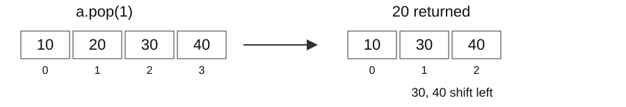

## Nearby duplicates in sensor logs

Retransmission produces the event log `[4, 7, 4, 4]`. We need to detect equal values at most one position apart. Comparing only the first and third 4 misses the final pair.

Repeatedly rescanning history becomes expensive as the log grows. This week retains only the past information needed by the question and uses sorted order to eliminate impossible candidates.

### Week 1 problems and learning outcomes

Session 1: array, set, and dictionary costs; values linked to earlier positions. Session 2: justified pointer moves in sorted values; extension to three-value sums.

- Input, output, and constraint definitions
- Stored state and justification for discarding candidates
- Time, auxiliary storage, and output costs

Practice uses LeetCode 1, 219, 167, and 15.

<!-- lecture-page -->

## Input size and one operation

n is the current number of elements. O(1) means the amount of work stays bounded as n grows; O(n) means the worst-case work grows proportionally to n. Constant complexity does not promise a smaller measured runtime for every input.

| Task | n=4 | n=8 | Growth |
| --- | --- | --- | --- |
| Read one specified slot | 1 slot | 1 slot | Constant |
| Search to the end for an absent value | 4 comparisons | 8 comparisons | Proportional to n |
| Compare every distinct pair of positions | 6 pairs | 28 pairs | n(n-1)/2 |

We count bounded-integer and reference operations as O(1). Large integers and hashing or comparing long strings have additional length-dependent costs. Big-O describes a growth-rate upper bound; also specify whether the analysis is worst-case, expected, or amortized.

<!-- lecture-page -->

## list: access by position versus search by value

For `a=[10,20,30,40]`, `a[2]` directly accesses the third slot. CPython lists store references in an array, so the preceding values need not be compared. In contrast, `30 in a` does not know the position and compares values from the beginning.

| Expression | Values examined | Result | Worst-case time |
| --- | --- | --- | --- |
| `a[2]` | Specified slot 2 | 30 | O(1) |
| `a[2] = 99` | Specified slot 2 | Replacement | O(1) |
| `30 in [10,20,30,40]` | 10,20,30 | True | O(n) |
| `50 in [10,20,30,40]` | 10,20,30,40 | False | O(n) |
| `a.index(40)` | Prefix through 40 | Index 3 | O(n) |
| `len(a)` | Stored length | 4 | O(1) |

Knowing an index is different from searching for a value to discover its index. `.index` raises ValueError when the value is absent.

<!-- lecture-page -->

## list: where removal happens

For `a=[10,20,30,40]`, `pop(1)` returns 20 and shifts references to 30 and 40 one slot left. Knowing the location does not eliminate the work of closing the gap.



| Expression | Work performed | Time |
| --- | --- | --- |
| `a.pop()` | Remove last; no trailing shifts | Amortized O(1) |
| `a.pop(i)`, `del a[i]` | Shift n-i-1 trailing references | O(n) worst at general positions |
| `a.remove(x)` | Find first x, then shift | O(n) worst case |
| `a.insert(0,x)` | Shift all references right | O(n) |

The argument of pop is a position; the argument of remove is a value. `remove(20)` does not mean position two. Resizing costs are included in the amortized bounds.

<!-- lecture-page -->

## append and amortized O(1)

A list reserves capacity beyond its current length. With spare capacity, append writes one reference at the end. When capacity is exhausted, a larger allocation may require moving the existing references, costing O(n) for that individual call.

| Case | Work in one call | Aggregate cost |
| --- | --- | --- |
| Append with spare capacity | Write one entry | O(1) |
| Append requiring growth | May move n references | O(n) for that call |
| N appends from an empty list | Spread growth costs across calls | O(N) total; O(1) amortized |

Amortized analysis does not assume random input. It divides the total cost of an operation sequence by its length. It is different from guaranteeing constant time for every individual call.

Removing the last element is also amortized O(1) when resizing is included. This is the cost model used for list-based stacks in this course.

<!-- lecture-page -->

## Sharing resize costs across calls

Count eight appends to an array whose capacity doubles through 1,2,4,8. This is a calculation for geometric growth, not CPython's exact allocation schedule.

| Length after append | New capacity needed | Existing references moved |
| --- | --- | --- |
| 1 | 1 | 0 |
| 2 | 2 | 1 |
| 3 | 4 | 2 |
| 4 | unchanged | 0 |
| 5 | 8 | 4 |
| 6–8 | unchanged | 0 |

Eight new writes plus 1+2+4=7 copies give 15 operations. When N is a power of two, copies total N−1 and all writes total 2N−1. Between powers of two, copies remain below 2N, so total cost is O(N). Growing by just one slot would instead copy 1+2+…+(N−1) references, giving O(N²).

Dividing O(N) total work by N calls gives amortized O(1) per append.

<!-- lecture-page -->

## Time and memory of copies and slices

```python
a = [10, 20, 30, 40]
b = a
c = a[1:3]
a[1] = 99
print(b)  # [10, 99, 30, 40]
print(c)  # [20, 30]
```

`b=a` adds a reference to the same list, using O(1) time and auxiliary space. `a[1:3]` copies two references into a new list, so later slot replacement is independent.

| Operation | Time | New storage |
| --- | --- | --- |
| Slice q entries | O(q) | O(q) |
| `a.copy()`, `list(a)` | O(n) | O(n) |
| `sorted(a)` | O(n log n) worst case | O(n) copy/sorting workspace |


With `rows=[[1],[2]]; copied=rows.copy()`, `copied[0].append(9)` changes both first rows to `[1,9]`: copied outer slots point to the same row object. Memory counts simultaneously retained storage, not the number of elements processed.

<!-- lecture-page -->

## stack and queue: removal order

A stack is LIFO: last in, first out. A queue is FIFO: first in, first out. These describe access order. In Python, use the end of a list for a stack and the ends of a deque for a queue.

```python
from collections import deque
stack = [10, 20, 30]
queue = deque([10, 20, 30])
print(stack.pop())     # 30
print(queue.popleft()) # 10
```

| Purpose | Operation | Cost and reason |
| --- | --- | --- |
| Stack insertion/removal | list.append / pop | End only; amortized O(1) |
| Queue insertion/removal | deque.append / popleft | O(1) at ends; no full shift |
| Insert at front | deque.appendleft | O(1) |
| Middle access/value search | q[i], x in q | O(n) worst case |

A deque supports efficient end operations; arbitrary-position access is not constant-time like a list. The same queue costs apply to BFS in Weeks 4–6.

<!-- lecture-page -->

## dict and set: information found by a key

A dict stores a value associated with each key; a set stores membership. Hashing narrows the locations to examine rather than comparing every element in order. Collisions can increase the number of comparisons.

```python
latest = {4: 2, 7: 1}
print(4 in latest)          # True: tests keys
print(latest[4])            # 2: associated value
print(2 in latest.values()) # True: searches values
```

| Operation | Expected/average time | Storage change |
| --- | --- | --- |
| `key in d`, `d[key]`, `d.get(key)` | O(1) | No new entry |
| `d[key]=v`, `d.pop(key)` | O(1), growth amortized | Add/remove a key |
| `x in s`, `s.add(x)`, `s.discard(x)` | O(1), growth amortized | Add/remove an element |
| `v in d.values()` | O(n) worst case | Only a view added |
| `d.copy()`, `set(a)` | Expected O(n) | Up to O(n) |

These bounds assume constant-cost hashing/equality and well-distributed keys. Severe collisions can make lookup O(n) in the worst case. Hashing a long string is not unconditionally O(1).

<!-- lecture-page -->

## Add operation costs across the whole program

Removing every element can have different total costs depending on the operation. Repeated removal from the front of a list shifts n-1, n-2, …, 0 references.

| Repeated operation | One operation | Count or total shifts | Total |
| --- | --- | --- | --- |
| list pop from end | Amortized O(1) | n calls | O(n) |
| list pop(0) | Current length | n(n-1)/2 shifts | O(<math xmlns="http://www.w3.org/1998/Math/MathML"><msup><mi>n</mi><mn>2</mn></msup></math>) |
| deque popleft | O(1) | n calls | O(n) |
| Search earlier list per value | Up to O(n) | n calls | O(<math xmlns="http://www.w3.org/1998/Math/MathML"><msup><mi>n</mi><mn>2</mn></msup></math>) |
| dict key lookup per value | Expected O(1) | n calls | Expected O(n) |

Summing n values while retaining only a running sum takes O(n) time and O(1) auxiliary space. Count iterations and retained storage separately.

<!-- lecture-page -->

## Input, auxiliary storage, and output

| Implementation | Storage beyond input | Auxiliary space | Output space |
| --- | --- | --- | --- |
| Return only a sum | Sum and current value | O(1) | O(1) |
| Return prefix sums | Sum and current value | O(1) | O(n) |
| Store seen values in a set | d distinct values | O(d) | O(1) bool |
| Copy and sort n entries | Copy and sorting workspace | O(n) | Depends on return type |
| Recursion of depth h | h unfinished calls | O(h) | Depends on return type |

Space measures the peak amount simultaneously retained. Overwriting a variable with each new value is different from continually appending to an output list.

Separate output from auxiliary space. A returned list with n entries and constant-size working variables means “O(1) auxiliary, O(n) output, O(n) combined.” Actual Python object byte sizes depend on implementation and value size.

[CPython operation complexity](https://docs.python.org/3/builtins/time-complexity.html) · [deque documentation](https://docs.python.org/3/library/collections.html#collections.deque)

<!-- lecture-page -->

## LeetCode 1: contract and baseline

[Two Sum](https://leetcode.com/problems/two-sum/): return indices at distinct positions summing to target. The source guarantees one answer; one position cannot be reused.

For `nums=[4,8,3], target=7`, return `[0,2]`. Enumerating every pair needs no stored history.

```python
def two_sum_brute(nums, target):
    for left in range(len(nums)):
        for right in range(left + 1, len(nums)):
            if nums[left] + nums[right] == target:
                return [left, right]
    return []
```

### Pair counts and repeated searches

There are this many distinct index pairs. For n=10,000, the count is 49,995,000. An answer may be found earlier, but the worst case examines a quadratic number of candidates.

<math display="block" aria-label="Number of distinct index pairs"><mfrac><mrow><mi>n</mi><mo>(</mo><mi>n</mi><mo>−</mo><mn>1</mn><mo>)</mo></mrow><mn>2</mn></mfrac></math>

If the current value is 3 and target is 7, the needed earlier value is 4. Store its presence and position instead of comparing every earlier value again.

<!-- lecture-page -->

## Earlier-value state for Two Sum

`seen[value]` records an earlier position. Looking up before recording the current position ensures that the two returned indices differ.

```python
def two_sum(nums, target):
    seen = {}
    for index, value in enumerate(nums):
        if target - value in seen:
            return [seen[target - value], index]
        seen[value] = index
    return []  # Defensive extension: official inputs have one answer.
```

Each iteration looks up the complement `target-value`. Store the current value only after an unsuccessful lookup, preventing reuse of the current position. With `[4,8,3]`, reading 3 finds 4:0 and recovers index 0.

| index | value | Needed | seen before lookup | Result |
| --- | --- | --- | --- | --- |
| 0 | 4 | 3 | {} | Absent → record 4:0 |
| 1 | 8 | -1 | {4:0} | Absent → record 8:1 |
| 2 | 3 | 4 | {4:0,8:1} | Found → [0,2] |

The map contains the distinct values already read, never future positions.

<!-- lecture-page -->

## Two Sum correctness and update order

At loop entry, seen contains only earlier positions. When the later position of the answer is reached, the earlier partner is present.

For `nums=[3,3], target=6`, recording first can make lookup return the current index itself. The first 3 should fail lookup and be stored; the second then returns `[0,1]`.

Each element performs a fixed number of dictionary operations. Expected O(1) operations repeated n times give expected O(n) time. Up to n distinct value-position entries use O(n) auxiliary space; two returned indices use O(1). Severe hash collisions give an O(<math xmlns="http://www.w3.org/1998/Math/MathML"><msup><mi>n</mi><mn>2</mn></msup></math>) worst-case upper bound.

<!-- lecture-page -->

## LeetCode 219: adding a distance condition

[Contains Duplicate II](https://leetcode.com/problems/contains-duplicate-ii/): decide whether equal values at distinct positions are at most k apart.

`nums=[4,7,4,4], k=1` is True because of the final two entries. With k=0, no distinct indices qualify.

Rescanning up to k earlier positions per entry costs O(n·min(n,k)); slicing also copies each interval. Which single past occurrence per value is sufficient?

### Meaning of the latest index

`latest[value]` is the most recent occurrence. It is the nearest past occurrence, so if it is too far, all older ones fail.

| index | value | Prior latest[value] | Distance | Action |
| --- | --- | --- | --- | --- |
| 0 | 4 | Absent | - | Store 4:0 |
| 1 | 7 | Absent | - | Store 7:1 |
| 2 | 4 | 0 | 2 > 1 | Fail, update to 4:2 |
| 3 | 4 | 2 | 1 <= 1 | Return True |

<!-- lecture-page -->

## Implementing latest-index state

```python
def nearby_duplicate(nums, k):
    latest = {}
    for index, value in enumerate(nums):
        if value in latest and index - latest[value] <= k:
            return True
        latest[value] = index
    return False
```

Update the latest position even when a repeated value fails the distance check. Keeping only the first occurrence misses the final pair in the example.

latest stores the most recent position for each value. Update it even after a failed distance check so the next occurrence uses its nearest predecessor. Only one position per distinct value is stored, although old keys are never deleted.

<!-- lecture-page -->

## Correctness and storage of recent state

At current position j, the largest earlier matching index i minimizes j-i. If it is within k, an answer exists; otherwise every older occurrence fails. Updating preserves this meaning for the next iteration.

Check: explain why all previous indices of value 4 need not be stored.

One lookup, distance comparison, and update per value give expected O(n) time. There are d entries for d distinct values, so auxiliary space is O(d), d<=n. Even with k=1, all-distinct input leaves n keys; this implementation is not O(k)-space.

<!-- lecture-page -->

## Session 1 concept checks

- What do `4 in events` and `4 in latest` each test?
- When does recording before lookup go wrong on `[3,3]`?
- Which answer is missed if index 2 does not update state in `[4,7,4,4], k=1`?
- How does copying latest on every iteration change complexity?

Check: membership tests list elements or dictionary keys. Storing first can return `[0,0]` on the first iteration of `[3,3]`. Skipping the latest-index update misses the last two 4s. Copying the dictionary each time can copy 0+1+…+(n−1) entries, giving expected O(n²) time and peak O(n) extra space even if only one copy is retained.

<!-- lecture-page -->

## Pairing sorted part lengths

Find two part lengths summing to 7 in sorted `[1,4,6,9]`. The endpoints 1 and 9 total 10. Why is it safe to discard 9?

Session 2 uses order to eliminate many candidates at once. Before memorizing pointer moves, identify every pair removed by each move.

### The input contract of LeetCode 167

[Two Sum II - Input Array Is Sorted](https://leetcode.com/problems/two-sum-ii-input-array-is-sorted/): input is nondecreasing and has one answer. Use distinct elements, return one-based positions, and use constant extra space.

`numbers=[1,4,6,9], target=7 → [1,3]`

This problem requires O(1) auxiliary space. Storing earlier values in a dictionary uses up to O(n) space, so we apply two pointers to the sorted input.

<!-- lecture-page -->

## Eliminating a left endpoint with a small sum

The candidate interval is `[left,right]`. If its endpoint sum is below target, every available partner for left is at most the right value. All those sums are too small.

Incrementing left removes only failed pairs using that endpoint. Decreasing right cannot repair a sum that is too small.

Invariant: if an answer has not yet been found, both its positions remain inside the interval.

### Eliminating a right endpoint with a large sum

If the endpoint sum exceeds target, every available partner for right is at least the left value. All those sums are too large.

| Current pair | Sum | Decision for target=7 | Removed candidates |
| --- | --- | --- | --- |
| 1,9 | 10 | Too large | 9 paired with 1,4,6 |
| 1,6 | 7 | Answer | No further elimination |

The condition is left<right because one element cannot be used twice.

<!-- lecture-page -->

## Implementing two pointers

```python
def two_sum_sorted(numbers, target):
    left, right = 0, len(numbers) - 1
    while left < right:
        total = numbers[left] + numbers[right]
        if total == target:
            return [left + 1, right + 1]
        if total < target:
            left += 1
        else:
            right -= 1
    return []
```

Use zero-based indices inside the loop; add one only when returning.

When the sum is too small, every pair using the current left value is too small; advance left. When it is too large, discard the right value. Each move narrows the remaining candidates without revisiting discarded pairs.

<!-- lecture-page -->

## Termination and total pointer movement

Each iteration returns an answer or moves one pointer inward. The gap shrinks, ensuring termination.

Outside the sorted contract, `[3,1,4], target=5` makes the rule miss 1 and 4. The elimination depends on the source problem’s sorting guarantee.

The initial gap right-left is n-1 and decreases by at least one per iteration, giving O(n) comparisons. Two pointers and a sum use O(1) auxiliary space; the two returned positions use O(1). No copy or sorting step is present.

<!-- lecture-page -->

## LeetCode 15: three values and duplicate triplets

[3Sum](https://leetcode.com/problems/3sum/): return unique value triplets summing to zero at distinct positions. Equal values remain usable when their positions differ.

`[-2,0,1,1,2] → [[-2,0,2],[-2,1,1]]`

Enumerating three positions costs O(n³). Fixing one value leaves a two-value target equal to its negative.

### Sorting and the fixed value

Sort a copy, fix index as the first position, and set left=index+1 and right=n-1. The three positions are then distinct.

Move left for a negative three-value sum and right for a positive one. This uses the same sorted elimination as 167.

3Sum returns value combinations, so we search the sorted array. Problems that return original indices require storing each value together with its original index.

<!-- lecture-page -->

## Tracing 3Sum with fixed value -2

| index,left,right | Values | Sum | Action |
| --- | --- | --- | --- |
| 0,1,4 | -2,0,2 | 0 | Store [-2,0,2]; move both |
| 0,2,3 | -2,1,1 | 0 | Store [-2,1,1]; move both |
| 0,3,2 | Interval ended | - | Finish fixed value -2 |

The next fixed value is 0. No pair from 1,1,2 sums to its negation, zero. Separate the search for one fixed value from subsequent fixed values.

<!-- lecture-page -->

## 3Sum implementation: fixing and moving


```python
def three_sum(nums):
    values = sorted(nums)
    result = []
    for index in range(len(values) - 2):
        if index and values[index] == values[index - 1]:
            continue
        left, right = index + 1, len(values) - 1
        while left < right:
            total = values[index] + values[left] + values[right]
            if total < 0:
                left += 1
```

For each fixed value, restart two pointers in the suffix. Skip repeated fixed values and, after recording a match, repeated values at both ends to avoid duplicate value combinations. Equal values at distinct positions may still be used together.

<!-- lecture-page -->

## 3Sum implementation: recording and duplicate skipping

```python
            elif total > 0:
                right -= 1
            else:
                result.append([values[index], values[left], values[right]])
                left += 1
                right -= 1
                while left < right and values[left] == values[left - 1]:
                    left += 1
                while left < right and values[right] == values[right + 1]:
                    right -= 1
    return result
```

After storing a match, move both pointers and skip values equal to the ones just used.

For `[-2,0,0,2,2]`, the first answer uses positions (0,1,4). Moving both pointers gives (left,right)=(2,3). Since `values[2]==values[1]==0`, left becomes 3 and the scan ends. The extra 0 and 2 would reproduce `[-2,0,2]`, so no new value combination is lost.

<!-- lecture-page -->

## Two places to remove duplicate output

First, skip a fixed value equal to the previous fixed value. Second, after a match skip repeated left and right values. Equal values at distinct positions can be used together. Duplicate removal targets value combinations already returned.

For `[0,0,0,0]`, several index choices produce the single value triplet `[0,0,0]`. In `[-2,0,1,1,2]`, `[-2,1,1]` is valid because the two 1s occupy different positions.

<!-- lecture-page -->

## 3Sum correctness and cost

Every sorted triplet has a smallest value. When it is fixed, the two-pointer search includes its remaining pair and eliminates only impossible sums. Duplicate skipping removes repeated representations of the same value triplet.

There are at most n fixed positions, each with O(n) total pointer movement: O(<math xmlns="http://www.w3.org/1998/Math/MathML"><msup><mi>n</mi><mn>2</mn></msup></math>) time. Duplicate-skipping loops are part of those same movements, not another factor of n. O(n log n) sorting is dominated. Copy/sort workspace is O(n), separate from O(z) space for z output triplets.

<!-- lecture-page -->

## Choosing state from the contract

| Question | Retained state | Contract to check |
| --- | --- | --- |
| Unsorted pair sum | Earlier value→position | No index reuse |
| Nearby equal values | Value→latest position | Distance k; update after failure |
| Sorted pair sum | left,right | Sorting, constant space, one-based output |
| Unique triplet sums | Fixed index and two pointers | Distinct indices, unique value triplets |

Identify the information needed for the next decision and candidates that can be discarded before naming a data structure.

<!-- lecture-page -->

## Independent exercises and submission

Solve LeetCode 1, 219, 167, and 15 in the [student exercises](/courses/practical-algorithms/week-01-practice/). Implement student_week_01.py and trace a small input by hand first.

Submit state meaning, correctness, complexity, and boundary inputs with each solution. Use the [staged hints and solutions](/courses/practical-algorithms/week-01-reading/) only as far as needed.

Run `python week01_walkthrough.py` from the [Python bundle](/assets/courses/practical-algorithms/practical-algorithms-code.zip) to check the lecture examples and traces.

### Core sources

Erik Demaine and Srini Devadas, [Introduction to Algorithms, MIT 6.006](https://ocw.mit.edu/courses/6-006-introduction-to-algorithms-fall-2011/) (Fall 2011).

Use each official LeetCode problem link for its complete input contract. Next week extends state updates to contiguous windows and unresolved information in stacks.

<!-- ko -->

## 센서 로그의 가까운 중복

같은 이벤트가 재전송되어 `[4, 7, 4, 4]`가 기록되었습니다. 같은 값이 한 칸 이내에 다시 나타나는지 확인하려고 합니다. 첫 번째 4와 세 번째 4만 비교하면 마지막 두 4를 놓칩니다.

매번 모든 과거 기록을 다시 읽으면 로그가 길어질수록 비교가 빠르게 늘어납니다. 이번 차시에서는 질문에 필요한 과거 정보만 저장하고, 정렬된 입력에서는 답이 될 수 없는 후보를 제거합니다.

### 1주차의 문제와 학습 목표

1차시: 배열·집합·사전의 연산 비용, 값과 이전 위치의 연결. 2차시: 정렬된 값에서 두 포인터 이동의 근거와 세 값의 합으로의 확장

- 입력·출력·제약 정의
- 저장 상태의 의미와 후보 제거 근거
- Python 구현의 시간·보조 공간·출력 비용

실습: LeetCode 1, 219, 167, 15

<!-- lecture-page -->

## 입력 크기와 한 번의 작업

n은 현재 컨테이너의 원소 수입니다. O(1)은 n이 커져도 작업 횟수가 일정한 정도라는 뜻이고, O(n)은 최악의 작업 횟수가 n에 비례한다는 뜻입니다. O(1)이 항상 실제 실행시간까지 더 짧다는 뜻은 아닙니다.

| 작업 | n=4 | n=8 | 증가 방식 |
| --- | --- | --- | --- |
| 지정한 칸 하나 읽기 | 1칸 | 1칸 | 일정 |
| 없는 값을 끝까지 찾기 | 4번 비교 | 8번 비교 | n에 비례 |
| 서로 다른 두 위치 모두 비교 | 6쌍 | 28쌍 | n(n-1)/2 |

이 강의의 수치 계산은 입력 범위 안의 정수·참조 연산을 O(1)로 셉니다. 큰 정수, 긴 문자열의 해시·비교는 길이에 따른 비용을 따로 계산합니다. Big-O는 증가율의 상한이며 최악·기대·분할상환 중 무엇을 분석하는지도 함께 밝혀야 합니다.

<!-- lecture-page -->

## list: 위치로 읽기와 값으로 찾기

`a=[10,20,30,40]`에서 `a[2]`는 세 번째 칸으로 바로 접근합니다. CPython list는 원소 참조를 배열에 저장하므로 앞의 두 값을 비교하지 않습니다. 반면 `30 in a`는 찾는 값의 위치를 모르므로 앞에서부터 비교합니다.

| 표현 | 확인한 값 | 결과 | 최악 시간 |
| --- | --- | --- | --- |
| `a[2]` | 지정한 2번 칸 | 30 | O(1) |
| `a[2] = 99` | 지정한 2번 칸 | 값 교체 | O(1) |
| `30 in [10,20,30,40]` | 10,20,30 | True | O(n) |
| `50 in [10,20,30,40]` | 10,20,30,40 | False | O(n) |
| `a.index(40)` | 앞에서 40까지 | 인덱스 3 | O(n) |
| `len(a)` | 저장된 길이 | 4 | O(1) |

인덱스를 이미 아는 것과 값을 찾아 인덱스를 알아내는 것은 다른 작업입니다. `.index`는 값이 없으면 ValueError를 냅니다.

<!-- lecture-page -->

## list: 어디에서 제거하는가

`a=[10,20,30,40]`에서 `pop(1)`은 값 20을 반환하고 뒤의 30·40을 한 칸씩 앞으로 옮깁니다. 원소가 이미 어디 있는지 알아도 빈칸을 메우는 작업이 남습니다.


| 표현 | 수행 작업 | 시간 |
| --- | --- | --- |
| `a.pop()` | 맨 뒤 제거, 뒤 원소 이동 없음 | 분할상환 O(1) |
| `a.pop(i)`, `del a[i]` | 뒤의 n-i-1개 참조 이동 | 일반 위치 최악 O(n) |
| `a.remove(x)` | 첫 x 검색 후 뒤 참조 이동 | 최악 O(n) |
| `a.insert(0,x)` | 기존 참조를 모두 한 칸 뒤로 | O(n) |

`pop(i)`의 i는 위치, `remove(x)`의 x는 값입니다. 예를 들어 `remove(20)`은 두 번째 위치라는 뜻이 아닙니다. 리스트 재할당 비용은 분할상환 비용에 포함합니다.

<!-- lecture-page -->

## append와 분할상환 O(1)

list는 현재 길이보다 여유 있는 저장 공간을 확보합니다. 여유 칸이 있으면 append는 끝에 참조 하나를 기록합니다. 공간이 부족하면 더 큰 저장 공간을 확보하고 기존 참조들을 옮길 수 있어 그 한 번은 O(n)입니다.

| 경우 | 한 번의 작업 | 여러 번 누적한 비용 |
| --- | --- | --- |
| 여유 공간이 있는 append | 끝에 한 원소 기록 | O(1) |
| 저장 공간을 늘리는 append | 기존 n개 참조 이동 가능 | 그 호출은 O(n) |
| 빈 리스트에 N번 append | 확장 비용을 전체 호출에 나눔 | 합 O(N), 분할상환 O(1) |

분할상환은 입력이 무작위라는 가정이 아닙니다. 일련의 연산 전체 비용을 연산 수로 나눈 분석입니다. 한 번의 호출이 언제나 같은 시간이라는 보장과 구분합니다.

마지막 원소 pop도 재할당을 포함하면 분할상환 O(1)입니다. 이 강의에서 list를 스택으로 사용하는 코드는 이 비용을 적용합니다.

<!-- lecture-page -->

## 확장 비용을 여러 호출에 나누기

용량을 1,2,4,8칸으로 두 배씩 늘리는 배열에서 append 8회를 세어봅니다. CPython의 실제 증설 비율을 재현한 표는 아니며, 비율을 정해 확장할 때 총 이동량이 어떻게 제한되는지 계산합니다.

| 추가 후 길이 | 필요한 새 용량 | 옮기는 기존 참조 수 |
| --- | --- | --- |
| 1 | 1 | 0 |
| 2 | 2 | 1 |
| 3 | 4 | 2 |
| 4 | 유지 | 0 |
| 5 | 8 | 4 |
| 6~8 | 유지 | 0 |

새 값 기록 8회와 복사 1+2+4=7회를 합하면 15회입니다. N이 2의 거듭제곱이면 복사 합은 N−1, 총 기록은 2N−1입니다. N이 그 사이에 있어도 복사 합은 2N보다 작아 총비용은 O(N)입니다. 반면 용량을 한 칸씩만 늘리면 1+2+…+(N−1)을 복사하므로 O(N²)이 됩니다.

전체 O(N)을 호출 N회로 나누면 append의 분할상환 비용은 O(1)입니다.

<!-- lecture-page -->

## 복사와 슬라이싱의 시간·메모리

```python
a = [10, 20, 30, 40]
b = a
c = a[1:3]
a[1] = 99
print(b)  # [10, 99, 30, 40]
print(c)  # [20, 30]
```

`b=a`는 같은 리스트를 가리키는 참조를 하나 추가합니다. 리스트 전체를 복사하지 않아 시간·보조 공간 모두 O(1)입니다. `a[1:3]`은 참조 2개를 새 리스트에 복사하여 이후 슬롯 교체가 분리됩니다.

| 작업 | 시간 | 새로 생기는 공간 |
| --- | --- | --- |
| q개 원소 슬라이스 | O(q) | O(q) |
| `a.copy()`, `list(a)` | O(n) | O(n) |
| `sorted(a)` | 최악 O(n log n) | 복사·정렬 작업 공간 O(n) |


예를 들어 `rows=[[1],[2]]; copied=rows.copy()` 뒤 `copied[0].append(9)`를 실행하면 두 목록 모두 첫 행이 `[1,9]`입니다. 바깥 슬롯만 복사했고 그 슬롯이 가리키는 첫 행 객체는 공유하기 때문입니다. 메모리는 처리 횟수가 아니라 동시에 유지되는 저장량입니다.

<!-- lecture-page -->

## stack과 queue: 꺼내는 순서

스택은 마지막에 넣은 값을 먼저 꺼내는 LIFO, 큐는 먼저 넣은 값을 먼저 꺼내는 FIFO입니다. 자료의 사용 순서이며, Python에서는 각각 list의 뒤쪽 연산과 deque의 양 끝 연산으로 구현합니다.

```python
from collections import deque
stack = [10, 20, 30]
queue = deque([10, 20, 30])
print(stack.pop())     # 30
print(queue.popleft()) # 10
```

| 목적 | 연산 | 비용과 이유 |
| --- | --- | --- |
| 스택에 넣고 꺼내기 | list.append / pop | 뒤쪽만 수정, 분할상환 O(1) |
| 큐에 넣고 꺼내기 | deque.append / popleft | 양 끝에서 O(1), 전체 이동 없음 |
| 앞쪽에도 넣기 | deque.appendleft | O(1) |
| deque 가운데 접근·값 검색 | q[i], x in q | 최악 O(n) |

deque는 양 끝 작업에 적합하며 임의 위치 접근이 list처럼 O(1)인 것은 아닙니다. 4–6주차 BFS에서 사용하는 큐에도 같은 비용이 적용됩니다.

<!-- lecture-page -->

## dict와 set: 키로 찾을 정보

dict는 키에 연결된 값을, set은 값의 존재 여부를 저장합니다. 해시값으로 조사할 위치를 좁혀 보통 모든 원소를 순서대로 비교하지 않습니다. 충돌이 많으면 비교가 늘 수 있습니다.

```python
latest = {4: 2, 7: 1}
print(4 in latest)          # True: 키 검사
print(latest[4])            # 2: 연결된 값
print(2 in latest.values()) # True: 값들을 검색
```

| 연산 | 기대/평균 시간 | 공간 변화 |
| --- | --- | --- |
| `key in d`, `d[key]`, `d.get(key)` | O(1) | 새 항목 없음 |
| `d[key]=v`, `d.pop(key)` | O(1), 확장 비용 분할상환 | 키 추가/제거 |
| `x in s`, `s.add(x)`, `s.discard(x)` | O(1), 확장 비용 분할상환 | 원소 추가/제거 |
| `v in d.values()` | 최악 O(n) | 보기 객체만 추가 |
| `d.copy()`, `set(a)` | 기대 O(n) | 최대 O(n) |

상수 비용 해시·동등 비교와 잘 분산된 키를 가정합니다. 심한 충돌 시 조회도 최악 O(n)이며, 긴 문자열의 해시 비용을 무조건 O(1)로 볼 수는 없습니다.

<!-- lecture-page -->

## 한 연산의 비용을 전체 코드로 합산

같은 데이터를 전부 제거해도 선택한 연산에 따라 총 비용이 달라집니다. n개 리스트의 앞을 계속 제거하면 이동하는 참조 수는 n-1, n-2, …, 0개입니다.

| 코드의 반복 작업 | 한 번 | 횟수 또는 총 이동량 | 전체 |
| --- | --- | --- | --- |
| list의 맨 뒤 pop | 분할상환 O(1) | n번 | O(n) |
| list의 맨 앞 pop(0) | 현재 길이에 비례 | n(n-1)/2회 이동 | O(<math xmlns="http://www.w3.org/1998/Math/MathML"><msup><mi>n</mi><mn>2</mn></msup></math>) |
| deque의 popleft | O(1) | n번 | O(n) |
| 매 값마다 이전 list에서 검색 | 최대 O(n) | n번 | O(<math xmlns="http://www.w3.org/1998/Math/MathML"><msup><mi>n</mi><mn>2</mn></msup></math>) |
| 매 값마다 dict 키 조회 | 기대 O(1) | n번 | 기대 O(n) |

합을 구하며 누적 값 하나만 유지하는 코드는 n번 더하므로 시간 O(n), 보조 공간 O(1)입니다. 반복 횟수와 저장량은 따로 셉니다.

<!-- lecture-page -->

## 입력·보조 공간·출력 공간

| 구현 | 입력 외에 저장하는 것 | 보조 공간 | 출력 공간 |
| --- | --- | --- | --- |
| 합만 반환 | 합·현재 값 | O(1) | O(1) |
| 누적 합 리스트 반환 | 합·현재 값 | O(1) | O(n) |
| 본 값들을 set에 저장 | 서로 다른 d개 값 | O(d) | bool O(1) |
| 크기 n의 복사 후 정렬 | 복사본·정렬 작업 공간 | O(n) | 반환 형식에 따라 다름 |
| 깊이 h의 재귀 | 아직 끝나지 않은 호출 h개 | O(h) | 반환 형식에 따라 다름 |

공간은 실행 중 가장 많이 동시에 사용하는 시점을 기준으로 셉니다. 매번 작은 변수를 새 값으로 덮어쓰는 것과 결과 리스트에 계속 append하는 것은 다릅니다.

출력 공간을 보조 공간과 분리해서 적습니다. 반환 리스트가 n칸이고 작업용 변수만 O(1)이면 “보조 O(1), 출력 O(n), 합계 O(n)”입니다. Python 객체의 실제 바이트 수는 구현과 값의 크기에 따라 달라집니다.

[CPython 연산 복잡도](https://docs.python.org/3/builtins/time-complexity.html) · [deque 문서](https://docs.python.org/3/library/collections.html#collections.deque)

<!-- lecture-page -->

## LeetCode 1: 문제 정의와 단순 풀이

[Two Sum](https://leetcode.com/problems/two-sum/): 서로 다른 두 위치의 합이 target인 인덱스를 반환합니다. 원문은 답 하나를 보장하며 같은 위치를 두 번 사용할 수 없습니다.

`nums=[4,8,3], target=7`의 답은 `[0,2]`입니다. 모든 쌍을 검사하면 추가 저장 없이 풀 수 있습니다.

```python
def two_sum_brute(nums, target):
    for left in range(len(nums)):
        for right in range(left + 1, len(nums)):
            if nums[left] + nums[right] == target:
                return [left, right]
    return []
```

### 쌍의 개수와 반복 조회

서로 다른 두 위치의 쌍은 다음만큼 있습니다. n=10,000이면 49,995,000쌍입니다. 실제로는 답을 일찍 찾을 수도 있지만 최악에는 이 수에 비례해 비교합니다.

<math display="block" aria-label="Number of distinct index pairs"><mfrac><mrow><mi>n</mi><mo>(</mo><mi>n</mi><mo>−</mo><mn>1</mn><mo>)</mo></mrow><mn>2</mn></mfrac></math>

현재 값이 3이고 target이 7이라면 필요한 과거 값은 4 하나입니다. 모든 과거 값을 다시 비교하는 대신, 4의 존재 여부와 위치를 바로 조회할 상태를 만듭니다.

<!-- lecture-page -->

## Two Sum의 이전 값 상태

`seen[value]`는 이미 지난 위치 하나입니다. 현재 위치를 읽기 전에 저장하지 않으므로 사전에서 찾은 위치와 현재 위치가 다릅니다.

```python
def two_sum(nums, target):
    seen = {}
    for index, value in enumerate(nums):
        if target - value in seen:
            return [seen[target - value], index]
        seen[value] = index
    return []  # Defensive extension: official inputs have one answer.
```

각 반복은 현재 값의 짝 `target-value`를 사전에서 조회합니다. 찾지 못했을 때만 현재 값을 저장하므로 같은 위치를 두 번 쓰지 않습니다. `nums=[4,8,3]`에서 3을 읽을 때 사전의 4:0이 인덱스 0을 알려줍니다.

| index | value | 필요한 값 | 조회 전 seen | 결과 |
| --- | --- | --- | --- | --- |
| 0 | 4 | 3 | {} | 없음 → 4:0 저장 |
| 1 | 8 | -1 | {4:0} | 없음 → 8:1 저장 |
| 2 | 3 | 4 | {4:0,8:1} | 발견 → [0,2] |

저장된 값의 개수는 지금까지 읽은 서로 다른 값의 수입니다. 사전에는 미래 위치가 들어 있지 않습니다.

<!-- lecture-page -->

## Two Sum의 정당성과 갱신 순서

반복 시작 때 seen은 이전 위치만 포함합니다. 답의 두 번째 위치에 도착하면 첫 위치의 값이 저장되어 있으므로 답을 찾습니다.

`nums=[3,3], target=6`에서 현재 값을 먼저 저장하면 조회 결과가 현재 인덱스 자신이 됩니다. 첫 3에서는 조회만 실패하고 저장한 뒤, 둘째 3에서 `[0,1]`을 반환해야 합니다.

각 원소에서 사전 조회·저장 횟수는 고정입니다. 기대 O(1)인 이 작업을 n번 하므로 기대 시간 O(n)입니다. 보조 사전은 최악에 n개의 서로 다른 값과 위치를 담아 O(n), 반환 인덱스 두 개는 O(1)입니다. 심한 해시 충돌까지 포함한 시간 상한은 O(<math xmlns="http://www.w3.org/1998/Math/MathML"><msup><mi>n</mi><mn>2</mn></msup></math>)입니다.

<!-- lecture-page -->

## LeetCode 219: 거리 조건의 추가

[Contains Duplicate II](https://leetcode.com/problems/contains-duplicate-ii/): 같은 값의 서로 다른 두 위치가 거리 k 이내인지 판정합니다.

`nums=[4,7,4,4], k=1`은 마지막 두 위치 때문에 True입니다. k=0이면 서로 다른 위치를 만족할 수 없습니다.

각 위치에서 앞의 최대 k개를 다시 보면 O(n·min(n,k)) 시간. 슬라이스를 만들면 반복마다 복사 비용도 듭니다. 값마다 어떤 과거 위치 하나를 남기면 충분한지 살펴봅니다.

### 가장 최근 인덱스의 의미

`latest[value]`는 그 값이 마지막으로 나타난 위치입니다. 현재 위치와 가장 가까운 과거 위치이므로 이것도 너무 멀면 더 오래된 위치는 모두 실패합니다.

| index | value | 이전 latest[value] | 거리 | 처리 |
| --- | --- | --- | --- | --- |
| 0 | 4 | 없음 | - | 4:0 저장 |
| 1 | 7 | 없음 | - | 7:1 저장 |
| 2 | 4 | 0 | 2 > 1 | 실패 후 4:2로 갱신 |
| 3 | 4 | 2 | 1 <= 1 | True 반환 |

<!-- lecture-page -->

## 최근 인덱스의 구현

```python
def nearby_duplicate(nums, k):
    latest = {}
    for index, value in enumerate(nums):
        if value in latest and index - latest[value] <= k:
            return True
        latest[value] = index
    return False
```

조건을 만족하지 않은 재등장도 최근 위치로 갱신합니다. 최초 위치만 남기면 예시의 마지막 쌍을 찾지 못합니다.

latest의 값은 해당 숫자를 가장 최근에 본 위치입니다. 멀리 떨어져 실패한 경우에도 갱신해야 다음에 더 가까운 쌍을 찾습니다. k가 커져도 값마다 최근 위치 하나만 저장하며, 오래된 키를 지우는 구현은 아닙니다.

<!-- lecture-page -->

## 최근 상태의 정당성과 저장 비용

현재 위치 j에서 같은 값의 가장 최근 위치 i가 거리 j-i를 최소화합니다. 최근 위치가 k 이내면 답이며, 아니면 이전 위치 어느 것도 답이 아닙니다. 갱신 후 다음 반복에서도 같은 의미가 유지됩니다.

확인 질문: 값 4가 여러 번 나오더라도 인덱스를 모두 저장할 필요가 없는 이유를 설명합니다.

각 값마다 조회·거리 비교·저장을 한 번씩 하므로 기대 O(n) 시간입니다. 서로 다른 값 수 d만큼 사전 항목이 생겨 보조 공간 O(d), d<=n입니다. k=1이어도 입력이 모두 다르면 이 코드는 n개 키를 유지하므로 공간을 O(k)라고 할 수 없습니다.

<!-- lecture-page -->

## 1차시 이해 확인

- `4 in events`와 `4 in latest`는 각각 무엇을 검사하나요?
- `[3,3]`에서 조회와 저장 순서가 바뀌면 어느 시점에 잘못되나요?
- `[4,7,4,4], k=1`에서 2번 위치의 갱신을 생략하면 어떤 답을 놓치나요?
- 매 반복에서 `latest.copy()`를 만들면 복잡도는 어떻게 달라지나요?

확인: 리스트에서는 원소 값, 사전에서는 키를 검사합니다. `[3,3]`을 먼저 저장하면 첫 반복부터 `[0,0]`을 만들 수 있습니다. 최근 위치 갱신을 생략하면 마지막 두 4를 놓칩니다. 매번 사전을 복사하면 최악에 0+1+…+(n−1)개 항목을 복사해 기대 시간 O(n²), 사본 하나만 유지해도 최대 추가 공간 O(n)입니다.

<!-- lecture-page -->

## 정렬된 부품 길이의 합

정렬된 길이 `[1,4,6,9]`에서 합이 7인 두 부품을 찾습니다. 왼쪽 값 1과 오른쪽 값 9의 합은 10입니다. 지금 9를 버려도 되는 이유를 설명할 수 있나요?

2차시에서는 정렬 순서가 한 번에 여러 후보를 지우는 근거임을 보입니다. 포인터 이동을 암기하기 전에 제거되는 모든 쌍을 확인

### LeetCode 167의 입력 계약

[Two Sum II - Input Array Is Sorted](https://leetcode.com/problems/two-sum-ii-input-array-is-sorted/): 입력은 비내림차순이며 답 하나가 보장됩니다. 서로 다른 두 원소를 사용하고 결과 위치는 1부터 셉니다. 추가 공간은 상수여야 합니다.

`numbers=[1,4,6,9], target=7 → [1,3]`

이 문제는 보조 공간 O(1)을 요구합니다. 이전 값을 사전에 저장하는 방식은 최대 O(n) 공간을 사용하므로, 정렬된 입력에 두 포인터를 적용합니다.

<!-- lecture-page -->

## 합이 작은 왼쪽 후보의 제거

현재 후보 범위는 `[left,right]`입니다. 양 끝 합이 target보다 작다면, 현재 left와 짝지을 수 있는 모든 값은 right의 값 이하입니다. 따라서 그 합들도 모두 너무 작습니다.

left를 하나 늘리면 현재 left를 사용하는 실패 쌍만 제거합니다. right를 줄여서는 부족한 합을 키울 수 없습니다.

불변식: 아직 찾지 못한 답이 있다면 현재 범위 안에 두 위치가 모두 남아 있습니다.

### 합이 큰 오른쪽 후보의 제거

양 끝 합이 target보다 크다면, 현재 right와 짝지을 수 있는 모든 값은 left의 값 이상입니다. 따라서 그 합들도 모두 너무 큽니다.

| 현재 쌍 | 합 | target=7의 판정 | 제거되는 후보 |
| --- | --- | --- | --- |
| 1,9 | 10 | 너무 큼 | 9와 1·4·6의 쌍 |
| 1,6 | 7 | 정답 | 더 제거하지 않음 |

같은 원소를 두 번 쓸 수 없으므로 반복 조건은 left<right입니다.

<!-- lecture-page -->

## 두 포인터의 구현

```python
def two_sum_sorted(numbers, target):
    left, right = 0, len(numbers) - 1
    while left < right:
        total = numbers[left] + numbers[right]
        if total == target:
            return [left + 1, right + 1]
        if total < target:
            left += 1
        else:
            right -= 1
    return []
```

루프 안에서는 0-based 인덱스를 쓰고 반환할 때만 1을 더합니다.

작은 합에서 left를 늘리는 것은 현재 왼쪽 값으로 만들 수 있는 모든 쌍이 너무 작기 때문입니다. 큰 합에서는 오른쪽 값을 제외합니다. 이동 뒤 두 포인터 사이 후보만 남으므로 이미 탈락한 쌍을 다시 읽지 않습니다.

<!-- lecture-page -->

## 포인터의 종료와 전체 이동 수

매 반복에서 답을 반환하거나 포인터 하나가 안쪽으로 한 칸 움직입니다. 두 포인터의 간격이 줄어들므로 무한 반복하지 않습니다.

반례: 정렬 전제 밖 `[3,1,4], target=5`에 같은 규칙을 적용하면 1과 4의 답을 놓칩니다. 이 규칙은 원문이 보장한 정렬 조건에 의존합니다.

간격 right-left는 처음 n-1이며 반복마다 적어도 1 줄어듭니다. 따라서 비교는 최대 O(n)번입니다. 포인터 두 개와 합만 저장하여 보조 공간 O(1), 반환 위치 두 개도 O(1)입니다. 원소들을 복사하거나 정렬하는 코드는 포함되어 있지 않습니다.

<!-- lecture-page -->

## LeetCode 15: 세 값과 중복 조합

[3Sum](https://leetcode.com/problems/3sum/): 서로 다른 세 위치의 합이 0인 값 조합을 중복 없이 반환합니다. 값이 같아도 위치가 다르면 사용할 수 있습니다.

`[-2,0,1,1,2] → [[-2,0,2],[-2,1,1]]`

세 위치를 모두 열거하면 O(n³)입니다. 값을 하나 고정하면 나머지 두 값의 목표 합은 고정 값의 음수가 됩니다.

### 정렬과 고정 값의 역할

초기 설정: 입력의 복사 정렬, 첫 원소의 위치 index 고정. left=index+1, right=n-1로 두면 세 위치가 항상 다릅니다.

현재 세 값의 합이 음수면 left를 늘리고, 양수면 right를 줄입니다. 167과 같은 정렬 기반 제거

3Sum은 값 조합을 반환하므로 정렬한 배열에서 탐색합니다. 원래 인덱스를 반환하는 문제에서는 값과 원래 인덱스를 함께 저장해야 합니다.

<!-- lecture-page -->

## 3Sum에서 고정 값 -2의 추적

| index,left,right | 세 값 | 합 | 동작 |
| --- | --- | --- | --- |
| 0,1,4 | -2,0,2 | 0 | [-2,0,2] 저장; 양쪽 이동 |
| 0,2,3 | -2,1,1 | 0 | [-2,1,1] 저장; 양쪽 이동 |
| 0,3,2 | 범위 끝 | - | 고정 값 -2의 탐색 종료 |

다음 고정 값: 0. 값 1·1·2에서 두 값을 골라도 0의 음수인 0을 만들지 못합니다. 현재 고정 값에서 찾지 못한 조합과 다음 고정 값의 조합을 구분

<!-- lecture-page -->

## 3Sum 구현: 고정과 후보 이동


```python
def three_sum(nums):
    values = sorted(nums)
    result = []
    for index in range(len(values) - 2):
        if index and values[index] == values[index - 1]:
            continue
        left, right = index + 1, len(values) - 1
        while left < right:
            total = values[index] + values[left] + values[right]
            if total < 0:
                left += 1
```

고정 값 하나마다 뒤쪽에서 두 포인터를 새로 시작합니다. 같은 고정 값을 건너뛰고, 정답을 저장한 뒤 양쪽의 같은 값을 건너뛰어 값 조합의 중복을 제거합니다. 서로 다른 위치의 같은 값 두 개를 사용하는 것은 허용됩니다.

<!-- lecture-page -->

## 3Sum 구현: 저장과 중복 건너뛰기

```python
            elif total > 0:
                right -= 1
            else:
                result.append([values[index], values[left], values[right]])
                left += 1
                right -= 1
                while left < right and values[left] == values[left - 1]:
                    left += 1
                while left < right and values[right] == values[right + 1]:
                    right -= 1
    return result
```

정답을 저장한 뒤 양쪽 포인터를 이동하고, 방금 사용한 값과 같은 값을 건너뜁니다.

`[-2,0,0,2,2]`에서 첫 답을 찾은 위치는 (0,1,4)입니다. 양쪽 이동 뒤 (left,right)=(2,3)인데 `values[2]==values[1]==0`이므로 left=3이 되어 종료합니다. 추가 0과 2로 만들 조합도 이미 저장한 `[-2,0,2]`여서 새 답을 잃지 않습니다.

<!-- lecture-page -->

## 중복 제거의 두 위치

첫째, 이미 고정한 값과 같은 값을 다시 고정하지 않습니다. 둘째, 답을 찾은 뒤 같은 left 값과 right 값이 반복되는 것을 건너뜁니다. 같은 값도 서로 다른 위치에 있으면 함께 사용할 수 있습니다. 중복 제거의 대상은 이미 반환한 값 조합입니다.

`[0,0,0,0]`에서는 위치 조합이 여러 개여도 값 조합 `[0,0,0]` 하나만 반환합니다. `[-2,0,1,1,2]`의 `[−2,1,1]`은 서로 다른 두 1의 위치를 사용하므로 유효합니다.

<!-- lecture-page -->

## 3Sum의 정당성과 비용

정렬된 조합마다 가장 작은 값이 하나 있습니다. 그 값을 고정한 차례의 두 포인터 탐색이 나머지 쌍을 포함하고, 합의 방향으로 실패 후보만 제거합니다. 중복 건너뛰기는 이미 기록한 같은 값 조합만 없앱니다.

고정 인덱스가 최대 n개이고 각 인덱스에서 두 포인터의 총 이동이 O(n)이므로 O(<math xmlns="http://www.w3.org/1998/Math/MathML"><msup><mi>n</mi><mn>2</mn></msup></math>)입니다. 중복을 넘기는 while도 같은 방향 이동의 일부라 별도 n을 다시 곱하지 않습니다. 정렬 O(n log n)은 이보다 작습니다. 복사·정렬 작업 공간 O(n)과 정답 z개의 출력 공간 O(z)를 구분합니다.

<!-- lecture-page -->

## 문제 조건에 따른 상태 선택

| 질문 | 남길 상태 | 확인할 조건 |
| --- | --- | --- |
| 정렬 안 된 두 값의 합 | 이전 값→위치 | 같은 위치 재사용 금지 |
| 가까운 같은 값 | 값→최근 위치 | 거리 k; 실패 후에도 갱신 |
| 정렬된 두 값의 합 | left,right | 정렬·상수 공간·1-based 반환 |
| 중복 없는 세 값의 합 | 고정 위치와 두 포인터 | 서로 다른 위치·값 조합 중복 제거 |

자료구조 이름을 먼저 고르기보다, 다음 판단에 필요한 정보와 버려도 되는 후보를 먼저 적습니다.

<!-- lecture-page -->

## 독립 실습과 제출물

[학생 실습](/courses/practical-algorithms/week-01-practice/)에서 LeetCode 1, 219, 167, 15를 풉니다. `student_week_01.py`에 코드를 작성하고 작은 입력을 먼저 손으로 추적합니다.

각 문제에 상태의 의미, 정당성, 시간·공간 분석과 경계 입력을 함께 제출합니다. 막힐 때는 [단계별 힌트·해설](/courses/practical-algorithms/week-01-reading/)을 필요한 단계까지만 확인합니다.

[Python 실습 묶음](/assets/courses/practical-algorithms/practical-algorithms-code.zip)에서 `python week01_walkthrough.py`로 강의의 예시와 추적 결과를 확인

### 핵심 참고자료

Erik Demaine·Srini Devadas, [Introduction to Algorithms, MIT 6.006](https://ocw.mit.edu/courses/6-006-introduction-to-algorithms-fall-2011/) (2011년 가을 학기).

문제의 전체 입력 조건은 각 LeetCode 공식 문제 링크에서 확인합니다. 다음 주에는 연속 구간의 상태를 갱신하는 슬라이딩 윈도우와 가장 최근 미해결 정보를 보관하는 스택으로 이어집니다.
