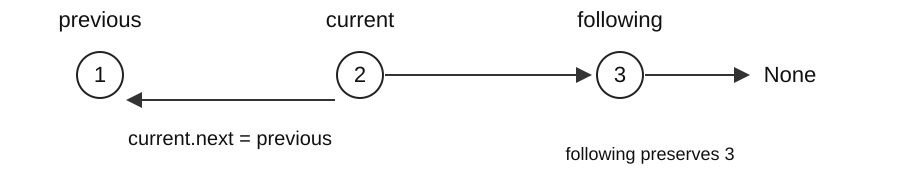

## Set up and run

Extract the [lab code ZIP](/assets/courses/practical-algorithms/week-03-code.zip) and work in its code folder. Use Python 3.11+ and the standard library.

```text
python trace_lab.py --case search_matrix
python verify.py
python verify.py --student
```

Predict the small example and its states on paper first. `trace_lab.py` traces the actual `solutions.py` implementation. `before L…` shows values immediately before that line executes: identify what the preceding executed line changed. Linked lists display a chain; tree nodes display their value and child values. Exclude tracing, copying, and printing overhead from the algorithm's complexity.

Implement the functions and methods in `student_week_03.py`, then run `verify.py --student`. An initial `NotImplementedError` identifies work still to implement. Without `--student`, the verifier checks the supplied solutions. Use `python trace_lab.py --case FUNCTION --student` to inspect your implementation.

For each task record the input/output meaning, state invariant, one state transition, final answer, time, auxiliary space, and output space. Passing one small example does not establish correctness for all inputs.

## This week’s problems

- [search_matrix](#en-search_matrix)
- [search_rotated](#en-search_rotated)
- [reverse_list](#en-reverse_list)
- [merge_lists](#en-merge_lists)

## Worked solutions

74 | 33 | 206 | 21

A device stores sorted measurements in rows. When a new reading arrives, can we find it without inspecting every record? Then a queue of records must be reordered while preserving the same node objects.

This week uses candidate intervals for search and changes links to reverse or merge lists.

## Positions and node references

An array directly accesses position i by index. A linked list follows next references from its head. Two nodes with the same value 2 can still be distinct objects.

```python
class ListNode:
    def __init__(self, val=0, next=None):
        self.val, self.next = val, next
```



The diagram processes node 2. Preserve node 3 as following before changing 2’s next to node 1. A node’s value and its links are different data. `node = node.next` moves a local reference; `node.next = other` changes the structure.

<a id="en-search_matrix"></a>

## [LeetCode 74: Search a 2D Matrix](https://leetcode.com/problems/search-a-2d-matrix/) · Medium

Return whether target occurs in the matrix.

1 <= R,C <= 100; values/target -10^4..10^4; sorted rows, each next row starts above the previous end.

### Predict before implementing

Treat the ordered matrix as six virtual positions. Convert midpoint with divmod(mid, column_count), without flattening a new list. Search 8 next and record when the inclusive interval becomes empty.

```python
search_matrix([[1, 3, 5], [7, 9, 11]], 9)
# True
```

In Week 3, linked() builds linked nodes; in Week 4, tree() builds a tree from level-order notation. Both helpers are in structures.py.

### Idea and state transitions

#### 74 · Idea and execution trace

[LeetCode 74: Search a 2D Matrix](https://leetcode.com/problems/search-a-2d-matrix/) · Medium

Return whether target occurs in the matrix.

Each row is sorted and its first value exceeds the previous row’s last value. Reading rows consecutively therefore gives one sorted sequence. Search that virtual sequence without copying it; translate each position into a row and column.

`matrix=[[1,3,5],[7,9,11]], target=9`. Bounds are shown before each comparison.

| left,right | mid | row,col | Value | Next action |
| --- | --- | --- | --- | --- |
| 0,5 | 2 | 0,2 | 5 | 5 < 9 → left=3 |
| 3,5 | 4 | 1,1 | 9 | Return True |

#### 74 · Why it works; time and memory

The cross-row property makes the flattened order sorted. Comparisons eliminate an impossible half; every update shrinks the interval, and an empty interval means absence.

For N=R·C elements, comparisons reduce the candidates roughly to N/2, N/4, and so on. N=8 needs at most four comparisons; time is O(log(N+1)). Index arithmetic and each list lookup cost O(1).

No flattened list is built. Only a fixed number of indices and values are retained, so auxiliary space is O(1). Copying the matrix into a new sequence would change this space bound.

left=mid can stall on two candidates. [[1,9],[2,10]] has sorted rows but violates this contract.

`matrix=[[1,4,7],[9,12,18]], target=12 → True`

#### Termination when the target is absent

Search for target=8 in `[[1,3,5],[7,9,11]]`. The interval `[left,right]` includes both remaining endpoints.

| Interval before comparison | mid and value | Reason for removal | Next interval |
| --- | --- | --- | --- |
| [0,5] | 2, value 5 | All positions at or below 2 have values below 8 | [3,5] |
| [3,5] | 4, value 9 | All positions at or above 4 have values above 8 | [3,3] |
| [3,3] | 3, value 7 | The last candidate also fails | [4,3] |

left>right means no candidate remains, so return False. left==right still requires one comparison. Updating left=mid can repeat mid=3 forever on `[3,4]`.

Halving N candidates takes about log₂N reductions to reach one. Including its comparison, the worst count is floor(log₂N)+1 for N≥1.

### Implement and execute

```python
from structures import ListNode

def search_matrix(matrix, target):
    rows, cols = len(matrix), len(matrix[0])
    left, right = 0, rows * cols - 1
    while left <= right:
        mid = (left + right) // 2
        value = matrix[mid // cols][mid % cols]
        if value == target:
            return True
        if value < target:
            left = mid + 1
        else:
            right = mid - 1
    return False
```

```text
python trace_lab.py --case search_matrix
```

Compare the trace return value with your prediction. Make the input change proposed above, find the first line where the state differs, and explain its effect on the answer.

<a id="en-search_rotated"></a>

## [LeetCode 33: Search in Rotated Sorted Array](https://leetcode.com/problems/search-in-rotated-sorted-array/) · Medium

Return target’s index in a rotated sorted array, or -1.

1 <= n <= 5000; values/target -10^4..10^4; all values distinct.

### Predict before implementing

Check which half is ordered, then whether target lies within that half. Update one boundary beyond mid. Repeat for missing target 3 and explain the -1 result. Distinct values make the ordered-half test decisive.

```python
search_rotated([4, 5, 6, 7, 0, 1, 2], 0)
# 4
```

In Week 3, linked() builds linked nodes; in Week 4, tree() builds a tree from level-order notation. Both helpers are in structures.py.

### Idea and state transitions

#### 33 · Idea and execution trace

[LeetCode 33: Search in Rotated Sorted Array](https://leetcode.com/problems/search-in-rotated-sorted-array/) · Medium

Return target’s index in a rotated sorted array, or -1.

Although a rotated array is not globally sorted, with distinct values at least one half around mid is sorted. Identify that half, then test whether target lies within its value range to decide which half to discard.

`nums=[4,5,6,7,0,1,2], target=0`

| left,mid,right | Sorted half | Target test | Update |
| --- | --- | --- | --- |
| 0,3,6 | Left: 4..7 | 0 is outside | left=4 |
| 4,5,6 | Left: 0..1 | 0 is inside | right=4 |
| 4,4,4 | nums[4]=0 | Match | Return 4 |

#### 33 · Why it works; time and memory

Distinct values and one rotation ensure a sorted half. Range tests discard only an impossible half; mid±1 guarantees progress.

Each iteration retains only one half, excluding mid. There are O(log(n+1)) iterations, each with a fixed number of comparisons and lookups.

No new array or recursive call stack is created, so auxiliary space is O(1). With duplicates, an input such as `[1,1,1,0,1]` can have equal endpoints and midpoint, hiding which half is sorted. This code and bound depend on distinct values.

With duplicates, [1,0,1,1,1] makes the sorted-side test ambiguous; duplicates are outside this contract.

`nums=[6,8,1,3,5], target=3 → 3`

### Implement and execute

```python
from structures import ListNode

def search_rotated(nums, target):
    left, right = 0, len(nums) - 1
    while left <= right:
        mid = (left + right) // 2
        if nums[mid] == target:
            return mid
        if nums[left] <= nums[mid]:
            if nums[left] <= target < nums[mid]:
                right = mid - 1
            else:
                left = mid + 1
        else:
            if nums[mid] < target <= nums[right]:
                left = mid + 1
            else:
                right = mid - 1
    return -1
```

```text
python trace_lab.py --case search_rotated
```

Compare the trace return value with your prediction. Make the input change proposed above, find the first line where the state differs, and explain its effect on the answer.

<a id="en-reverse_list"></a>

## [LeetCode 206: Reverse Linked List](https://leetcode.com/problems/reverse-linked-list/) · Easy

Reverse a singly linked list and return its new head.

0..5000 nodes; values -5000..5000.

### Predict before implementing

Save current.next before rewriting it to previous. Then advance previous and current. Draw 2→5→8, then 2→None with current at 5. Check that the reversed chain ends at None.

```python
reverse_list(linked([2, 5, 8]),)
# [8, 5, 2]
```

In Week 3, linked() builds linked nodes; in Week 4, tree() builds a tree from level-order notation. Both helpers are in structures.py.

### Idea and state transitions

#### 206 · Idea and execution trace

[LeetCode 206: Reverse Linked List](https://leetcode.com/problems/reverse-linked-list/) · Easy

Reverse a singly linked list and return its new head.

A linked list’s order is determined by next links. Reverse each link without allocating replacement nodes. Save the original successor before changing the link, or the unprocessed remainder becomes unreachable.

Input: `1 → 2 → 3 → None`. Each row is the state after one loop body.

| Node processed | Chain at previous | Chain at current |
| --- | --- | --- |
| None yet | None | 1 → 2 → 3 |
| 1 | 1 → None | 2 → 3 |
| 2 | 2 → 1 → None | 3 |
| 3 | 3 → 2 → 1 → None | None |

#### 206 · Why it works; time and memory

previous holds the reversed prefix and current the untouched suffix. Moving one node preserves all nodes; when current is None, previous is the full reversed list.

Each of n nodes is visited once, with a fixed number of reference assignments per visit, giving O(n) time. Reversing the first link does not reverse later links; every node must be processed.

Only previous, current, and following are added. Existing nodes are reused, so auxiliary space is O(1) and no output nodes are allocated. The O(n) input structure is distinct from extra workspace. A recursive implementation would need O(n) call-stack space.

Overwriting without saving next loses the suffix. Two nodes with equal values are still different objects.

`head=[4,6,9] → [9,6,4]`

### Implement and execute

```python
from structures import ListNode

def reverse_list(head):
    previous, current = None, head
    while current:
        following = current.next
        current.next = previous
        previous, current = current, following
    return previous
```

```text
python trace_lab.py --case reverse_list
```

Compare the trace return value with your prediction. Make the input change proposed above, find the first line where the state differs, and explain its effect on the answer.

<a id="en-merge_lists"></a>

## [LeetCode 21: Merge Two Sorted Lists](https://leetcode.com/problems/merge-two-sorted-lists/) · Easy

Splice two sorted linked lists into one sorted list.

Each list has 0..50 nodes, values -100..100, nondecreasing.

### Predict before implementing

Use a dummy node and a tail. Attach the smaller head and advance only that input. Once one list ends, attach the remaining chain. Compare duplicate values and an empty input.

```python
merge_lists(linked([1, 3]), linked([2, 4]))
# [1, 2, 3, 4]
```

In Week 3, linked() builds linked nodes; in Week 4, tree() builds a tree from level-order notation. Both helpers are in structures.py.

### Idea and state transitions

#### 21 · Idea and execution trace

[LeetCode 21: Merge Two Sorted Lists](https://leetcode.com/problems/merge-two-sorted-lists/) · Easy

Splice two sorted linked lists into one sorted list.

The smallest remaining value must be at one of the two sorted-list heads. Attach the smaller head to the result tail and advance only that input. There is no need to search farther down either list.

A=`1 → 4`, B=`2 → 3`. Links beyond tail may still point into an input until the next assignment replaces them.

| Choice | Finalized result prefix | A head | B head |
| --- | --- | --- | --- |
| Initial | Empty | 1 | 2 |
| A: 1 | 1 | 4 | 2 |
| B: 2 | 1 → 2 | 4 | 3 |
| B: 3 | 1 → 2 → 3 | 4 | None |
| Attach remaining A | 1 → 2 → 3 → 4 | 4 | None |

#### 21 · Why it works; time and memory

The prefix through tail is sorted. The smaller head is minimal among all remaining nodes; the leftover suffix is already sorted.

For lengths n and m, each iteration finalizes one node. Alternating choices can require O(n+m) work. The final remainder attachment itself costs O(1).

One dummy node and a fixed number of references give O(1) auxiliary space. The result has n+m nodes, but these are reused input nodes. Preserving both input chains would require a copying implementation with O(n+m) new-node space.

Returning dummy includes a fake node. This implementation assumes acyclic input lists with no shared nodes.

`first=[1,5], second=[2,3] → [1,2,3,5]`

### Implement and execute

```python
from structures import ListNode

def merge_lists(first, second):
    dummy = tail = ListNode()
    while first and second:
        if first.val <= second.val:
            tail.next, first = first, first.next
        else:
            tail.next, second = second, second.next
        tail = tail.next
    tail.next = first or second
    return dummy.next
```

```text
python trace_lab.py --case merge_lists
```

Compare the trace return value with your prediction. Make the input change proposed above, find the first line where the state differs, and explain its effect on the answer.

## Lab report

Include the small-input state table, completed code, your own boundary input and expected result, and verification results. Explain time by total operation counts and space by simultaneously live state. Include any input copying or sorting costs.

<!-- ko -->

## 실행 준비

[실습 코드 ZIP](/assets/courses/practical-algorithms/week-03-code.zip)을 풀고 코드 폴더에서 실행합니다. Python 3.11 이상과 표준 라이브러리를 사용합니다.

```text
python trace_lab.py --case search_matrix
python verify.py
python verify.py --student
```

먼저 작은 입력의 답과 상태 변화를 종이에 적고 실행 결과와 비교하세요. `trace_lab.py`는 `solutions.py`의 실제 실행을 추적합니다. `before L…`은 그 행을 실행하기 직전의 값이므로, 앞서 실행한 행이 무엇을 바꿨는지 읽습니다. 연결 리스트는 chain, 트리 노드는 값과 두 자식 값으로 표시합니다. 추적 출력의 복사·표시 비용은 알고리즘의 시간·공간 분석에 포함하지 않습니다.

`student_week_03.py`의 함수와 메서드를 구현한 뒤 `verify.py --student`로 검사합니다. 미구현 상태의 `NotImplementedError`는 해당 함수부터 채우라는 뜻입니다. `--student` 없이 실행하면 제공 풀이를 검사합니다. 특정 풀이의 동작은 `python trace_lab.py --case 함수명 --student`로 대조할 수 있습니다.

각 문제에서 입력·출력의 의미, 상태의 불변식, 한 단계의 변화, 최종 답, 시간·보조 공간·반환값 공간을 기록하세요. 아래 작은 예제 하나의 통과만으로 전체 정당성이 증명되지는 않습니다.

## 이 주의 문제

- [search_matrix](#ko-search_matrix)
- [search_rotated](#ko-search_rotated)
- [reverse_list](#ko-reverse_list)
- [merge_lists](#ko-merge_lists)

## 풀이와 실행 과정

74 | 33 | 206 | 21

장치가 측정값을 정렬된 행에 저장합니다. 새 측정값을 찾을 때 모든 기록을 확인하지 않을 수 있을까요? 이어서 대기열의 노드 객체를 유지한 채 순서를 바꿉니다.

이번 주에는 후보 구간으로 값을 탐색하고 노드의 연결을 바꿔 리스트를 뒤집거나 병합합니다.

## 위치와 노드 참조

배열의 i번째 원소는 인덱스로 직접 읽습니다. 연결 리스트는 노드가 다음 노드를 가리키므로 머리에서 next를 따라 이동합니다. 같은 값 2를 가진 노드 두 개도 서로 다른 객체일 수 있습니다.

```python
class ListNode:
    def __init__(self, val=0, next=None):
        self.val, self.next = val, next
```


그림은 2를 처리할 때입니다. following으로 3을 보존한 뒤 2의 next를 1로 바꿉니다. 노드의 값과 노드 사이 연결은 서로 다른 데이터입니다. `node = node.next`는 지역 참조만 옮기고 `node.next = other`는 연결을 바꿉니다.

<a id="ko-search_matrix"></a>

## [LeetCode 74: Search a 2D Matrix](https://leetcode.com/problems/search-a-2d-matrix/) · Medium

행렬에서 target의 존재 여부를 반환합니다.

1 <= R,C <= 100; 값·target -10^4..10^4; 행은 정렬되고 다음 행 첫 값은 앞 행 끝보다 큼.

### 구현 전 예측

정렬된 행렬을 여섯 개의 가상 위치로 봅니다. 새 list를 만들지 않고 divmod(mid, 열 수)로 행·열을 구합니다. 8도 탐색해 양 끝을 포함한 구간이 언제 비는지 기록하세요.

```python
search_matrix([[1, 3, 5], [7, 9, 11]], 9)
# True
```

3주차 예제의 linked()는 list를 노드 연결로, 4주차의 tree()는 level-order 표기를 트리로 바꾸는 structures.py 함수입니다.

### 풀이 아이디어와 상태 변화

#### 74 · 풀이의 출발점과 실행 추적

[LeetCode 74: Search a 2D Matrix](https://leetcode.com/problems/search-a-2d-matrix/) · Medium

행렬에서 target의 존재 여부를 반환합니다.

각 행이 정렬되어 있고 다음 행의 첫 값이 앞 행의 마지막 값보다 큽니다. 따라서 행을 이어 붙였다고 생각하면 하나의 정렬된 배열입니다. 실제로 복사할 필요 없이 가상의 위치를 행·열 번호로 바꿉니다.

`matrix=[[1,3,5],[7,9,11]], target=9`. 비교 직전의 범위와 갱신 결과입니다.

| left,right | mid | 행,열 | 값 | 다음 동작 |
| --- | --- | --- | --- | --- |
| 0,5 | 2 | 0,2 | 5 | 5 < 9 → left=3 |
| 3,5 | 4 | 1,1 | 9 | True 반환 |

#### 74 · 정당성·시간·메모리의 근거

행 사이 조건까지 있으므로 평탄 배열은 정렬되어 있습니다. mid가 target보다 작으면 mid 이하를 제거합니다. 매 반복 구간이 줄고, 종료하면 후보가 없습니다.

원소 수를 N=R·C라 하면 비교 후 후보가 대략 N/2, N/4, …로 줄어듭니다. N=8이면 최대 4번 비교하며, 일반적으로 시간은 O(log(N+1))입니다. 각 비교의 행·열 계산과 리스트 접근은 O(1)입니다.

행렬을 평탄화한 새 리스트를 만들지 않습니다. left, right, mid 등 고정 개수의 값만 추가하므로 보조 공간은 O(1)입니다. `sum(matrix, [])` 같은 복사는 이 공간 분석에 포함되지 않는 다른 구현입니다.

left=mid는 길이 2 구간에서 정체할 수 있습니다. [[1,9],[2,10]]은 행만 정렬된 다른 문제입니다.

`matrix=[[1,4,7],[9,12,18]], target=12 → True`

#### 없는 값을 찾을 때의 종료

같은 행렬 `[[1,3,5],[7,9,11]]`에서 target=8을 찾습니다. `[left,right]`는 양 끝을 포함한 아직 남은 위치입니다.

| 비교 전 범위 | mid와 값 | 제거 근거 | 다음 범위 |
| --- | --- | --- | --- |
| [0,5] | 2, 값 5 | 2 이하 값은 모두 8보다 작음 | [3,5] |
| [3,5] | 4, 값 9 | 4 이상 값은 모두 8보다 큼 | [3,3] |
| [3,3] | 3, 값 7 | 마지막 후보도 불일치 | [4,3] |

left>right이면 후보가 0개라 False입니다. left==right는 후보가 한 개 남은 상태이므로 검사해야 합니다. 첫 행의 갱신을 left=mid로 쓰면 `[3,4]`에서 mid=3을 반복할 수 있습니다.

범위 크기를 반씩 줄여 1개가 되려면 약 log₂N번이 필요하고, 마지막 한 개의 검사까지 더해 최악 비교 횟수는 floor(log₂N)+1입니다(N≥1).

### 구현과 실행

```python
from structures import ListNode

def search_matrix(matrix, target):
    rows, cols = len(matrix), len(matrix[0])
    left, right = 0, rows * cols - 1
    while left <= right:
        mid = (left + right) // 2
        value = matrix[mid // cols][mid % cols]
        if value == target:
            return True
        if value < target:
            left = mid + 1
        else:
            right = mid - 1
    return False
```

```text
python trace_lab.py --case search_matrix
```

위 예측과 trace의 반환값을 대조하세요. 입력을 앞에서 제안한 대로 바꾸고, 처음으로 상태가 달라지는 행을 찾아 그 변화가 답에 미친 영향을 설명합니다.

<a id="ko-search_rotated"></a>

## [LeetCode 33: Search in Rotated Sorted Array](https://leetcode.com/problems/search-in-rotated-sorted-array/) · Medium

회전된 정렬 배열에서 target의 위치를 반환하고 없으면 -1입니다.

1 <= n <= 5000; 값·target -10^4..10^4; 값은 모두 다름.

### 구현 전 예측

어느 절반이 정렬됐는지 확인한 뒤 그 구간에 target이 있는지 검사합니다. 한쪽 경계를 mid 너머로 옮깁니다. 없는 값 3을 탐색하고 -1을 설명하세요. 값이 서로 다르다는 조건이 절반 판정을 가능하게 합니다.

```python
search_rotated([4, 5, 6, 7, 0, 1, 2], 0)
# 4
```

3주차 예제의 linked()는 list를 노드 연결로, 4주차의 tree()는 level-order 표기를 트리로 바꾸는 structures.py 함수입니다.

### 풀이 아이디어와 상태 변화

#### 33 · 풀이의 출발점과 실행 추적

[LeetCode 33: Search in Rotated Sorted Array](https://leetcode.com/problems/search-in-rotated-sorted-array/) · Medium

회전된 정렬 배열에서 target의 위치를 반환하고 없으면 -1입니다.

회전된 배열 전체는 정렬되어 있지 않아도, 서로 다른 값이라는 조건에서는 mid를 기준으로 적어도 한쪽 절반이 정렬되어 있습니다. 먼저 정렬된 쪽을 찾고, target이 그 값 범위에 들어가는지 확인하면 버릴 절반을 결정할 수 있습니다.

`nums=[4,5,6,7,0,1,2], target=0`

| left,mid,right | 정렬된 쪽 | target 검사 | 갱신 |
| --- | --- | --- | --- |
| 0,3,6 | 왼쪽: 4..7 | 0은 범위 밖 | left=4 |
| 4,5,6 | 왼쪽: 0..1 | 0은 범위 안 | right=4 |
| 4,4,4 | nums[4]=0 | 일치 | 4 반환 |

#### 33 · 정당성·시간·메모리의 근거

서로 다른 값의 한 번 회전 배열에서는 적어도 한 절반이 정렬되어 있습니다. 그 범위 안/밖 검사는 target을 포함할 수 없는 절반만 제거하며 mid±1로 진전합니다.

각 반복에서 mid를 제외한 한쪽 절반만 남깁니다. 비교 횟수는 입력을 몇 번 반으로 줄일 수 있는지에 따라 O(log(n+1))이고, 반복 안의 고정 개수 비교·접근은 O(1)입니다.

새 배열이나 재귀 호출을 만들지 않아 보조 공간은 O(1)입니다. 중복을 허용하면 `[1,1,1,0,1]`처럼 양 끝과 mid가 같아 정렬된 쪽을 판별할 수 없는 경우가 생깁니다. 이 복잡도와 코드는 서로 다른 값 조건에 의존합니다.

중복을 허용한 [1,0,1,1,1]에서는 양 끝과 mid가 같아 정렬 방향 판정이 모호합니다. 공식 제약 밖 확장입니다.

`nums=[6,8,1,3,5], target=3 → 3`

### 구현과 실행

```python
from structures import ListNode

def search_rotated(nums, target):
    left, right = 0, len(nums) - 1
    while left <= right:
        mid = (left + right) // 2
        if nums[mid] == target:
            return mid
        if nums[left] <= nums[mid]:
            if nums[left] <= target < nums[mid]:
                right = mid - 1
            else:
                left = mid + 1
        else:
            if nums[mid] < target <= nums[right]:
                left = mid + 1
            else:
                right = mid - 1
    return -1
```

```text
python trace_lab.py --case search_rotated
```

위 예측과 trace의 반환값을 대조하세요. 입력을 앞에서 제안한 대로 바꾸고, 처음으로 상태가 달라지는 행을 찾아 그 변화가 답에 미친 영향을 설명합니다.

<a id="ko-reverse_list"></a>

## [LeetCode 206: Reverse Linked List](https://leetcode.com/problems/reverse-linked-list/) · Easy

단일 연결 리스트를 뒤집고 새 head를 반환합니다.

노드 0..5000개; 값 -5000..5000.

### 구현 전 예측

current.next를 저장한 뒤 previous를 향하도록 바꿉니다. 그다음 previous와 current를 전진시킵니다. 2→5→8에서 2→None, current=5가 되는 모습을 그리세요. 뒤집은 연결의 끝이 None인지 확인합니다.

```python
reverse_list(linked([2, 5, 8]),)
# [8, 5, 2]
```

3주차 예제의 linked()는 list를 노드 연결로, 4주차의 tree()는 level-order 표기를 트리로 바꾸는 structures.py 함수입니다.

### 풀이 아이디어와 상태 변화

#### 206 · 풀이의 출발점과 실행 추적

[LeetCode 206: Reverse Linked List](https://leetcode.com/problems/reverse-linked-list/) · Easy

단일 연결 리스트를 뒤집고 새 head를 반환합니다.

리스트의 순서는 값이 저장된 위치가 아니라 next 연결로 정해집니다. 새 노드를 만들지 않고 현재 노드의 next를 앞쪽으로 돌립니다. 다만 연결을 바꾸기 전에 원래 다음 노드를 저장해야 아직 처리하지 않은 부분을 잃지 않습니다.

입력 `1 → 2 → 3 → None`. 각 행은 while 본문을 한 번 끝낸 상태입니다.

| 처리한 노드 | previous가 가리키는 부분 | current가 가리키는 부분 |
| --- | --- | --- |
| 없음 | None | 1 → 2 → 3 |
| 1 | 1 → None | 2 → 3 |
| 2 | 2 → 1 → None | 3 |
| 3 | 3 → 2 → 1 → None | None |

#### 206 · 정당성·시간·메모리의 근거

반복 시작 때 previous는 처리한 접두부의 역순, current는 미처리 접미부입니다. 한 노드를 옮겨도 둘의 합은 원래 노드 전체입니다. current가 None이면 previous가 완성된 역순입니다.

노드 n개를 각각 한 번 방문하고, 방문마다 고정 개수의 참조 대입을 하므로 시간은 O(n)입니다. 첫 노드를 바꾸었다고 뒤 노드의 연결까지 자동으로 바뀌지는 않아 모든 노드를 처리해야 합니다.

previous, current, following의 세 참조만 추가합니다. 입력 노드를 재사용하므로 보조 공간은 O(1), 새 출력 노드 수는 0입니다. 노드의 개수 O(n)과 추가로 사용한 공간 O(1)을 구분합니다. 재귀 구현은 호출 스택 O(n)이 필요합니다.

다음 참조를 먼저 저장하지 않으면 나머지 연결을 잃습니다. 같은 값의 두 노드도 서로 다른 객체입니다.

`head=[4,6,9] → [9,6,4]`

### 구현과 실행

```python
from structures import ListNode

def reverse_list(head):
    previous, current = None, head
    while current:
        following = current.next
        current.next = previous
        previous, current = current, following
    return previous
```

```text
python trace_lab.py --case reverse_list
```

위 예측과 trace의 반환값을 대조하세요. 입력을 앞에서 제안한 대로 바꾸고, 처음으로 상태가 달라지는 행을 찾아 그 변화가 답에 미친 영향을 설명합니다.

<a id="ko-merge_lists"></a>

## [LeetCode 21: Merge Two Sorted Lists](https://leetcode.com/problems/merge-two-sorted-lists/) · Easy

정렬된 두 연결 리스트의 노드를 이어 하나의 정렬 리스트로 반환합니다.

각 리스트 0..50개 노드; 값 -100..100; 비내림차순.

### 구현 전 예측

dummy 노드와 tail을 둡니다. 두 head 중 작은 노드를 붙이고 해당 입력만 전진시킵니다. 한 list가 끝나면 남은 연결을 통째로 붙입니다. 같은 값과 빈 입력도 비교하세요.

```python
merge_lists(linked([1, 3]), linked([2, 4]))
# [1, 2, 3, 4]
```

3주차 예제의 linked()는 list를 노드 연결로, 4주차의 tree()는 level-order 표기를 트리로 바꾸는 structures.py 함수입니다.

### 풀이 아이디어와 상태 변화

#### 21 · 풀이의 출발점과 실행 추적

[LeetCode 21: Merge Two Sorted Lists](https://leetcode.com/problems/merge-two-sorted-lists/) · Easy

정렬된 두 연결 리스트의 노드를 이어 하나의 정렬 리스트로 반환합니다.

두 정렬된 리스트에서 가장 작은 남은 값은 두 머리 중 하나입니다. 작은 머리를 결과의 꼬리에 연결한 뒤 그 리스트만 한 칸 전진합니다. 뒤쪽 노드를 매번 다시 검색할 필요가 없습니다.

입력 A=`1 → 4`, B=`2 → 3`. tail 뒤에 아직 붙어 있는 입력 연결은 다음 대입에서 바뀔 수 있습니다.

| 선택 | 확정된 결과 접두부 | A 머리 | B 머리 |
| --- | --- | --- | --- |
| 시작 | 없음 | 1 | 2 |
| A의 1 | 1 | 4 | 2 |
| B의 2 | 1 → 2 | 4 | 3 |
| B의 3 | 1 → 2 → 3 | 4 | None |
| 남은 A 연결 | 1 → 2 → 3 → 4 | 4 | None |

#### 21 · 정당성·시간·메모리의 근거

tail까지는 정렬된 병합 접두부입니다. 두 head 중 작은 것은 남은 모든 값 중 최소이므로 다음 노드로 안전합니다. 남은 접미부도 정렬되어 있습니다.

길이가 n, m이면 반복 한 번마다 한 노드가 확정됩니다. 두 리스트가 번갈아 선택되는 경우 O(n+m)번의 작업이 필요합니다. 남은 사슬을 연결하는 마지막 대입은 O(1)입니다.

dummy 한 개와 고정 개수의 참조만 추가하므로 보조 공간은 O(1)입니다. 결과에 n+m개 노드가 있어도 기존 입력 노드를 다시 연결한 것이므로 새 노드 n+m개를 저장하지 않습니다. 입력 연결을 보존해야 한다면 복사 구현과 O(n+m) 공간이 필요합니다.

head 대신 dummy를 반환하면 가짜 값이 포함됩니다. 이 구현은 서로 겹치지 않고 사이클 없는 입력 리스트를 전제로 합니다.

`first=[1,5], second=[2,3] → [1,2,3,5]`

### 구현과 실행

```python
from structures import ListNode

def merge_lists(first, second):
    dummy = tail = ListNode()
    while first and second:
        if first.val <= second.val:
            tail.next, first = first, first.next
        else:
            tail.next, second = second, second.next
        tail = tail.next
    tail.next = first or second
    return dummy.next
```

```text
python trace_lab.py --case merge_lists
```

위 예측과 trace의 반환값을 대조하세요. 입력을 앞에서 제안한 대로 바꾸고, 처음으로 상태가 달라지는 행을 찾아 그 변화가 답에 미친 영향을 설명합니다.

## 실습 보고서

작은 입력의 상태표, 완성 코드, 직접 만든 경계 입력과 예상값, 검증 결과를 함께 기록합니다. 시간 복잡도는 총 연산 횟수로, 공간 복잡도는 동시에 살아 있는 상태로 설명하세요. 입력을 복사하거나 정렬한다면 그 비용도 포함합니다.
