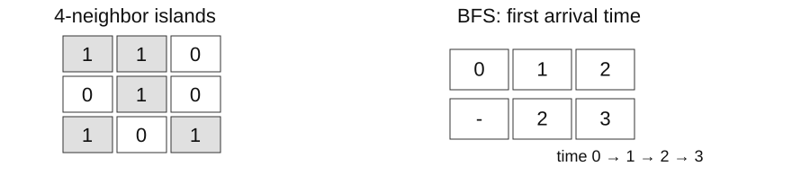

## Worked solutions

215 | 56 | 200 | 994

Maintain the top k measurements as values arrive, and merge overlapping maintenance intervals. On a sensor map, identify separate failure regions and the time needed for failures to spread.

Full ordering, partial ranking, and connectivity need different state. Track a heap boundary, the end of a sorted interval, and traversal visits.

<!-- lecture-page -->

## What counts as one step on a grid?

Treat cells as vertices and four-directional adjacencies as edges. Islands ask for connected components; propagation asks for distance from the nearest source.



Diagonal land cells on the left belong to separate islands. Numbers on the right are first infection times for `[[2,1,1],[0,1,1]]`; `-` marks an empty cell.

| Goal | Processing order | Retained information |
| --- | --- | --- |
| Find all connected land | Stack: depth first | Visited coordinates and pending neighbors |
| Spread simultaneously by minute | Queue: breadth first | Current sources and remaining fresh cells |

Mark cells when discovered so different neighbors cannot enqueue or push the same cell repeatedly.

<!-- lecture-page -->

## 215 · Idea and execution trace

[LeetCode 215: Kth Largest Element in an Array](https://leetcode.com/problems/kth-largest-element-in-an-array/) · Medium

Return the kth value in descending order, counting duplicates.

Sorting everything finds the kth value, but only the largest k values need to be retained. In a min-heap containing those values, the root is their minimum and hence the current kth largest. Replace it only when a larger value arrives.

`nums=[3,1,5,2,4], k=2`. The table shows the actual heap list, not a fully sorted sequence.

| Operation | heap | Current kth value |
| --- | --- | --- |
| Heapify first two | [1,3] | 1 |
| 5 > 1: replace | [3,5] | 3 |
| 2 <= 3: retain | [3,5] | 3 |
| 4 > 3: replace | [4,5] | 4 |

<!-- lecture-page -->

## 215 · Turning the idea into code

```python
import heapq

def kth_largest(nums, k):
    heap = nums[:k]
    heapq.heapify(heap)
    for index in range(k, len(nums)):
        value = nums[index]
        if value > heap[0]:
            heapq.heapreplace(heap, value)
    return heap[0]
```

`nums[:k]` copies k entries before heapify. A min-heap is a complete binary tree whose parents are no larger than their children. Capacity doubles per level, giving O(log k) height; heapreplace may descend that height. Simply reading the root `heap[0]` costs O(1).

A value no larger than the root cannot improve the retained k values. Duplicates remain separate entries: the second largest in `[5,5,1]` is 5.

<!-- lecture-page -->

## 215 · Why it works; time and memory

The heap retains the largest k values seen. A new value at most its minimum cannot improve that set; a larger one replaces the minimum. The final root is kth largest.

Copying and heapify cost O(k). Each of the remaining n-k values requires one root comparison and, only on replacement, a path of height O(log k). Time is O(k+(n-k)(1+log k)), commonly O(n log k) for k>=2. For k=1 it is O(n), like tracking a maximum.

The heap always has k entries, so auxiliary space is O(k); the result is one value. Heapify is linear because most nodes are near the bottom and have only short downward paths.

In a min-heap, each parent is no greater than its children, and the root holds a global minimum. Deduplicating changes the example’s answer.

`nums=[8,3,8,2,5], k=2 → 8`

<!-- lecture-page -->

## 56 · Idea and execution trace

[LeetCode 56: Merge Intervals](https://leetcode.com/problems/merge-intervals/) · Medium

Return disjoint closed intervals covering the input union.

After sorting by start, the next interval begins no earlier than processed intervals. It can therefore overlap only the last merged interval. Extend that interval’s end on overlap, or begin a new result interval when there is a gap.

Input: `[[1,4],[2,3],[4,6],[8,9]]`. Each row shows result after processing that interval.

| Interval | Test | result |
| --- | --- | --- |
| [1,4] | First interval | [[1,4]] |
| [2,3] | 2 <= 4 | [[1,4]] |
| [4,6] | 4 <= 4 | [[1,6]] |
| [8,9] | 8 > 6 | [[1,6],[8,9]] |

<!-- lecture-page -->

## 56 · Turning the idea into code

```python
def merge_intervals(intervals):
    result = []
    for start, end in sorted(intervals, key=lambda item: item[0]):
        if result and start <= result[-1][1]:
            result[-1][1] = max(result[-1][1], end)
        else:
            result.append([start, end])
    return result
```

The equality in `start <= result[-1][1]` merges closed intervals touching at an endpoint. Update with max so a nested `[2,3]` cannot shorten `[1,4]`.

Create each result interval as `[start,end]` rather than modifying an input interval’s list.

<!-- lecture-page -->

## 56 · Why it works; time and memory

result equals the union of the processed prefix. Increasing starts mean a new interval can overlap only the last result; a gap makes a new disjoint component.

Sorting n intervals costs O(n log n). The subsequent scan runs n times and compares only one last result interval each time, so it costs O(n). Sorting dominates the total O(n log n).

`sorted` creates a list of n references and uses sorting workspace, giving O(n) auxiliary space. If z merged intervals remain, output space is O(z), with z<=n. Each output interval stores its own two endpoints.

Overwriting the end with 3 for [[1,8],[2,3]] loses coverage. Half-open time intervals may use a different touching rule.

`intervals=[[5,7],[1,3],[3,6]] → [[1,7]]`

<!-- lecture-page -->

## 200 · Idea and execution trace

[LeetCode 200: Number of Islands](https://leetcode.com/problems/number-of-islands/) · Medium

Count land components connected horizontally or vertically in a character grid.

Starting from one land cell and following all four-directional connections reaches its whole island. Start a traversal and increase the count only at unvisited land, preventing duplicate counting. Diagonals do not connect cells.

Grid: `[["1","1","0"],["0","1","0"],["1","0","1"]]`. Coordinates start at zero; stack top is on the right.

| Action | stack | Newly added to seen | count |
| --- | --- | --- | --- |
| Start (0,0) | [(0,0)] | (0,0) | 1 |
| Pop (0,0) | [(0,1)] | (0,1) | 1 |
| Pop (0,1) | [(1,1)] | (1,1) | 1 |
| Pop (1,1) | [] | None | 1 |
| Traverse (2,0), (2,2) separately | [] | (2,0), (2,2) | 3 |

<!-- lecture-page -->

## 200 · Turning the idea into code

```python
def islands(grid):
    rows, cols = len(grid), len(grid[0])
    seen, count = set(), 0
    for row in range(rows):
        for col in range(cols):
            if grid[row][col] != "1" or (row, col) in seen:
                continue
            count += 1
            stack = [(row, col)]
            seen.add((row, col))
            while stack:
                r, c = stack.pop()
                for nr, nc in ((r-1,c),(r+1,c),(r,c-1),(r,c+1)):
                    if (0 <= nr < rows and 0 <= nc < cols
                            and grid[nr][nc] == "1" and (nr,nc) not in seen):
                        seen.add((nr,nc))
                        stack.append((nr,nc))
    return count
```

The outer loops locate traversal starts; the inner while finishes one connected island. Mark a cell in seen just before pushing it, preventing another neighbor from pushing it again.

Cells contain strings "1" and "0". Check coordinate bounds before reading a cell. The input grid remains unchanged.

<!-- lecture-page -->

## 200 · Why it works; time and memory

A traversal reaches exactly its starting component. Marked components cannot restart; the number of starts equals the component count.

The outer scan reads R·C cells. Each land cell is pushed and popped once because of seen, and each pop checks four neighbors. Four is independent of input size, giving expected O(RC) time under expected hash-set costs. The inner traversal is not restarted fully for every cell.

Both seen and the pending stack can hold up to RC coordinates, so auxiliary space is O(RC). Marking the grid itself could replace seen, but would mutate the input and would not eliminate stack storage.

Use == for values; is tests identity. Diagonal land in a 2x2 grid forms two components.

`grid=[["1","0","1"],["1","0","0"]] → 2`

<!-- lecture-page -->

## 994 · Idea and execution trace

[LeetCode 994: Rotting Oranges](https://leetcode.com/problems/rotting-oranges/) · Medium

Return the minimum minutes for all fresh cells to change under simultaneous spread, or -1.

All initially rotten cells are sources at time zero. Put them all in one queue and expand by levels. The first infection time of a cell is its distance from the nearest source. Processing sources sequentially would misrepresent simultaneous spread.

Input: `[[2,1,1],[0,1,1]]`. Each queue contains cells newly rotten at that time, awaiting processing.

| Time minutes | queue | fresh |
| --- | --- | --- |
| 0 | [(0,0)] | 4 |
| 1 | [(0,1)] | 3 |
| 2 | [(1,1),(0,2)] | 1 |
| 3 | [(1,2)] | 0 |

Once fresh is zero, return 3 without processing the final queue.

<!-- lecture-page -->

## 994 · Turning the idea into code

```python
def rot_minutes(grid):
    rows, cols = len(grid), len(grid[0])
    board = [row[:] for row in grid]
    queue, fresh, minutes = deque(), 0, 0
    for r in range(rows):
        for c in range(cols):
            if board[r][c] == 2:
                queue.append((r,c))
            fresh += board[r][c] == 1
    while queue and fresh:
        for _ in range(len(queue)):
            r, c = queue.popleft()
            for nr, nc in ((r-1,c),(r+1,c),(r,c-1),(r,c+1)):
                if 0 <= nr < rows and 0 <= nc < cols and board[nr][nc] == 1:
                    board[nr][nc] = 2
                    fresh -= 1
                    queue.append((nr,nc))
        minutes += 1
    return minutes if fresh == 0 else -1
```

`range(len(queue))` freezes the source count for the current time. Mark newly infected cells as 2 immediately to avoid duplicate infection, but append them for processing in the next while round.

An empty queue with fresh cells remaining means unreachable cells and returns -1. If fresh is initially zero, no time step is needed and the result is 0.

<!-- lecture-page -->

## 994 · Why it works; time and memory

BFS levels are minimum edge distances from any source. Equal edge durations make first discovery earliest; remaining fresh cells after exhaustion are unreachable.

Copying and the initial scan each cost O(RC). Every cell enters the queue once and checks four neighbors when removed, so propagation also costs O(RC). Adding these stages gives O(RC); do not multiply by the number of minutes again.

The board copy stores RC cells to preserve the input. The queue may also hold O(RC) cells, giving O(RC) auxiliary space. Constant-size fresh and minutes counters do not make the whole algorithm constant-space.

[[2,0,1]] gives -1; [[0,2]] gives 0. Processing newly queued levels in the same minute undercounts time.

`grid=[[2,1,1],[0,1,0]] → 2`

<!-- lecture-page -->

## Checkpoint answers and reasoning

1. 8 and 2. Both copies of 8 count.
2. `[[1,8]]` and `[[1,6]]`. A nested interval cannot shorten the union; closed intervals touching at an endpoint merge.
3. `2`. Diagonals are not connected.
4. -1 and 0. The first has unreachable fresh cells; the second starts with no fresh cells.

### Concept-check explanations

Insertion into a sorted list takes O(n) because elements shift, even if binary search finds the position. A min-heap is not fully sorted; its root is a global minimum.

BFS first discovery gives minimum cost when every edge has the same cost. With unequal costs, a path with fewer edges can cost more.

<!-- lecture-page -->

## Exercises and sources

[LeetCode · 215, 56, 200, 994](/courses/practical-algorithms/week-05-practice/) · [Worked solutions](/courses/practical-algorithms/week-05-reading/) · [Python ZIP](/assets/courses/practical-algorithms/week-05-code.zip)

```text
python demo_09.py
python demo_10.py
python verify.py
```

After implementing the student file, check it with `python verify.py --student`.

Erik Demaine, Srini Devadas. [MIT 6.006, Introduction to Algorithms](https://ocw.mit.edu/courses/6-006-introduction-to-algorithms-fall-2011/) (2011).

<!-- ko -->

## 풀이와 실행 과정

215 | 56 | 200 | 994

측정값이 계속 들어오는 동안 상위 k개를 유지하고, 겹치는 정비 시간을 합쳐야 합니다. 센서 지도에서는 떨어진 장애 영역과 장애가 퍼지는 시간을 구합니다.

전체 정렬·부분 순위·연결 관계는 서로 다른 상태가 필요합니다. 힙의 경계, 정렬된 구간의 끝, 탐색의 방문 기록을 추적합니다.

<!-- lecture-page -->

## 격자에서 무엇을 한 단계로 셀 것인가

격자 한 칸을 정점으로 보고 상하좌우 이웃 사이에 간선이 있다고 생각합니다. 섬 문제는 연결된 덩어리의 수를, 전파 문제는 가장 가까운 출발점에서의 거리를 묻습니다.


왼쪽에서 대각선으로 닿은 육지는 별도 섬입니다. 오른쪽 숫자는 `[[2,1,1],[0,1,1]]`에서 처음 썩는 시각이며 `-`는 빈칸입니다.

| 목표 | 다음 처리 순서 | 보관할 정보 |
| --- | --- | --- |
| 연결된 육지 전부 찾기 | 스택으로 깊이 우선 | 방문한 좌표·미처리 이웃 |
| 한 분마다 동시에 확산 | 큐로 너비 우선 | 현재 시각의 전파원·남은 fresh |

둘 다 방문 표시를 넣는 시점이 중요합니다. 발견할 때 표시하면 여러 이웃이 같은 칸을 중복 삽입하지 않습니다.

<!-- lecture-page -->

## 215 · 풀이의 출발점과 실행 추적

[LeetCode 215: Kth Largest Element in an Array](https://leetcode.com/problems/kth-largest-element-in-an-array/) · Medium

정렬했을 때 큰 순서로 k번째 값을 반환합니다. 중복도 개수에 포함합니다.

전체를 정렬하면 k번째 값을 찾을 수 있지만, 필요한 것은 큰 값 k개뿐입니다. 지금까지 본 큰 값 k개를 최소 힙에 보관하면 그중 가장 작은 루트가 현재 k번째 값입니다. 새 값이 루트보다 클 때만 교체합니다.

`nums=[3,1,5,2,4], k=2`. 표는 실제 heap 리스트이며 전체 정렬 결과는 아닙니다.

| 처리 | heap | 현재 k번째 값 |
| --- | --- | --- |
| 첫 두 값 heapify | [1,3] | 1 |
| 5 > 1, 교체 | [3,5] | 3 |
| 2 <= 3, 유지 | [3,5] | 3 |
| 4 > 3, 교체 | [4,5] | 4 |

<!-- lecture-page -->

## 215 · 아이디어를 코드로 옮기기

```python
import heapq

def kth_largest(nums, k):
    heap = nums[:k]
    heapq.heapify(heap)
    for index in range(k, len(nums)):
        value = nums[index]
        if value > heap[0]:
            heapq.heapreplace(heap, value)
    return heap[0]
```

`nums[:k]`로 k개를 복사하고 heapify합니다. 최소 힙은 부모가 자식보다 크지 않은 완전 이진 트리입니다. 층마다 최대 노드 수가 두 배라 높이는 O(log k)이며, `heapreplace`는 그 높이만큼 내려갈 수 있습니다. 루트 `heap[0]`를 읽기만 하면 O(1)입니다.

루트 이하인 값은 이미 가진 k개보다 유리하지 않습니다. 중복은 별개 원소로 유지하므로 `[5,5,1]`의 두 번째 큰 값도 5입니다.

<!-- lecture-page -->

## 215 · 정당성·시간·메모리의 근거

힙은 지금까지 본 값 중 큰 k개입니다. root 이하의 새 값은 상위 k개를 바꾸지 못하고, 큰 새 값은 가장 작은 보관 값을 대체해야 합니다. 마지막 root가 k번째입니다.

복사와 heapify는 O(k)입니다. 나머지 n-k개는 루트를 한 번 비교하고, 교체할 때만 높이 O(log k)의 경로를 따라갑니다. 따라서 O(k+(n-k)(1+log k)), k>=2이면 보통 O(n log k)로 씁니다. k=1은 최댓값을 추적하는 O(n)입니다.

힙 크기는 항상 k라서 보조 공간은 O(k), 반환 값은 한 개입니다. heapify의 O(k)는 원소마다 O(log k)를 단순 곱한 비용보다 작습니다. 아래쪽에 있는 많은 노드는 내려갈 높이가 짧기 때문입니다.

최소 힙에서는 각 부모의 값이 자식 이하이고, root에 전체 최솟값이 놓입니다. 중복을 set으로 없애면 예시의 답이 달라집니다.

`nums=[8,3,8,2,5], k=2 → 8`

<!-- lecture-page -->

## 56 · 풀이의 출발점과 실행 추적

[LeetCode 56: Merge Intervals](https://leetcode.com/problems/merge-intervals/) · Medium

닫힌 구간들의 합집합을 겹치지 않는 구간으로 반환합니다.

구간을 시작점순으로 정렬하면 다음 구간은 지금까지 처리한 구간보다 뒤에서 시작합니다. 따라서 결과의 마지막 구간과 겹치는지만 보면 됩니다. 겹치면 끝점을 더 멀리 늘리고, 떨어져 있으면 새 구간을 시작합니다.

입력 `[[1,4],[2,3],[4,6],[8,9]]`. 각 행은 현재 구간 처리 후의 result입니다.

| 구간 | 검사 | result |
| --- | --- | --- |
| [1,4] | 첫 구간 | [[1,4]] |
| [2,3] | 2 <= 4 | [[1,4]] |
| [4,6] | 4 <= 4 | [[1,6]] |
| [8,9] | 8 > 6 | [[1,6],[8,9]] |

<!-- lecture-page -->

## 56 · 아이디어를 코드로 옮기기

```python
def merge_intervals(intervals):
    result = []
    for start, end in sorted(intervals, key=lambda item: item[0]):
        if result and start <= result[-1][1]:
            result[-1][1] = max(result[-1][1], end)
        else:
            result.append([start, end])
    return result
```

`start <= result[-1][1]`에서 등호는 닫힌 구간의 끝점이 닿는 경우도 병합한다는 뜻입니다. 끝점은 `max`로 갱신해야 안쪽에 포함된 `[2,3]` 때문에 `[1,4]`가 짧아지지 않습니다.

새 결과 구간은 `[start,end]`로 만들어 입력의 내부 리스트를 직접 수정하지 않습니다.

<!-- lecture-page -->

## 56 · 정당성·시간·메모리의 근거

처리한 접두부의 합집합은 result와 같습니다. 시작점이 증가하므로 새 구간은 마지막 결과와만 겹칠 수 있습니다. 분리되면 이후에도 앞 결과와 겹치지 않습니다.

n개 구간 정렬이 O(n log n), 정렬 뒤 스캔은 n번입니다. 각 스캔에서 마지막 구간 한 개만 비교하므로 O(n), 전체는 O(n log n)입니다. 앞의 모든 결과 구간을 매번 훑는 방식과 차이가 납니다.

`sorted`가 입력 참조 n개의 새 리스트를 만들고 정렬 작업 공간도 사용하므로 보조 공간은 O(n)입니다. 병합 결과가 z개라면 출력 공간은 O(z), z<=n입니다. 구간을 입력 그대로 공유하지 않는 비용도 결과의 두 끝점에 포함됩니다.

[[1,8],[2,3]]에서 end=3으로 덮으면 [3,8]을 잃습니다. 반열린 시간 구간은 닿음 규칙이 다를 수 있습니다.

`intervals=[[5,7],[1,3],[3,6]] → [[1,7]]`

<!-- lecture-page -->

## 200 · 풀이의 출발점과 실행 추적

[LeetCode 200: Number of Islands](https://leetcode.com/problems/number-of-islands/) · Medium

문자 격자의 상하좌우로 연결된 육지 덩어리 수를 반환합니다.

육지 한 칸에서 상하좌우 연결을 모두 따라가면 그 섬 전체를 찾습니다. 아직 방문하지 않은 육지를 만날 때만 섬 수를 늘리고 탐색을 시작하면 같은 섬을 여러 번 세지 않습니다. 대각선은 연결에 포함되지 않습니다.

격자 `[["1","1","0"],["0","1","0"],["1","0","1"]]`. 스택 오른쪽이 top이며 좌표는 0부터 셉니다.

| 동작 | stack | seen에 새로 추가 | count |
| --- | --- | --- | --- |
| (0,0) 시작 | [(0,0)] | (0,0) | 1 |
| (0,0) pop | [(0,1)] | (0,1) | 1 |
| (0,1) pop | [(1,1)] | (1,1) | 1 |
| (1,1) pop | [] | 없음 | 1 |
| (2,0), (2,2) 각각 탐색 | [] | (2,0), (2,2) | 3 |

<!-- lecture-page -->

## 200 · 아이디어를 코드로 옮기기

```python
def islands(grid):
    rows, cols = len(grid), len(grid[0])
    seen, count = set(), 0
    for row in range(rows):
        for col in range(cols):
            if grid[row][col] != "1" or (row, col) in seen:
                continue
            count += 1
            stack = [(row, col)]
            seen.add((row, col))
            while stack:
                r, c = stack.pop()
                for nr, nc in ((r-1,c),(r+1,c),(r,c-1),(r,c+1)):
                    if (0 <= nr < rows and 0 <= nc < cols
                            and grid[nr][nc] == "1" and (nr,nc) not in seen):
                        seen.add((nr,nc))
                        stack.append((nr,nc))
    return count
```

바깥 두 for는 탐색 시작점을 찾습니다. 안쪽 while은 그 시작점과 연결된 섬 하나를 끝냅니다. `seen.add`를 push 직전에 실행하므로 다른 이웃이 같은 칸을 다시 넣을 수 없습니다.

입력은 문자열 "1"·"0"입니다. 좌표 범위를 확인한 다음 값을 읽으며, 원본 격자는 변경하지 않습니다.

<!-- lecture-page -->

## 200 · 정당성·시간·메모리의 근거

한 번 시작한 탐색은 연결 경로를 따라 그 성분의 모든 노드와 그 노드만 방문합니다. 이미 표시한 성분은 다시 시작하지 않으므로 시작 횟수가 성분 수입니다.

R·C칸을 한 번 훑습니다. 육지 칸은 seen 때문에 한 번만 push·pop되고, 꺼낼 때 이웃 네 개만 검사합니다. 네 방향은 입력 크기와 무관한 상수라서 해시 연산의 기대 비용을 적용한 시간은 O(RC)입니다. 루프가 중첩되어 보여도 섬 탐색 전체가 매 칸에서 반복되는 것은 아닙니다.

seen에는 최대 RC개 좌표, stack에도 최대 RC개 좌표가 남을 수 있어 보조 공간은 O(RC)입니다. 격자를 직접 표시하면 seen을 없앨 수 있지만, 입력 변경과 탐색 스택의 비용은 여전히 따져야 합니다.

값 비교는 ==입니다. is는 객체 동일성입니다. [["1","0"],["0","1"]]은 대각선을 연결하지 않아 두 성분입니다.

`grid=[["1","0","1"],["1","0","0"]] → 2`

<!-- lecture-page -->

## 994 · 풀이의 출발점과 실행 추적

[LeetCode 994: Rotting Oranges](https://leetcode.com/problems/rotting-oranges/) · Medium

동시에 퍼지는 변화를 적용해 모든 신선한 셀이 바뀌는 최소 분을 반환합니다. 불가능하면 -1입니다.

모든 썩은 칸은 같은 시각 0에서 출발하는 전파원입니다. 이들을 모두 큐에 넣고 한 층씩 확산하면 각 칸이 처음 썩는 시각이 가장 가까운 전파원까지의 거리입니다. 한 원점씩 따로 전파하면 동시에 일어나는 일을 잘못 셀 수 있습니다.

입력 `[[2,1,1],[0,1,1]]`. 아래 queue는 해당 시각에 새로 썩어 다음에 처리될 칸입니다.

| 시각 minutes | queue | fresh |
| --- | --- | --- |
| 0 | [(0,0)] | 4 |
| 1 | [(0,1)] | 3 |
| 2 | [(1,1),(0,2)] | 1 |
| 3 | [(1,2)] | 0 |

fresh가 0이므로 마지막 큐를 더 처리하지 않고 3을 반환합니다.

<!-- lecture-page -->

## 994 · 아이디어를 코드로 옮기기

```python
def rot_minutes(grid):
    rows, cols = len(grid), len(grid[0])
    board = [row[:] for row in grid]
    queue, fresh, minutes = deque(), 0, 0
    for r in range(rows):
        for c in range(cols):
            if board[r][c] == 2:
                queue.append((r,c))
            fresh += board[r][c] == 1
    while queue and fresh:
        for _ in range(len(queue)):
            r, c = queue.popleft()
            for nr, nc in ((r-1,c),(r+1,c),(r,c-1),(r,c+1)):
                if 0 <= nr < rows and 0 <= nc < cols and board[nr][nc] == 1:
                    board[nr][nc] = 2
                    fresh -= 1
                    queue.append((nr,nc))
        minutes += 1
    return minutes if fresh == 0 else -1
```

`range(len(queue))`가 현재 시각의 전파원 수를 고정합니다. 새로 썩은 칸을 즉시 2로 표시하고 큐 뒤에 넣어 중복 감염을 막되, 그 칸의 이웃 처리는 다음 while로 미룹니다.

큐가 비었는데 fresh가 남으면 도달 불가능하여 -1입니다. 처음부터 fresh가 0이면 시간이 흐를 필요 없이 0입니다.

<!-- lecture-page -->

## 994 · 정당성·시간·메모리의 근거

큐의 레벨은 어떤 시작점에서든 그 셀까지의 최소 간선 수입니다. 모든 간선의 전파 시간이 같으므로 먼저 발견한 시간이 최소입니다. 큐가 비어도 fresh가 남으면 경로가 없습니다.

격자 복사와 초기 스캔이 각각 O(RC)입니다. 각 칸은 한 번만 큐에 들어가고 나올 때 네 이웃을 검사하므로 전파도 O(RC)입니다. 세 단계의 합은 O(RC)이며 분 수를 RC에 다시 곱하지 않습니다.

board는 원본을 보존하려고 만든 RC칸 복사본입니다. 큐도 최대 RC칸을 담으므로 보조 공간은 O(RC)입니다. fresh와 minutes가 O(1) 변수여도 큰 board·queue가 존재하므로 전체 공간을 O(1)이라고 할 수 없습니다.

[[2,0,1]]은 -1, [[0,2]]는 0입니다. 다음 레벨까지 같은 분에 연쇄 처리하면 시간을 작게 계산합니다.

`grid=[[2,1,1],[0,1,0]] → 2`

<!-- lecture-page -->

## 중간 점검의 답과 근거

1. 8과 2. 중복 8을 두 번 셉니다.
2. `[[1,8]]`과 `[[1,6]]`. 포함 구간의 끝으로 기존 끝을 줄이지 않으며, 닫힌 구간은 끝점이 닿으면 합칩니다.
3. `2`. 대각선은 연결하지 않습니다.
4. -1과 0. 첫 지도는 신선한 셀에 경로가 없고, 둘째는 처음부터 신선한 셀이 없습니다.

### 개념 질문 해설

정렬된 리스트의 삽입은 위치를 이진 탐색해도 원소 이동 때문에 O(n)입니다. 최소 힙은 전체 정렬이 아니며 루트만 전역 최솟값입니다.

BFS의 첫 발견이 최소 비용이 되는 조건은 모든 간선 비용이 같다는 것입니다. 비용이 다르면 간선 수가 적은 경로가 더 비쌀 수 있습니다.

<!-- lecture-page -->

## 실습과 참고자료

[LeetCode · 215, 56, 200, 994](/courses/practical-algorithms/week-05-practice/) · [풀이](/courses/practical-algorithms/week-05-reading/) · [Python ZIP](/assets/courses/practical-algorithms/week-05-code.zip)

```text
python demo_09.py
python demo_10.py
python verify.py
```

학생 파일을 구현한 뒤 `python verify.py --student`로 검사합니다.

Erik Demaine, Srini Devadas. [MIT 6.006, Introduction to Algorithms](https://ocw.mit.edu/courses/6-006-introduction-to-algorithms-fall-2011/) (2011).
