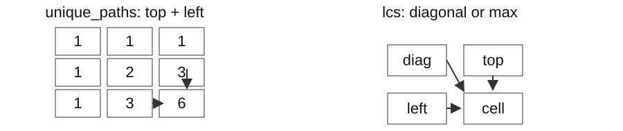

## Repeated subproblem calculations

What information is needed to maximize inspection value when adjacent items cannot both be selected? Grid paths and common order in two event logs can also be divided into smaller problems.

Store and reuse previously computed optima or counts. The meaning of the state determines whether to add, minimize, or maximize.

### Learning outcomes

Sessions 13 and 14: State meaning, base cases, recurrences, and evaluation order

- Check contracts and boundary conditions.
- Trace state and implement in Python.
- Explain correctness, time, auxiliary space, and output space.

<!-- lecture-page -->

## DP state meaning and evaluation order

Dynamic programming stores and reuses answers to repeated subproblems. Define what one table entry means before choosing base cases and transitions.



| Problem | Meaning of a state | Combination |
| --- | --- | --- |
| Maximum nonadjacent sum | Best value for a prefix | max(select,skip) |
| Coins | Minimum count for an amount | min over final coins |
| Grid paths | Number of paths reaching a cell | top+left |
| Common subsequence | Best length for two prefixes | diagonal+1 on match; otherwise max |

Time counts states times work per state. Space counts states retained simultaneously. The nonadjacent-sum problem needs only two prior states, but a table implementation is not automatically constant-space.

<!-- lecture-page -->

## 198 · Idea and execution trace

[LeetCode 198: House Robber](https://leetcode.com/problems/house-robber/) · Medium

Maximize selected value without selecting adjacent positions.

Selecting the current value excludes its immediate predecessor. The best prefix value is therefore the larger of skipping the current value or adding it to the best prefix ending two positions earlier. Only those two prior results are needed for the next decision.

`nums=[3,1,4,2]`. Evaluate the entire right-hand side using old values before assignment.

| value | Old previous_two | Old previous_one | New previous_one |
| --- | --- | --- | --- |
| 3 | 0 | 0 | max(0,0+3)=3 |
| 1 | 0 | 3 | max(3,0+1)=3 |
| 4 | 3 | 3 | max(3,3+4)=7 |
| 2 | 3 | 7 | max(7,3+2)=7 |

<!-- lecture-page -->

## 198 · Turning the idea into code

```python
def rob(nums):
    previous_two = previous_one = 0
    for value in nums:
        previous_two, previous_one = previous_one, max(previous_one, previous_two + value)
    return previous_one
```

The initial zeros represent selecting nothing. Simultaneous assignment evaluates both right-hand expressions using the old state, so an early overwrite cannot destroy a needed predecessor.

Selecting or skipping the current position covers every possible solution. On `[2,1,1,2]`, the optimum 4 uses both ends and is missed by comparing only even-position and odd-position sums.

<!-- lecture-page -->

## A recurrence table and its two variables

Let D[i] be the maximum sum from the first i values. For [3,1,4,2], the empty prefix has D[0]=0.

| i and current value | Skip current | Take current | D[i] |
| --- | --- | --- | --- |
| 1, value 3 | 0 | 0+3 | 3 |
| 2, value 1 | D[1]=3 | D[0]+1=1 | 3 |
| 3, value 4 | D[2]=3 | D[1]+4=7 | 7 |
| 4, value 2 | D[3]=7 | D[2]+2=5 | 7 |

Before processing 4, previous_two=D[1] and previous_one=D[2]. After the update they become D[2] and D[3], preserving their roles for the next iteration. Taking the current value with D[i−1] could also take its neighbor, violating the constraint.

The branch taking 4 adds it to the already computed prefix optimum 3. Reusing that optimum rather than solving the prefix again is the DP step.

<!-- lecture-page -->

## 198 · Why it works; time and memory

Every optimum either selects the current item or skips it. Each case leaves an optimal prefix, so the recurrence covers all optima.

For each of n values, perform one addition, one max comparison, and a fixed number of assignments. With constant-cost arithmetic for the input range, time is O(n). Prior prefix optima are already computed rather than searched again.

Only two optima and the current value are retained, independent of n, giving O(1) auxiliary space. A full prefix table would use O(n); this implementation retains only the two dependencies. Reconstructing selected positions requires additional information.

<!-- lecture-page -->

## 322 · Idea and execution trace

[LeetCode 322: Coin Change](https://leetcode.com/problems/coin-change/) · Medium

Return the minimum coin count for amount, or -1 if impossible.

If the last coin for amount a is c, the preceding coins must form an optimum for a-c. Compare every possible final coin. Choosing the largest coin first fails for amount 6 with `[1,3,4]`: 4+1+1 uses more coins than 3+3.

`coins=[1,3,4], amount=6`. Values are finalized after checking every coin for that total.

| total | Candidates dp[total-coin]+1 | Final dp[total] |
| --- | --- | --- |
| 0 | No coins needed | 0 |
| 1,2 | 0+1 / 1+1 | 1,2 |
| 3 | 2+1, 0+1 | 1 |
| 4 | 1+1, 1+1, 0+1 | 1 |
| 5 | 1+1, 2+1, 1+1 | 2 |
| 6 | 2+1, 1+1, 2+1 | 2 |

<!-- lecture-page -->

## 322 · Turning the idea into code

```python
def coin_change(coins, amount):
    dp = [float("inf")] * (amount + 1)
    dp[0] = 0
    for total in range(1, amount + 1):
        for coin in coins:
            if coin <= total:
                dp[total] = min(dp[total], dp[total - coin] + 1)
    return -1 if dp[amount] == float("inf") else dp[amount]
```

Set dp[0]=0 and all other entries to inf, meaning unreachable so far. Positive c makes total-c smaller than total and therefore already computed. The `+1` counts the chosen last coin.

Adding one to inf remains inf, so unreachable states cannot produce a false minimum. Return -1 if the target stays infinite; amount 3 with coins `[2]` is unreachable.

With coins [2] and amount=3, dp starts as `[0,∞,∞,∞]`. total=1 has no usable coin; total=2 gets dp[0]+1=1; total=3 gets dp[1]+1=∞. The final `[0,∞,1,∞]` therefore returns −1.

<!-- lecture-page -->

## 322 · Why it works; time and memory

Removing the last coin c from an optimum leaves an optimum for a-c. Comparing all final coins finds the minimum; positive values ensure dependencies were filled earlier.

Each of A amount states checks m coins, giving at most A·m transitions. Each uses constant-time indexing, addition, and comparison, so time is O(Am). The outer bound is the numeric target A, not the number of coins.

The table has A+1 entries and other variables are constant-size, giving O(A) auxiliary space. Since A takes only O(log A) input bits, this is pseudopolynomial time in that bit length. The input coin list is not counted again as workspace.

<!-- lecture-page -->

## 62 · Idea and execution trace

[LeetCode 62: Unique Paths](https://leetcode.com/problems/unique-paths/) · Medium

Count grid paths using only right and down moves.

With only right and down moves, the last move into a cell comes either from above or from the left. These cases have different last moves and are disjoint, so add their path counts rather than taking a maximum.

rows=3, cols=3. The first row and column have one possible route.

| Cell processed | Calculation | Current dp rows |
| --- | --- | --- |
| Initialize | Boundary values 1 | [1,1,1] / [1,1,1] / [1,1,1] |
| (1,1) | 1+1=2 | [1,1,1] / [1,2,1] / [1,1,1] |
| (1,2) | 1+2=3 | [1,1,1] / [1,2,3] / [1,1,1] |
| (2,1) | 2+1=3 | [1,1,1] / [1,2,3] / [1,3,1] |
| (2,2) | 3+3=6 | [1,1,1] / [1,2,3] / [1,3,6] |

<!-- lecture-page -->

## 62 · Turning the idea into code

```python
def unique_paths(rows, cols):
    dp = [[1] * cols for _ in range(rows)]
    for r in range(1, rows):
        for c in range(1, cols):
            dp[r][c] = dp[r-1][c] + dp[r][c-1]
    return dp[-1][-1]
```

Row-major order computes both `dp[r-1][c]` and `dp[r][c-1]` before they are used. Initial ones in interior cells are placeholders that are overwritten before serving as dependencies.

Create each row independently with a comprehension. `[[1]*cols]*rows` aliases one row, so one cell update can appear in multiple rows.

<!-- lecture-page -->

## 62 · Why it works; time and memory

Every path arrives from top or left. These disjoint classes cover all paths, so counts add; row order respects dependencies.

Initialization touches R·C cells; transitions fill (R-1)(C-1) cells. Two lookups and one addition per cell give O(RC) time. Paths are counted rather than enumerated, so runtime is not proportional to the number of paths.

Keeping the whole dp table uses O(RC) auxiliary space. This implementation is not the one-row O(C) optimization. Arithmetic is treated as constant within the official bounded-answer contract; unrestricted large grids would add large-integer bit costs.

<!-- lecture-page -->

## 1143 · Idea and execution trace

[LeetCode 1143: Longest Common Subsequence](https://leetcode.com/problems/longest-common-subsequence/) · Medium

Return the length of a longest common subsequence preserving order.

Store answers for pairs of prefixes. If their final characters match, pair them and add one to the shorter-prefix answer. Otherwise they cannot be paired with each other, so take the better result from omitting either final character.

`first="abc", second="ac"`. Rows and columns are prefixes of the two strings.

| Completed row | Empty prefix | a | ac |
| --- | --- | --- | --- |
| Empty prefix | 0 | 0 | 0 |
| a | 0 | 1 (=0+1) | 1 (=max(0,1)) |
| ab | 0 | 1 (=max(1,0)) | 1 (=max(1,1)) |
| abc | 0 | 1 (=max(1,0)) | 2 (=1+1) |

The answer 2 is the length of `ac`. Skipping b distinguishes a subsequence from a contiguous substring.

<!-- lecture-page -->

## 1143 · Turning the idea into code

```python
def lcs(first, second):
    rows, cols = len(first), len(second)
    dp = [[0] * (cols + 1) for _ in range(rows + 1)]
    for r in range(1, rows + 1):
        for c in range(1, cols + 1):
            if first[r-1] == second[c-1]:
                dp[r][c] = dp[r-1][c-1] + 1
            else:
                dp[r][c] = max(dp[r-1][c], dp[r][c-1])
    return dp[rows][cols]
```

dp[r][c] refers to prefixes of lengths r and c; their final-character indices are r-1 and c-1. Row and column zero represent an empty string, whose common-subsequence length is zero.

On a match use diagonal+1; otherwise use max(top,left). The two alternatives can include the same subsequence, so do not add them. This code returns length only.

<!-- lecture-page -->

## 1143 · Why it works; time and memory

Equal final characters can be paired in an optimum. Unequal ends cannot both be the final match, so at least one is skipped; maximize over both cases.

For lengths n and m, there are (n+1)(m+1) prefix pairs. Each interior cell uses one character comparison and an addition or max, giving O(nm) time. It becomes O(<math xmlns="http://www.w3.org/1998/Math/MathML"><msup><mi>n</mi><mn>2</mn></msup></math>) only when the two lengths have the same scale.

The full table uses O(nm) auxiliary space, while the returned length occupies O(1). Reconstructing an actual common subsequence would require traceback and output-character storage.

When both final characters are c, an optimal subsequence can be chosen to match those final positions. A subsequence using neither final position can be extended by c; a match using an earlier c can move to the final c without changing order. This is why the matching case needs only the diagonal optimum plus one.

<!-- lecture-page -->

## Checkpoint questions

1. Find the maximum nonadjacent sum for `[2,1,1,2]`.
2. Find the minimum coins for amount 6 using `[1,3,4]`.
3. Count paths in 1×4 and 2×4 grids.
4. Find the LCS length of `abc` and `ac`. Must the characters be contiguous?

### Exercises and sources

[LeetCode · 198, 322, 62, 1143](/courses/practical-algorithms/week-07-practice/) · [Worked solutions](/courses/practical-algorithms/week-07-reading/) · [Python ZIP](/assets/courses/practical-algorithms/week-07-code.zip)

```text
python demo_13.py
python demo_14.py
python verify.py
```

After implementing the student file, check it with `python verify.py --student`.

Erik Demaine, Srini Devadas. [MIT 6.006, Introduction to Algorithms](https://ocw.mit.edu/courses/6-006-introduction-to-algorithms-fall-2011/) (2011).

<!-- ko -->

## 같은 부분 문제의 반복 계산

인접한 점검 항목을 함께 선택할 수 없을 때 최대 가치를 구하려면 어떤 정보를 남겨야 할까요? 격자 경로와 두 이벤트 기록의 공통 순서도 작은 부분 문제로 나눌 수 있습니다.

앞에서 계산한 최적값이나 개수를 저장하고 재사용합니다. 상태의 의미에 따라 합·최소·최대 중 연산을 결정합니다.

### 학습 목표

13·14차시: 상태 의미·초기값·점화식·계산 순서

- 입력 계약과 경계 조건 확인
- 상태 추적과 Python 구현
- 정당성·시간·보조 공간·출력 공간 설명

<!-- lecture-page -->

## DP 상태의 뜻과 계산 순서

동적 계획법은 같은 부분 문제의 답을 저장해 재사용합니다. 먼저 “표 한 칸이 무엇의 답인가”를 정해야 초기값과 전이를 결정할 수 있습니다.


| 문제 | 상태의 뜻 | 결합 연산 |
| --- | --- | --- |
| 인접하지 않은 최대 합 | 접두부에서 얻을 수 있는 최대 합 | 선택·건너뛰기의 max |
| 동전 | 금액을 만드는 최소 개수 | 마지막 동전별 min |
| 격자 경로 | 이 칸까지의 경로 수 | 위+왼쪽 |
| 공통 부분수열 | 두 접두부의 최대 공통 길이 | 일치 시 대각선+1, 아니면 max |

시간은 상태 수 × 상태 하나의 계산량으로 셉니다. 공간은 동시에 보관하는 상태 수입니다. 이전 두 상태만 필요한 최대 합은 표를 없앨 수 있지만, 모든 표 구현이 자동으로 O(1) 공간인 것은 아닙니다.

<!-- lecture-page -->

## 198 · 풀이의 출발점과 실행 추적

[LeetCode 198: House Robber](https://leetcode.com/problems/house-robber/) · Medium

인접한 위치를 함께 고르지 않고 값의 합을 최대화합니다.

현재 값을 고르면 바로 앞 값은 고를 수 없습니다. 따라서 현재 값까지의 최댓값은 “직전까지의 최댓값을 유지”하거나 “두 칸 전까지의 최댓값에 현재 값을 더함” 중 큰 값입니다. 다음 결정에는 이 두 과거 결과만 필요합니다.

`nums=[3,1,4,2]`. old 값으로 오른쪽 식을 모두 계산한 뒤 갱신합니다.

| value | old previous_two | old previous_one | 새 previous_one |
| --- | --- | --- | --- |
| 3 | 0 | 0 | max(0,0+3)=3 |
| 1 | 0 | 3 | max(3,0+1)=3 |
| 4 | 3 | 3 | max(3,3+4)=7 |
| 2 | 3 | 7 | max(7,3+2)=7 |

<!-- lecture-page -->

## 198 · 아이디어를 코드로 옮기기

```python
def rob(nums):
    previous_two = previous_one = 0
    for value in nums:
        previous_two, previous_one = previous_one, max(previous_one, previous_two + value)
    return previous_one
```

처음의 두 0은 아무 원소도 고르지 않은 합입니다. 동시 대입 오른쪽은 모두 이전 값을 사용하므로, previous_two를 먼저 덮어써 필요한 값을 잃지 않습니다.

현재 위치를 선택하거나 건너뛰는 두 경우가 모든 가능한 선택을 포함합니다. `[2,1,1,2]`의 답 4는 양 끝을 골라 얻으며 짝수 위치 합·홀수 위치 합만 비교하면 놓칩니다.

<!-- lecture-page -->

## 점화식의 표와 두 변수의 대응

D[i]를 앞의 i개 값에서 얻는 최대 합으로 정의합니다. [3,1,4,2]에서 빈 접두부 D[0]=0입니다.

| i와 현재 값 | 현재 값 제외 | 현재 값 포함 | D[i] |
| --- | --- | --- | --- |
| 1, 값 3 | 0 | 0+3 | 3 |
| 2, 값 1 | D[1]=3 | D[0]+1=1 | 3 |
| 3, 값 4 | D[2]=3 | D[1]+4=7 | 7 |
| 4, 값 2 | D[3]=7 | D[2]+2=5 | 7 |

값 4를 처리하기 직전 previous_two=D[1], previous_one=D[2]입니다. 계산 후에는 각각 D[2],D[3]이 되어 다음 반복의 의미를 유지합니다. 포함 경로에서 D[i−1]을 더하면 바로 앞 값을 함께 고를 수 있어 인접 금지 조건을 깨뜨립니다.

4를 포함하는 경우 이미 고른 앞부분의 최적값 3에 4를 더합니다. 최적값 3을 매번 처음부터 다시 구하지 않는 것이 DP의 재사용입니다.

<!-- lecture-page -->

## 198 · 정당성·시간·메모리의 근거

최적 선택은 현재 위치를 선택하거나 선택하지 않는 두 경우로 나뉩니다. 두 경우 모두 남은 접두부를 최적으로 풀어야 하므로 점화식이 모든 최적해를 포함합니다.

n개 값마다 덧셈 한 번, max 비교 한 번, 고정 개수 대입을 수행합니다. 숫자 연산을 O(1)로 보는 입력 범위에서 전체 시간은 O(n)입니다. 과거 최댓값은 이미 계산되어 있으므로 같은 접두부를 다시 탐색하지 않습니다.

입력이 커져도 두 최댓값과 현재 값만 보관하므로 보조 공간은 O(1)입니다. 모든 접두부 최댓값을 dp 리스트에 저장하면 O(n) 공간이지만 이 코드는 다음 단계에 필요한 두 값만 남깁니다. 실제 선택 위치 복원에는 추가 기록이 필요합니다.

<!-- lecture-page -->

## 322 · 풀이의 출발점과 실행 추적

[LeetCode 322: Coin Change](https://leetcode.com/problems/coin-change/) · Medium

amount를 만드는 최소 동전 수를 반환하고 불가능하면 -1입니다.

금액 a를 만드는 마지막 동전이 c라고 정하면, 그 앞에는 a-c를 만드는 최선의 방법이 있어야 합니다. 각 동전을 마지막에 놓는 경우를 모두 비교합니다. 큰 동전부터 고르는 규칙은 `[1,3,4]`로 6을 만들 때 4+1+1을 골라 3+3을 놓칩니다.

`coins=[1,3,4], amount=6`. 표의 값은 해당 total의 모든 coin을 검사한 뒤입니다.

| total | 후보 dp[total-coin]+1 | 확정 dp[total] |
| --- | --- | --- |
| 0 | 동전 없이 가능 | 0 |
| 1,2 | 0+1 / 1+1 | 1,2 |
| 3 | 2+1, 0+1 | 1 |
| 4 | 1+1, 1+1, 0+1 | 1 |
| 5 | 1+1, 2+1, 1+1 | 2 |
| 6 | 2+1, 1+1, 2+1 | 2 |

<!-- lecture-page -->

## 322 · 아이디어를 코드로 옮기기

```python
def coin_change(coins, amount):
    dp = [float("inf")] * (amount + 1)
    dp[0] = 0
    for total in range(1, amount + 1):
        for coin in coins:
            if coin <= total:
                dp[total] = min(dp[total], dp[total - coin] + 1)
    return -1 if dp[amount] == float("inf") else dp[amount]
```

dp[0]=0이고 나머지는 아직 불가능하다는 뜻의 inf입니다. 동전 c가 양수이므로 total-c는 total보다 작아 이미 계산된 상태입니다. `+1`은 마지막에 놓은 동전 한 개를 셉니다.

inf에 1을 더해도 inf이므로 불가능한 상태가 거짓 최솟값을 만들지 않습니다. 끝까지 inf이면 -1을 반환합니다. `[2]`로 금액 3은 불가능합니다.

동전 [2], amount=3에서는 dp가 `[0,∞,∞,∞]`에서 시작합니다. total=1은 사용할 동전이 없어 그대로, total=2는 dp[0]+1=1, total=3은 dp[1]+1=∞이므로 최종 `[0,∞,1,∞]`에서 −1을 반환합니다.

<!-- lecture-page -->

## 322 · 정당성·시간·메모리의 근거

최적해의 마지막 동전 c를 제거하면 a-c의 최적해가 남아야 합니다. 모든 가능한 마지막 동전을 비교하므로 최소를 놓치지 않습니다. 양수 동전이라 필요한 상태가 먼저 계산됩니다.

금액 상태 A개마다 동전 m개를 검사하므로 최대 A·m번의 전이가 있습니다. 각 전이는 리스트 접근·덧셈·비교이므로 O(1), 전체 시간은 O(Am)입니다. 바깥 범위가 동전 수가 아니라 목표 금액의 값 A라는 점에 주의합니다.

dp는 0부터 A까지 A+1칸이고 나머지 변수는 고정 개수라서 보조 공간 O(A)입니다. A를 입력에 쓰는 비트 수는 log A이므로 O(Am)은 그 비트 길이에 대해서는 의사다항 시간입니다. 입력 동전 목록은 보조 공간에 다시 세지 않습니다.

<!-- lecture-page -->

## 62 · 풀이의 출발점과 실행 추적

[LeetCode 62: Unique Paths](https://leetcode.com/problems/unique-paths/) · Medium

격자에서 오른쪽·아래로만 이동하는 경로 수를 반환합니다.

오른쪽·아래로만 이동할 때 현재 칸에 도착하는 마지막 이동은 위에서 내려오거나 왼쪽에서 오는 경우뿐입니다. 두 경우는 마지막 이동이 달라 서로 겹치지 않으므로 경로 수를 더합니다. 최댓값을 고르는 문제가 아닙니다.

rows=3, cols=3. 첫 행·열은 한 방향으로만 올 수 있어 1입니다.

| 처리한 칸 | 계산 | 현재 dp의 행들 |
| --- | --- | --- |
| 초기화 | 경계값 1 | [1,1,1] / [1,1,1] / [1,1,1] |
| (1,1) | 1+1=2 | [1,1,1] / [1,2,1] / [1,1,1] |
| (1,2) | 1+2=3 | [1,1,1] / [1,2,3] / [1,1,1] |
| (2,1) | 2+1=3 | [1,1,1] / [1,2,3] / [1,3,1] |
| (2,2) | 3+3=6 | [1,1,1] / [1,2,3] / [1,3,6] |

<!-- lecture-page -->

## 62 · 아이디어를 코드로 옮기기

```python
def unique_paths(rows, cols):
    dp = [[1] * cols for _ in range(rows)]
    for r in range(1, rows):
        for c in range(1, cols):
            dp[r][c] = dp[r-1][c] + dp[r][c-1]
    return dp[-1][-1]
```

행 우선 순서로 채우면 `dp[r-1][c]`와 `dp[r][c-1]`이 모두 계산된 뒤입니다. 아직 갱신하지 않은 내부 칸의 초기 1은 임시 값이며, 그 칸을 사용할 때는 전이가 이미 끝나 있습니다.

행마다 새 리스트를 만드는 comprehension을 사용합니다. `[[1]*cols]*rows`는 같은 행을 공유하므로 한 칸 수정이 여러 행에 나타납니다.

<!-- lecture-page -->

## 62 · 정당성·시간·메모리의 근거

각 경로의 마지막 이동은 아래 또는 오른쪽 하나입니다. 두 집합은 겹치지 않고 전체 경로를 덮으므로 수를 더합니다. 행 순서로 필요한 선행 상태가 준비됩니다.

초기화에 R·C칸, 전이에 (R-1)(C-1)칸을 처리합니다. 각 칸에서 두 값 조회와 덧셈 한 번을 수행하므로 시간 O(RC)입니다. 경로를 직접 하나씩 나열하지 않아 답의 개수만큼 반복하지 않습니다.

전체 dp 표를 보관하므로 보조 공간 O(RC)입니다. 이 구현의 공간을 한 행만 저장하는 최적화의 O(C)와 혼동하면 안 됩니다. 공식 입력의 답 범위에서는 정수 연산을 상수 비용으로 보며, 제한 없는 큰 격자에서는 큰 정수의 비트 비용도 증가합니다.

<!-- lecture-page -->

## 1143 · 풀이의 출발점과 실행 추적

[LeetCode 1143: Longest Common Subsequence](https://leetcode.com/problems/longest-common-subsequence/) · Medium

두 문자열에서 순서를 보존하는 공통 부분수열의 최대 길이를 반환합니다.

두 문자열의 앞부분끼리 비교하는 답을 표에 저장합니다. 마지막 문자가 같으면 두 문자를 함께 사용하여 더 짧은 두 접두부의 답에 1을 더합니다. 다르면 둘을 서로 짝지을 수 없으므로 한쪽 끝을 제외하는 두 경우 중 큰 값을 택합니다.

`first="abc", second="ac"`. 행은 첫 문자열 접두부, 열은 두 번째 접두부입니다.

| 행 계산 완료 | 빈 접두부 | a | ac |
| --- | --- | --- | --- |
| 빈 접두부 | 0 | 0 | 0 |
| a | 0 | 1 (=0+1) | 1 (=max(0,1)) |
| ab | 0 | 1 (=max(1,0)) | 1 (=max(1,1)) |
| abc | 0 | 1 (=max(1,0)) | 2 (=1+1) |

답 2는 `ac`의 길이입니다. b를 건너뛰므로 연속 부분문자열과 다릅니다.

<!-- lecture-page -->

## 1143 · 아이디어를 코드로 옮기기

```python
def lcs(first, second):
    rows, cols = len(first), len(second)
    dp = [[0] * (cols + 1) for _ in range(rows + 1)]
    for r in range(1, rows + 1):
        for c in range(1, cols + 1):
            if first[r-1] == second[c-1]:
                dp[r][c] = dp[r-1][c-1] + 1
            else:
                dp[r][c] = max(dp[r-1][c], dp[r][c-1])
    return dp[rows][cols]
```

dp[r][c]는 길이 r, c인 접두부의 답입니다. 마지막 문자의 인덱스는 각각 r-1, c-1입니다. 0행·0열은 한쪽 문자열이 비어 있어 답 0입니다.

같으면 왼쪽 위 대각선+1, 다르면 위·왼쪽의 max를 사용합니다. 두 선택은 같은 부분수열을 포함할 수 있으므로 더하지 않습니다. 이 코드는 길이만 반환합니다.

<!-- lecture-page -->

## 1143 · 정당성·시간·메모리의 근거

끝 문자가 같으면 두 끝을 맞춘 최적 부분수열을 택할 수 있습니다. 다르면 둘을 동시에 마지막으로 맞출 수 없어 적어도 한쪽을 생략해야 합니다. 두 경우의 최댓값을 취합니다.

길이가 n, m인 문자열에는 (n+1)(m+1)개 접두부 쌍이 있습니다. 각 내부 칸은 문자 비교와 최대 한 번의 덧셈 또는 max로 계산하므로 O(nm) 시간입니다. n과 m이 같은 크기일 때만 이를 O(<math xmlns="http://www.w3.org/1998/Math/MathML"><msup><mi>n</mi><mn>2</mn></msup></math>)로 쓸 수 있습니다.

표 전체가 (n+1)(m+1)칸이므로 보조 공간 O(nm)입니다. 문자열 길이를 반환하는 한 정수는 O(1) 출력입니다. 실제 공통 부분수열을 복원하려면 표를 역추적하고 별도 출력 문자를 저장해야 합니다.

끝 문자가 모두 c라면 어떤 최적 부분수열도 마지막 c들을 짝지은 형태로 바꿀 수 있습니다. c를 사용하지 않는 더 짧은 양쪽 접두부의 해에는 c를 붙일 수 있고, 한쪽의 더 이른 c를 사용했다면 그 짝을 마지막 c로 옮겨도 순서가 유지됩니다. 그래서 일치할 때는 대각선 답+1만으로 충분합니다.

<!-- lecture-page -->

## 중간 점검

1. `[2,1,1,2]`의 인접하지 않은 최대 합은?
2. 동전 `[1,3,4]`로 6을 만드는 최소 개수는?
3. 1×4와 2×4 격자의 경로 수는?
4. `abc`, `ac`의 LCS 길이는? 연속해야 하나요?

### 실습과 참고자료

[LeetCode · 198, 322, 62, 1143](/courses/practical-algorithms/week-07-practice/) · [풀이](/courses/practical-algorithms/week-07-reading/) · [Python ZIP](/assets/courses/practical-algorithms/week-07-code.zip)

```text
python demo_13.py
python demo_14.py
python verify.py
```

학생 파일을 구현한 뒤 `python verify.py --student`로 검사합니다.

Erik Demaine, Srini Devadas. [MIT 6.006, Introduction to Algorithms](https://ocw.mit.edu/courses/6-006-introduction-to-algorithms-fall-2011/) (2011).
