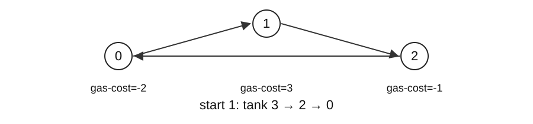

## Worked solutions

55 | 45 | 134 | 200

When each position allows a different travel distance, determine reachability and the fewest moves. On a circular route, find a starting point that never runs out of fuel.

Solving these tasks without storing every choice requires a reason that discarded candidates cannot be needed. Reachable ranges and prefix sums provide that reason.

<!-- lecture-page -->

## Why discarded candidates stay unnecessary

A greedy algorithm eliminates alternatives before storing all choices. It needs a reason why a discarded choice cannot later improve the answer. Merely choosing a large value does not establish that reason.



| Problem | Summary retained | Reason for elimination |
| --- | --- | --- |
| Reachability | Interval 0..farthest | Earlier positions cover a continuous prefix |
| Minimum jumps | Current end, next farthest | Inspect every position with fewer jumps first |
| Fuel circuit | Candidate start and tank | Every start inside a failed segment also fails |

The pictured total balance is zero. Start 0 fails immediately, whereas start 1 completes the circuit with balances 3,2,0. Testing total fuel and selecting a starting point serve different roles.

<!-- lecture-page -->

## 55 · Idea and execution trace

[LeetCode 55: Jump Game](https://leetcode.com/problems/jump-game/) · Medium

Decide whether maximum forward jump lengths permit reaching the last index.

Each value is a maximum jump length, not a mandatory jump. Reachable intervals therefore form a continuous prefix starting at zero. Keep only its farthest endpoint to decide whether the current index can be visited.

`nums=[2,0,1,0]`. Test reachability using the old farthest before updating it.

| index | step | Old farthest | New farthest |
| --- | --- | --- | --- |
| 0 | 2 | 0 | max(0,0+2)=2 |
| 1 | 0 | 2 | max(2,1+0)=2 |
| 2 | 1 | 2 | max(2,2+1)=3 |
| 3 | 0 | 3 | max(3,3+0)=3 |

Index 3 is reachable, so return True.

<!-- lecture-page -->

## 55 · Turning the idea into code

```python
def can_jump(nums):
    farthest = 0
    for index, step in enumerate(nums):
        if index > farthest:
            return False
        farthest = max(farthest, index + step)
    return True
```

Extending the range using an unreachable position would invent a nonexistent path. Test `index > farthest` before updating the range.

For `[1,0,2]`, farthest remains 1 when index 2 is reached, so return False. A large step at an unreachable cell cannot help.

<!-- lecture-page -->

## 55 · Why it works; time and memory

Reachable positions form the interval 0..farthest. Allowed jumps include every shorter distance, preserving an interval; an index beyond it cannot be crossed.

Read n elements once, using only comparison, addition, and max at each step. Paths are not enumerated, so time is O(n); early failure may shorten a run.

Instead of storing every reachable position in a set, retain one endpoint of a continuous interval. A fixed number of variables gives O(1) auxiliary space. Allowing all smaller jump lengths is what makes this interval summary valid.

In [2,3,0,0,0], taking the longest first jump stops at the zero at index 2. Exploring reachable index 1 also exposes a path to the last index. The algorithm maintains the range reachable from all eligible positions.

`nums=[2,0,1,0] → True`

<!-- lecture-page -->

## 45 · Idea and execution trace

[LeetCode 45: Jump Game II](https://leetcode.com/problems/jump-game-ii/) · Medium

Return the minimum jumps needed to reach the last index.

Treat all positions reachable with one more jump as a layer. Inspect the whole current layer before fixing the next farthest endpoint. The first layer covering the destination gives the minimum jump count; no single longest jump is chosen in advance.

`nums=[2,3,0,1,0]`. end marks the layer boundary for the current jump count.

| index | Updated farthest | Old end | Updated jumps,end |
| --- | --- | --- | --- |
| 0 | 2 | 0 | 1,2 |
| 1 | 4 | 2 | 1,2 |
| 2 | 4 | 2 | 2,4 |
| 3 | 4 | 4 | 2,4 |

Route 0 → 1 → 4 needs two jumps; committing to 0 → 2 gets stuck.

<!-- lecture-page -->

## 45 · Turning the idea into code

```python
def min_jumps(nums):
    end = farthest = jumps = 0
    for index in range(len(nums) - 1):
        farthest = max(farthest, index + nums[index])
        if index == end:
            jumps += 1
            end = farthest
    return jumps
```

First include the current position’s reach in farthest. When `index == end`, the current layer is fully inspected: increase jumps and move end to farthest.

Use `range(len(nums)-1)` because no jump is needed from the destination. The problem guarantees reachability; without that guarantee, check can_jump first.

<!-- lecture-page -->

## 45 · Why it works; time and memory

Scan every reachable position in the current level before fixing the next frontier. These are BFS levels in an implicit unweighted graph, so the jump count is minimal.

Explicitly constructing all possible jump edges could create many edges per position. This implementation summarizes each continuous layer with endpoints and scans only n-1 indices, taking O(n) time. Expanding farthest never restarts earlier scans.

Only end, farthest, jumps, and loop variables are stored, giving O(1) auxiliary space. It uses BFS layers conceptually without building a queue. Length one executes zero iterations and returns zero jumps.

The target is n-1. Processing the last index overcounts; [0] gives zero. Unreachable inputs are outside this contract.

`nums=[2,3,0,1,0] → 2`

<!-- lecture-page -->

## 134 · Idea and execution trace

[LeetCode 134: Gas Station](https://leetcode.com/problems/gas-station/) · Medium

Return a start completing a circular route from an empty tank, or -1.

When a segment first runs out of fuel, every intermediate starting point also fails by that endpoint. The original start accumulated a nonnegative balance before reaching each intermediate point; starting there with no balance cannot improve the failed suffix. Discard the whole failed segment at once.

`gas=[1,4,2], cost=[3,1,3]`. total is the global balance; tank is the current candidate’s balance.

| index | gas-cost | total | tank after failure check | start |
| --- | --- | --- | --- | --- |
| 0 | -2 | -2 | 0 (reset) | 1 |
| 1 | +3 | 1 | 3 | 1 |
| 2 | -1 | 0 | 2 | 1 |

Starting at 1, balances along 1 → 2 → 0 are 3 → 2 → 0.

<!-- lecture-page -->

## 134 · Turning the idea into code

```python
def gas_start(gas, cost):
    total = tank = start = 0
    for index, (supply, use) in enumerate(zip(gas, cost)):
        total += supply - use
        tank += supply - use
        if tank < 0:
            start, tank = index + 1, 0
    return start if total >= 0 else -1
```

Do not reset total on failure: it measures whether total supply covers total consumption. Reset only tank and move start past the failure point.

A negative total makes every start impossible. Otherwise the final candidate follows a minimum prefix balance and completes the circuit. Tank capacity is unlimited and gas/cost lengths agree.

<!-- lecture-page -->

## 134 · Why it works; time and memory

At the first failure over s..i, each earlier prefix s..j-1 is nonnegative. Removing such a prefix leaves j..i negative too, eliminating all intermediate starts. If total is nonnegative, the final candidate also has enough surplus to wrap through the eliminated prefixes.

Trying n steps independently from each start would cost O(<math xmlns="http://www.w3.org/1998/Math/MathML"><msup><mi>n</mi><mn>2</mn></msup></math>). Eliminating every start in a failed segment lets index advance without restarting, so there are n constant-cost updates: O(n) time.

zip reads one pair at a time without constructing a difference array. A fixed number of counters gives O(1) auxiliary space. Check both the size of the returned index and the absence of growing intermediate storage.

Choosing the largest gas supply is unjustified: gas=[5,0,4],cost=[6,1,2] fails at station 0; station 2 is the unique valid start.

`gas=[1,4,2], cost=[3,1,3] → 1`

<!-- lecture-page -->

## 200 · Idea and execution trace

[LeetCode 200: Number of Islands](https://leetcode.com/problems/number-of-islands/) · Medium

Count land components connected horizontally or vertically in a character grid.

Starting from one land cell and following all four-directional connections reaches its whole island. Start a traversal and increase the count only at unvisited land, preventing duplicate counting. Diagonals do not connect cells.

Grid: `[["1","1","0"],["0","1","0"],["1","0","1"]]`. Coordinates start at zero; stack top is on the right.

| Action | stack | Newly added to seen | count |
| --- | --- | --- | --- |
| Start (0,0) | [(0,0)] | (0,0) | 1 |
| Pop (0,0) | [(0,1)] | (0,1) | 1 |
| Pop (0,1) | [(1,1)] | (1,1) | 1 |
| Pop (1,1) | [] | None | 1 |
| Traverse (2,0), (2,2) separately | [] | (2,0), (2,2) | 3 |

<!-- lecture-page -->

## 200 · Turning the idea into code

```python
def islands(grid):
    rows, cols = len(grid), len(grid[0])
    seen, count = set(), 0
    for row in range(rows):
        for col in range(cols):
            if grid[row][col] != "1" or (row, col) in seen:
                continue
            count += 1
            stack = [(row, col)]
            seen.add((row, col))
            while stack:
                r, c = stack.pop()
                for nr, nc in ((r-1,c),(r+1,c),(r,c-1),(r,c+1)):
                    if (0 <= nr < rows and 0 <= nc < cols
                            and grid[nr][nc] == "1" and (nr,nc) not in seen):
                        seen.add((nr,nc))
                        stack.append((nr,nc))
    return count
```

The outer loops locate traversal starts; the inner while finishes one connected island. Mark a cell in seen just before pushing it, preventing another neighbor from pushing it again.

Cells contain strings "1" and "0". Check coordinate bounds before reading a cell. The input grid remains unchanged.

<!-- lecture-page -->

## 200 · Why it works; time and memory

A traversal reaches exactly its starting component. Marked components cannot restart; the number of starts equals the component count.

The outer scan reads R·C cells. Each land cell is pushed and popped once because of seen, and each pop checks four neighbors. Four is independent of input size, giving expected O(RC) time under expected hash-set costs. The inner traversal is not restarted fully for every cell.

Both seen and the pending stack can hold up to RC coordinates, so auxiliary space is O(RC). Marking the grid itself could replace seen, but would mutate the input and would not eliminate stack storage.

Use == for values; is tests identity. Diagonal land in a 2x2 grid forms two components.

`grid=[["1","0","1"],["1","0","0"]] → 2`

<!-- lecture-page -->

## Checkpoint answers and reasoning

1. No. The reachable boundary remains 2.
2. 2, following 0→1→4.
3. Zero-based index 1. The tank after each leg is 3,2,0.
4. `0`. The start is already the last position, so no jump is counted.

### Concept-check explanations

A successful example does not prove a greedy rule. Every position in the current reachable range must be considered before fixing the next level’s boundary.

### Why the final start completes the circuit

Let d[i]=gas[i]−cost[i], with prefix sums P[0]=0 and P[k]=d[0]+…+d[k−1]. Resetting the candidate when tank becomes negative records a new smaller prefix sum. The final start s is a position of a minimum prefix sum.

After s, accumulated fuel is P[k]−P[s], which is nonnegative. After wrapping to an earlier k, it is P[n]−P[s]+P[k]. If P[n]≥0, this is also nonnegative because P[k]≥P[s]. Thus a nonnegative total guarantees that the final candidate completes the circuit.

<!-- lecture-page -->

## Exercises and sources

[LeetCode · 55, 45, 134, 200](/courses/practical-algorithms/week-08-practice/) · [Worked solutions](/courses/practical-algorithms/week-08-reading/) · [Python ZIP](/assets/courses/practical-algorithms/week-08-code.zip)

```text
python demo_15.py
python demo_16.py
python verify.py
```

After implementing the student file, check it with `python verify.py --student`.

Erik Demaine, Srini Devadas. [MIT 6.006, Introduction to Algorithms](https://ocw.mit.edu/courses/6-006-introduction-to-algorithms-fall-2011/) (2011).

[Mixed assessment](/courses/practical-algorithms/week-08-assessment/)

<!-- ko -->

## 풀이와 실행 과정

55 | 45 | 134 | 200

위치마다 이동 가능한 거리가 다를 때 목적지 도달 여부와 최소 이동 횟수를 구합니다. 순환 경로에서는 연료가 바닥나지 않는 출발점을 찾습니다.

모든 선택을 저장하지 않고도 답을 구하려면 버린 후보가 답이 될 수 없다는 근거가 필요합니다. 도달 범위와 누적합으로 그 근거를 확인합니다.

<!-- lecture-page -->

## 버린 후보가 다시 필요하지 않은 이유

그리디 알고리즘은 여러 선택을 저장하기 전에 일부를 제외합니다. 제외한 선택이 나중에 더 좋은 답이 되지 않는 근거가 있어야 합니다. 큰 값부터 고르는 규칙만으로는 그 근거가 생기지 않습니다.


| 문제 | 요약하는 정보 | 후보 제외의 근거 |
| --- | --- | --- |
| 도달 가능성 | 0부터 farthest까지 | 이전 위치가 만드는 연속 구간 |
| 최소 점프 | 현재 층 end, 다음 층 farthest | 적은 점프의 모든 위치를 먼저 조사 |
| 순환 연료 경로 | 현재 start와 tank | 실패한 구간 안의 출발점도 모두 실패 |

그림에서 전체 차이 합은 0입니다. 출발점 0은 즉시 실패하지만 출발점 1은 잔량 3,2,0으로 완주합니다. 전체 합 검사와 출발점 선택은 서로 다른 역할입니다.

<!-- lecture-page -->

## 55 · 풀이의 출발점과 실행 추적

[LeetCode 55: Jump Game](https://leetcode.com/problems/jump-game/) · Medium

각 위치의 최대 전진 거리로 마지막 인덱스에 도달할 수 있는지 판정합니다.

현재 위치의 숫자는 반드시 그만큼 뛰라는 뜻이 아니라 최대 점프 길이입니다. 그래서 도달한 위치가 만드는 구간들이 0부터 연속으로 이어집니다. 그 구간의 가장 먼 끝 farthest만 기억하면 현재 인덱스를 밟을 수 있는지 판단할 수 있습니다.

`nums=[2,0,1,0]`. 갱신 전에 index가 이전 farthest 이내인지 확인합니다.

| index | step | 이전 farthest | 새 farthest |
| --- | --- | --- | --- |
| 0 | 2 | 0 | max(0,0+2)=2 |
| 1 | 0 | 2 | max(2,1+0)=2 |
| 2 | 1 | 2 | max(2,2+1)=3 |
| 3 | 0 | 3 | max(3,3+0)=3 |

마지막 인덱스 3까지 도달하므로 True입니다.

<!-- lecture-page -->

## 55 · 아이디어를 코드로 옮기기

```python
def can_jump(nums):
    farthest = 0
    for index, step in enumerate(nums):
        if index > farthest:
            return False
        farthest = max(farthest, index + step)
    return True
```

도달 불가능한 위치의 step을 읽어 범위를 늘리면 존재하지 않는 경로를 만들어 냅니다. 그래서 `index > farthest` 검사를 갱신보다 먼저 합니다.

`[1,0,2]`에서는 인덱스 2에 도착하기 전에 farthest=1에 막혀 False입니다. 뒤의 2가 아무리 커도 그 칸을 밟을 수 없으면 사용할 수 없습니다.

<!-- lecture-page -->

## 55 · 정당성·시간·메모리의 근거

이전 도달 집합은 0..farthest의 연속 구간입니다. 도달한 위치에서 최대 step 이내의 모든 거리가 허용되어 같은 형태를 유지합니다. index>farthest면 건널 방법이 없습니다.

n개 원소를 한 번씩 읽으며 각 단계에서 비교·덧셈·max만 수행합니다. 실제 경로를 모두 열거하지 않아 시간은 O(n)입니다. 조기 실패 시 더 짧게 끝나지만 최악에는 끝까지 읽습니다.

경로별 도달 위치를 집합으로 저장하지 않고 연속 구간의 끝 하나만 보관합니다. index, step, farthest 등 고정 개수 변수이므로 보조 공간 O(1)입니다. 모든 작은 점프 길이가 허용된다는 조건이 이 구간 요약을 가능하게 합니다.

[2,3,0,0,0]에서 처음부터 최대 거리로 점프하면 위치 2의 0에서 멈춥니다. 도달 가능한 위치 1도 탐색하면 마지막 위치까지 갈 수 있습니다. 알고리즘은 가능한 위치들의 도달 범위를 유지합니다.

`nums=[2,0,1,0] → True`

<!-- lecture-page -->

## 45 · 풀이의 출발점과 실행 추적

[LeetCode 45: Jump Game II](https://leetcode.com/problems/jump-game-ii/) · Medium

마지막 위치까지 필요한 최소 점프 수를 반환합니다.

한 번의 점프로 갈 수 있는 모든 위치를 같은 층으로 생각합니다. 그 층의 위치들을 모두 조사한 뒤 다음 층의 가장 먼 끝을 확정하면, 처음 마지막 위치를 덮는 층 번호가 최소 점프 수입니다. 가장 멀리 한 번 뛰는 경로를 미리 고르지 않습니다.

`nums=[2,3,0,1,0]`. end는 현재 점프 수로 처리할 층의 끝입니다.

| index | 갱신 farthest | 이전 end | 갱신 후 jumps,end |
| --- | --- | --- | --- |
| 0 | 2 | 0 | 1,2 |
| 1 | 4 | 2 | 1,2 |
| 2 | 4 | 2 | 2,4 |
| 3 | 4 | 4 | 2,4 |

경로 0 → 1 → 4는 두 번입니다. 0 → 2로만 뛰면 0에 막힙니다.

<!-- lecture-page -->

## 45 · 아이디어를 코드로 옮기기

```python
def min_jumps(nums):
    end = farthest = jumps = 0
    for index in range(len(nums) - 1):
        farthest = max(farthest, index + nums[index])
        if index == end:
            jumps += 1
            end = farthest
    return jumps
```

먼저 현재 위치에서 다음 층으로 갈 수 있는 범위를 farthest에 반영합니다. `index == end`가 되면 현재 층을 다 본 것이므로 jumps를 하나 늘리고 end를 farthest로 옮깁니다.

마지막 위치에서는 더 뛸 필요가 없으므로 `range(len(nums)-1)`입니다. 이 문제는 도달 가능을 보장합니다. 보장 없는 입력에는 먼저 can_jump로 가능 여부를 확인해야 합니다.

<!-- lecture-page -->

## 45 · 정당성·시간·메모리의 근거

현재 레벨의 모든 도달 위치를 스캔한 뒤 다음 최대 범위를 확정합니다. 이는 암묵적 무가중 그래프의 BFS 레벨 확장이므로 더 적은 점프로 끝을 넘을 수 없습니다.

그래프의 모든 점프 간선을 만들면 한 위치에서 많은 간선이 나올 수 있습니다. 이 구현은 각 층의 연속 구간을 두 끝값으로 요약하고 인덱스 n-1개만 훑으므로 O(n) 시간입니다. farthest를 확장해도 이미 지난 위치를 다시 검사하지 않습니다.

end, farthest, jumps와 반복 변수만 저장하여 보조 공간은 O(1)입니다. BFS의 층 개념을 사용하지만 큐를 만들지는 않습니다. 길이 1이면 반복 횟수 0, 반환 점프 수 0입니다.

목표는 n-1입니다. 마지막 위치까지 반복하면 점프를 한 번 더 셉니다. [0]의 답은 0입니다. 비도달 입력은 공식 보장 밖입니다.

`nums=[2,3,0,1,0] → 2`

<!-- lecture-page -->

## 134 · 풀이의 출발점과 실행 추적

[LeetCode 134: Gas Station](https://leetcode.com/problems/gas-station/) · Medium

빈 탱크로 출발해 원형 경로를 한 바퀴 도는 시작점을 반환하고 없으면 -1입니다.

한 구간을 지나며 연료가 처음 음수가 되었다면, 그 구간 안의 다른 위치에서도 실패 지점까지 갈 수 없습니다. 원래 출발점에서 그 위치까지 남긴 연료가 0 이상이었으므로, 그 연료 없이 새로 출발하면 더 불리하기 때문입니다. 실패한 구간 전체를 한 번에 제외합니다.

`gas=[1,4,2], cost=[3,1,3]`. total은 전체 합, tank는 현재 후보에서의 합입니다.

| index | gas-cost | total | 실패 검사 후 tank | start |
| --- | --- | --- | --- | --- |
| 0 | -2 | -2 | 0 (초기화) | 1 |
| 1 | +3 | 1 | 3 | 1 |
| 2 | -1 | 0 | 2 | 1 |

출발점 1에서 순서 1 → 2 → 0의 잔량은 3 → 2 → 0입니다.

<!-- lecture-page -->

## 134 · 아이디어를 코드로 옮기기

```python
def gas_start(gas, cost):
    total = tank = start = 0
    for index, (supply, use) in enumerate(zip(gas, cost)):
        total += supply - use
        tank += supply - use
        if tank < 0:
            start, tank = index + 1, 0
    return start if total >= 0 else -1
```

total은 실패해도 초기화하지 않습니다. 한 바퀴 전체의 공급이 소비보다 작은지 판정하는 값입니다. tank만 0으로 만들고 start를 실패 지점 다음으로 옮깁니다.

전체 합이 음수면 어떤 출발점도 불가능합니다. 음수가 아니면 마지막 후보가 최소 누적합 바로 뒤에 있어 한 바퀴를 완주할 수 있습니다. 연료통 용량은 제한이 없고 공급·비용 배열 길이는 같습니다.

<!-- lecture-page -->

## 134 · 정당성·시간·메모리의 근거

s..i에서 처음 실패했다면 s..j-1의 누적합은 음수가 아닙니다. 따라서 중간 j에서 시작한 j..i 합은 실패 합보다 크지 않아 모두 실패합니다. 전체 합이 음수가 아니면 마지막 후보는 끝 구간을 통과하고, 앞의 제거된 구간을 감싸 돌아도 부족하지 않습니다.

각 출발점에서 n칸씩 따로 시험하면 O(<math xmlns="http://www.w3.org/1998/Math/MathML"><msup><mi>n</mi><mn>2</mn></msup></math>)입니다. 실패 구간 안의 출발점을 함께 제외하면 index가 뒤로 돌아가지 않아 n번만 처리합니다. 각 처리의 합·비교가 O(1)이므로 시간 O(n)입니다.

차이 배열을 새로 만들지 않고 zip으로 한 쌍씩 읽습니다. total, tank, start 등 고정 개수의 변수만 보관하므로 보조 공간 O(1)입니다. 반환 인덱스가 한 개라는 사실과 실제 실행 중 배열을 만들지 않는다는 사실을 함께 확인해야 합니다.

연료가 가장 많은 곳을 고르는 규칙에는 증명이 없습니다. gas=[5,0,4],cost=[6,1,2]에서는 최대 연료 위치 0이 즉시 실패하고 유일한 시작점 2가 가능합니다.

`gas=[1,4,2], cost=[3,1,3] → 1`

<!-- lecture-page -->

## 200 · 풀이의 출발점과 실행 추적

[LeetCode 200: Number of Islands](https://leetcode.com/problems/number-of-islands/) · Medium

문자 격자의 상하좌우로 연결된 육지 덩어리 수를 반환합니다.

육지 한 칸에서 상하좌우 연결을 모두 따라가면 그 섬 전체를 찾습니다. 아직 방문하지 않은 육지를 만날 때만 섬 수를 늘리고 탐색을 시작하면 같은 섬을 여러 번 세지 않습니다. 대각선은 연결에 포함되지 않습니다.

격자 `[["1","1","0"],["0","1","0"],["1","0","1"]]`. 스택 오른쪽이 top이며 좌표는 0부터 셉니다.

| 동작 | stack | seen에 새로 추가 | count |
| --- | --- | --- | --- |
| (0,0) 시작 | [(0,0)] | (0,0) | 1 |
| (0,0) pop | [(0,1)] | (0,1) | 1 |
| (0,1) pop | [(1,1)] | (1,1) | 1 |
| (1,1) pop | [] | 없음 | 1 |
| (2,0), (2,2) 각각 탐색 | [] | (2,0), (2,2) | 3 |

<!-- lecture-page -->

## 200 · 아이디어를 코드로 옮기기

```python
def islands(grid):
    rows, cols = len(grid), len(grid[0])
    seen, count = set(), 0
    for row in range(rows):
        for col in range(cols):
            if grid[row][col] != "1" or (row, col) in seen:
                continue
            count += 1
            stack = [(row, col)]
            seen.add((row, col))
            while stack:
                r, c = stack.pop()
                for nr, nc in ((r-1,c),(r+1,c),(r,c-1),(r,c+1)):
                    if (0 <= nr < rows and 0 <= nc < cols
                            and grid[nr][nc] == "1" and (nr,nc) not in seen):
                        seen.add((nr,nc))
                        stack.append((nr,nc))
    return count
```

바깥 두 for는 탐색 시작점을 찾습니다. 안쪽 while은 그 시작점과 연결된 섬 하나를 끝냅니다. `seen.add`를 push 직전에 실행하므로 다른 이웃이 같은 칸을 다시 넣을 수 없습니다.

입력은 문자열 "1"·"0"입니다. 좌표 범위를 확인한 다음 값을 읽으며, 원본 격자는 변경하지 않습니다.

<!-- lecture-page -->

## 200 · 정당성·시간·메모리의 근거

한 번 시작한 탐색은 연결 경로를 따라 그 성분의 모든 노드와 그 노드만 방문합니다. 이미 표시한 성분은 다시 시작하지 않으므로 시작 횟수가 성분 수입니다.

R·C칸을 한 번 훑습니다. 육지 칸은 seen 때문에 한 번만 push·pop되고, 꺼낼 때 이웃 네 개만 검사합니다. 네 방향은 입력 크기와 무관한 상수라서 해시 연산의 기대 비용을 적용한 시간은 O(RC)입니다. 루프가 중첩되어 보여도 섬 탐색 전체가 매 칸에서 반복되는 것은 아닙니다.

seen에는 최대 RC개 좌표, stack에도 최대 RC개 좌표가 남을 수 있어 보조 공간은 O(RC)입니다. 격자를 직접 표시하면 seen을 없앨 수 있지만, 입력 변경과 탐색 스택의 비용은 여전히 따져야 합니다.

값 비교는 ==입니다. is는 객체 동일성입니다. [["1","0"],["0","1"]]은 대각선을 연결하지 않아 두 성분입니다.

`grid=[["1","0","1"],["1","0","0"]] → 2`

<!-- lecture-page -->

## 중간 점검의 답과 근거

1. 불가능합니다. 도달 범위의 끝이 2에 머뭅니다.
2. `2`. 0→1→4로 이동합니다.
3. 0부터 센 인덱스 1. 순환하며 탱크는 3,2,0입니다.
4. `0`. 이미 마지막 위치에 있으므로 추가 점프를 세지 않습니다.

### 개념 질문 해설

예제 성공은 그리디 규칙의 증명이 아닙니다. 현재 도달 범위의 모든 위치를 확인해야 다음 레벨의 최대 범위를 확정할 수 있습니다.

### 순환 경로의 충분조건

차이를 d[i]=gas[i]−cost[i], 접두합을 P[0]=0, P[k]=d[0]+…+d[k−1]로 둡니다. tank가 음수가 될 때 새 출발점으로 옮기는 것은 더 작은 접두합을 만날 때마다 그 위치를 저장하는 것과 같습니다. 최종 출발점 s는 접두합의 최솟값 위치입니다.

s 이후의 누적 연료는 P[k]−P[s]이므로 음수가 아닙니다. 앞쪽 k로 돌아온 뒤에는 P[n]−P[s]+P[k]입니다. P[n]≥0이고 P[k]≥P[s]이므로 이 값도 음수가 아닙니다. 따라서 전체 합이 음수가 아니면 최종 후보가 한 바퀴를 완주합니다.

<!-- lecture-page -->

## 실습과 참고자료

[LeetCode · 55, 45, 134, 200](/courses/practical-algorithms/week-08-practice/) · [풀이](/courses/practical-algorithms/week-08-reading/) · [Python ZIP](/assets/courses/practical-algorithms/week-08-code.zip)

```text
python demo_15.py
python demo_16.py
python verify.py
```

학생 파일을 구현한 뒤 `python verify.py --student`로 검사합니다.

Erik Demaine, Srini Devadas. [MIT 6.006, Introduction to Algorithms](https://ocw.mit.edu/courses/6-006-introduction-to-algorithms-fall-2011/) (2011).

[혼합 평가](/courses/practical-algorithms/week-08-assessment/)
