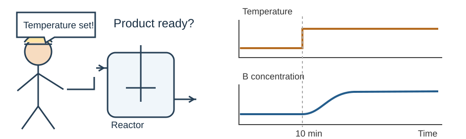
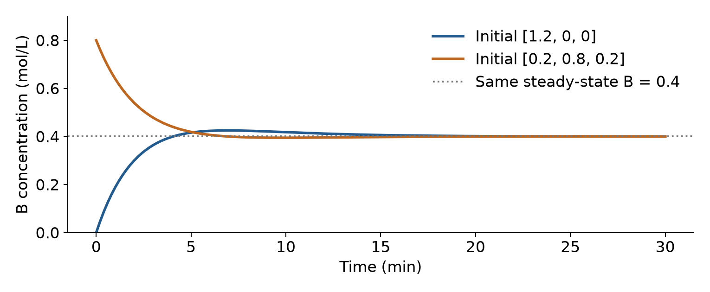
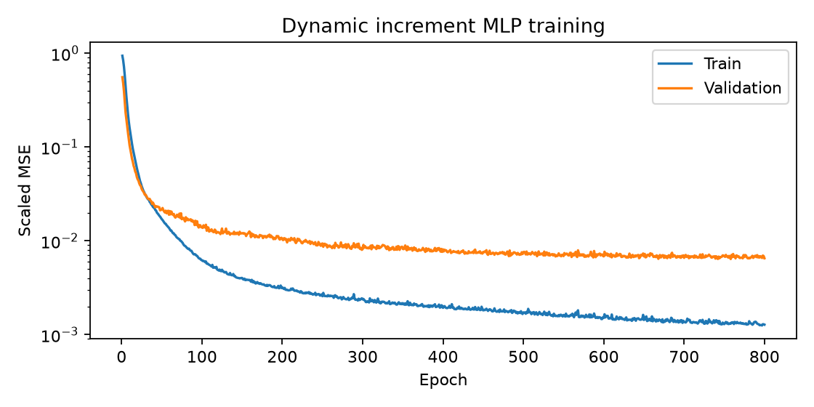
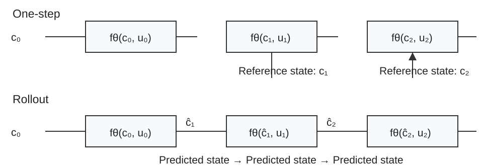
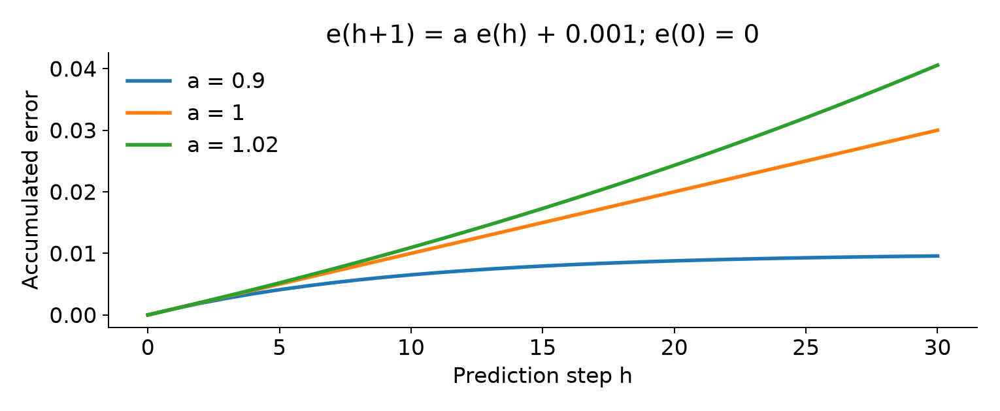
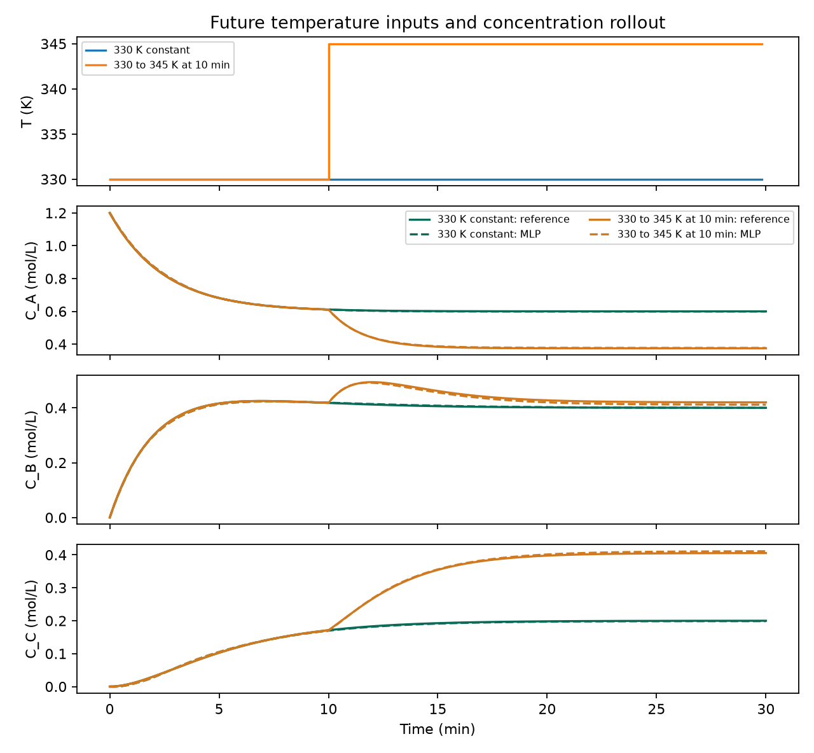
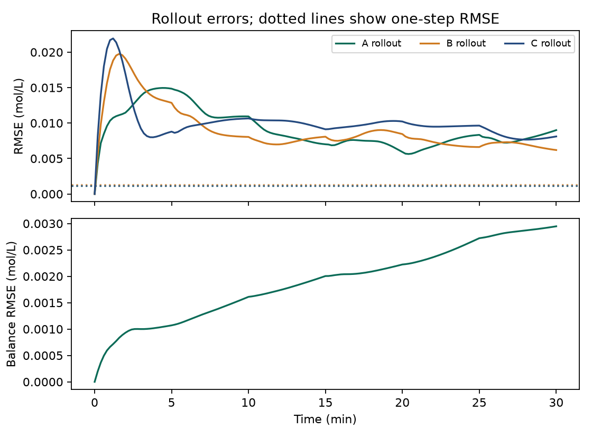
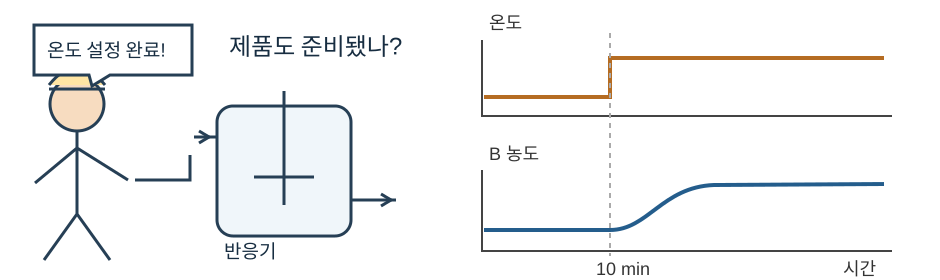
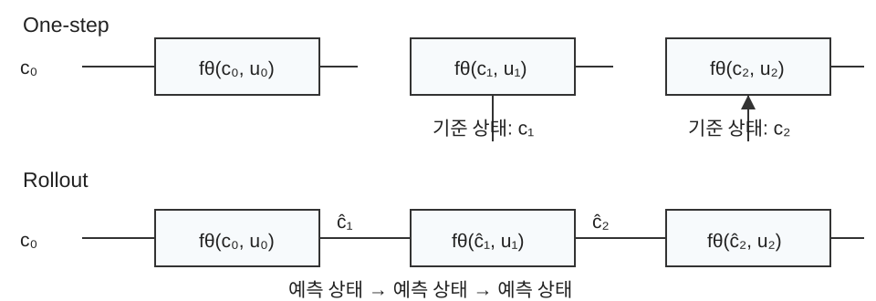

## Transient product concentrations after a temperature change

A process engineer changes reactor temperature at 10 min. If the outlet flows directly into a product tank, how will B concentration change over the next 20 min?

<figure></figure>

<!-- lecture-page -->

## Transient response toward a new steady state

During a grade change or startup, material produced before the target composition is reached can require separation or reprocessing. The endpoint alone does not describe that transient.

At the same temperature, different current tank compositions can lead to different next responses. Learn a short state transition and apply it repeatedly to predict the full trajectory.

<figure><figcaption>T = 330 K, τ = 5 min, C_Af = 1.2 mol/L; only the initial state differs.</figcaption></figure>

<!-- lecture-page -->

## State-transition model training and rollout evaluation

1. Current state, prescribed future inputs, fixed context, and sampling interval
2. State-transition MLP training on concentration increments
3. One-step versus 30 min rollout on held-out trajectories

Submission: the same model’s component errors in both evaluations, error versus horizon, and two temperature-plan trajectories. Optional extensions: RNN/LSTM and encoder-decoder.

<!-- lecture-page -->

## Steady-state and state-transition maps

Week 2: [T, τ, C_Af] → the composition after equilibration.

Week 3: current composition + interval input + context → composition one interval later.

<math display="block"><mtable columnalign="left"><mtr><mtd><mrow><msub><mi>c</mi><mrow><mi>k</mi><mo>+</mo><mn>1</mn></mrow></msub><mo>=</mo><msub><mi>F</mi><mrow><mi>Δt</mi></mrow></msub><mrow><mo>(</mo><msub><mi>c</mi><mrow><mi>k</mi></mrow></msub><mo>,</mo><msub><mi>u</mi><mrow><mi>k</mi></mrow></msub><mo>;</mo><mi>q</mi><mo>)</mo></mrow></mrow></mtd></mtr></mtable></math>

Repeatedly applying this map produces a trajectory. A feedforward MLP can model a dynamic transition when its inputs contain the state needed for that transition.

An equilibrium predictor cannot account for how much A and B remain in the tank now. A transition model includes that current state, so the same temperature can produce different next states from different starting compositions.

<!-- lecture-page -->

## State, future input, and fixed context

| Quantity | Meaning | Unit / role |
| --- | --- | --- |
| c_k = [C_A,k, C_B,k, C_C,k] | Current reactor composition | mol/L; state |
| u_k = T_k | Temperature over interval k | K; prescribed input |
| q = [τ, C_Af] | Residence time and feed concentration | min, mol/L; fixed per trajectory |
| Δt = 0.2 | Sampling interval | min; fixed for this model |

Specify c_0 and the complete temperature sequence before rollout. The temperature plan is supplied by the exercise.

<!-- lecture-page -->

## The reference CSTR

An ideal, perfectly mixed reactor has constant volume and equal inlet/outlet flow. Its consecutive first-order reactions are A → B → C with 1:1 stoichiometry. Feed contains A only. Temperature is prescribed; an energy balance is not included.

<math display="block"><mtable columnalign="left"><mtr><mtd><mrow><mfrac><mrow><mi>d</mi><msub><mi>C</mi><mrow><mi>A</mi></mrow></msub></mrow><mrow><mi>d</mi><mi>t</mi></mrow></mfrac><mo>=</mo><mfrac><mrow><msub><mi>C</mi><mrow><mi>Af</mi></mrow></msub><mo>−</mo><msub><mi>C</mi><mrow><mi>A</mi></mrow></msub></mrow><mrow><mi>τ</mi></mrow></mfrac><mo>−</mo><msub><mi>k</mi><mrow><mn>1</mn></mrow></msub><msub><mi>C</mi><mrow><mi>A</mi></mrow></msub></mrow></mtd></mtr><mtr><mtd><mrow><mfrac><mrow><mi>d</mi><msub><mi>C</mi><mrow><mi>B</mi></mrow></msub></mrow><mrow><mi>d</mi><mi>t</mi></mrow></mfrac><mo>=</mo><msub><mi>k</mi><mrow><mn>1</mn></mrow></msub><msub><mi>C</mi><mrow><mi>A</mi></mrow></msub><mo>−</mo><mfrac><mrow><msub><mi>C</mi><mrow><mi>B</mi></mrow></msub></mrow><mrow><mi>τ</mi></mrow></mfrac><mo>−</mo><msub><mi>k</mi><mrow><mn>2</mn></mrow></msub><msub><mi>C</mi><mrow><mi>B</mi></mrow></msub></mrow></mtd></mtr><mtr><mtd><mrow><mfrac><mrow><mi>d</mi><msub><mi>C</mi><mrow><mi>C</mi></mrow></msub></mrow><mrow><mi>d</mi><mi>t</mi></mrow></mfrac><mo>=</mo><msub><mi>k</mi><mrow><mn>2</mn></mrow></msub><msub><mi>C</mi><mrow><mi>B</mi></mrow></msub><mo>−</mo><mfrac><mrow><msub><mi>C</mi><mrow><mi>C</mi></mrow></msub></mrow><mrow><mi>τ</mi></mrow></mfrac></mrow></mtd></mtr></mtable></math>

k₁(T) = 0.2 exp[6000(1/330 − 1/T)], k₂(T) = 0.1 exp[5000(1/330 − 1/T)] in min⁻¹. At 330 K, k₁ = 0.2 and k₂ = 0.1 min⁻¹.

<!-- lecture-page -->

## A continuous process, sampled at fixed times

For each interval [t_k, t_k + Δt), hold T_k constant. Integrate the balances over that interval to obtain c_k+1. The state stays continuous when the input switches.

30 min / 0.2 min = 150 transitions; 151 sampled states including the initial state. Temperature step at 10 min: interval index 50.

The learned map predicts a 0.2 min transition. Increasing the number of applications extends the horizon; it does not change the sampling interval.

The state just before the temperature change at 10 min initializes the next interval. Even with an instantaneous prescribed temperature change, concentrations are not replaced by their new equilibrium values. Compute their evolution over the next 0.2 min using the new rates.

<!-- lecture-page -->

## Interval response of the reference model

With constant interval inputs, the balances are affine in the state. Write dc/dt = Mc + b. The steady state c∗ satisfies Mc∗ + b = 0.

<math display="block"><mtable columnalign="left"><mtr><mtd><mrow><msub><mi>F</mi><mrow><mi>Δt</mi></mrow></msub><mrow><mo>(</mo><mi>c</mi><mo>,</mo><mi>u</mi><mo>;</mo><mi>q</mi><mo>)</mo></mrow><mo>=</mo><msup><mi>c</mi><mrow><mo>∗</mo></mrow></msup><mo>+</mo><msup><mi>e</mi><mrow><mi>M</mi><mi>Δt</mi></mrow></msup><mrow><mo>(</mo><mi>c</mi><mo>−</mo><msup><mi>c</mi><mrow><mo>∗</mo></mrow></msup><mo>)</mo></mrow></mrow></mtd></mtr></mtable></math>

The lab generates labels at the selected Δt from this analytic solution.

At c₀ = [1.2, 0, 0], T = 330 K, τ = 5 min, feed = 1.2 mol/L: c₁ ≈ [1.153870, 0.045672, 0.000458] mol/L.

Subtracting equilibrium removes the constant feed term, leaving deviations. The matrix exponential describes both their decay and transfer from A into B and C. At a changed input, recompute equilibrium and the matrix while retaining the current state.

<!-- lecture-page -->

## Connecting the balance matrix to exponential response

At 330 K and τ=5, M has rows [−0.4,0,0], [0.2,−0.3,0], [0,0.1,−0.2], and b=[0.24,0,0]. Its second row gives the original B balance, 0.2<math xmlns="http://www.w3.org/1998/Math/MathML"><msub><mi>C</mi><mi>A</mi></msub></math>−0.3<math xmlns="http://www.w3.org/1998/Math/MathML"><msub><mi>C</mi><mi>B</mi></msub></math>.

Subtracting equilibrium <math xmlns="http://www.w3.org/1998/Math/MathML"><msup><mi>c</mi><mo>∗</mo></msup></math> gives dz/dt=Mz. The scalar solution of dz/dt=−0.4z is exp(−0.4t)z(0); exp(Mt)z(0) extends this to coupled components.

<div class="equation"><math xmlns="http://www.w3.org/1998/Math/MathML" display="block"><mrow><msup><mi>e</mi><mrow><mi>M</mi><mi>t</mi></mrow></msup><mo>=</mo><mi>I</mi><mo>+</mo><mi>M</mi><mi>t</mi><mo>+</mo><mfrac><msup><mrow><mo stretchy="false">(</mo><mi>M</mi><mi>t</mi><mo stretchy="false">)</mo></mrow><mn>2</mn></msup><mn>2!</mn></mfrac><mo>+</mo><mfrac><msup><mrow><mo stretchy="false">(</mo><mi>M</mi><mi>t</mi><mo stretchy="false">)</mo></mrow><mn>3</mn></msup><mn>3!</mn></mfrac><mo>+</mo><mo>⋯</mo></mrow></math></div>

M² is a matrix product, not an elementwise power. Likewise, exp(Mt) is not an array of elementwise exponentials. Mt is dimensionless. Keeping only I+Mt gives one Euler step; later terms account for changing concentrations feeding back into reaction rates within the interval.

For z(0)=[0.6,−0.4,−0.2], Mz=[−0.24,0.24,0]. Thus <math xmlns="http://www.w3.org/1998/Math/MathML"><msup><mi>c</mi><mo>∗</mo></msup></math>+(I+0.2M)z=[1.152,0.048,0], recovering the Euler calculation.

<!-- lecture-page -->

## Concentration changes over the first 0.2 min

At [1.2,0,0], A inflow minus outflow is zero and its reaction consumption is 0.24 mol/(L·min). B forms at that rate; C initially has zero production rate because no B is yet present.

| Quantity | Calculation | mol/L |
| --- | --- | --- |
| Euler A | 1.2−0.2×0.24 | 1.152000 |
| Exact A | 0.6+0.6 exp(−0.08) | 1.153870 |
| B equilibrium-deviation term | 0.4−0.4 exp(−0.06) | 0.023294 |
| Transfer from A into B | 0.12[exp(−0.08)−exp(−0.06)]/(−0.1) | 0.022378 |
| Exact B | 0.023294+0.022378 | 0.045672 |
| Exact C | 1.2−1.153870−0.045672 | 0.000458 |

Euler uses the initial rate throughout the interval. During the actual interval, A decreases, B forms, and C production begins. These changing rates explain its difference from the exact interval solution.

<!-- lecture-page -->

## Integrating the effect of A on B

Write deviations <math xmlns="http://www.w3.org/1998/Math/MathML"><msub><mi>z</mi><mi>A</mi></msub></math>=<math xmlns="http://www.w3.org/1998/Math/MathML"><msub><mi>C</mi><mi>A</mi></msub></math>−<math xmlns="http://www.w3.org/1998/Math/MathML"><msubsup><mi>C</mi><mi>A</mi><mo>∗</mo></msubsup></math> and <math xmlns="http://www.w3.org/1998/Math/MathML"><msub><mi>z</mi><mi>B</mi></msub></math>=<math xmlns="http://www.w3.org/1998/Math/MathML"><msub><mi>C</mi><mi>B</mi></msub></math>−<math xmlns="http://www.w3.org/1998/Math/MathML"><msubsup><mi>C</mi><mi>B</mi><mo>∗</mo></msubsup></math>, with a=1/τ+k₁ and b=1/τ+k₂. Then <math xmlns="http://www.w3.org/1998/Math/MathML"><msub><mi>z</mi><mi>A</mi></msub></math>(t)=<math xmlns="http://www.w3.org/1998/Math/MathML"><msub><mi>z</mi><mi>A</mi></msub></math>(0)exp(−at).

Multiply <math xmlns="http://www.w3.org/1998/Math/MathML"><msub><mi>z</mi><mi>B</mi></msub></math>′+b<math xmlns="http://www.w3.org/1998/Math/MathML"><msub><mi>z</mi><mi>B</mi></msub></math>=k₁<math xmlns="http://www.w3.org/1998/Math/MathML"><msub><mi>z</mi><mi>A</mi></msub></math>(0)exp(−at) by exp(bt). The left side becomes the derivative of a product. Integrating from 0 to t gives:

<div class="equation"><math xmlns="http://www.w3.org/1998/Math/MathML" display="block"><mrow><msup><mi>e</mi><mrow><mi>b</mi><mi>t</mi></mrow></msup><msub><mi>z</mi><mi>B</mi></msub><mo stretchy="false">(</mo><mi>t</mi><mo stretchy="false">)</mo><mo>−</mo><msub><mi>z</mi><mi>B</mi></msub><mo stretchy="false">(</mo><mn>0</mn><mo stretchy="false">)</mo><mo>=</mo><msub><mi>k</mi><mn>1</mn></msub><msub><mi>z</mi><mi>A</mi></msub><mo stretchy="false">(</mo><mn>0</mn><mo stretchy="false">)</mo><mfrac><mrow><msup><mi>e</mi><mrow><mo stretchy="false">(</mo><mi>b</mi><mo>−</mo><mi>a</mi><mo stretchy="false">)</mo><mi>t</mi></mrow></msup><mo>−</mo><mn>1</mn></mrow><mrow><mi>b</mi><mo>−</mo><mi>a</mi></mrow></mfrac></mrow></math></div>

Multiplying by exp(−bt) gives the transfer term k₁<math xmlns="http://www.w3.org/1998/Math/MathML"><msub><mi>z</mi><mi>A</mi></msub></math>(0)[exp(−at)−exp(−bt)]/(b−a). In the numerical calculation, 0.12 is k₁<math xmlns="http://www.w3.org/1998/Math/MathML"><msub><mi>z</mi><mi>A</mi></msub></math>(0)=0.2×0.6, and −0.1 is b−a=0.3−0.4.

If a=b, the integrand is 1 and its integral is t. Use k₁<math xmlns="http://www.w3.org/1998/Math/MathML"><msub><mi>z</mi><mi>A</mi></msub></math>(0)t exp(−at) rather than evaluating 0/0.

<!-- lecture-page -->

## Trajectory generation and transition-pair construction

Input ranges: 300-360 K, τ = 1-10 min, feed = 0.8-1.5 mol/L. Random temperature plans: six 5 min blocks. Initial composition for each trajectory: nonnegative components summing to feed.

| Split | Trajectories | Transition rows |
| --- | --- | --- |
| Train | 60 | 9000 |
| Validation | 15 | 2250 |
| Test | 20 | 3000 |

Adjacent transition rows share states from the same trajectory. Random row splitting can put nearly the same trajectory in training and test. Splitting whole trajectories first preserves evaluation on unseen temperature plans and initial states.

<!-- lecture-page -->

## States, inputs, and targets in the training data

| Fields | Construction |
| --- | --- |
| Input v_k | [C_A,k, C_B,k, C_C,k, T_k, τ, C_Af] |
| Next-state label | c_k+1 from the reference interval response |
| Increment target | Δc_k = c_k+1 − c_k |
| Identification | split, trajectory ID, t_k |

<math display="block"><mtable columnalign="left"><mtr><mtd><mrow><msub><mi>Δc</mi><mrow><mi>k</mi></mrow></msub><mo>=</mo><msub><mi>c</mi><mrow><mi>k</mi><mo>+</mo><mn>1</mn></mrow></msub><mo>−</mo><msub><mi>c</mi><mrow><mi>k</mi></mrow></msub></mrow></mtd></mtr><mtr><mtd><mrow><msub><mover><mi>c</mi><mo>^</mo></mover><mrow><mi>k</mi><mo>+</mo><mn>1</mn></mrow></msub><mo>=</mo><msub><mi>c</mi><mrow><mi>k</mi></mrow></msub><mo>+</mo><msub><mi>μ</mi><mrow><mi>Δ</mi></mrow></msub><mo>+</mo><msub><mi>s</mi><mrow><mi>Δ</mi></mrow></msub><mo>⊙</mo><msub><mi>g</mi><mrow><mi>θ</mi></mrow></msub><mrow><mo>(</mo><msub><mi>ṽ</mi><mrow><mi>k</mi></mrow></msub><mo>)</mo></mrow></mrow></mtd></mtr></mtable></math>

Target: concentration increment in mol/L

The first row is [1.2,0,0,330,5,1.2], with target increment approximately [−0.046130,0.045672,0.000458] mol/L. Learning an increment focuses on the local change; adding it to the current state is still required to obtain the next state.

<!-- lecture-page -->

## The transition MLP and its scaling

Architecture: 6 → 32 → 32 → 3; ReLU hidden layers and a linear output. Parameters: (6×32 + 32) + (32×32 + 32) + (32×3 + 3) = 1379.

Compute input and increment means/standard deviations from train rows. Apply those same statistics to validation, test, and rollout states.

MLP output: standardized increments. Restore each increment to mol/L before adding it to the current state.

Training means and scales define the coordinates in which the model interprets inputs. Recomputing them from predicted rollout states would map the same physical state to different numbers and change the learned input convention.

<!-- lecture-page -->

## Train on reference current states

Each train input contains the reference current state. Minimize the mean squared standardized increment error.

<math display="block"><mtable columnalign="left"><mtr><mtd><mrow><msub><mi>L</mi><mrow><mn>1</mn></mrow></msub><mo>=</mo><mfrac><mrow><mn>1</mn></mrow><mrow><mn>3</mn><mi>N</mi></mrow></mfrac><msub><mo>∑</mo><mrow><mi>n</mi></mrow></msub><msub><mo>∑</mo><mrow><mi>j</mi></mrow></msub><msup><mrow><mo>(</mo><msub><msub><mi>g</mi><mrow><mi>θ</mi></mrow></msub><mrow><mo>(</mo><msub><mi>ṽ</mi><mrow><mi>n</mi></mrow></msub><mo>)</mo></mrow><mrow><mi>j</mi></mrow></msub><mo>−</mo><msub><mi>Δc̃</mi><mrow><mi>n</mi><mo>,</mo><mi>j</mi></mrow></msub><mo>)</mo></mrow><mrow><mn>2</mn></mrow></msup></mrow></mtd></mtr></mtable></math>

Training: Adam, learning rate 0.001, batch size 512, up to 800 epochs. Weight selection: minimum validation loss. Test-trajectory evaluation after selection.

<!-- lecture-page -->

## Training history

<figure></figure>

The horizontal axis counts epochs; the vertical axis is loss on standardized increments. Select weights at the minimum validation loss. A low value does not establish accurate recursive predictions, because this loss uses reference current states; the next evaluation tests rollout separately.

<!-- lecture-page -->

## One-step and rollout evaluation

<math display="block"><mtable columnalign="left"><mtr><mtd><mrow><mtext>one-step:  </mtext><msub><mover><mi>c</mi><mo>^</mo></mover><mrow><mi>k</mi><mo>+</mo><mn>1</mn></mrow></msub><mo>=</mo><msub><mi>f</mi><mrow><mi>θ</mi></mrow></msub><mrow><mo>(</mo><msub><mi>c</mi><mrow><mi>k</mi></mrow></msub><mo>,</mo><msub><mi>u</mi><mrow><mi>k</mi></mrow></msub><mo>;</mo><mi>q</mi><mo>)</mo></mrow></mrow></mtd></mtr><mtr><mtd><mrow><mtext>rollout:  </mtext><msub><mover><mi>c</mi><mo>^</mo></mover><mrow><mi>k</mi><mo>+</mo><mn>1</mn></mrow></msub><mo>=</mo><msub><mi>f</mi><mrow><mi>θ</mi></mrow></msub><mrow><mo>(</mo><msub><mover><mi>c</mi><mo>^</mo></mover><mrow><mi>k</mi></mrow></msub><mo>,</mo><msub><mi>u</mi><mrow><mi>k</mi></mrow></msub><mo>;</mo><mi>q</mi><mo>)</mo></mrow><mo>,</mo><mtext>  </mtext><msub><mover><mi>c</mi><mo>^</mo></mover><mrow><mn>0</mn></mrow></msub><mo>=</mo><msub><mi>c</mi><mrow><mn>0</mn></mrow></msub></mrow></mtd></mtr></mtable></math>

One-step: reset the input to the reference state at every time.

Rollout: start at c₀, then feed each predicted state into the next transition. Keep all future inputs and the context identical in both evaluations.

One-step evaluation receives a new reference state at every time, so it uses more state information than a forecast initialized only once.

<!-- lecture-page -->

## Reference-state and predicted-state inputs

<figure></figure>

Both paths start from the same initial state. At the second transition, one-step uses reference c₁ while rollout uses its first prediction ĉ₁. The feedback arrow marks where the first error enters the next input.

<!-- lecture-page -->

## Iterative computation of multistep rollout

```python
pred = np.empty((len(controls) + 1, 3))
pred[0] = initial_state
for k, control in enumerate(controls):
    pred[k + 1] = dynamic_step(
        model, scaling, pred[k:k+1], control[None, :]
    )[0]
```

No reference state enters this loop after initialization. Evaluate all 150 predicted states.

pred[k:k+1] retains shape (1,3), and control[None,:] creates one control row. Index [0] extracts the returned state row. Reading pred[k] and writing pred[k+1] carries the previous prediction into the next iteration.

<!-- lecture-page -->

## Propagation of one-step prediction error

Let e_k = ĉ_k − c_k. Add and subtract the prediction at the reference state:

<math display="block"><mtable columnalign="left"><mtr><mtd><mrow><msub><mi>e</mi><mrow><mi>k</mi><mo>+</mo><mn>1</mn></mrow></msub><mo>=</mo><msub><mi>f</mi><mrow><mi>θ</mi></mrow></msub><mrow><mo>(</mo><msub><mover><mi>c</mi><mo>^</mo></mover><mrow><mi>k</mi></mrow></msub><mo>,</mo><msub><mi>u</mi><mrow><mi>k</mi></mrow></msub><mo>)</mo></mrow><mo>−</mo><msub><mi>f</mi><mrow><mi>θ</mi></mrow></msub><mrow><mo>(</mo><msub><mi>c</mi><mrow><mi>k</mi></mrow></msub><mo>,</mo><msub><mi>u</mi><mrow><mi>k</mi></mrow></msub><mo>)</mo></mrow><mo>+</mo><msub><mi>δ</mi><mrow><mi>k</mi></mrow></msub></mrow></mtd></mtr><mtr><mtd><mrow><msub><mi>δ</mi><mrow><mi>k</mi></mrow></msub><mo>=</mo><msub><mi>f</mi><mrow><mi>θ</mi></mrow></msub><mrow><mo>(</mo><msub><mi>c</mi><mrow><mi>k</mi></mrow></msub><mo>,</mo><msub><mi>u</mi><mrow><mi>k</mi></mrow></msub><mo>)</mo></mrow><mo>−</mo><msub><mi>F</mi><mrow><mi>Δt</mi></mrow></msub><mrow><mo>(</mo><msub><mi>c</mi><mrow><mi>k</mi></mrow></msub><mo>,</mo><msub><mi>u</mi><mrow><mi>k</mi></mrow></msub><mo>)</mo></mrow></mrow></mtd></mtr></mtable></math>

The first difference transports the existing state error through the learned map. δ_k is the local prediction error at the reference state. Even a small δ_k enters each successive prediction.

First compare the model at predicted and reference states to isolate the effect of input-state error. The remaining difference between model and process at the reference state is the new local error δ. Adding the two differences recovers the next-state error.

<!-- lecture-page -->

## Accumulation of one-step bias: a worked example

For a scalar illustration, let the reference be F(c) = 0.9c and the learned map be f(c) = 0.9c + 0.001. Start with e₀ = 0.

<math display="block"><mtable columnalign="left"><mtr><mtd><mrow><msub><mi>e</mi><mrow><mi>h</mi><mo>+</mo><mn>1</mn></mrow></msub><mo>=</mo><mn>0.9</mn><msub><mi>e</mi><mrow><mi>h</mi></mrow></msub><mo>+</mo><mn>0.001</mn></mrow></mtd></mtr><mtr><mtd><mrow><msub><mi>e</mi><mrow><mi>h</mi></mrow></msub><mo>=</mo><mn>0.001</mn><mfrac><mrow><mn>1</mn><mo>−</mo><msup><mn>0.9</mn><mrow><mi>h</mi></mrow></msup></mrow><mrow><mn>1</mn><mo>−</mo><mn>0.9</mn></mrow></mfrac></mrow></mtd></mtr></mtable></math>

One-step bias is 0.001; at 10 recursive steps the error is about 0.00651. A contracting map limits the accumulation. A different state sensitivity can produce a different horizon pattern.

<!-- lecture-page -->

## Intermediate states in the two evaluation protocols

Use reference F(c)=0.9c, model f(c)=0.9c+0.001, and c₀=1. Values below are calculated from these scalar functions.

| Step | Reference c | One-step prediction | Rollout prediction | Rollout error |
| --- | --- | --- | --- | --- |
| 0 | 1 | Initial state | 1 | 0 |
| 1 | 0.9 | 0.901 | 0.901 | 0.001 |
| 2 | 0.81 | 0.811 | 0.8119 | 0.0019 |
| 3 | 0.729 | 0.730 | 0.73171 | 0.00271 |

```python
state = 1.0
for step in range(3):
    state = 0.9 * state + 0.001
    print(step + 1, state)
```

The second rollout computes 0.9×0.901+0.001. One-step receives reference 0.9 again and computes 0.9×0.9+0.001, so it does not inherit the previous error.

<!-- lecture-page -->

## State sensitivity and error propagation

<figure></figure>

Actual rollout errors can increase, level off, or change sign.

A sensitivity of 0.9 carries 90% of existing error into the next step. At 1, previous error remains and new bias keeps adding; above 1 it can be amplified. In a multivariable model, sensitivity depends on direction and state.

<!-- lecture-page -->

## Two prescribed temperature plans

| Setting | Constant plan | Step plan |
| --- | --- | --- |
| Initial composition, mol/L | [1.2, 0, 0] | [1.2, 0, 0] |
| τ; C_Af | 5 min; 1.2 mol/L | 5 min; 1.2 mol/L |
| 0 ≤ t < 10 min | 330 K | 330 K |
| 10 ≤ t ≤ 30 min | 330 K | 345 K |

Compare reference trajectories and the MLP rollout under exactly the same plans. Check when the curves separate and how they approach their new steady response.

<!-- lecture-page -->

## A, B, and C over the full trajectory

<figure class="tall-figure"></figure>

Concentrations evolve continuously after the temperature change. Read A depletion, B formation, and conversion of B to C together. At the same time, the vertical difference between reference and predicted trajectories is that component’s rollout error.

<!-- lecture-page -->

## Compare error in physical units

| RMSE, mol/L | A | B | C |
| --- | --- | --- | --- |
| One-step | 0.001170 | 0.001288 | 0.001163 |
| Rollout | 0.009465 | 0.009629 | 0.010425 |

Results from 20 held-out trajectories, 150 predicted times each. Rollout errors are larger in this stored run. Compute per-component RMSE across the 3000 predictions, then also inspect each horizon separately.

<math display="block"><mtable columnalign="left"><mtr><mtd><mrow><msub><mi>RMSE</mi><mrow><mi>j</mi><mo>,</mo><mi>h</mi></mrow></msub><mo>=</mo><msqrt><mfrac><mrow><mn>1</mn></mrow><mrow><mi>N</mi></mrow></mfrac><msub><mo>∑</mo><mrow><mi>n</mi></mrow></msub><msup><mrow><mo>(</mo><msub><mover><mi>C</mi><mo>^</mo></mover><mrow><mi>n</mi><mo>,</mo><mi>h</mi><mo>,</mo><mi>j</mi></mrow></msub><mo>−</mo><msub><mi>C</mi><mrow><mi>n</mi><mo>,</mo><mi>h</mi><mo>,</mo><mi>j</mi></mrow></msub><mo>)</mo></mrow><mrow><mn>2</mn></mrow></msup></msqrt></mrow></mtd></mtr></mtable></math>

Here n indexes test trajectories, h the number of transitions, and j the component.

<!-- lecture-page -->

## Read the error versus horizon

<figure></figure>

h=1 measures the first prediction from the initial state; h=150 measures the forecast after 30 min. Averaging the 20 test trajectories separately at each h reveals accumulation with horizon. A single RMSE over all times hides this shape.

<!-- lecture-page -->

## Physical checks along the trajectory

<math display="block"><mtable columnalign="left"><mtr><mtd><mrow><mi>S</mi><mo>=</mo><msub><mi>C</mi><mrow><mi>A</mi></mrow></msub><mo>+</mo><msub><mi>C</mi><mrow><mi>B</mi></mrow></msub><mo>+</mo><msub><mi>C</mi><mrow><mi>C</mi></mrow></msub><mo>,</mo><mtext>  </mtext><mfrac><mrow><mi>d</mi><mi>S</mi></mrow><mrow><mi>d</mi><mi>t</mi></mrow></mfrac><mo>=</mo><mfrac><mrow><msub><mi>C</mi><mrow><mi>Af</mi></mrow></msub><mo>−</mo><mi>S</mi></mrow><mrow><mi>τ</mi></mrow></mfrac></mrow></mtd></mtr><mtr><mtd><mrow><msub><mi>S</mi><mrow><mi>k</mi><mo>+</mo><mn>1</mn></mrow></msub><mo>=</mo><msub><mi>C</mi><mrow><mi>Af</mi></mrow></msub><mo>+</mo><mrow><mo>(</mo><msub><mi>S</mi><mrow><mi>k</mi></mrow></msub><mo>−</mo><msub><mi>C</mi><mrow><mi>Af</mi></mrow></msub><mo>)</mo></mrow><msup><mi>e</mi><mrow><mo>−</mo><mi>Δt</mi><mo>/</mo><mi>τ</mi></mrow></msup></mrow></mtd></mtr></mtable></math>

With S₀ = C_Af and fixed feed, the reference sum stays equal to feed. The learned outputs need not satisfy this relation.

| Check, mol/L | One-step | Rollout |
| --- | --- | --- |
| Sum-residual RMSE | 0.000051 | 0.002014 |
| Minimum prediction | -0.001152 | -0.005166 |

<!-- lecture-page -->

## Restoring increments and checking total concentration

Take state [0.6,0.4,0.2] mol/L, increment mean [0,0,0], scales [0.02,0.01,0.01] mol/L, and model output [−0.5,0.6,0.4].

| Step | Value |
| --- | --- |
| Standardized output | [−0.5,0.6,0.4] |
| Multiply by scales | [−0.010,0.006,0.004] mol/L |
| Add to current state | [0.590,0.406,0.204] mol/L |
| Total concentration | 0.590+0.406+0.204=1.200 mol/L |

```python
increment = d_mean + d_scale * standardized_increment
next_state = state + increment
```

These example increments sum to zero. A general MLP does not enforce that property, so check the sum and negative entries at each predicted state. When the initial total differs from feed, compare against the exact total-concentration transition rather than a fixed 1.2.

<!-- lecture-page -->

## Final B concentrations under two temperature plans

| B at 30 min, mol/L | Reference | MLP rollout |
| --- | --- | --- |
| Constant 330 K | 0.400091 | 0.399819 |
| 330 → 345 K at 10 min | 0.420021 | 0.411526 |

Both calculations give more B at 30 min under the step plan. The MLP underestimates that endpoint by about 0.00850 mol/L.

A time-dependent product specification would require checking the relevant interval, not just this final sample.

<!-- lecture-page -->

## Run the local lab and submit the comparison

The supplied [lab bundle](/assets/courses/surrogate-models/week-03/week03-lab.zip) includes the reference, stored model, scaling, plots, and [notebook](/assets/courses/surrogate-models/week-03/week03_lab.ipynb).

```bash
python -m pip install -r requirements.txt
python week03_lab.py --output-dir week03-results
# Optional: train again with the same data construction
python week03_lab.py --train --output-dir week03-retrained
```

Submission: state/input definitions, split/scaling details, one-step and rollout RMSE, horizon plots, and two temperature-plan trajectories.

<!-- lecture-page -->

## Exercises and reading

1. Derive dS/dt and state the condition for S to remain equal to feed.
2. Compute the first 0.2 min transition and compare it with forward Euler.
3. Explain why the same MLP receives different state inputs in the two evaluations.
4. Change an initial state while keeping the input plan fixed. Compare both reference and predicted trajectories.

[reading companion](/courses/surrogate-models/week-03-reading/)

<!-- lecture-page -->

## Optional: hidden states in RNNs and LSTMs

The core example supplies all three concentration states and prescribed temperature. If measurements omit relevant states, a history of observations and inputs can help reconstruct them.

<math display="block"><mtable columnalign="left"><mtr><mtd><mrow><msub><mi>h</mi><mrow><mi>k</mi></mrow></msub><mo>=</mo><mi>φ</mi><mrow><mo>(</mo><msub><mi>W</mi><mrow><mi>x</mi></mrow></msub><msub><mi>x</mi><mrow><mi>k</mi></mrow></msub><mo>+</mo><msub><mi>W</mi><mrow><mi>h</mi></mrow></msub><msub><mi>h</mi><mrow><mi>k</mi><mo>−</mo><mn>1</mn></mrow></msub><mo>+</mo><mi>b</mi><mo>)</mo></mrow></mrow></mtd></mtr><mtr><mtd><mrow><msub><mover><mi>y</mi><mo>^</mo></mover><mrow><mi>k</mi></mrow></msub><mo>=</mo><msub><mi>W</mi><mrow><mi>y</mi></mrow></msub><msub><mi>h</mi><mrow><mi>k</mi></mrow></msub><mo>+</mo><msub><mi>b</mi><mrow><mi>y</mi></mrow></msub></mrow></mtd></mtr></mtable></math>

An RNN updates a learned hidden state. An LSTM adds gated memory updates. Compare these models with the same trajectory split and forecast information.

Implementation: PyTorch [RNN](https://docs.pytorch.org/docs/stable/generated/torch.nn.RNN.html) and [LSTM](https://docs.pytorch.org/docs/stable/generated/torch.nn.LSTM.html).

For a scalar RNN with φ=tanh, W_x=1,W_h=0.5,b=0 and h₀=0, observation x₁=1 gives h₁=tanh(1)≈0.762. Even when x₂=0, h₂=tanh(0.5×0.762)≈0.363 retains information from the past. An LSTM uses learned gates to control retention, addition and exposure of memory.

<!-- lecture-page -->

## Optional: an encoder and a trajectory decoder

Encoder: summarize past observations and inputs into a state representation.

Decoder: predict the future concentration sequence using that representation and the prescribed future input plan. Ensure each future input reaches the corresponding prediction step.

Read Sutskever, Vinyals & Le (2014), Sections 1-2, for the sequence-to-sequence idea.

[Original paper](https://proceedings.neurips.cc/paper_files/paper/2014/hash/5a18e133cbf9f257297f410bb7eca942-Abstract.html).

<!-- ko -->

## 온도 변경에 따른 제품 농도의 과도응답

공정 엔지니어가 10분에 반응기 온도를 바꿉니다. 출구 유체가 곧바로 제품 탱크에 들어간다면 앞으로 20분 동안 B 농도는 어떻게 변할까요?

<figure></figure>

<!-- lecture-page -->

## 새 정상상태까지의 과도응답

제품 전환이나 기동 중 목표 조성에 도달하기 전에 나온 유체는 따로 모으거나 다시 처리해야 할 수 있습니다. 최종 농도만으로는 이 과도 구간을 설명할 수 없습니다.

온도가 같아도 탱크 안의 현재 조성이 다르면 다음 응답이 달라질 수 있습니다. 짧은 상태전이를 학습하고 반복 적용해 전체 궤적을 예측해봅니다.

<figure><figcaption>T = 330 K, τ = 5 min, C_Af = 1.2 mol/L. 초기 상태만 다르다.</figcaption></figure>

<!-- lecture-page -->

## 상태전이 모델의 학습과 rollout 평가

1. 현재 상태, 주어진 미래 입력, 고정 조건(context)과 표본 간격을 정의합니다.
2. 농도 변화량을 학습하는 상태전이 MLP를 만듭니다.
3. 독립 test 궤적에서 one-step 예측과 30분 rollout을 비교

제출물: 같은 모델의 두 평가에서 성분별 오차, 예측 거리(horizon)에 따른 오차, 두 온도 계획의 궤적. 선택 확장: RNN/LSTM과 encoder-decoder

<!-- lecture-page -->

## 정상상태 mapping과 상태전이 mapping

2주차: [T, τ, C_Af] → 정상상태에 도달한 뒤의 조성.

3주차: 현재 조성 + 해당 구간 입력 + context → 한 구간 뒤의 조성.

<math display="block"><mtable columnalign="left"><mtr><mtd><mrow><msub><mi>c</mi><mrow><mi>k</mi><mo>+</mo><mn>1</mn></mrow></msub><mo>=</mo><msub><mi>F</mi><mrow><mi>Δt</mi></mrow></msub><mrow><mo>(</mo><msub><mi>c</mi><mrow><mi>k</mi></mrow></msub><mo>,</mo><msub><mi>u</mi><mrow><mi>k</mi></mrow></msub><mo>;</mo><mi>q</mi><mo>)</mo></mrow></mrow></mtd></mtr></mtable></math>

이 관계식을 반복 적용하면 궤적을 얻습니다. 전이에 필요한 상태를 입력에 포함하면 feedforward MLP로도 동적 상태전이를 학습할 수 있습니다.

평형 농도만 예측하는 모델에는 탱크에 지금 얼마나 A와 B가 남았는지 전달할 수 없습니다. 전이 모델은 그 현재 상태를 입력에 포함하므로 같은 온도에서도 출발 조성에 따라 다른 다음 상태를 계산합니다.

<!-- lecture-page -->

## 상태·미래 입력·고정 context

| 기호 | 의미 | 단위·역할 |
| --- | --- | --- |
| c_k = [C_A,k, C_B,k, C_C,k] | 현재 반응기 조성 | mol/L; 상태 |
| u_k = T_k | k번째 구간의 온도 | K; 주어진 입력 |
| q = [τ, C_Af] | 체류시간·유입 농도 | min, mol/L; 궤적별 고정 |
| Δt = 0.2 | Sampling interval | min; 이 모델에서 고정 |

Rollout 전에 c_0와 전체 온도 입력열을 정합니다. 실습에서는 온도 계획이 주어집니다.

<!-- lecture-page -->

## 기준 CSTR

완전 혼합·일정 부피·동일한 유입 및 유출 유량을 가정하는 이상적 반응기입니다. 1:1 화학양론의 1차 연속반응 A → B → C를 사용하며 유입에는 A만 포함됩니다. 온도는 주어지고 에너지수지는 포함하지 않습니다.

<math display="block"><mtable columnalign="left"><mtr><mtd><mrow><mfrac><mrow><mi>d</mi><msub><mi>C</mi><mrow><mi>A</mi></mrow></msub></mrow><mrow><mi>d</mi><mi>t</mi></mrow></mfrac><mo>=</mo><mfrac><mrow><msub><mi>C</mi><mrow><mi>Af</mi></mrow></msub><mo>−</mo><msub><mi>C</mi><mrow><mi>A</mi></mrow></msub></mrow><mrow><mi>τ</mi></mrow></mfrac><mo>−</mo><msub><mi>k</mi><mrow><mn>1</mn></mrow></msub><msub><mi>C</mi><mrow><mi>A</mi></mrow></msub></mrow></mtd></mtr><mtr><mtd><mrow><mfrac><mrow><mi>d</mi><msub><mi>C</mi><mrow><mi>B</mi></mrow></msub></mrow><mrow><mi>d</mi><mi>t</mi></mrow></mfrac><mo>=</mo><msub><mi>k</mi><mrow><mn>1</mn></mrow></msub><msub><mi>C</mi><mrow><mi>A</mi></mrow></msub><mo>−</mo><mfrac><mrow><msub><mi>C</mi><mrow><mi>B</mi></mrow></msub></mrow><mrow><mi>τ</mi></mrow></mfrac><mo>−</mo><msub><mi>k</mi><mrow><mn>2</mn></mrow></msub><msub><mi>C</mi><mrow><mi>B</mi></mrow></msub></mrow></mtd></mtr><mtr><mtd><mrow><mfrac><mrow><mi>d</mi><msub><mi>C</mi><mrow><mi>C</mi></mrow></msub></mrow><mrow><mi>d</mi><mi>t</mi></mrow></mfrac><mo>=</mo><msub><mi>k</mi><mrow><mn>2</mn></mrow></msub><msub><mi>C</mi><mrow><mi>B</mi></mrow></msub><mo>−</mo><mfrac><mrow><msub><mi>C</mi><mrow><mi>C</mi></mrow></msub></mrow><mrow><mi>τ</mi></mrow></mfrac></mrow></mtd></mtr></mtable></math>

k₁(T) = 0.2 exp[6000(1/330 − 1/T)], k₂(T) = 0.1 exp[5000(1/330 − 1/T)]이며 단위는 min⁻¹. 330 K에서 k₁ = 0.2, k₂ = 0.1 min⁻¹

<!-- lecture-page -->

## 연속 공정을 일정 간격으로 관찰하기

각 구간 [t_k, t_k + Δt)에서 T_k를 일정하게 유지하고 수지를 적분해 c_k+1을 구합니다. 입력이 바뀌는 순간에도 상태는 연속

30 min / 0.2 min = 상태전이 150개. 초기값을 포함한 관찰 상태: 151개. 10분 온도 변경 시작: index 50 구간

학습한 관계식은 0.2분 전이를 예측. 반복 횟수를 늘리면 예측 거리가 길어지고 표본 간격은 그대로 유지됩니다.

온도 변경 시각 10 min 직전의 상태가 변경 직후 계산의 시작점입니다. 온도는 즉시 바뀐다고 가정해도 농도를 새 평형값으로 덮어쓰지 않습니다. 이후 0.2 min 동안 새 반응속도로 이동한 양을 계산합니다.

<!-- lecture-page -->

## 기준 모델의 구간 응답

구간 입력이 일정하면 수지는 상태에 대해 affine합니다. dc/dt = Mc + b로 나타낼 때 정상상태 c∗는 Mc∗ + b = 0을 만족합니다.

<math display="block"><mtable columnalign="left"><mtr><mtd><mrow><msub><mi>F</mi><mrow><mi>Δt</mi></mrow></msub><mrow><mo>(</mo><mi>c</mi><mo>,</mo><mi>u</mi><mo>;</mo><mi>q</mi><mo>)</mo></mrow><mo>=</mo><msup><mi>c</mi><mrow><mo>∗</mo></mrow></msup><mo>+</mo><msup><mi>e</mi><mrow><mi>M</mi><mi>Δt</mi></mrow></msup><mrow><mo>(</mo><mi>c</mi><mo>−</mo><msup><mi>c</mi><mrow><mo>∗</mo></mrow></msup><mo>)</mo></mrow></mrow></mtd></mtr></mtable></math>

실습은 이 식의 해석해로 정한 Δt의 기준값을 생성합니다.

c₀ = [1.2, 0, 0], T = 330 K, τ = 5 min, feed = 1.2 mol/L이면 c₁ ≈ [1.153870, 0.045672, 0.000458] mol/L입니다.

평형값을 빼면 일정한 유입 항이 사라져 편차만 남습니다. 행렬 지수는 각 편차가 줄고 A의 편차가 B와 C로 전달되는 효과를 함께 계산합니다. 입력이 바뀌면 평형점과 행렬을 새로 계산하되 현재 상태는 이어받습니다.

<!-- lecture-page -->

## 수지 행렬과 지수 응답의 연결

330 K, τ=5에서 M의 첫 행은 [−0.4,0,0], 둘째는 [0.2,−0.3,0], 셋째는 [0,0.1,−0.2]이고 b=[0.24,0,0]입니다. 예를 들어 B의 변화율은 0.2<math xmlns="http://www.w3.org/1998/Math/MathML"><msub><mi>C</mi><mi>A</mi></msub></math>−0.3<math xmlns="http://www.w3.org/1998/Math/MathML"><msub><mi>C</mi><mi>B</mi></msub></math>로 원래 수지와 같습니다.

평형 <math xmlns="http://www.w3.org/1998/Math/MathML"><msup><mi>c</mi><mo>∗</mo></msup></math>를 뺀 편차 z는 dz/dt=Mz를 만족합니다. 스칼라 dz/dt=−0.4z의 해 z(t)=exp(−0.4t)z(0)를 행렬로 확장한 것이 exp(Mt)z(0)입니다.

<div class="equation"><math xmlns="http://www.w3.org/1998/Math/MathML" display="block"><mrow><msup><mi>e</mi><mrow><mi>M</mi><mi>t</mi></mrow></msup><mo>=</mo><mi>I</mi><mo>+</mo><mi>M</mi><mi>t</mi><mo>+</mo><mfrac><msup><mrow><mo stretchy="false">(</mo><mi>M</mi><mi>t</mi><mo stretchy="false">)</mo></mrow><mn>2</mn></msup><mn>2!</mn></mfrac><mo>+</mo><mfrac><msup><mrow><mo stretchy="false">(</mo><mi>M</mi><mi>t</mi><mo stretchy="false">)</mo></mrow><mn>3</mn></msup><mn>3!</mn></mfrac><mo>+</mo><mo>⋯</mo></mrow></math></div>

M²은 행렬곱입니다. 각 원소를 따로 지수화한 배열이 아닙니다. Mt는 무차원이고, I+Mt까지만 남기면 시작 시점 기울기를 사용하는 Euler 한 단계가 됩니다. 뒤 항들은 구간 안에서 변하는 농도가 반응속도에 다시 미치는 영향을 반영합니다.

첫 단계에서 z(0)=[0.6,−0.4,−0.2]이며 Mz=[−0.24,0.24,0]입니다. <math xmlns="http://www.w3.org/1998/Math/MathML"><msup><mi>c</mi><mo>∗</mo></msup></math>+(I+0.2M)z=[1.152,0.048,0]으로 Euler 계산을 다시 얻습니다.

<!-- lecture-page -->

## 첫 0.2 min의 농도 변화

초기 조성 [1.2,0,0]에서 A의 유입·유출 차이는 0이고 반응 소모는 0.24 mol/(L·min)입니다. B는 같은 속도로 생기며 C는 아직 B가 없어 순간 생성속도가 0입니다.

| 항목 | 계산 | mol/L |
| --- | --- | --- |
| Euler의 A | 1.2−0.2×0.24 | 1.152000 |
| 정확한 A | 0.6+0.6 exp(−0.08) | 1.153870 |
| B의 평형 편차 항 | 0.4−0.4 exp(−0.06) | 0.023294 |
| A에서 B로 전달 | 0.12[exp(−0.08)−exp(−0.06)]/(−0.1) | 0.022378 |
| 정확한 B | 0.023294+0.022378 | 0.045672 |
| 정확한 C | 1.2−1.153870−0.045672 | 0.000458 |

Euler는 시작 순간의 속도를 구간 전체에 사용합니다. 실제 구간 안에서는 A가 줄고 B가 생겨 C 생성도 시작되므로 정확한 구간 해와 차이가 납니다.

<!-- lecture-page -->

## A의 변화가 B로 전달되는 적분

편차를 <math xmlns="http://www.w3.org/1998/Math/MathML"><msub><mi>z</mi><mi>A</mi></msub></math>=<math xmlns="http://www.w3.org/1998/Math/MathML"><msub><mi>C</mi><mi>A</mi></msub></math>−<math xmlns="http://www.w3.org/1998/Math/MathML"><msubsup><mi>C</mi><mi>A</mi><mo>∗</mo></msubsup></math>, <math xmlns="http://www.w3.org/1998/Math/MathML"><msub><mi>z</mi><mi>B</mi></msub></math>=<math xmlns="http://www.w3.org/1998/Math/MathML"><msub><mi>C</mi><mi>B</mi></msub></math>−<math xmlns="http://www.w3.org/1998/Math/MathML"><msubsup><mi>C</mi><mi>B</mi><mo>∗</mo></msubsup></math>로 두고 a=1/τ+k₁, b=1/τ+k₂로 씁니다. A의 편차는 <math xmlns="http://www.w3.org/1998/Math/MathML"><msub><mi>z</mi><mi>A</mi></msub></math>(t)=<math xmlns="http://www.w3.org/1998/Math/MathML"><msub><mi>z</mi><mi>A</mi></msub></math>(0)exp(−at)입니다.

B의 식 <math xmlns="http://www.w3.org/1998/Math/MathML"><msub><mi>z</mi><mi>B</mi></msub></math>′+b<math xmlns="http://www.w3.org/1998/Math/MathML"><msub><mi>z</mi><mi>B</mi></msub></math>=k₁<math xmlns="http://www.w3.org/1998/Math/MathML"><msub><mi>z</mi><mi>A</mi></msub></math>(0)exp(−at)에 exp(bt)를 곱하면 왼쪽은 곱의 미분이 됩니다. 0부터 t까지 적분하면:

<div class="equation"><math xmlns="http://www.w3.org/1998/Math/MathML" display="block"><mrow><msup><mi>e</mi><mrow><mi>b</mi><mi>t</mi></mrow></msup><msub><mi>z</mi><mi>B</mi></msub><mo stretchy="false">(</mo><mi>t</mi><mo stretchy="false">)</mo><mo>−</mo><msub><mi>z</mi><mi>B</mi></msub><mo stretchy="false">(</mo><mn>0</mn><mo stretchy="false">)</mo><mo>=</mo><msub><mi>k</mi><mn>1</mn></msub><msub><mi>z</mi><mi>A</mi></msub><mo stretchy="false">(</mo><mn>0</mn><mo stretchy="false">)</mo><mfrac><mrow><msup><mi>e</mi><mrow><mo stretchy="false">(</mo><mi>b</mi><mo>−</mo><mi>a</mi><mo stretchy="false">)</mo><mi>t</mi></mrow></msup><mo>−</mo><mn>1</mn></mrow><mrow><mi>b</mi><mo>−</mo><mi>a</mi></mrow></mfrac></mrow></math></div>

양변에 exp(−bt)를 곱하면 A에서 전달되는 항이 k₁<math xmlns="http://www.w3.org/1998/Math/MathML"><msub><mi>z</mi><mi>A</mi></msub></math>(0)[exp(−at)−exp(−bt)]/(b−a)가 됩니다. 앞 계산의 0.12는 k₁<math xmlns="http://www.w3.org/1998/Math/MathML"><msub><mi>z</mi><mi>A</mi></msub></math>(0)=0.2×0.6, −0.1은 b−a=0.3−0.4입니다.

a=b이면 적분 안 지수항이 1이므로 적분값은 t입니다. 따라서 0/0을 계산하지 않고 전달항 k₁<math xmlns="http://www.w3.org/1998/Math/MathML"><msub><mi>z</mi><mi>A</mi></msub></math>(0)t exp(−at)를 사용합니다.

<!-- lecture-page -->

## 궤적 생성과 상태전이 데이터 구성

입력 범위: 300-360 K, τ = 1-10 min, feed = 0.8-1.5 mol/L. 무작위 온도 계획: 5분 구간 6개. 각 궤적의 초기 조성: 비음수, 합은 유입 농도

| 분할 | 궤적 수 | 상태전이 행 수 |
| --- | --- | --- |
| Train | 60 | 9000 |
| Validation | 15 | 2250 |
| Test | 20 | 3000 |

인접한 두 전이 행은 같은 궤적의 상태를 공유합니다. 행을 무작위로 나누면 거의 같은 궤적 일부가 학습과 시험에 동시에 들어갑니다. 궤적 단위로 먼저 분할하면 새 온도 계획과 초기 상태에 대한 평가를 유지할 수 있습니다.

<!-- lecture-page -->

## 학습 데이터의 상태·입력·목표값

| 항목 | 구성 |
| --- | --- |
| 입력 v_k | [C_A,k, C_B,k, C_C,k, T_k, τ, C_Af] |
| 다음 상태 label | 기준 구간 응답으로 계산한 c_k+1 |
| 변화량 target | Δc_k = c_k+1 − c_k |
| 식별 정보 | split, 궤적 ID, t_k |

<math display="block"><mtable columnalign="left"><mtr><mtd><mrow><msub><mi>Δc</mi><mrow><mi>k</mi></mrow></msub><mo>=</mo><msub><mi>c</mi><mrow><mi>k</mi><mo>+</mo><mn>1</mn></mrow></msub><mo>−</mo><msub><mi>c</mi><mrow><mi>k</mi></mrow></msub></mrow></mtd></mtr><mtr><mtd><mrow><msub><mover><mi>c</mi><mo>^</mo></mover><mrow><mi>k</mi><mo>+</mo><mn>1</mn></mrow></msub><mo>=</mo><msub><mi>c</mi><mrow><mi>k</mi></mrow></msub><mo>+</mo><msub><mi>μ</mi><mrow><mi>Δ</mi></mrow></msub><mo>+</mo><msub><mi>s</mi><mrow><mi>Δ</mi></mrow></msub><mo>⊙</mo><msub><mi>g</mi><mrow><mi>θ</mi></mrow></msub><mrow><mo>(</mo><msub><mi>ṽ</mi><mrow><mi>k</mi></mrow></msub><mo>)</mo></mrow></mrow></mtd></mtr></mtable></math>

학습 대상: mol/L 단위의 농도 변화량

첫 행은 [1.2,0,0,330,5,1.2]이고 정답 증가량은 약 [−0.046130,0.045672,0.000458] mol/L입니다. 상태 전체 대신 작은 변화량을 학습하지만, 복원할 때 현재 상태에 더해야 다음 상태가 됩니다.

<!-- lecture-page -->

## 상태전이 MLP와 scaling

MLP 구조: 6 → 32 → 32 → 3. ReLU 은닉층과 선형 출력층. 파라미터 수: (6×32 + 32) + (32×32 + 32) + (32×3 + 3) = 1379개

입력과 변화량의 평균·표준편차는 train 행으로 계산하며, 같은 통계량을 validation·test·rollout 상태에 적용

MLP가 예측한 표준화 변화량을 mol/L로 복원해 현재 상태에 더합니다.

훈련 평균과 표준편차는 모델이 입력을 해석하는 좌표계입니다. rollout에서 예측 상태의 통계로 다시 계산하면 같은 물리 상태가 다른 숫자로 변환되어 학습한 함수와 입력 좌표가 어긋납니다.

<!-- lecture-page -->

## 기준 현재 상태에서 학습하기

각 train 입력에는 기준 현재 상태를 넣고, 표준화 변화량의 평균제곱 오차를 최소화

<math display="block"><mtable columnalign="left"><mtr><mtd><mrow><msub><mi>L</mi><mrow><mn>1</mn></mrow></msub><mo>=</mo><mfrac><mrow><mn>1</mn></mrow><mrow><mn>3</mn><mi>N</mi></mrow></mfrac><msub><mo>∑</mo><mrow><mi>n</mi></mrow></msub><msub><mo>∑</mo><mrow><mi>j</mi></mrow></msub><msup><mrow><mo>(</mo><msub><msub><mi>g</mi><mrow><mi>θ</mi></mrow></msub><mrow><mo>(</mo><msub><mi>ṽ</mi><mrow><mi>n</mi></mrow></msub><mo>)</mo></mrow><mrow><mi>j</mi></mrow></msub><mo>−</mo><msub><mi>Δc̃</mi><mrow><mi>n</mi><mo>,</mo><mi>j</mi></mrow></msub><mo>)</mo></mrow><mrow><mn>2</mn></mrow></msup></mrow></mtd></mtr></mtable></math>

학습 설정: Adam, 학습률 0.001, batch size 512, 최대 800 epoch. 가중치 선택: 최소 validation loss. 이후 test 궤적 평가

<!-- lecture-page -->

## 학습 곡선

<figure></figure>

가로축은 학습 epoch, 세로축은 표준화 증가량의 손실입니다. 검증 손실이 가장 작은 가중치를 선택합니다. 이 곡선이 낮아져도 예측 상태를 반복 입력하는 rollout 오차가 작다는 결론은 나오지 않으므로 다음 평가에서 별도로 확인합니다.

<!-- lecture-page -->

## One-step 평가와 rollout 평가

<math display="block"><mtable columnalign="left"><mtr><mtd><mrow><mtext>one-step:  </mtext><msub><mover><mi>c</mi><mo>^</mo></mover><mrow><mi>k</mi><mo>+</mo><mn>1</mn></mrow></msub><mo>=</mo><msub><mi>f</mi><mrow><mi>θ</mi></mrow></msub><mrow><mo>(</mo><msub><mi>c</mi><mrow><mi>k</mi></mrow></msub><mo>,</mo><msub><mi>u</mi><mrow><mi>k</mi></mrow></msub><mo>;</mo><mi>q</mi><mo>)</mo></mrow></mrow></mtd></mtr><mtr><mtd><mrow><mtext>rollout:  </mtext><msub><mover><mi>c</mi><mo>^</mo></mover><mrow><mi>k</mi><mo>+</mo><mn>1</mn></mrow></msub><mo>=</mo><msub><mi>f</mi><mrow><mi>θ</mi></mrow></msub><mrow><mo>(</mo><msub><mover><mi>c</mi><mo>^</mo></mover><mrow><mi>k</mi></mrow></msub><mo>,</mo><msub><mi>u</mi><mrow><mi>k</mi></mrow></msub><mo>;</mo><mi>q</mi><mo>)</mo></mrow><mo>,</mo><mtext>  </mtext><msub><mover><mi>c</mi><mo>^</mo></mover><mrow><mn>0</mn></mrow></msub><mo>=</mo><msub><mi>c</mi><mrow><mn>0</mn></mrow></msub></mrow></mtd></mtr></mtable></math>

One-step에서는 매 시각 기준 상태를 입력으로 새로 넣습니다.

Rollout에서는 c₀에서 시작해 예측 상태를 다음 전이에 계속 넣습니다. 두 평가의 미래 입력과 context는 동일하게 유지

One-step은 매 시각 기준 상태를 다시 받으므로, 초기 상태에서 한 번만 시작하는 예측보다 더 많은 상태 정보를 사용합니다.

<!-- lecture-page -->

## 기준 상태 입력과 예측 상태 입력

<figure></figure>

두 경로의 첫 계산은 같은 초기 상태를 사용합니다. 두 번째부터 one-step은 실제 c₁을, rollout은 첫 예측 ĉ₁을 사용합니다. 그림의 피드백 화살표는 첫 오차가 다음 입력에 들어가는 지점을 나타냅니다.

<!-- lecture-page -->

## 다단계 rollout의 반복 계산

```python
pred = np.empty((len(controls) + 1, 3))
pred[0] = initial_state
for k, control in enumerate(controls):
    pred[k + 1] = dynamic_step(
        model, scaling, pred[k:k+1], control[None, :]
    )[0]
```

초기화 후에는 기준 상태를 반복문에 넣지 않고 예측 상태 150개를 평가합니다.

pred[k:k+1]은 (1,3) 행렬을 유지하고 control[None,:]도 행 하나를 만듭니다. dynamic_step 결과의 첫 행 [0]을 다음 상태 칸에 넣습니다. pred[k]를 읽고 pred[k+1]에 쓰므로 이전 예측이 다음 반복의 입력으로 이어집니다.

<!-- lecture-page -->

## 한 단계 오차의 전달식

e_k = ĉ_k − c_k로 정의하고, 기준 상태에서 계산한 예측값을 더했다 빼봅니다.

<math display="block"><mtable columnalign="left"><mtr><mtd><mrow><msub><mi>e</mi><mrow><mi>k</mi><mo>+</mo><mn>1</mn></mrow></msub><mo>=</mo><msub><mi>f</mi><mrow><mi>θ</mi></mrow></msub><mrow><mo>(</mo><msub><mover><mi>c</mi><mo>^</mo></mover><mrow><mi>k</mi></mrow></msub><mo>,</mo><msub><mi>u</mi><mrow><mi>k</mi></mrow></msub><mo>)</mo></mrow><mo>−</mo><msub><mi>f</mi><mrow><mi>θ</mi></mrow></msub><mrow><mo>(</mo><msub><mi>c</mi><mrow><mi>k</mi></mrow></msub><mo>,</mo><msub><mi>u</mi><mrow><mi>k</mi></mrow></msub><mo>)</mo></mrow><mo>+</mo><msub><mi>δ</mi><mrow><mi>k</mi></mrow></msub></mrow></mtd></mtr><mtr><mtd><mrow><msub><mi>δ</mi><mrow><mi>k</mi></mrow></msub><mo>=</mo><msub><mi>f</mi><mrow><mi>θ</mi></mrow></msub><mrow><mo>(</mo><msub><mi>c</mi><mrow><mi>k</mi></mrow></msub><mo>,</mo><msub><mi>u</mi><mrow><mi>k</mi></mrow></msub><mo>)</mo></mrow><mo>−</mo><msub><mi>F</mi><mrow><mi>Δt</mi></mrow></msub><mrow><mo>(</mo><msub><mi>c</mi><mrow><mi>k</mi></mrow></msub><mo>,</mo><msub><mi>u</mi><mrow><mi>k</mi></mrow></msub><mo>)</mo></mrow></mrow></mtd></mtr></mtable></math>

첫 번째 차이는 기존 상태 오차가 학습된 관계식을 거쳐 전달되는 부분. δ_k는 기준 상태에서의 한 단계 예측 오차로, 작더라도 매번 다음 예측에 더해집니다.

예측 상태에서의 모델값과 기준 상태에서의 모델값을 먼저 비교하면 입력 오차의 영향을 분리할 수 있습니다. 기준 상태에서 모델과 공정을 비교한 나머지가 새로 생기는 국소 오차 δ입니다. 두 차이를 더하면 원래 다음 상태 오차가 됩니다.

<!-- lecture-page -->

## One-step 편향의 누적 예제

한 변수 예제에서 기준 관계식을 F(c) = 0.9c, 학습 모델을 f(c) = 0.9c + 0.001로 두고 e₀ = 0에서 시작합니다.

<math display="block"><mtable columnalign="left"><mtr><mtd><mrow><msub><mi>e</mi><mrow><mi>h</mi><mo>+</mo><mn>1</mn></mrow></msub><mo>=</mo><mn>0.9</mn><msub><mi>e</mi><mrow><mi>h</mi></mrow></msub><mo>+</mo><mn>0.001</mn></mrow></mtd></mtr><mtr><mtd><mrow><msub><mi>e</mi><mrow><mi>h</mi></mrow></msub><mo>=</mo><mn>0.001</mn><mfrac><mrow><mn>1</mn><mo>−</mo><msup><mn>0.9</mn><mrow><mi>h</mi></mrow></msup></mrow><mrow><mn>1</mn><mo>−</mo><mn>0.9</mn></mrow></mfrac></mrow></mtd></mtr></mtable></math>

One-step bias는 0.001이지만 10번 반복한 오차는 약 0.00651. 수축하는 관계식에서는 누적이 제한되며, 상태 민감도가 달라지면 예측 거리에 따른 오차도 달라집니다.

<!-- lecture-page -->

## 두 평가 방식의 중간 상태

기준 F(c)=0.9c, 모델 f(c)=0.9c+0.001, 초기값 c₀=1을 사용합니다. 수치는 이 스칼라 식의 계산값입니다.

| 단계 | 기준 c | one-step 예측 | rollout 예측 | rollout 오차 |
| --- | --- | --- | --- | --- |
| 0 | 1 | 초기 상태 | 1 | 0 |
| 1 | 0.9 | 0.901 | 0.901 | 0.001 |
| 2 | 0.81 | 0.811 | 0.8119 | 0.0019 |
| 3 | 0.729 | 0.730 | 0.73171 | 0.00271 |

```python
state = 1.0
for step in range(3):
    state = 0.9 * state + 0.001
    print(step + 1, state)
```

두 번째 rollout은 0.9×0.901+0.001을 계산합니다. one-step은 기준 0.9를 다시 받아 0.9×0.9+0.001을 계산하므로 이전 오차를 물려받지 않습니다.

<!-- lecture-page -->

## 상태 민감도와 오차 전파

<figure></figure>

실제 rollout 오차는 증가하거나 완만해지거나 부호가 바뀔 수 있습니다.

한 단계의 민감도가 0.9이면 기존 오차의 90%가 다음 단계로 넘어옵니다. 1이면 기존 오차가 그대로 남고 새 편향이 계속 더해집니다. 1보다 크면 오차가 증폭될 수 있습니다. 실제 다변수 모델에서는 방향과 상태에 따라 민감도가 달라집니다.

<!-- lecture-page -->

## 주어진 두 온도 계획

| 조건 | 일정 온도 계획 | 온도 변경 계획 |
| --- | --- | --- |
| 초기 조성, mol/L | [1.2, 0, 0] | [1.2, 0, 0] |
| τ; C_Af | 5 min; 1.2 mol/L | 5 min; 1.2 mol/L |
| 0 ≤ t < 10 min | 330 K | 330 K |
| 10 ≤ t ≤ 30 min | 330 K | 345 K |

동일한 온도 계획에서 기준 궤적과 MLP rollout을 비교. 두 곡선이 달라지기 시작하는 시점과 새 정상상태 응답에 접근하는 과정을 살펴봅니다.

<!-- lecture-page -->

## 전체 시간에 걸친 A·B·C 농도

<figure class="tall-figure"></figure>

온도 변경 뒤의 농도는 연속적으로 이동합니다. A가 줄고 B가 생기는 속도와 B가 C로 넘어가는 속도를 함께 봅니다. 동일한 시간에서 기준 궤적과 예측 궤적의 수직 차이가 해당 성분의 rollout 오차입니다.

<!-- lecture-page -->

## 물리 단위에서 오차 비교하기

| RMSE, mol/L | A | B | C |
| --- | --- | --- | --- |
| One-step | 0.001170 | 0.001288 | 0.001163 |
| Rollout | 0.009465 | 0.009629 | 0.010425 |

독립 test 궤적 20개에서 궤적당 예측 시각 150개를 평가한 결과. 이번 실행에서는 rollout 오차가 더 큽니다. 예측 3000개의 성분별 RMSE를 계산하고 각 예측 거리의 오차도 따로 확인

<math display="block"><mtable columnalign="left"><mtr><mtd><mrow><msub><mi>RMSE</mi><mrow><mi>j</mi><mo>,</mo><mi>h</mi></mrow></msub><mo>=</mo><msqrt><mfrac><mrow><mn>1</mn></mrow><mrow><mi>N</mi></mrow></mfrac><msub><mo>∑</mo><mrow><mi>n</mi></mrow></msub><msup><mrow><mo>(</mo><msub><mover><mi>C</mi><mo>^</mo></mover><mrow><mi>n</mi><mo>,</mo><mi>h</mi><mo>,</mo><mi>j</mi></mrow></msub><mo>−</mo><msub><mi>C</mi><mrow><mi>n</mi><mo>,</mo><mi>h</mi><mo>,</mo><mi>j</mi></mrow></msub><mo>)</mo></mrow><mrow><mn>2</mn></mrow></msup></msqrt></mrow></mtd></mtr></mtable></math>

n은 test 궤적, h는 상태전이 횟수, j는 성분을 뜻합니다.

<!-- lecture-page -->

## Horizon에 따른 오차 읽기

<figure></figure>

h=1은 초기 상태에서 한 번 예측한 오차입니다. h=150은 30 min까지 반복한 오차입니다. 각 h에서 시험 궤적 20개를 평균하므로 시간에 따른 오차 축적을 볼 수 있습니다. 모든 시점을 한 번에 평균한 RMSE에는 이 모양이 사라집니다.

<!-- lecture-page -->

## 궤적을 따라 물리적 일관성 확인하기

<math display="block"><mtable columnalign="left"><mtr><mtd><mrow><mi>S</mi><mo>=</mo><msub><mi>C</mi><mrow><mi>A</mi></mrow></msub><mo>+</mo><msub><mi>C</mi><mrow><mi>B</mi></mrow></msub><mo>+</mo><msub><mi>C</mi><mrow><mi>C</mi></mrow></msub><mo>,</mo><mtext>  </mtext><mfrac><mrow><mi>d</mi><mi>S</mi></mrow><mrow><mi>d</mi><mi>t</mi></mrow></mfrac><mo>=</mo><mfrac><mrow><msub><mi>C</mi><mrow><mi>Af</mi></mrow></msub><mo>−</mo><mi>S</mi></mrow><mrow><mi>τ</mi></mrow></mfrac></mrow></mtd></mtr><mtr><mtd><mrow><msub><mi>S</mi><mrow><mi>k</mi><mo>+</mo><mn>1</mn></mrow></msub><mo>=</mo><msub><mi>C</mi><mrow><mi>Af</mi></mrow></msub><mo>+</mo><mrow><mo>(</mo><msub><mi>S</mi><mrow><mi>k</mi></mrow></msub><mo>−</mo><msub><mi>C</mi><mrow><mi>Af</mi></mrow></msub><mo>)</mo></mrow><msup><mi>e</mi><mrow><mo>−</mo><mi>Δt</mi><mo>/</mo><mi>τ</mi></mrow></msup></mrow></mtd></mtr></mtable></math>

S₀ = C_Af이고 유입 농도가 고정이면 기준 농도 합은 유입 농도와 같습니다. 학습 모델의 출력에는 이 관계가 자동으로 강제되지 않습니다.

| 진단, mol/L | One-step | Rollout |
| --- | --- | --- |
| 농도 합 residual RMSE | 0.000051 | 0.002014 |
| 최소 예측 농도 | -0.001152 | -0.005166 |

<!-- lecture-page -->

## 증가량의 복원과 총농도 검사

현재 상태가 [0.6,0.4,0.2] mol/L이고, 증가량 평균 [0,0,0], scale=[0.02,0.01,0.01] mol/L, 모델 출력 [−0.5,0.6,0.4]라고 둡니다.

| 순서 | 값 |
| --- | --- |
| 표준화 출력 | [−0.5,0.6,0.4] |
| scale 곱한 증가량 | [−0.010,0.006,0.004] mol/L |
| 현재 상태에 더하기 | [0.590,0.406,0.204] mol/L |
| 총농도 | 0.590+0.406+0.204=1.200 mol/L |

```python
increment = d_mean + d_scale * standardized_increment
next_state = state + increment
```

이 계산 예의 증가량 합은 0입니다. 일반 MLP에는 그 조건을 강제하지 않았으므로 실제 예측마다 합과 음수 성분을 검사합니다. 초기 총농도가 유입 농도와 다르면 비교 대상은 고정 1.2가 아니라 정확한 총농도 전이식입니다.

<!-- lecture-page -->

## 온도 계획별 최종 B 농도 비교

| 30분 B 농도, mol/L | 기준 모델 | MLP rollout |
| --- | --- | --- |
| 일정 330 K | 0.400091 | 0.399819 |
| 10분에 330 → 345 K | 0.420021 | 0.411526 |

두 계산 모두 온도 변경 계획의 30분 B 농도가 더 높습니다. MLP는 그 최종 농도를 약 0.00850 mol/L 낮게 예측

시간에 따라 적용되는 제품 규격을 확인할 때는 마지막 표본과 함께 해당 구간 전체를 살펴야 합니다.

<!-- lecture-page -->

## 실습 실행과 제출

[실습 묶음](/assets/courses/surrogate-models/week-03/week03-lab.zip)에서 기준 모델, 저장된 학습 모델, scaling, 그림과 [Notebook](/assets/courses/surrogate-models/week-03/week03_lab.ipynb)을 받습니다.

```bash
python -m pip install -r requirements.txt
python week03_lab.py --output-dir week03-results
# 선택: 같은 데이터 구성으로 다시 학습하기
python week03_lab.py --train --output-dir week03-retrained
```

제출물: 상태·입력 정의, 데이터 분할·scaling, one-step·rollout RMSE, 예측 거리에 따른 오차 그림, 두 온도 계획의 궤적

<!-- lecture-page -->

## 연습문제와 읽기자료

1. dS/dt를 유도하고 S가 유입 농도와 같게 유지되는 조건을 적습니다.
2. 첫 0.2분 전이를 계산해 forward Euler와 비교
3. 두 평가에서 같은 MLP에 서로 다른 상태를 입력하는 이유를 설명합니다.
4. 입력 계획은 유지한 채 초기 상태를 바꿔 기준 궤적과 예측 궤적을 비교

[읽기자료](/courses/surrogate-models/week-03-reading/)

<!-- lecture-page -->

## 선택 확장: RNN·LSTM의 은닉 상태

필수 예제는 세 농도 상태와 주어진 온도를 모두 입력으로 받습니다. 필요한 상태가 측정에서 빠져 있다면 과거 관측과 입력으로 그 상태를 추정하는 방법이 도움이 될 수 있습니다.

<math display="block"><mtable columnalign="left"><mtr><mtd><mrow><msub><mi>h</mi><mrow><mi>k</mi></mrow></msub><mo>=</mo><mi>φ</mi><mrow><mo>(</mo><msub><mi>W</mi><mrow><mi>x</mi></mrow></msub><msub><mi>x</mi><mrow><mi>k</mi></mrow></msub><mo>+</mo><msub><mi>W</mi><mrow><mi>h</mi></mrow></msub><msub><mi>h</mi><mrow><mi>k</mi><mo>−</mo><mn>1</mn></mrow></msub><mo>+</mo><mi>b</mi><mo>)</mo></mrow></mrow></mtd></mtr><mtr><mtd><mrow><msub><mover><mi>y</mi><mo>^</mo></mover><mrow><mi>k</mi></mrow></msub><mo>=</mo><msub><mi>W</mi><mrow><mi>y</mi></mrow></msub><msub><mi>h</mi><mrow><mi>k</mi></mrow></msub><mo>+</mo><msub><mi>b</mi><mrow><mi>y</mi></mrow></msub></mrow></mtd></mtr></mtable></math>

RNN은 학습된 은닉 상태를 갱신하고 LSTM은 gate를 사용한 메모리 갱신을 추가합니다. 비교할 때는 궤적 분할과 예측에 제공하는 미래 정보를 같게 둡니다.

구현은 PyTorch [RNN](https://docs.pytorch.org/docs/stable/generated/torch.nn.RNN.html)·[LSTM](https://docs.pytorch.org/docs/stable/generated/torch.nn.LSTM.html)을 참고합니다.

스칼라 RNN의 φ를 tanh로 두고 W_x=1,W_h=0.5,b=0,h₀=0이라 합시다. 관측 x₁=1이면 h₁=tanh(1)≈0.762이고, 다음 관측 x₂=0이어도 h₂=tanh(0.5×0.762)≈0.363으로 이전 정보가 남습니다. LSTM은 이 메모리의 유지·추가·출력 비율을 학습한 gate로 조절합니다.

<!-- lecture-page -->

## 선택 확장: encoder와 궤적 decoder

Encoder는 과거 관측과 입력열을 상태 표현으로 요약합니다.

Decoder는 그 표현과 주어진 미래 입력 계획으로 미래 농도열을 예측. 각 미래 입력이 해당 예측 단계에 전달되도록 구성합니다.

Sutskever·Vinyals·Le (2014)의 1-2절에서 sequence-to-sequence 아이디어를 읽습니다.

[논문 원문](https://proceedings.neurips.cc/paper_files/paper/2014/hash/5a18e133cbf9f257297f410bb7eca942-Abstract.html).
