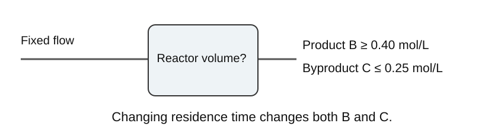
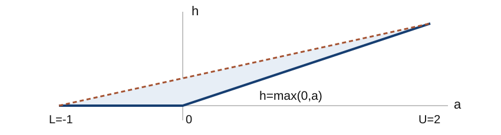
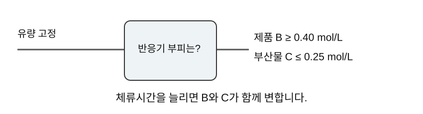

## The smallest reactor that meets product specifications

Product B must reach 0.40 mol/L while byproduct C stays below 0.25 mol/L. At fixed flow, how small can the reactor be?

<figure></figure>

<!-- lecture-page -->

## Product specifications and reactor volume minimization

Given a residence time, the network predicts outlet concentrations. Design asks for a residence time that satisfies those concentration requirements.

Longer residence converts A to B, but also converts B to C. Maximizing B and minimizing volume are different objectives.

This week: decision formulation and frozen ReLU computation using linear constraints and binary variables.

### Learning objectives for optimization formulation

1. Decisions, fixed context, predicted outputs, objective, and constraints
2. Big-M equivalence for one ReLU: proof by branch
3. Valid pre-activation bounds from the input domain
4. Hand-built MILP versus forward pass at identical inputs

Submission: formulation, verification results, and solution interpretation.

<!-- lecture-page -->

## Decision variables and fixed context

| Role | Value or range in the lab |
| --- | --- |
| Decision | Residence time τ ∈ [2, 10] min |
| Fixed context | T = 330 K, C_Af = 1.2 mol/L |
| Fixed flow | Q = 1 L/min |
| Predicted output | A, B, C concentrations y [mol/L] |
| Objective | Minimize volume V = Qτ [L] |

Here τ is a design variable selecting volume at fixed flow. Choosing temperature as well requires a model with temperature as an input and bounds over that domain.

Choosing residence time fixes the required volume through V=Qτ at fixed flow. Changing residence time in an existing vessel instead requires changing flow or another condition, which changes the variables and costs of the design problem.

<!-- lecture-page -->

## An optimization problem in symbols

<math display="block"><mtable columnalign="left"><mtr><mtd><mrow><msub><mrow><mi>min</mi></mrow><mrow><mi>u</mi><mo>,</mo><mi>y</mi></mrow></msub><mtext>  </mtext><mi>J</mi><mrow><mo>(</mo><mi>u</mi><mo>,</mo><mi>y</mi><mo>;</mo><mi>d</mi><mo>)</mo></mrow></mrow></mtd></mtr><mtr><mtd><mrow><mi>y</mi><mo>=</mo><msub><mrow><mi>f</mi></mrow><mrow><mi>θ</mi></mrow></msub><mrow><mo>(</mo><mi>u</mi><mo>;</mo><mi>d</mi><mo>)</mo></mrow><mo>,</mo><mtext>  </mtext><mi>g</mi><mrow><mo>(</mo><mi>u</mi><mo>,</mo><mi>y</mi><mo>;</mo><mi>d</mi><mo>)</mo></mrow><mo>≤</mo><mn>0</mn></mrow></mtd></mtr></mtable></math>

Notation: decisions u, fixed context d, model outputs y. Fitted weights θ: fixed.

Feasible point: satisfies network equations and process constraints. Optimum: feasible point with the smallest objective.

Prediction supplies u and computes y. Optimization treats both as unknowns and links them with y=fθ(u). Encoding that relation prevents the solver from changing y independently just to satisfy specifications.

<!-- lecture-page -->

## CSTR design optimization problem

<math display="block"><mtable columnalign="left"><mtr><mtd><mrow><msub><mrow><mi>min</mi></mrow><mrow><mi>τ</mi><mo>,</mo><mi>y</mi></mrow></msub><mtext>  </mtext><mi>V</mi><mo>=</mo><mi>Q</mi><mi>τ</mi></mrow></mtd></mtr><mtr><mtd><mrow><mn>2</mn><mo>≤</mo><mi>τ</mi><mo>≤</mo><mn>10</mn><mo>,</mo><mtext>  </mtext><mi>y</mi><mo>=</mo><msub><mrow><mi>f</mi></mrow><mrow><mi>θ</mi></mrow></msub><mrow><mo>(</mo><mi>τ</mi><mo>)</mo></mrow></mrow></mtd></mtr><mtr><mtd><mrow><msub><mrow><mi>y</mi></mrow><mrow><mi>B</mi></mrow></msub><mo>≥</mo><mn>.40</mn><mo>,</mo><mtext>  </mtext><msub><mrow><mi>y</mi></mrow><mrow><mi>C</mi></mrow></msub><mo>≤</mo><mn>.25</mn><mo>,</mo><mtext>  </mtext><mi>y</mi><mo>≥</mo><mn>0</mn></mrow></mtd></mtr></mtable></math>

With Q = 1 L/min, minimizing τ also minimizes V. Outputs are in mol/L and must be converted to those units before checking specifications.

B ≥ 0.40 is a concentration specification. Purity or production-rate requirements need constraints written from their own definitions.

τ=2 gives a small volume but may lack sufficient B. Increasing τ until B reaches its lower bound identifies a boundary below which volume is smaller but B fails. The C upper limit must also hold at that boundary before it is a minimum feasible design.

<!-- lecture-page -->

## Reference concentrations for the lab

Assume perfect mixing, constant volume, equal inlet and outlet flow, and consecutive 1:1 reactions A → B → C. At 330 K, k₁ = 0.2 min⁻¹ and k₂ = 0.1 min⁻¹.

<math display="block"><mtable columnalign="left"><mtr><mtd><mrow><msub><mrow><mi>C</mi></mrow><mrow><mi>A</mi></mrow></msub><mo>=</mo><mfrac><mrow><mn>1.2</mn></mrow><mrow><mn>1</mn><mo>+</mo><mn>.2</mn><mi>τ</mi></mrow></mfrac></mrow></mtd></mtr><mtr><mtd><mrow><msub><mrow><mi>C</mi></mrow><mrow><mi>B</mi></mrow></msub><mo>=</mo><mfrac><mrow><mn>.2</mn><mi>τ</mi><msub><mrow><mi>C</mi></mrow><mrow><mi>A</mi></mrow></msub></mrow><mrow><mn>1</mn><mo>+</mo><mn>.1</mn><mi>τ</mi></mrow></mfrac><mo>,</mo><mtext>  </mtext><msub><mrow><mi>C</mi></mrow><mrow><mi>C</mi></mrow></msub><mo>=</mo><mn>.1</mn><mi>τ</mi><msub><mrow><mi>C</mi></mrow><mrow><mi>B</mi></mrow></msub></mrow></mtd></mtr></mtable></math>

We evaluate these equations at five residence times to construct a small ReLU model.

<!-- lecture-page -->

## The frozen computational graph

<math display="block"><mtable columnalign="left"><mtr><mtd><mrow><msup><mrow><mi>h</mi></mrow><mrow><mn>0</mn></mrow></msup><mo>=</mo><mi>x</mi></mrow></mtd></mtr><mtr><mtd><mrow><msup><mrow><mi>a</mi></mrow><mrow><mi>ℓ</mi></mrow></msup><mo>=</mo><msup><mrow><mi>W</mi></mrow><mrow><mi>ℓ</mi></mrow></msup><msup><mrow><mi>h</mi></mrow><mrow><mi>ℓ</mi><mo>−</mo><mn>1</mn></mrow></msup><mo>+</mo><msup><mrow><mi>b</mi></mrow><mrow><mi>ℓ</mi></mrow></msup></mrow></mtd></mtr><mtr><mtd><mrow><msup><mrow><mi>h</mi></mrow><mrow><mi>ℓ</mi></mrow></msup><mo>=</mo><mi>max</mi><mrow><mo>(</mo><mn>0</mn><mo>,</mo><msup><mrow><mi>a</mi></mrow><mrow><mi>ℓ</mi></mrow></msup><mo>)</mo></mrow></mrow></mtd></mtr><mtr><mtd><mrow><mi>y</mi><mo>=</mo><msub><mrow><mi>W</mi></mrow><mrow><mi>out</mi></mrow></msub><msup><mrow><mi>h</mi></mrow><mrow><mi>K</mi></mrow></msup><mo>+</mo><msub><mrow><mi>b</mi></mrow><mrow><mi>out</mi></mrow></msub></mrow></mtd></mtr></mtable></math>

ReLU: componentwise in each hidden layer. Optimization variables: inputs, intermediate values, and outputs. Numeric constants: W and b.

Making weights variable introduces products of W and h, so the MILP derived here would no longer apply.

Intermediate network values become optimization variables, but they are not free choices. Each affine equality and ReLU constraint ties one layer to the preceding layer. This converts the forward calculation into relations that must hold simultaneously.

<!-- lecture-page -->

## Equality representation of input scaling

<math display="block"><mtable columnalign="left"><mtr><mtd><mrow><mi>x</mi><mo>=</mo><mfrac><mrow><mi>τ</mi><mo>−</mo><mn>2</mn></mrow><mrow><mn>8</mn></mrow></mfrac><mo>,</mo><mtext>  </mtext><mn>0</mn><mo>≤</mo><mi>x</mi><mo>≤</mo><mn>1</mn></mrow></mtd></mtr><mtr><mtd><mrow><mi>τ</mi><mo>=</mo><mn>2</mn><mo>+</mo><mn>8</mn><mi>x</mi></mrow></mtd></mtr></mtable></math>

The lab maps τ to dimensionless input x. Optimization uses exactly the offset and scale used to construct the predictor.

If outputs were standardized as well, include y = μ + Ds. This inverse transformation is linear when μ and D are fixed.

For example, τ=6 gives x=(6−2)/8=0.5. Feeding 6 directly to the network leaves its 0–1 input domain. Check the coordinates entering each equation rather than relying only on variable names.

<!-- lecture-page -->

## Piecewise-linear structure of ReLU

<math display="block"><mtable columnalign="left"><mtr><mtd><mrow><mi>h</mi><mo>=</mo><mi>max</mi><mrow><mo>(</mo><mn>0</mn><mo>,</mo><mi>a</mi><mo>)</mo></mrow></mrow></mtd></mtr></mtable></math>

<figure></figure>
The blue line is the exact graph. The shaded region includes points admitted when the binary variable is relaxed.

For a<0, h=0 is horizontal; for a>0, h=a is a line of slope one. Binary z selects the branch. Relaxing z to a continuous value also admits points between the branches, allowing outputs above the actual ReLU.

<!-- lecture-page -->

## The ReLU graph and its lower inequalities

<math display="block"><mtable columnalign="left"><mtr><mtd><mrow><mi>h</mi><mo>≥</mo><mn>0</mn><mo>,</mo><mtext>  </mtext><mi>h</mi><mo>≥</mo><mi>a</mi></mrow></mtd></mtr></mtable></math>

At a = −0.2, h = 0.4 satisfies both inequalities, although ReLU returns 0.

The objective or a later layer may favor larger h. For an arbitrary network, these lower inequalities alone are insufficient; exact graph modeling also needs branch-specific upper inequalities.

<!-- lecture-page -->

## Big-M formulation of one ReLU

Assume valid finite bounds L ≤ a ≤ U with L < 0 < U.

<math display="block"><mtable columnalign="left"><mtr><mtd><mrow><mi>h</mi><mo>≥</mo><mn>0</mn><mo>,</mo><mtext>  </mtext><mi>h</mi><mo>≥</mo><mi>a</mi></mrow></mtd></mtr><mtr><mtd><mrow><mi>h</mi><mo>≤</mo><mi>a</mi><mo>−</mo><mi>L</mi><mrow><mo>(</mo><mn>1</mn><mo>−</mo><mi>z</mi><mo>)</mo></mrow></mrow></mtd></mtr><mtr><mtd><mrow><mi>h</mi><mo>≤</mo><mi>U</mi><mi>z</mi><mo>,</mo><mtext>  </mtext><mi>z</mi><mo>∈</mo><mo>{</mo><mn>0</mn><mo>,</mo><mn>1</mn><mo>}</mo></mrow></mtd></mtr></mtable></math>

Branches: inactive at z = 0; active at z = 1. L and U: bounds on this neuron’s pre-activation.

h≤Uz pins h to zero when z=0. h≤a−L(1−z) pins h to a when z=1. Valid L and U make the unused upper inequality permissive enough to retain every correct point on the selected branch.

<!-- lecture-page -->

## Equivalence of the inactive branch (z = 0)

<math display="block"><mtable columnalign="left"><mtr><mtd><mrow><mi>h</mi><mo>≤</mo><mi>U</mi><mn>0</mn><mo>=</mo><mn>0</mn><mo>,</mo><mtext>  </mtext><mi>h</mi><mo>≥</mo><mn>0</mn></mrow></mtd></mtr><mtr><mtd><mrow><mi>h</mi><mo>=</mo><mn>0</mn><mo>,</mo><mtext>  </mtext><mi>a</mi><mo>≤</mo><mi>h</mi><mo>=</mo><mn>0</mn></mrow></mtd></mtr></mtable></math>

The remaining upper inequality, 0 ≤ a − L, holds because a ≥ L. This branch therefore represents exactly L ≤ a ≤ 0 and h = 0.

<!-- lecture-page -->

## Equivalence of the active branch (z = 1)

<math display="block"><mtable columnalign="left"><mtr><mtd><mrow><mi>h</mi><mo>≤</mo><mi>a</mi><mo>−</mo><mi>L</mi><mn>0</mn><mo>=</mo><mi>a</mi><mo>,</mo><mtext>  </mtext><mi>h</mi><mo>≥</mo><mi>a</mi></mrow></mtd></mtr><mtr><mtd><mrow><mi>h</mi><mo>=</mo><mi>a</mi><mo>≥</mo><mn>0</mn></mrow></mtd></mtr></mtable></math>

The remaining upper inequality h ≤ U is equivalent to a ≤ U. Thus 0 ≤ a ≤ U and h = a.

At a = 0, z can be either 0 or 1, and the output h is fixed at 0.

<!-- lecture-page -->

## Substituting numbers into one ReLU formulation

For a=2x−1 and x∈[0,1], L=−1,U=1. The inequalities are h≥0, h≥a, h≤a+1−z, and h≤z.

| Input and branch | Lower bound | Upper bound | Output |
| --- | --- | --- | --- |
| x=0.2, a=−0.6, z=0 | h≥0 | h≤0; h≤0.4 | h=0 |
| x=0.8, a=0.6, z=1 | h≥0.6 | h≤0.6; h≤1 | h=0.6 |
| Wrong z=0 at x=0.8 | h≥0.6 | h≤0 | Impossible |

```python
a = 2 * x - 1
h = max(0., a)
z = int(a >= 0.)
assert h >= 0 and h >= a
assert h <= a + 1 - z and h <= z
```

The binary selects a branch compatible with a; it does not create an arbitrary output. At a=0, either z is possible but both give h=0.

<!-- lecture-page -->

## Linear representations of stable active and inactive neurons

| Valid range | Replacement | Binary variable |
| --- | --- | --- |
| U ≤ 0 | h = 0 | None |
| L ≥ 0 | h = a | None |
| L < 0 < U | Four Big-M inequalities | One |

Allowing inputs outside the bounded domain invalidates this simplification. Recheck bounds and classifications when changing the domain.

An interval [−2,−0.1] never activates, so replace the neuron by h=0. On [0.2,1.3], h=a everywhere. Only a possible sign change needs branch selection; bounds therefore determine which neurons require binaries.

<!-- lecture-page -->

## Interval bounds accounting for weight signs

<math display="block"><mtable columnalign="left"><mtr><mtd><mrow><mi>a</mi><mo>=</mo><msub><mrow><mo>∑</mo></mrow><mrow><mi>i</mi></mrow></msub><msub><mrow><mi>w</mi></mrow><mrow><mi>i</mi></mrow></msub><msub><mrow><mi>h</mi></mrow><mrow><mi>i</mi></mrow></msub><mo>+</mo><mi>b</mi></mrow></mtd></mtr><mtr><mtd><mrow><mi>L</mi><mo>=</mo><mi>b</mi><mo>+</mo><msub><mrow><mo>∑</mo></mrow><mrow><mi>i</mi></mrow></msub><mi>min</mi><mrow><mo>(</mo><msub><mrow><mi>w</mi></mrow><mrow><mi>i</mi></mrow></msub><msub><mrow><mi>l</mi></mrow><mrow><mi>i</mi></mrow></msub><mo>,</mo><msub><mrow><mi>w</mi></mrow><mrow><mi>i</mi></mrow></msub><msub><mrow><mi>u</mi></mrow><mrow><mi>i</mi></mrow></msub><mo>)</mo></mrow></mrow></mtd></mtr><mtr><mtd><mrow><mi>U</mi><mo>=</mo><mi>b</mi><mo>+</mo><msub><mrow><mo>∑</mo></mrow><mrow><mi>i</mi></mrow></msub><mi>max</mi><mrow><mo>(</mo><msub><mrow><mi>w</mi></mrow><mrow><mi>i</mi></mrow></msub><msub><mrow><mi>l</mi></mrow><mrow><mi>i</mi></mrow></msub><mo>,</mo><msub><mrow><mi>w</mi></mrow><mrow><mi>i</mi></mrow></msub><msub><mrow><mi>u</mi></mrow><mrow><mi>i</mi></mrow></msub><mo>)</mo></mrow></mrow></mtd></mtr></mtable></math>

Assume lᵢ ≤ hᵢ ≤ uᵢ for every input. Negative weights reverse which input endpoint gives the minimum or maximum.

Interval arithmetic gives valid bounds, but ignoring correlations between inputs can make them wider than the attainable range.

<!-- lecture-page -->

## A bound calculation by hand

<math display="block"><mtable columnalign="left"><mtr><mtd><mrow><mi>a</mi><mo>=</mo><mn>2</mn><msub><mrow><mi>x</mi></mrow><mrow><mn>1</mn></mrow></msub><mo>−</mo><mn>3</mn><msub><mrow><mi>x</mi></mrow><mrow><mn>2</mn></mrow></msub><mo>+</mo><mn>.5</mn></mrow></mtd></mtr><mtr><mtd><mrow><mn>0</mn><mo>≤</mo><msub><mrow><mi>x</mi></mrow><mrow><mn>1</mn></mrow></msub><mo>≤</mo><mn>1</mn><mo>,</mo><mtext>  </mtext><mo>−</mo><mn>1</mn><mo>≤</mo><msub><mrow><mi>x</mi></mrow><mrow><mn>2</mn></mrow></msub><mo>≤</mo><mn>2</mn></mrow></mtd></mtr><mtr><mtd><mrow><mi>L</mi><mo>=</mo><mo>−</mo><mn>5.5</mn><mo>,</mo><mtext>  </mtext><mi>U</mi><mo>=</mo><mn>5.5</mn></mrow></mtd></mtr></mtable></math>

The minimum occurs at (x₁, x₂) = (0, 2), and the maximum at (1, −1). Do this calculation before choosing an arbitrary large constant.

For the lower bound, use x₁=0 with positive coefficient 2 and x₂=2 with negative coefficient −3: 0−6+0.5=−5.5. Reverse those endpoints for the upper bound: 2−3×(−1)+0.5=5.5. A negative coefficient reverses the direction of an extreme.

<!-- lecture-page -->

## Bound validity and formulation correctness

Using U = 0.5 at a point whose true pre-activation is a = 0.7 excludes h = 0.7: even z = 1 imposes h ≤ 0.5.

Wider valid bounds preserve the graph at integer solutions, but can weaken the continuous relaxation.

Observed extrema in the training samples do not automatically bound the entire input domain.

<!-- lecture-page -->

## Frozen coefficients of the ReLU interpolant

Linearly interpolate reference concentrations at τ = 2, 4, 6, 8, 10 min. Fix the hidden hinges at those breakpoints and compute output weights from interpolation slopes.

<math display="block"><mtable columnalign="left"><mtr><mtd><mrow><msub><mrow><mi>a</mi></mrow><mrow><mi>j</mi></mrow></msub><mo>=</mo><mi>x</mi><mo>−</mo><msub><mrow><mi>t</mi></mrow><mrow><mi>j</mi></mrow></msub><mo>,</mo><mtext>  </mtext><msub><mrow><mi>h</mi></mrow><mrow><mi>j</mi></mrow></msub><mo>=</mo><mi>max</mi><mrow><mo>(</mo><mn>0</mn><mo>,</mo><msub><mrow><mi>a</mi></mrow><mrow><mi>j</mi></mrow></msub><mo>)</mo></mrow></mrow></mtd></mtr><mtr><mtd><mrow><mi>t</mi><mo>=</mo><mrow><mo>[</mo><mtable><mtr><mtd><mrow><mn>0</mn></mrow></mtd><mtd><mrow><mn>.25</mn></mrow></mtd><mtd><mrow><mn>.50</mn></mrow></mtd><mtd><mrow><mn>.75</mn></mrow></mtd></mtr></mtable><mo>]</mo></mrow></mrow></mtd></mtr><mtr><mtd><mrow><msub><mrow><mi>y</mi></mrow><mrow><mi>k</mi></mrow></msub><mo>=</mo><msub><mrow><mi>b</mi></mrow><mrow><mi>k</mi></mrow></msub><mo>+</mo><munderover><mo>∑</mo><mrow><mi>j</mi><mo>=</mo><mn>0</mn></mrow><mn>3</mn></munderover><msub><mrow><mi>W</mi></mrow><mrow><mi>jk</mi></mrow></msub><msub><mrow><mi>h</mi></mrow><mrow><mi>j</mi></mrow></msub></mrow></mtd></mtr></mtable></math>

j = 0, 1, 2, 3 and output k is A, B, or C. This lab constructs the model by interpolation rather than gradient training.

Apply the first segment slope from the start. At each later knot, an activating ReLU adds the difference between the new and old slopes. The active slope changes therefore sum to the slope of the current segment.

<!-- lecture-page -->

## From interpolation slopes to ReLU weights

The first three B knot values at τ=2,4,6 are 0.285714286,0.380952381,0.409090909. Since x=(τ−2)/8, adjacent knots are 2/8=0.25 apart in x.

| Calculation | Result |
| --- | --- |
| First slope in x | (0.380952381−0.285714286)/0.25=0.380952381 |
| Second slope in x | (0.409090909−0.380952381)/0.25=0.112554113 |
| First ReLU weight W₀B | first slope: 0.380952381 |
| Weight W₁B at knot 0.25 | new minus previous slope: −0.268398268 |

For 0.25<x<0.5, only the first two ReLUs have derivative 1, so the total slope is 0.380952381 − 0.268398268 = 0.112554113. The new hinge is zero at its knot, preserving continuity.

Slopes computed with respect to τ must be multiplied by 8 to obtain weights for x: the same concentration change occurs over an x interval eight times shorter. Construct the A and C columns in the same way.

<!-- lecture-page -->

## Neuron bounds in the lab model

| Neuron | aⱼ | Lⱼ | Uⱼ | Treatment |
| --- | --- | --- | --- | --- |
| 0 | x | 0 | 1 | h₀ = x |
| 1 | x − 0.25 | −0.25 | 0.75 | Binary |
| 2 | x − 0.50 | −0.50 | 0.50 | Binary |
| 3 | x − 0.75 | −0.75 | 0.25 | Binary |

There are three binary variables. Substituting the affine pre-activations leaves eight continuous variables: one x, four h values, and three outputs.

<!-- lecture-page -->

## Hidden values and B concentration at τ=5 min

Subtract thresholds [0,0.25,0.50,0.75] from x=(5−2)/8=0.375.

| j | aⱼ=x−tⱼ | hⱼ | Contribution WⱼB·hⱼ |
| --- | --- | --- | --- |
| 0 | 0.375 | 0.375 | 0.380952381×0.375=0.142857143 |
| 1 | 0.125 | 0.125 | −0.268398268×0.125=−0.033549784 |
| 2 | −0.125 | 0 | 0 |
| 3 | −0.375 | 0 | 0 |

Adding bias 0.285714286 gives B≈0.395021645 mol/L. Taking the midpoint of the 4-min and 6-min values also gives (0.380952381+0.409090909)/2=0.395021645.

The ReLU sum and segment interpolation express the same calculation. They differ from reference-process B=0.4 at 5 min, so this prediction falls slightly below the B≥0.40 specification.

<!-- lecture-page -->

## Matrix representation of Big-M constraints

For neuron 1, a₁ = x − 0.25, L₁ = −0.25, and U₁ = 0.75.

<math display="block"><mtable columnalign="left"><mtr><mtd><mrow><msub><mrow><mi>h</mi></mrow><mrow><mn>1</mn></mrow></msub><mo>−</mo><mi>x</mi><mo>≥</mo><mo>−</mo><mn>.25</mn></mrow></mtd></mtr><mtr><mtd><mrow><msub><mrow><mi>h</mi></mrow><mrow><mn>1</mn></mrow></msub><mo>−</mo><mi>x</mi><mo>+</mo><mn>.25</mn><msub><mrow><mi>z</mi></mrow><mrow><mn>1</mn></mrow></msub><mo>≤</mo><mn>0</mn></mrow></mtd></mtr><mtr><mtd><mrow><msub><mrow><mi>h</mi></mrow><mrow><mn>1</mn></mrow></msub><mo>−</mo><mn>.75</mn><msub><mrow><mi>z</mi></mrow><mrow><mn>1</mn></mrow></msub><mo>≤</mo><mn>0</mn></mrow></mtd></mtr></mtable></math>

Set h₁ ≥ 0 and 0 ≤ z₁ ≤ 1 as variable bounds, and declare z₁ integer. The lab assembles the full matrix in the same way.

The second row collects h₁≤x−0.25+0.25(1−z₁)=x−0.25z₁ on the left. At x=0.5,z₁=1 it gives h₁≤0.25; the first row gives h₁≥0.25, fixing h₁=0.25.

<!-- lecture-page -->

## Storing one constraint as a solver row

Use variable order [x,h₀,h₁,h₂,h₃,y_A,y_B,y_C,z₁,z₂,z₃]. Only three columns are nonzero for h₁−x+0.25z₁≤0.

```python
import numpy as np
row = [-1, 0, 1, 0, 0, 0, 0, 0, 0.25, 0, 0]
row_lower = -np.inf
row_upper = 0.0
```

| Substitution | Row dot product | Check |
| --- | --- | --- |
| x=0.5,h₁=0.25,z₁=1 | −0.5+0.25+0.25=0 | satisfies upper bound 0 |
| x=0.5,h₁=0.30,z₁=1 | −0.5+0.30+0.25=0.05 | violates upper bound |

For output equality y_B−∑WⱼB hⱼ=b_B, set both row bounds to b_B. Mark the z₁ column as integer and also give it bounds [0,1]. A coefficient row alone does not make a variable binary.

[SciPy LinearConstraint](https://docs.scipy.org/doc/scipy/reference/generated/scipy.optimize.LinearConstraint.html) interprets each row as `lb <= A @ v <= ub`. Check variable order and coefficient signs against the same equation.

<!-- lecture-page -->

## Conditions for MILP representability

A graph of fixed affine layers, ReLUs, and affine scaling can be expressed by an MILP. The objective and all remaining constraints must also be linear for the entire problem to be an MILP.

Products Qy with both flow and concentration variable, nonlinear kinetics, or sigmoid/tanh operations fall outside this formulation.

The Week 4 projection can also be appended as affine equalities when its coefficient matrices are fixed and its input dependence is affine.

<!-- lecture-page -->

## MILP and forward-pass consistency at fixed inputs

Fix one residence time, remove product specifications, and solve the network equations. Compare every h and y with the forward pass.

41 checked inputs: domain endpoints, all breakpoints, both sides of interior breakpoints, and random inputs. Maximum difference: 1.25e-08.

This tests the formulation implementation. Process prediction error requires comparison with separate reference values.

Once the input is fixed, the original network output is determined. A different solver output points to weight ordering, scaling, signs, or bounds. Product specifications are separate from evaluating the network at that point, so remove them during this check.

<!-- lecture-page -->

## CSTR design optimization results

| Quantity | This run |
| --- | --- |
| Minimum τ [min] | 5.353846 |
| Minimum V [L] | 5.353846 |
| Predicted [A, B, C] [mol/L] | [0.584615, 0.400000, 0.215385] |
| Binary [z₁, z₂, z₃] | [1, 0, 0] |
| Termination | optimal, status = 0 |

The B lower bound is active, while the C upper bound has slack. Independent segmentwise linear calculations give the same residence time.

B slack is 0.400000−0.40=0; C slack is 0.25−0.215385=0.034615 mol/L. A small decrease in τ makes B insufficient first. This active constraint prevents a further volume reduction.

<!-- lecture-page -->

## Interpolation fraction at the product lower bound

Across 4–6 min, B increases from 0.380952381 to 0.409090909. Divide the required increase by the full segment increase.

| Calculation | Value |
| --- | --- |
| Required B increase | 0.40−0.380952381=0.019047619 |
| Full segment increase | 0.409090909−0.380952381=0.028138528 |
| Segment fraction α | 0.019047619/0.028138528≈0.676923077 |
| Residence time | 4+2α≈5.353846154 min |
| C at the same α | 0.152380952+α(0.245454545−0.152380952)≈0.215384615 |

B is below 0.40 on all earlier segments. At this first crossing, C≤0.25 and nonnegativity also hold, giving the minimum volume. Comparing interpolated B with C at a different τ would not check specifications for the same design.

<!-- lecture-page -->

## Formulation equivalence and process prediction error

The MILP exactly represents the frozen interpolant. This property does not remove its process approximation error.

At the selected τ = 5.353846 min, the reference concentrations are [0.579495, 0.404137, 0.216369] mol/L, which differ from the predictor.

The solution is optimal for the specified surrogate problem. A process design decision also requires checking reference-process specifications and comparing objective values.

<!-- lecture-page -->

## LP relaxation and objective lower bounds

Relaxing z to [0, 1] gives a lower bound on the MILP optimum for minimization. Intermediate values and outputs may nevertheless leave the network graph.

With L = −1, U = 2, a = 0, the relaxed point z = 1/3, h = 2/3 is feasible, although the ReLU output is 0.

The LP and MILP objective values coincide in this CSTR example. Equality of objectives in one instance does not establish general graph equivalence.

Enlarging a minimization feasible set retains the original optimum, so the new optimal value cannot be larger. This makes the LP value a lower bound. Its outputs may leave the network graph, so an LP solution is not automatically an acceptable design.

<!-- lecture-page -->

## Run the lab and prepare the submission

```bash
python -m pip install -r requirements.txt
python week05_lab.py --output-dir my-results
```

1. Hand checks: one neuron’s bounds and matrix signs
2. Checks in `results.json`: forward error and termination status
3. Translate one row of `milp_matrix.csv` back into an equation.
4. Change the B lower bound from 0.40 to 0.41 and explain whether feasibility remains.

[reading companion](/courses/surrogate-models/week-05-reading/) · [lab bundle](/assets/courses/surrogate-models/week-05/week05-lab.zip)

<!-- lecture-page -->

## Sources and assigned reading

[Boyd & Vandenberghe, Convex Optimization](https://stanford.edu/~boyd/cvxbook/), §4.1: variables, objectives, and feasible sets.

[Anderson et al., Strong mixed-integer programming formulations for trained neural networks](https://arxiv.org/abs/1811.08359), §2.1: the ReLU Big-M formulation.

[SciPy milp documentation](https://docs.scipy.org/doc/scipy/reference/generated/scipy.optimize.milp.html): bounds, integrality, LinearConstraint, and return status.

<!-- ko -->

## 제품 규격을 맞추는 최소 반응기

제품 B는 0.40 mol/L 이상, 부산물 C는 0.25 mol/L 이하가 필요합니다. 유량이 일정할 때 반응기 부피를 얼마나 줄일 수 있을까요?

<figure></figure>

<!-- lecture-page -->

## 제품 규격과 반응기 부피 최소화

체류시간을 주면 신경망이 출구 농도를 계산합니다. 설계에서는 반대로, 농도 조건을 만족하는 체류시간을 찾아야 합니다.

체류시간을 늘리면 A가 B로 전환되지만 B도 C로 반응합니다. B만 크게 만드는 선택과 부피를 줄이는 선택은 같지 않습니다.

이번 주에는 이 선택을 최적화 문제로 적고, 고정된 ReLU 모델의 계산을 선형식과 이진변수로 표현해봅니다.

### 최적화 정식화의 학습 목표

1. 조작변수·고정 조건·예측 출력을 구분하고 목적함수와 제약을 적습니다.
2. ReLU 한 개의 Big-M 식을 두 분기로 증명합니다.
3. 입력 범위에서 유효한 pre-activation bounds를 계산
4. 직접 작성한 MILP와 forward 계산을 같은 입력에서 대조합니다.

실습 제출물: 정식화, 검증 결과와 해의 해석

<!-- lecture-page -->

## 결정변수와 고정 조건

| 역할 | 실습의 값 또는 범위 |
| --- | --- |
| 결정변수 | 체류시간 τ ∈ [2, 10] min |
| 고정 조건 | T = 330 K, C_Af = 1.2 mol/L |
| 고정 유량 | Q = 1 L/min |
| 예측 출력 | A·B·C 농도 y [mol/L] |
| 목적 | 부피 V = Qτ [L] 최소화 |

여기서 τ는 고정 유량에서 부피를 선택하는 설계변수. 온도까지 선택하려면 온도를 입력으로 받는 모델과 그 영역의 bounds가 필요합니다.

체류시간을 선택하면 고정 유량 Q에서 필요한 부피 V=Qτ도 정해집니다. 이미 부피가 정해진 장치에서 체류시간을 바꾸려면 유량 등을 바꾸어야 하므로 이 설계 문제와 변수·비용이 달라집니다.

<!-- lecture-page -->

## 최적화 문제의 기본 구성

<math display="block"><mtable columnalign="left"><mtr><mtd><mrow><msub><mrow><mi>min</mi></mrow><mrow><mi>u</mi><mo>,</mo><mi>y</mi></mrow></msub><mtext>  </mtext><mi>J</mi><mrow><mo>(</mo><mi>u</mi><mo>,</mo><mi>y</mi><mo>;</mo><mi>d</mi><mo>)</mo></mrow></mrow></mtd></mtr><mtr><mtd><mrow><mi>y</mi><mo>=</mo><msub><mrow><mi>f</mi></mrow><mrow><mi>θ</mi></mrow></msub><mrow><mo>(</mo><mi>u</mi><mo>;</mo><mi>d</mi><mo>)</mo></mrow><mo>,</mo><mtext>  </mtext><mi>g</mi><mrow><mo>(</mo><mi>u</mi><mo>,</mo><mi>y</mi><mo>;</mo><mi>d</mi><mo>)</mo></mrow><mo>≤</mo><mn>0</mn></mrow></mtd></mtr></mtable></math>

u는 설계·운전 변수, d는 고정 조건, y는 모델 출력입니다. 학습을 마친 가중치 θ도 고정합니다.

가능해: 신경망 등식과 공정 제약을 모두 만족하는 점. 최적해: 가능해 중 목적함수가 가장 작은 점

예측에서는 u를 주고 y를 계산했습니다. 최적화에서는 u와 y를 함께 미지수로 놓고, y=fθ(u)가 두 값을 묶습니다. solver가 y를 마음대로 낮추거나 높여 규격을 맞추지 못하도록 예측 관계 자체를 제약으로 넣습니다.

<!-- lecture-page -->

## CSTR 설계 최적화 문제

<math display="block"><mtable columnalign="left"><mtr><mtd><mrow><msub><mrow><mi>min</mi></mrow><mrow><mi>τ</mi><mo>,</mo><mi>y</mi></mrow></msub><mtext>  </mtext><mi>V</mi><mo>=</mo><mi>Q</mi><mi>τ</mi></mrow></mtd></mtr><mtr><mtd><mrow><mn>2</mn><mo>≤</mo><mi>τ</mi><mo>≤</mo><mn>10</mn><mo>,</mo><mtext>  </mtext><mi>y</mi><mo>=</mo><msub><mrow><mi>f</mi></mrow><mrow><mi>θ</mi></mrow></msub><mrow><mo>(</mo><mi>τ</mi><mo>)</mo></mrow></mrow></mtd></mtr><mtr><mtd><mrow><msub><mrow><mi>y</mi></mrow><mrow><mi>B</mi></mrow></msub><mo>≥</mo><mn>.40</mn><mo>,</mo><mtext>  </mtext><msub><mrow><mi>y</mi></mrow><mrow><mi>C</mi></mrow></msub><mo>≤</mo><mn>.25</mn><mo>,</mo><mtext>  </mtext><mi>y</mi><mo>≥</mo><mn>0</mn></mrow></mtd></mtr></mtable></math>

Q = 1 L/min이므로 τ를 줄이면 V도 줄어듭니다. y의 농도 단위는 mol/L이며, 모델의 출력은 이 단위로 복원한 뒤 규격과 비교합니다.

농도 규격: B ≥ 0.40. 순도나 생산량을 요구한다면 해당 정의로 제약을 다시 적어야 합니다.

τ=2는 부피가 작아 목적값은 좋지만 B가 부족할 수 있습니다. τ를 늘려 B 하한에 도달하면 더 작은 부피는 그 제약을 위반합니다. 다만 C 상한도 같은 지점에서 만족하는지 확인해야 최소 가능 설계가 됩니다.

<!-- lecture-page -->

## 실습의 기준 농도

완전 혼합·일정 부피·동일한 유입 및 유출 유량을 가정하고, 1:1 연속반응 A → B → C를 사용합니다. 330 K에서 k₁ = 0.2 min⁻¹, k₂ = 0.1 min⁻¹입니다.

<math display="block"><mtable columnalign="left"><mtr><mtd><mrow><msub><mrow><mi>C</mi></mrow><mrow><mi>A</mi></mrow></msub><mo>=</mo><mfrac><mrow><mn>1.2</mn></mrow><mrow><mn>1</mn><mo>+</mo><mn>.2</mn><mi>τ</mi></mrow></mfrac></mrow></mtd></mtr><mtr><mtd><mrow><msub><mrow><mi>C</mi></mrow><mrow><mi>B</mi></mrow></msub><mo>=</mo><mfrac><mrow><mn>.2</mn><mi>τ</mi><msub><mrow><mi>C</mi></mrow><mrow><mi>A</mi></mrow></msub></mrow><mrow><mn>1</mn><mo>+</mo><mn>.1</mn><mi>τ</mi></mrow></mfrac><mo>,</mo><mtext>  </mtext><msub><mrow><mi>C</mi></mrow><mrow><mi>C</mi></mrow></msub><mo>=</mo><mn>.1</mn><mi>τ</mi><msub><mrow><mi>C</mi></mrow><mrow><mi>B</mi></mrow></msub></mrow></mtd></mtr></mtable></math>

다섯 체류시간에서 이 식을 계산해 작은 ReLU 모델을 구성합니다.

<!-- lecture-page -->

## 가중치를 고정한 계산 그래프

<math display="block"><mtable columnalign="left"><mtr><mtd><mrow><msup><mrow><mi>h</mi></mrow><mrow><mn>0</mn></mrow></msup><mo>=</mo><mi>x</mi></mrow></mtd></mtr><mtr><mtd><mrow><msup><mrow><mi>a</mi></mrow><mrow><mi>ℓ</mi></mrow></msup><mo>=</mo><msup><mrow><mi>W</mi></mrow><mrow><mi>ℓ</mi></mrow></msup><msup><mrow><mi>h</mi></mrow><mrow><mi>ℓ</mi><mo>−</mo><mn>1</mn></mrow></msup><mo>+</mo><msup><mrow><mi>b</mi></mrow><mrow><mi>ℓ</mi></mrow></msup></mrow></mtd></mtr><mtr><mtd><mrow><msup><mrow><mi>h</mi></mrow><mrow><mi>ℓ</mi></mrow></msup><mo>=</mo><mi>max</mi><mrow><mo>(</mo><mn>0</mn><mo>,</mo><msup><mrow><mi>a</mi></mrow><mrow><mi>ℓ</mi></mrow></msup><mo>)</mo></mrow></mrow></mtd></mtr><mtr><mtd><mrow><mi>y</mi><mo>=</mo><msub><mrow><mi>W</mi></mrow><mrow><mi>out</mi></mrow></msub><msup><mrow><mi>h</mi></mrow><mrow><mi>K</mi></mrow></msup><mo>+</mo><msub><mrow><mi>b</mi></mrow><mrow><mi>out</mi></mrow></msub></mrow></mtd></mtr></mtable></math>

ReLU: 각 은닉층에서 성분별 적용. 최적화 변수: 입력·중간값·출력. 수치 상수: W, b

가중치까지 변수로 두면 W와 h의 곱이 생기므로 여기서 유도하는 MILP가 성립하지 않습니다.

신경망 내부 숫자도 최적화 변수가 되지만 자유롭게 선택되지는 않습니다. 각 층의 가중합 등식과 ReLU 제약이 앞 층 값으로 뒷 층 값을 결정합니다. 원래 순전파를 동시에 만족해야 하는 연립 관계로 옮기는 것입니다.

<!-- lecture-page -->

## 입력 scaling의 등식 표현

<math display="block"><mtable columnalign="left"><mtr><mtd><mrow><mi>x</mi><mo>=</mo><mfrac><mrow><mi>τ</mi><mo>−</mo><mn>2</mn></mrow><mrow><mn>8</mn></mrow></mfrac><mo>,</mo><mtext>  </mtext><mn>0</mn><mo>≤</mo><mi>x</mi><mo>≤</mo><mn>1</mn></mrow></mtd></mtr><mtr><mtd><mrow><mi>τ</mi><mo>=</mo><mn>2</mn><mo>+</mo><mn>8</mn><mi>x</mi></mrow></mtd></mtr></mtable></math>

실습은 τ를 무차원 입력 x로 바꿉니다. 학습 때 사용한 offset과 scale을 최적화에서도 그대로 사용합니다.

출력까지 표준화했다면 y = μ + Ds를 추가합니다. μ와 D가 고정이면 이 복원식은 선형입니다.

예를 들어 τ=6이면 x=(6−2)/8=0.5입니다. 신경망에 τ=6을 그대로 넣으면 학습 때의 0~1 입력 범위를 벗어납니다. solver 변수의 이름보다 실제로 어떤 좌표가 각 식에 들어가는지 확인합니다.

<!-- lecture-page -->

## ReLU 함수의 구간별 선형 구조

<math display="block"><mtable columnalign="left"><mtr><mtd><mrow><mi>h</mi><mo>=</mo><mi>max</mi><mrow><mo>(</mo><mn>0</mn><mo>,</mo><mi>a</mi><mo>)</mo></mrow></mrow></mtd></mtr></mtable></math>

<figure></figure>
파란 선이 정확한 그래프입니다. 색칠한 영역은 이진변수를 연속으로 풀었을 때 허용되는 점을 포함합니다.

a<0 구간은 수평선 h=0, a>0 구간은 직선 h=a입니다. 두 선분 중 어느 쪽을 사용할지 이진변수 z가 선택합니다. z를 연속값으로 풀면 두 선분 사이의 점도 허용되어 출력이 실제 ReLU보다 커질 수 있습니다.

<!-- lecture-page -->

## ReLU 그래프와 하한 제약

<math display="block"><mtable columnalign="left"><mtr><mtd><mrow><mi>h</mi><mo>≥</mo><mn>0</mn><mo>,</mo><mtext>  </mtext><mi>h</mi><mo>≥</mo><mi>a</mi></mrow></mtd></mtr></mtable></math>

a = −0.2일 때 h = 0.4도 이 두 식을 만족하지만 ReLU 출력은 0입니다.

목적함수나 후속 layer가 큰 h를 선호할 수 있으므로, 임의의 신경망에서는 이 두 하한만 넣어서는 안 됩니다. 정확한 그래프에는 두 분기에 맞는 상한도 필요합니다.

<!-- lecture-page -->

## 한 개 ReLU의 Big-M 정식화

유효한 유한 bounds L ≤ a ≤ U를 알고 있고 L < 0 < U라고 놓습니다.

<math display="block"><mtable columnalign="left"><mtr><mtd><mrow><mi>h</mi><mo>≥</mo><mn>0</mn><mo>,</mo><mtext>  </mtext><mi>h</mi><mo>≥</mo><mi>a</mi></mrow></mtd></mtr><mtr><mtd><mrow><mi>h</mi><mo>≤</mo><mi>a</mi><mo>−</mo><mi>L</mi><mrow><mo>(</mo><mn>1</mn><mo>−</mo><mi>z</mi><mo>)</mo></mrow></mrow></mtd></mtr><mtr><mtd><mrow><mi>h</mi><mo>≤</mo><mi>U</mi><mi>z</mi><mo>,</mo><mtext>  </mtext><mi>z</mi><mo>∈</mo><mo>{</mo><mn>0</mn><mo>,</mo><mn>1</mn><mo>}</mo></mrow></mtd></mtr></mtable></math>

분기: z = 0은 비활성, z = 1은 활성. L·U: 해당 뉴런의 pre-activation 하한·상한

h≤Uz는 z=0일 때 h를 0에 고정합니다. h≤a−L(1−z)는 z=1일 때 h를 a에 고정합니다. 선택되지 않은 상한은 유효한 L,U 덕분에 해당 가지의 올바른 점을 잘라내지 않습니다.

<!-- lecture-page -->

## 비활성 분기(z = 0)의 동치성

<math display="block"><mtable columnalign="left"><mtr><mtd><mrow><mi>h</mi><mo>≤</mo><mi>U</mi><mn>0</mn><mo>=</mo><mn>0</mn><mo>,</mo><mtext>  </mtext><mi>h</mi><mo>≥</mo><mn>0</mn></mrow></mtd></mtr><mtr><mtd><mrow><mi>h</mi><mo>=</mo><mn>0</mn><mo>,</mo><mtext>  </mtext><mi>a</mi><mo>≤</mo><mi>h</mi><mo>=</mo><mn>0</mn></mrow></mtd></mtr></mtable></math>

나머지 상한 0 ≤ a − L은 a ≥ L이므로 만족합니다. 따라서 이 분기는 L ≤ a ≤ 0, h = 0을 정확히 나타냅니다.

<!-- lecture-page -->

## 활성 분기(z = 1)의 동치성

<math display="block"><mtable columnalign="left"><mtr><mtd><mrow><mi>h</mi><mo>≤</mo><mi>a</mi><mo>−</mo><mi>L</mi><mn>0</mn><mo>=</mo><mi>a</mi><mo>,</mo><mtext>  </mtext><mi>h</mi><mo>≥</mo><mi>a</mi></mrow></mtd></mtr><mtr><mtd><mrow><mi>h</mi><mo>=</mo><mi>a</mi><mo>≥</mo><mn>0</mn></mrow></mtd></mtr></mtable></math>

나머지 상한 h ≤ U는 a ≤ U와 같습니다. 따라서 0 ≤ a ≤ U, h = a를 얻습니다.

a = 0에서는 z가 0 또는 1이어도 출력 h는 0으로 정해집니다.

<!-- lecture-page -->

## 하나의 ReLU 제약에 수치 대입

a=2x−1, x∈[0,1]이면 L=−1,U=1입니다. 네 식은 h≥0, h≥a, h≤a+1−z, h≤z입니다.

| 입력과 가지 | 하한 | 상한 | 결정된 출력 |
| --- | --- | --- | --- |
| x=0.2, a=−0.6, z=0 | h≥0 | h≤0; h≤0.4 | h=0 |
| x=0.8, a=0.6, z=1 | h≥0.6 | h≤0.6; h≤1 | h=0.6 |
| x=0.8에서 잘못된 z=0 | h≥0.6 | h≤0 | 불가능 |

```python
a = 2 * x - 1
h = max(0., a)
z = int(a >= 0.)
assert h >= 0 and h >= a
assert h <= a + 1 - z and h <= z
```

이진변수가 임의의 출력을 만드는 것이 아니라, 주어진 a와 양립하는 가지를 선택합니다. a=0에서는 두 z가 가능하지만 h는 모두 0입니다.

<!-- lecture-page -->

## 활성·비활성 뉴런의 선형 표현

| 유효한 범위 | 대체 식 | 이진변수 |
| --- | --- | --- |
| U ≤ 0 | h = 0 | 불필요 |
| L ≥ 0 | h = a | 불필요 |
| L < 0 < U | Big-M 네 부등식 | 1개 |

범위를 벗어나는 입력까지 허용하면 이 단순화의 근거가 사라집니다. 입력 영역을 바꾸면 bounds와 분류도 다시 확인합니다.

범위가 [−2,−0.1]이면 어떤 입력에도 켜지지 않아 h=0으로 대체합니다. [0.2,1.3]이면 항상 h=a입니다. 부호가 바뀔 가능성이 있는 뉴런에만 가지 선택이 필요하므로 bounds가 이진변수 수를 결정합니다.

<!-- lecture-page -->

## 가중치 부호를 반영한 구간 bounds

<math display="block"><mtable columnalign="left"><mtr><mtd><mrow><mi>a</mi><mo>=</mo><msub><mrow><mo>∑</mo></mrow><mrow><mi>i</mi></mrow></msub><msub><mrow><mi>w</mi></mrow><mrow><mi>i</mi></mrow></msub><msub><mrow><mi>h</mi></mrow><mrow><mi>i</mi></mrow></msub><mo>+</mo><mi>b</mi></mrow></mtd></mtr><mtr><mtd><mrow><mi>L</mi><mo>=</mo><mi>b</mi><mo>+</mo><msub><mrow><mo>∑</mo></mrow><mrow><mi>i</mi></mrow></msub><mi>min</mi><mrow><mo>(</mo><msub><mrow><mi>w</mi></mrow><mrow><mi>i</mi></mrow></msub><msub><mrow><mi>l</mi></mrow><mrow><mi>i</mi></mrow></msub><mo>,</mo><msub><mrow><mi>w</mi></mrow><mrow><mi>i</mi></mrow></msub><msub><mrow><mi>u</mi></mrow><mrow><mi>i</mi></mrow></msub><mo>)</mo></mrow></mrow></mtd></mtr><mtr><mtd><mrow><mi>U</mi><mo>=</mo><mi>b</mi><mo>+</mo><msub><mrow><mo>∑</mo></mrow><mrow><mi>i</mi></mrow></msub><mi>max</mi><mrow><mo>(</mo><msub><mrow><mi>w</mi></mrow><mrow><mi>i</mi></mrow></msub><msub><mrow><mi>l</mi></mrow><mrow><mi>i</mi></mrow></msub><mo>,</mo><msub><mrow><mi>w</mi></mrow><mrow><mi>i</mi></mrow></msub><msub><mrow><mi>u</mi></mrow><mrow><mi>i</mi></mrow></msub><mo>)</mo></mrow></mrow></mtd></mtr></mtable></math>

각 입력이 lᵢ ≤ hᵢ ≤ uᵢ를 만족한다고 가정합니다. 음의 가중치는 입력의 위아래 끝점을 뒤집습니다.

이 구간 계산은 유효한 범위를 주지만, 입력 간 상관관계를 무시하므로 가능한 실제 범위보다 넓을 수 있습니다.

<!-- lecture-page -->

## Bounds 손계산 예제

<math display="block"><mtable columnalign="left"><mtr><mtd><mrow><mi>a</mi><mo>=</mo><mn>2</mn><msub><mrow><mi>x</mi></mrow><mrow><mn>1</mn></mrow></msub><mo>−</mo><mn>3</mn><msub><mrow><mi>x</mi></mrow><mrow><mn>2</mn></mrow></msub><mo>+</mo><mn>.5</mn></mrow></mtd></mtr><mtr><mtd><mrow><mn>0</mn><mo>≤</mo><msub><mrow><mi>x</mi></mrow><mrow><mn>1</mn></mrow></msub><mo>≤</mo><mn>1</mn><mo>,</mo><mtext>  </mtext><mo>−</mo><mn>1</mn><mo>≤</mo><msub><mrow><mi>x</mi></mrow><mrow><mn>2</mn></mrow></msub><mo>≤</mo><mn>2</mn></mrow></mtd></mtr><mtr><mtd><mrow><mi>L</mi><mo>=</mo><mo>−</mo><mn>5.5</mn><mo>,</mo><mtext>  </mtext><mi>U</mi><mo>=</mo><mn>5.5</mn></mrow></mtd></mtr></mtable></math>

최솟값은 (x₁, x₂) = (0, 2), 최댓값은 (1, −1)에서 나옵니다. 임의의 큰 숫자를 고르기 전에 이 계산부터 합니다.

하한은 양수 계수 2에 x₁의 하한 0을, 음수 계수 −3에 x₂의 상한 2를 넣어 0−6+0.5=−5.5입니다. 상한은 반대로 2−3×(−1)+0.5=5.5입니다. 음수 계수가 곱해질 때 극값 방향이 뒤집힙니다.

<!-- lecture-page -->

## Bounds의 유효성과 정식화의 정확성

실제 pre-activation이 a = 0.7인 점에 U = 0.5를 사용하면 h = 0.7을 표현할 수 없습니다. z = 1에서도 h ≤ 0.5이기 때문입니다.

반대로 충분히 넓은 유효 bounds는 정수해의 그래프를 유지하지만, 연속 완화를 느슨하게 만들 수 있습니다.

학습 샘플에서 관측한 최솟값·최댓값은 전체 입력 영역의 bounds를 자동으로 보장하지 않습니다.

<!-- lecture-page -->

## ReLU 보간 모델의 고정 계수

τ = 2, 4, 6, 8, 10 min의 기준 농도를 선형 보간합니다. 꺾이는 위치를 hidden layer에 고정하고, 보간 기울기에서 출력 가중치를 계산

<math display="block"><mtable columnalign="left"><mtr><mtd><mrow><msub><mrow><mi>a</mi></mrow><mrow><mi>j</mi></mrow></msub><mo>=</mo><mi>x</mi><mo>−</mo><msub><mrow><mi>t</mi></mrow><mrow><mi>j</mi></mrow></msub><mo>,</mo><mtext>  </mtext><msub><mrow><mi>h</mi></mrow><mrow><mi>j</mi></mrow></msub><mo>=</mo><mi>max</mi><mrow><mo>(</mo><mn>0</mn><mo>,</mo><msub><mrow><mi>a</mi></mrow><mrow><mi>j</mi></mrow></msub><mo>)</mo></mrow></mrow></mtd></mtr><mtr><mtd><mrow><mi>t</mi><mo>=</mo><mrow><mo>[</mo><mtable><mtr><mtd><mrow><mn>0</mn></mrow></mtd><mtd><mrow><mn>.25</mn></mrow></mtd><mtd><mrow><mn>.50</mn></mrow></mtd><mtd><mrow><mn>.75</mn></mrow></mtd></mtr></mtable><mo>]</mo></mrow></mrow></mtd></mtr><mtr><mtd><mrow><msub><mrow><mi>y</mi></mrow><mrow><mi>k</mi></mrow></msub><mo>=</mo><msub><mrow><mi>b</mi></mrow><mrow><mi>k</mi></mrow></msub><mo>+</mo><munderover><mo>∑</mo><mrow><mi>j</mi><mo>=</mo><mn>0</mn></mrow><mn>3</mn></munderover><msub><mrow><mi>W</mi></mrow><mrow><mi>jk</mi></mrow></msub><msub><mrow><mi>h</mi></mrow><mrow><mi>j</mi></mrow></msub></mrow></mtd></mtr></mtable></math>

j = 0, 1, 2, 3이며 출력 k는 A, B, C입니다. 이 실습의 모델 구성은 보간이고, 경사하강 학습은 사용하지 않습니다.

첫 구간의 기울기는 처음부터 적용합니다. 이후 절점에서 ReLU가 켜질 때마다 새 기울기와 이전 기울기의 차이를 더합니다. 그러면 현재 켜진 기울기 변화량의 합이 그 구간의 기울기가 됩니다.

<!-- lecture-page -->

## 보간 기울기에서 ReLU 가중치로

B의 첫 세 절점 값은 τ=2,4,6에서 0.285714286,0.380952381,0.409090909입니다. x=(τ−2)/8이므로 절점의 x 간격은 2/8=0.25입니다.

| 계산 | 결과 |
| --- | --- |
| 첫 구간의 x 기울기 | (0.380952381−0.285714286)/0.25=0.380952381 |
| 두 번째 구간의 x 기울기 | (0.409090909−0.380952381)/0.25=0.112554113 |
| 첫 ReLU 가중치 W₀B | 첫 기울기 0.380952381 |
| 절점 0.25의 가중치 W₁B | 새 기울기−이전 기울기=−0.268398268 |

0.25<x<0.5에서는 첫 두 ReLU만 미분이 1이므로 전체 기울기는 0.380952381 − 0.268398268 = 0.112554113입니다. 새 항은 절점에서 0이므로 값의 연속성도 유지됩니다.

τ 기준 기울기를 사용했다면 x 기준 가중치로 옮길 때 8을 곱해야 합니다. 같은 농도 변화가 x에서는 8배 짧은 간격에 걸쳐 일어나기 때문입니다. A와 C 열도 같은 방법으로 구합니다.

<!-- lecture-page -->

## 실습 모델의 뉴런별 bounds

| 뉴런 | aⱼ | Lⱼ | Uⱼ | 처리 |
| --- | --- | --- | --- | --- |
| 0 | x | 0 | 1 | h₀ = x |
| 1 | x − 0.25 | −0.25 | 0.75 | 이진변수 |
| 2 | x − 0.50 | −0.50 | 0.50 | 이진변수 |
| 3 | x − 0.75 | −0.75 | 0.25 | 이진변수 |

총 이진변수는 3개입니다. a를 식에 대입해 없애면 연속변수는 x 1개, h 4개, y 3개로 8개입니다.

<!-- lecture-page -->

## τ=5 min에서 은닉값과 B 농도

x=(5−2)/8=0.375를 네 절점 [0,0.25,0.50,0.75]에서 뺍니다.

| j | aⱼ=x−tⱼ | hⱼ | B에 더해지는 값 WⱼB·hⱼ |
| --- | --- | --- | --- |
| 0 | 0.375 | 0.375 | 0.380952381×0.375=0.142857143 |
| 1 | 0.125 | 0.125 | −0.268398268×0.125=−0.033549784 |
| 2 | −0.125 | 0 | 0 |
| 3 | −0.375 | 0 | 0 |

편향 0.285714286을 더하면 B≈0.395021645 mol/L입니다. 4분과 6분의 농도를 반씩 섞어도 (0.380952381+0.409090909)/2=0.395021645가 됩니다.

ReLU 가중합과 구간 보간이 같은 계산을 다른 표현으로 수행합니다. 기준 공정의 5분 B=0.4와는 차이가 있어, 이 예측은 B≥0.40 규격에 조금 못 미칩니다.

<!-- lecture-page -->

## Big-M 제약의 행렬 표현

뉴런 1에서 a₁ = x − 0.25, L₁ = −0.25, U₁ = 0.75

<math display="block"><mtable columnalign="left"><mtr><mtd><mrow><msub><mrow><mi>h</mi></mrow><mrow><mn>1</mn></mrow></msub><mo>−</mo><mi>x</mi><mo>≥</mo><mo>−</mo><mn>.25</mn></mrow></mtd></mtr><mtr><mtd><mrow><msub><mrow><mi>h</mi></mrow><mrow><mn>1</mn></mrow></msub><mo>−</mo><mi>x</mi><mo>+</mo><mn>.25</mn><msub><mrow><mi>z</mi></mrow><mrow><mn>1</mn></mrow></msub><mo>≤</mo><mn>0</mn></mrow></mtd></mtr><mtr><mtd><mrow><msub><mrow><mi>h</mi></mrow><mrow><mn>1</mn></mrow></msub><mo>−</mo><mn>.75</mn><msub><mrow><mi>z</mi></mrow><mrow><mn>1</mn></mrow></msub><mo>≤</mo><mn>0</mn></mrow></mtd></mtr></mtable></math>

h₁ ≥ 0과 0 ≤ z₁ ≤ 1은 변수 bounds에 적고, z₁을 정수로 지정합니다. 실습은 같은 방식으로 전체 행렬을 직접 조립합니다.

두 번째 행은 h₁≤x−0.25+0.25(1−z₁)=x−0.25z₁을 왼쪽으로 모은 식입니다. x=0.5,z₁=1이면 h₁≤0.25이고, 첫 행이 h₁≥0.25를 주므로 h₁=0.25로 정해집니다.

<!-- lecture-page -->

## 제약식 한 줄을 solver 행으로 저장하기

전체 변수 순서는 [x,h₀,h₁,h₂,h₃,y_A,y_B,y_C,z₁,z₂,z₃]입니다. h₁−x+0.25z₁≤0의 계수는 해당 세 열에만 들어갑니다.

```python
import numpy as np
row = [-1, 0, 1, 0, 0, 0, 0, 0, 0.25, 0, 0]
row_lower = -np.inf
row_upper = 0.0
```

| 대입 | 행 내적 | 판정 |
| --- | --- | --- |
| x=0.5,h₁=0.25,z₁=1 | −0.5+0.25+0.25=0 | 상한 0 만족 |
| x=0.5,h₁=0.30,z₁=1 | −0.5+0.30+0.25=0.05 | 상한 위반 |

출력 등식 y_B−∑WⱼB hⱼ=b_B는 해당 행의 하한과 상한을 모두 b_B로 둡니다. z₁ 열은 정수 표시와 [0,1] bounds를 함께 설정합니다. 계수 배열만 만들고 이 두 설정을 빼면 이진변수가 되지 않습니다.

[SciPy LinearConstraint](https://docs.scipy.org/doc/scipy/reference/generated/scipy.optimize.LinearConstraint.html)는 각 행을 `lb <= A @ v <= ub`로 해석합니다. 따라서 변수 순서와 계수의 부호를 같은 행에서 대조합니다.

<!-- lecture-page -->

## MILP 표현의 성립 조건

고정 계수의 affine layer, ReLU, affine scaling을 위 식으로 연결하면 신경망 그래프를 MILP로 표현할 수 있습니다. 전체 문제의 목적함수와 나머지 제약도 선형이어야 합니다.

가변 유량 Q와 가변 농도의 곱 Qy, 비선형 속도식, sigmoid·tanh를 그대로 추가하면 현재 MILP 구조를 벗어납니다.

4주차의 투영도 계수 행렬이 고정이고 입력에 affine이면 마지막 선형 등식으로 연결할 수 있습니다.

<!-- lecture-page -->

## 고정 입력의 MILP·forward 일치 검사

체류시간 하나를 고정하고 제품 규격 제약을 뺀 뒤 신경망 등식만 풉니다. 계산된 모든 h와 y를 forward 결과와 비교

확인 입력 41개: 끝점, 모든 꺾임점, 꺾임점 양쪽, 난수 입력. 최대 차이: 1.25e-08

이 대조는 정식화 구현을 검사합니다. 공정 예측 오차는 별도의 기준값과 비교해야 합니다.

입력을 고정하면 원래 신경망의 출력은 이미 정해져 있습니다. 이때 solver가 다른 출력을 주면 가중치 배치, scaling, 부호 또는 bounds 구현을 의심할 수 있습니다. 제품 규격은 이 점의 신경망 계산과 별개의 제약이라 검사 중에는 제거합니다.

<!-- lecture-page -->

## CSTR 설계 최적화 결과

| 항목 | 이번 실행 |
| --- | --- |
| 최소 τ [min] | 5.353846 |
| 최소 V [L] | 5.353846 |
| 예측 [A, B, C] [mol/L] | [0.584615, 0.400000, 0.215385] |
| 이진변수 [z₁, z₂, z₃] | [1, 0, 0] |
| 종료 상태 | optimal, status = 0 |

B의 하한이 활성이고 C의 상한에는 여유가 있습니다. 독립적인 구간별 선형 계산에서도 같은 체류시간을 얻었습니다.

B의 여유는 0.400000−0.40=0이고 C의 여유는 0.25−0.215385=0.034615 mol/L입니다. τ를 조금 줄이면 B가 먼저 부족해집니다. 이 활성 제약이 부피를 더 줄이지 못하게 합니다.

<!-- lecture-page -->

## 제품 하한에 도달하는 보간 비율

4~6분 구간에서 B는 0.380952381에서 0.409090909로 증가합니다. 필요한 증가량을 구간 전체 증가량으로 나눕니다.

| 계산 | 값 |
| --- | --- |
| 필요한 B 증가량 | 0.40−0.380952381=0.019047619 |
| 구간 전체 증가량 | 0.409090909−0.380952381=0.028138528 |
| 구간 비율 α | 0.019047619/0.028138528≈0.676923077 |
| 체류시간 | 4+2α≈5.353846154 min |
| 같은 α의 C | 0.152380952+α(0.245454545−0.152380952)≈0.215384615 |

이전 구간의 B는 모두 0.40보다 작습니다. 이 첫 교점에서 C≤0.25와 비음수 조건도 만족하므로 최소 부피를 얻습니다. B만 따로 보간한 뒤 다른 τ의 C와 비교하면 같은 설계의 규격 검사가 되지 않습니다.

<!-- lecture-page -->

## 정식화의 동치성과 공정 예측 오차

MILP는 고정한 보간 모델을 정확히 표현합니다. 이 성질이 보간 모델의 공정 오차를 없애지는 않습니다.

선택된 τ = 5.353846 min에서 기준 농도는 [0.579495, 0.404137, 0.216369] mol/L이고, 모델 예측과 차이가 있습니다.

해의 범위: 주어진 surrogate 문제의 최적해. 실제 공정에 대한 설계 판단에는 기준 공정의 규격 확인과 목적값 비교가 더 필요합니다.

<!-- lecture-page -->

## LP 완화와 목적값 하한

z ∈ [0, 1]로 완화하면 최소화 문제의 목적값은 MILP 최적값의 하한입니다. 그러나 중간값과 출력이 원래 신경망 그래프를 벗어날 수 있습니다.

L = −1, U = 2, a = 0에서 z = 1/3, h = 2/3은 완화식을 만족하지만 실제 ReLU 출력은 0입니다.

이번 CSTR 예제에서는 LP와 MILP의 목적값이 같았습니다. 한 사례의 목적값 일치로 일반적인 그래프 동치가 성립하지는 않습니다.

최소화 문제에서 허용 집합을 넓히면 기존 최적점도 여전히 허용되므로 최적값이 더 커질 수 없습니다. 그래서 LP 값은 하한입니다. 다만 LP의 출력은 신경망 그래프 위에 없을 수 있어 그 입력을 그대로 설계안으로 채택하지 않습니다.

<!-- lecture-page -->

## 실습 실행과 제출

```bash
python -m pip install -r requirements.txt
python week05_lab.py --output-dir my-results
```

1. 한 뉴런의 bounds와 행렬 부호를 손으로 확인
2. `results.json`의 forward 오차와 종료 상태를 확인
3. `milp_matrix.csv`의 행 하나를 수식으로 되돌려 적습니다.
4. B 하한을 0.40에서 0.41로 바꾸고 가능해가 남는지 설명

[읽기자료](/courses/surrogate-models/week-05-reading/) · [실습 묶음](/assets/courses/surrogate-models/week-05/week05-lab.zip)

<!-- lecture-page -->

## 출처와 지정 읽기

[Boyd & Vandenberghe, Convex Optimization](https://stanford.edu/~boyd/cvxbook/), 4.1절: 변수·목적함수·가능집합.

[Anderson et al., Strong mixed-integer programming formulations for trained neural networks](https://arxiv.org/abs/1811.08359), 2.1절: ReLU Big-M 표현.

[SciPy milp 공식 문서](https://docs.scipy.org/doc/scipy/reference/generated/scipy.optimize.milp.html): bounds, integrality, LinearConstraint와 반환 상태.
