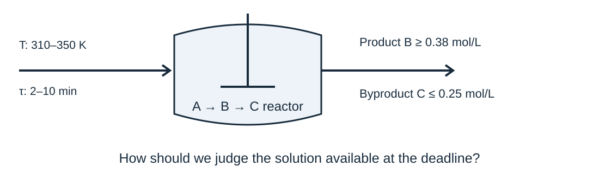
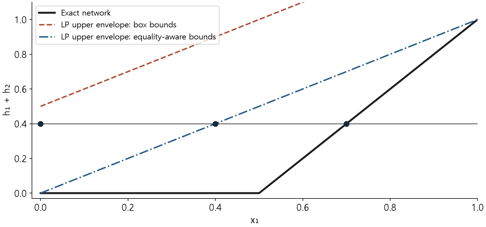
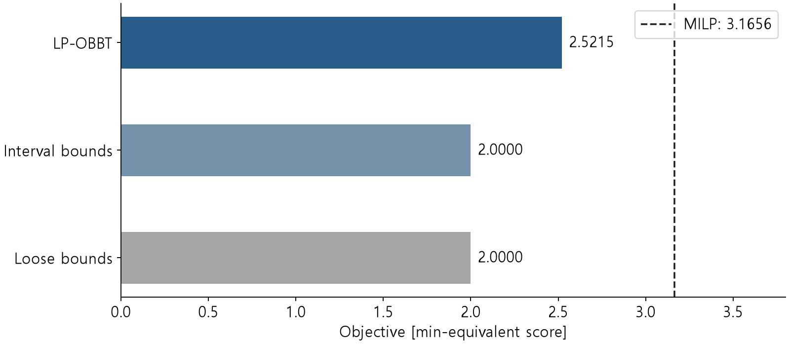
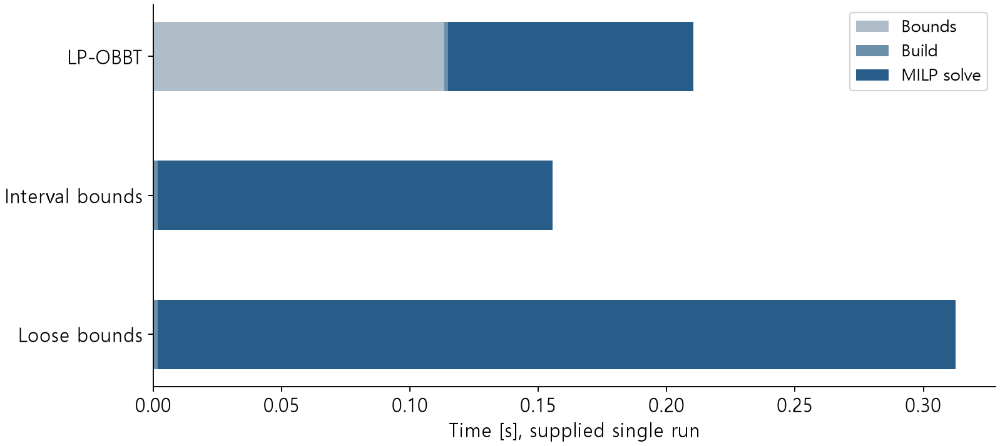
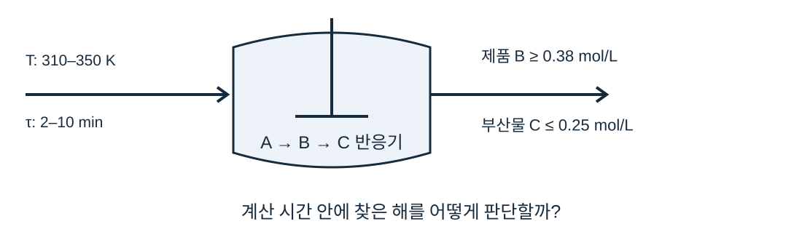
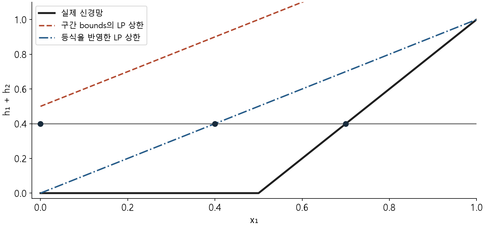
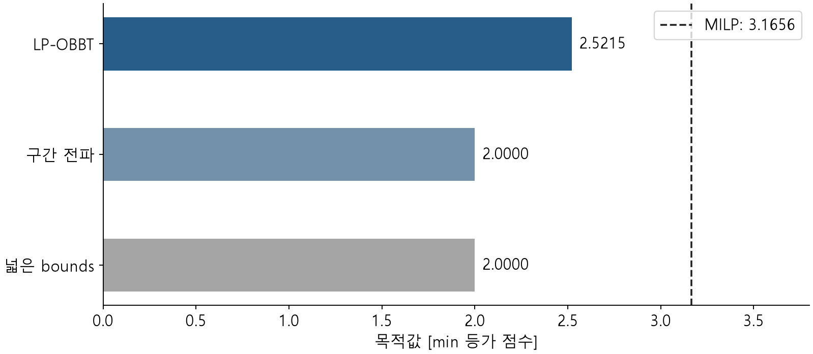
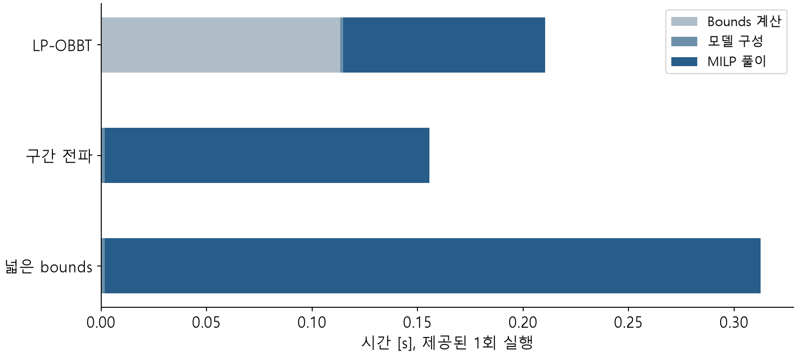

## Reactor conditions that meet product specifications

A reactor design review requires repeated searches over temperature and residence time. After finding conditions that meet the product specifications, we still need to assess how much improvement may remain.

<figure></figure>

This week: unfinished-solve assessment, bounds, and formulation choices.

<!-- lecture-page -->

## The problem and the comparison conditions

Add temperature as an input to the Week 5 reactor setting. At a fixed flow of 1 L/min, residence time also selects reactor volume and is therefore a design variable.

Hold the fitted ReLU model, input domain, objective, and product specifications fixed while comparing formulations. Arbitrarily shrinking the temperature interval changes the design problem.

Solver for all LPs and MILPs: open-source HiGHS.

### Learning objectives for formulations and solver results

1. Incumbent objective, objective bound, and gap
2. Interval propagation versus LP-based bound tightening
3. Frozen network and scaling in Pyomo and OMLT
4. Termination, time, forward agreement, and constraint residuals

Review the Week 5 Big-M equivalence and input-bound calculations first.

<!-- lecture-page -->

## The frozen network and its MILP representation

For a ReLU input a with valid bounds L ≤ a ≤ U and L < 0 < U, use these inequalities with binary z.

<math display="block"><mtable columnalign="left"><mtr><mtd><mrow><mi>h</mi><mo>≥</mo><mn>0</mn><mo>,</mo><mtext>  </mtext><mi>h</mi><mo>≥</mo><mi>a</mi></mrow></mtd></mtr><mtr><mtd><mrow><mi>h</mi><mo>≤</mo><mi>U</mi><mi>z</mi><mo>,</mo><mtext>  </mtext><mi>h</mi><mo>≤</mo><mi>a</mi><mo>−</mo><mi>L</mi><mo>(</mo><mn>1</mn><mo>−</mo><mi>z</mi><mo>)</mo></mrow></mtd></mtr></mtable></math>

Weights, biases, and scaling remain fixed. The full problem is an MILP when the other constraints and objective are linear. Exact network representation is separate from process prediction error.

<!-- lecture-page -->

## Incumbents, objective bounds, and gaps

For minimization, the incumbent is the best integer-feasible solution found so far. Its objective value supplies an upper bound that, together with a valid lower bound, brackets the optimum.

<math display="block"><mtable columnalign="left"><mtr><mtd><mrow><msub><mrow><mi>J</mi></mrow><mrow><mi>bound</mi></mrow></msub><mo>≤</mo><msub><mrow><mi>J</mi></mrow><mrow><mi>opt</mi></mrow></msub><mo>≤</mo><msub><mrow><mi>J</mi></mrow><mrow><mi>inc</mi></mrow></msub></mrow></mtd></mtr><mtr><mtd><mrow><msub><mrow><mi>g</mi></mrow><mrow><mi>abs</mi></mrow></msub><mo>=</mo><msub><mrow><mi>J</mi></mrow><mrow><mi>inc</mi></mrow></msub><mo>−</mo><msub><mrow><mi>J</mi></mrow><mrow><mi>bound</mi></mrow></msub><mo>,</mo><mtext>  </mtext><msub><mrow><mi>g</mi></mrow><mrow><mi>rel</mi></mrow></msub><mo>=</mo><mfrac><mrow><msub><mrow><mi>J</mi></mrow><mrow><mi>inc</mi></mrow></msub><mo>−</mo><msub><mrow><mi>J</mi></mrow><mrow><mi>bound</mi></mrow></msub></mrow><mrow><mo>|</mo><msub><mrow><mi>J</mi></mrow><mrow><mi>inc</mi></mrow></msub><mo>|</mo></mrow></mfrac></mrow></mtd></mtr></mtable></math>

An upper bound of 100 and lower bound of 80 give an absolute gap of 20 and a relative gap of 20% under this definition. Without an incumbent this gap is unavailable; near a zero objective, also report the absolute gap.

A feasible design supplies an upper bound because there is no need to select anything more expensive. A relaxation admits even more favorable choices and supplies a lower bound. The interval between them is the remaining possible improvement.

<!-- lecture-page -->

## How branch-and-bound progresses

Relaxing binaries to continuous intervals gives an LP lower bound for minimization. A fractional binary can be branched into subproblems with z = 0 and z = 1.

An integer-feasible solution updates the incumbent. Infeasible nodes and nodes whose lower bounds cannot improve the incumbent need no further search.

Valid bounds from open nodes form the global lower bound. HiGHS also uses presolve, cuts, and heuristics, so the original LP relaxation value can differ from the final solver bound.

If the incumbent costs 100 and a node has lower bound 105, every integer solution in that node costs at least 105, so it can be pruned. A node bounded by 80 may still contain an improvement below 100 and needs further investigation.

<!-- lecture-page -->

## The continuous relaxation of a ReLU

Relaxing z to [0, 1] and eliminating it gives this triangle for L < 0 < U.

<math display="block"><mtable columnalign="left"><mtr><mtd><mrow><mi>h</mi><mo>≥</mo><mn>0</mn><mo>,</mo><mtext>  </mtext><mi>h</mi><mo>≥</mo><mi>a</mi><mo>,</mo><mtext>  </mtext><mi>h</mi><mo>≤</mo><mfrac><mrow><mi>U</mi></mrow><mrow><mi>U</mi><mo>−</mo><mi>L</mi></mrow></mfrac><mo>(</mo><mi>a</mi><mo>−</mo><mi>L</mi><mo>)</mo></mrow></mtd></mtr></mtable></math>

At a = 0, the largest allowed h is −UL/(U − L). It is 0.5 when L = −1 and U = 1, although the ReLU output is zero.

This triangle is the convex hull of the scalar (a, h) graph. Correlations across inputs and neurons may require additional constraints.

With L=−1,U=1 and a=0, the upper bound is (0+1)/2=0.5. Allowing this value above the true h=0 creates relaxation slack. Tighter valid bounds can reduce it.

<!-- lecture-page -->

## Two neurons coupled by an equality

Dimensionless example: a dependence missed by box bounds

<math display="block"><mtable columnalign="left"><mtr><mtd><mrow><mn>0</mn><mo>≤</mo><msub><mrow><mi>x</mi></mrow><mrow><mn>1</mn></mrow></msub><mo>,</mo><msub><mrow><mi>x</mi></mrow><mrow><mn>2</mn></mrow></msub><mo>≤</mo><mn>1</mn><mo>,</mo><mtext>  </mtext><msub><mrow><mi>x</mi></mrow><mrow><mn>1</mn></mrow></msub><mo>+</mo><msub><mrow><mi>x</mi></mrow><mrow><mn>2</mn></mrow></msub><mo>=</mo><mn>1</mn></mrow></mtd></mtr><mtr><mtd><mrow><msub><mrow><mi>h</mi></mrow><mrow><mn>1</mn></mrow></msub><mo>=</mo><mi>max</mi><mo>(</mo><mn>0</mn><mo>,</mo><msub><mrow><mi>x</mi></mrow><mrow><mn>1</mn></mrow></msub><mo>+</mo><msub><mrow><mi>x</mi></mrow><mrow><mn>2</mn></mrow></msub><mo>−</mo><mn>1</mn><mo>)</mo><mo>,</mo></mrow></mtd></mtr><mtr><mtd><mrow><msub><mrow><mi>h</mi></mrow><mrow><mn>2</mn></mrow></msub><mo>=</mo><mi>max</mi><mo>(</mo><mn>0</mn><mo>,</mo><msub><mrow><mi>x</mi></mrow><mrow><mn>1</mn></mrow></msub><mo>−</mo><msub><mrow><mi>x</mi></mrow><mrow><mn>2</mn></mrow></msub><mo>)</mo></mrow></mtd></mtr><mtr><mtd><mrow><msub><mrow><mi>min</mi></mrow><mrow><msub><mrow><mi>x</mi></mrow><mrow><mn>1</mn></mrow></msub><mo>,</mo><msub><mrow><mi>x</mi></mrow><mrow><mn>2</mn></mrow></msub></mrow></msub><mtext>  </mtext><msub><mrow><mi>x</mi></mrow><mrow><mn>1</mn></mrow></msub><mtext>   subject to   </mtext><msub><mrow><mi>h</mi></mrow><mrow><mn>1</mn></mrow></msub><mo>+</mo><msub><mrow><mi>h</mi></mrow><mrow><mn>2</mn></mrow></msub><mo>≥</mo><mn>.4</mn></mrow></mtd></mtr></mtable></math>

Using only the input box gives [−1, 1] for both pre-activations. The input equality, however, makes the first pre-activation identically zero.

Box bounds alone allow combinations x₁=x₂=0 or 1. The equality x₁+x₂=1 excludes them and fixes the first pre-activation at zero. Individual variable ranges and relations between variables therefore contain different information.

<!-- lecture-page -->

## The exact solution of the two-neuron example

<math display="block"><mtable columnalign="left"><mtr><mtd><mrow><msub><mrow><mi>h</mi></mrow><mrow><mn>1</mn></mrow></msub><mo>=</mo><mn>0</mn><mo>,</mo><mtext>  </mtext><msub><mrow><mi>h</mi></mrow><mrow><mn>2</mn></mrow></msub><mo>=</mo><mi>max</mi><mo>(</mo><mn>0</mn><mo>,</mo><mn>2</mn><msub><mrow><mi>x</mi></mrow><mrow><mn>1</mn></mrow></msub><mo>−</mo><mn>1</mn><mo>)</mo></mrow></mtd></mtr><mtr><mtd><mrow><msub><mrow><mi>h</mi></mrow><mrow><mn>2</mn></mrow></msub><mo>≥</mo><mn>.4</mn><mo>⇒</mo><msub><mrow><mi>x</mi></mrow><mrow><mn>1</mn></mrow></msub><mo>≥</mo><mn>.7</mn></mrow></mtd></mtr></mtable></math>

The minimum <math><msub><mrow><mi>x</mi></mrow><mrow><mn>1</mn></mrow></msub></math> is therefore 0.7. The MILP with box bounds and the MILP using the equality both attain this optimum.

The LP relaxation can place h above the network output, so this conclusion does not immediately apply to its solution.

When x₁≤0.5, the second ReLU is also zero and cannot meet 0.4. In its active branch, solve 2x₁−1≥0.4 to get x₁≥0.7. Substituting 0.7 verifies feasibility and makes the lower limit attainable.

<!-- lecture-page -->

## LP relaxations before and after tightening

<figure></figure>

The original LP allows <math><msub><mrow><mi>h</mi></mrow><mrow><mn>1</mn></mrow></msub></math> = 0.4 even at <math><msub><mrow><mi>x</mi></mrow><mrow><mn>1</mn></mrow></msub></math> = 0. Enforcing <math><msub><mrow><mi>h</mi></mrow><mrow><mn>1</mn></mrow></msub></math> = 0 raises the LP optimum to 0.4, still below the MILP optimum of 0.7.

<!-- lecture-page -->

## Relaxed solutions versus the actual network

Each formulation minimizes x₁ with x₂=1−x₁ and required output sum 0.4.

| Formulation | x₁,x₂ | Allowed h₁,h₂ | Actual ReLU output | Interpretation |
| --- | --- | --- | --- | --- |
| Box-bound LP | 0,1 | 0.4,0 | 0,0 | Inflated h₁ meets the limit |
| Equality-aware LP | 0.4,0.6 | 0,0.4 | 0,0 | Inflated h₂ meets the limit |
| MILP | 0.7,0.3 | 0,0.4 | 0,0.4 | Matches the original output |

After incorporating the equality, the second triangle has upper bound h₂≤x₁. Thus h₂≥0.4 requires x₁≥0.4. Yet at x₁=0.4, the actual a₂=−0.2 gives zero ReLU output. Improving the lower bound does not make the relaxation identical to the graph.

<!-- lecture-page -->

## Branching and termination in the two-neuron example

After enforcing h₁=0, only h₂'s binary z₂ remains. Its bounds are L=−1,U=1 and a₂=2x₁−1. Adding the root LP rows h₂≤z₂ and h₂≤2x₁−z₂ gives h₂≤x₁. Since h₂≥0.4, x₁≥0.4 is a lower bound.

| Problem | Calculation | Conclusion |
| --- | --- | --- |
| Root LP, 0≤z₂≤1 | x₁=0.4,h₂=0.4,z₂=0.4 is feasible | lower bound 0.4; not integer |
| Child z₂=0 | h₂=0 contradicts h₂≥0.4 | infeasible; close |
| Child z₂=1 | h₂=2x₁−1≥0.4 | minimum attained at x₁=0.7 |

The children cover both possible binary values. One is infeasible and the other has minimum 0.7, establishing a global lower bound of 0.7. It matches feasible cost 0.7, so the gap is zero.

With several open nodes, the smallest node lower bound identifies a branch that may still improve the incumbent. A branch whose bound reaches the incumbent cannot improve it and can be closed. A real solver may use different branching and cuts.

<!-- lecture-page -->

## The domain over which bounds are valid

Bounds must hold at every allowed input. Training-sample extrema alone do not guarantee coverage of the full input domain.

Overly narrow bounds can cut off valid network points. Wider valid bounds preserve the integer graph but can weaken its relaxation.

Bounds computed using product specifications are valid only over that constrained feasible set. Recheck them when specifications or the input domain change.

<!-- lecture-page -->

## Interval propagation with weight signs

Suppose the previous layer satisfies ℓ ≤ h ≤ u, with <math><msup><mrow><mi>w</mi></mrow><mrow><mo>+</mo></mrow></msup></math> = max(w, 0) and <math><msup><mrow><mi>w</mi></mrow><mrow><mo>−</mo></mrow></msup></math> = min(w, 0).

<math display="block"><mtable columnalign="left"><mtr><mtd><mrow><msub><mrow><mi>L</mi></mrow><mrow><mi>j</mi></mrow></msub><mo>=</mo><msub><mrow><mi>b</mi></mrow><mrow><mi>j</mi></mrow></msub><mo>+</mo><msub><mrow><mo>∑</mo></mrow><mrow><mi>i</mi></mrow></msub><mo>(</mo><msup><mrow><msub><mrow><mi>w</mi></mrow><mrow><mi>ij</mi></mrow></msub></mrow><mrow><mo>+</mo></mrow></msup><msub><mrow><mi>ℓ</mi></mrow><mrow><mi>i</mi></mrow></msub><mo>+</mo><msup><mrow><msub><mrow><mi>w</mi></mrow><mrow><mi>ij</mi></mrow></msub></mrow><mrow><mo>−</mo></mrow></msup><msub><mrow><mi>u</mi></mrow><mrow><mi>i</mi></mrow></msub><mo>)</mo></mrow></mtd></mtr><mtr><mtd><mrow><msub><mrow><mi>U</mi></mrow><mrow><mi>j</mi></mrow></msub><mo>=</mo><msub><mrow><mi>b</mi></mrow><mrow><mi>j</mi></mrow></msub><mo>+</mo><msub><mrow><mo>∑</mo></mrow><mrow><mi>i</mi></mrow></msub><mo>(</mo><msup><mrow><msub><mrow><mi>w</mi></mrow><mrow><mi>ij</mi></mrow></msub></mrow><mrow><mo>+</mo></mrow></msup><msub><mrow><mi>u</mi></mrow><mrow><mi>i</mi></mrow></msub><mo>+</mo><msup><mrow><msub><mrow><mi>w</mi></mrow><mrow><mi>ij</mi></mrow></msub></mrow><mrow><mo>−</mo></mrow></msup><msub><mrow><mi>ℓ</mi></mrow><mrow><mi>i</mi></mrow></msub><mo>)</mo></mrow></mtd></mtr></mtable></math>

After a ReLU, pass [max(0, L), max(0, U)] to the next layer. This is inexpensive but does not check whether different variable extremes can occur simultaneously.

If h₁=h₂ but both are represented only by [0,1], interval arithmetic gives h₁−h₂ in [−1,1], although the true difference is zero. Interval propagation quickly constructs valid outward bounds but loses such dependencies.

<!-- lecture-page -->

## LP-based bound tightening

Let P be an LP relaxation containing the network MILP feasible set. Minimize and maximize each pre-activation over P.

<math display="block"><mtable columnalign="left"><mtr><mtd><mrow><msub><mrow><mi>L</mi></mrow><mrow><mi>j</mi></mrow></msub><mo>=</mo><msub><mrow><mi>min</mi></mrow><mrow><mi>v</mi><mo>∈</mo><mi>P</mi></mrow></msub><mtext>  </mtext><msub><mrow><mi>a</mi></mrow><mrow><mi>j</mi></mrow></msub><mo>(</mo><mi>v</mi><mo>)</mo></mrow></mtd></mtr><mtr><mtd><mrow><msub><mrow><mi>U</mi></mrow><mrow><mi>j</mi></mrow></msub><mo>=</mo><msub><mrow><mi>max</mi></mrow><mrow><mi>v</mi><mo>∈</mo><mi>P</mi></mrow></msub><mtext>  </mtext><msub><mrow><mi>a</mi></mrow><mrow><mi>j</mi></mrow></msub><mo>(</mo><mi>v</mi><mo>)</mo></mrow></mtd></mtr></mtable></math>

This is optimization-based bound tightening, or OBBT. The lab solves 54 LPs over the full input domain without product specifications, then rebuilds the MILP with the resulting bounds.

The lower-bound problem asks how small this neuron can become over every allowed input. The upper-bound problem maximizes the same expression. Solving over a relaxation containing every original network point produces bounds that do not exclude those points.

Suppose minimizing a stops with feasible value −0.2 and valid lower bound −0.6. Its true minimum lies in [−0.6,−0.2]. Use −0.6 as the neuron's lower bound: using −0.2 could cut off a valid point with a=−0.4. For a maximum, use a valid upper bound instead.

<!-- lecture-page -->

## Handling neurons with fixed activation states

<math display="block"><mtable columnalign="left"><mtr><mtd><mrow><mi>U</mi><mo>≤</mo><mn>0</mn><mo>⇒</mo><mi>h</mi><mo>=</mo><mn>0</mn></mrow></mtd></mtr><mtr><mtd><mrow><mi>L</mi><mo>≥</mo><mn>0</mn><mo>⇒</mo><mi>h</mi><mo>=</mo><mi>a</mi></mrow></mtd></mtr></mtable></math>

These cases need no binary variable. Only neurons whose intervals cross zero remain candidates for branching.

Hand-built MILP binary counts: 24 with loose bounds, 22 with interval propagation, 19 with LP-OBBT. Counts before solver presolve.

<!-- lecture-page -->

## Input scaling and physical units

<math display="block"><mtable columnalign="left"><mtr><mtd><mrow><msub><mrow><mi>x</mi></mrow><mrow><mn>1</mn></mrow></msub><mo>=</mo><mfrac><mrow><mi>T</mi><mo>−</mo><mn>310</mn></mrow><mrow><mn>40</mn></mrow></mfrac><mo>,</mo><mtext>  </mtext><msub><mrow><mi>x</mi></mrow><mrow><mn>2</mn></mrow></msub><mo>=</mo><mfrac><mrow><mi>τ</mi><mo>−</mo><mn>2</mn></mrow><mrow><mn>8</mn></mrow></mfrac></mrow></mtd></mtr><mtr><mtd><mrow><mi>T</mi><mo>=</mo><mn>310</mn><mo>+</mo><mn>40</mn><msub><mrow><mi>x</mi></mrow><mrow><mn>1</mn></mrow></msub><mo>,</mo><mtext>  </mtext><mi>τ</mi><mo>=</mo><mn>2</mn><mo>+</mo><mn>8</mn><msub><mrow><mi>x</mi></mrow><mrow><mn>2</mn></mrow></msub></mrow></mtd></mtr></mtable></math>

Reuse exactly the offsets and scales used during fitting. Supplying physical-input bounds as scaled-input bounds changes the domain evaluated by the network.

Outputs in this lab already use mol/L. If outputs were standardized, include the fixed inverse transform before connecting product specifications.

330 K and 6 min are both interval midpoints, giving scaled input [0.5,0.5]. Swapping input order makes temperature weights read residence time. Comparing forward outputs at identical physical inputs also detects this ordering error.

<!-- lecture-page -->

## Objective constants and relative gaps

<math display="block"><mtable columnalign="left"><mtr><mtd><mrow><mi>J</mi><mo>=</mo><mi>τ</mi><mo>+</mo><mi>α</mi><mo>(</mo><mi>T</mi><mo>−</mo><mn>310</mn><mo>)</mo><mo>,</mo><mtext>  </mtext><mi>α</mi><mo>=</mo><mn>.02</mn><mtext> min/K</mtext></mrow></mtd></mtr><mtr><mtd><mrow><mi>J</mi><mo>=</mo><mn>2</mn><mo>+</mo><mn>8</mn><msub><mrow><mi>x</mi></mrow><mrow><mn>2</mn></mrow></msub><mo>+</mo><mn>.8</mn><msub><mrow><mi>x</mi></mrow><mrow><mn>1</mn></mrow></msub></mrow></mtd></mtr></mtable></math>

Educational objective: residence time + temperature increase weighted by α. Unit: min-equivalent score.

Dropping the constant 2 preserves the optimizer but changes the denominator of a relative gap. The lab reports objectives and bounds with the constant included.

<!-- lecture-page -->

## Computing gaps with an objective constant

Keep the same incumbent and valid bound, removing only constant 2 from the objective.

| Calculation | J with constant | J−2 without constant |
| --- | --- | --- |
| Feasible objective | 3.2 | 1.2 |
| Valid lower bound | 2.8 | 0.8 |
| Absolute gap | 3.2−2.8=0.4 | 1.2−0.8=0.4 |
| Relative gap | 0.4/3.2=12.5% | 0.4/1.2≈33.3% |

Subtracting the same number from every candidate preserves ranking and the optimal input. The relative-gap denominator changes, however. Percentages alone cannot compare solve quality when the objective definitions differ.

Without an incumbent there is no value for that denominator. Report the valid bound and absence of a feasible solution; do not interpret initialized variables as the answer.

<!-- lecture-page -->

## Roles of the open-source tools

| Tool | Role |
| --- | --- |
| NumPy | Network forward pass and optional refitting |
| Pyomo | Variables, objective, and process constraints |
| OMLT | Frozen-network constraints in Pyomo |
| HiGHS / highspy | LP and MILP solution |

All LPs and MILPs use open-source HiGHS under the MIT license.

Check the input ordering, scaling, and bounds of the constraints generated by OMLT. [HiGHS official site](https://highs.dev/)

<!-- lecture-page -->

## Connecting OMLT to process constraints

Build `definition` from the weights and scaling, then connect the process constraints. `nn.inputs` uses physical units; `scaled_inputs` holds transformed inputs.

```python
model.nn = OmltBlock()
model.nn.build_formulation(ReluBigMFormulation(definition))
model.product = pyo.Constraint(expr=model.nn.outputs[1] >= .38)
model.byproduct = pyo.Constraint(expr=model.nn.outputs[2] <= .25)
model.obj = pyo.Objective(
    expr=model.nn.inputs[1] + .02*(model.nn.inputs[0]-310))
```


outputs[1] is B and outputs[2] is C. inputs[0] is temperature in K; inputs[1] is residence time in min. OMLT scaling equalities connect physical inputs to network coordinates; the objective must use the intended physical quantities.

<!-- lecture-page -->

## Reproducing Week 5 with OMLT

First check the existing interpolant with residence time as its sole decision, at 330 K and a feed A concentration of 1.2 mol/L. Apply B ≥ 0.40 and C ≤ 0.25 mol/L.

| Formulation | Minimum residence time [min] | Generated binaries |
| --- | --- | --- |
| Hand-built | 5.353846 | 3 |
| OMLT | 5.353846 | 4 |

This OMLT version creates a binary for each ReLU. The hand-built model represents one always-active neuron linearly, using one fewer binary while giving the same outputs.

<!-- lecture-page -->

## Choosing temperature and residence time

<math display="block"><mtable columnalign="left"><mtr><mtd><mrow><msub><mrow><mi>min</mi></mrow><mrow><mi>T</mi><mo>,</mo><mi>τ</mi></mrow></msub><mtext>  </mtext><mi>J</mi><mo>=</mo><mi>τ</mi><mo>+</mo><mn>.02</mn><mo>(</mo><mi>T</mi><mo>−</mo><mn>310</mn><mo>)</mo></mrow></mtd></mtr><mtr><mtd><mrow><mn>310</mn><mo>≤</mo><mi>T</mi><mo>≤</mo><mn>350</mn><mo>,</mo><mtext>  </mtext><mn>2</mn><mo>≤</mo><mi>τ</mi><mo>≤</mo><mn>10</mn></mrow></mtd></mtr><mtr><mtd><mrow><mi>y</mi><mo>=</mo><msub><mrow><mi>f</mi></mrow><mrow><mi>θ</mi></mrow></msub><mo>(</mo><mi>T</mi><mo>,</mo><mi>τ</mi><mo>)</mo><mo>,</mo><mtext>  </mtext><msub><mrow><mi>y</mi></mrow><mrow><mi>B</mi></mrow></msub><mo>≥</mo><mn>.38</mn><mo>,</mo><mtext>  </mtext><msub><mrow><mi>y</mi></mrow><mrow><mi>C</mi></mrow></msub><mo>≤</mo><mn>.25</mn></mrow></mtd></mtr></mtable></math>

Units: concentrations mol/L, temperature K, residence time min. Additional constraint: nonnegative predicted concentrations.

Architecture: two inputs, two hidden layers of 12 ReLUs each, and three linear outputs. All comparisons: the same frozen coefficients.

<!-- lecture-page -->

## Fitting and independently evaluating the frozen model

Generate concentrations at 1,200 training inputs from ideal isothermal A → B → C CSTR balances and fit with 6,000 NumPy Adam updates. Evaluate physical-unit errors at 500 independent random inputs.

| Component | Test RMSE [mol/L] |
| --- | --- |
| A | 0.00546 |
| B | 0.00440 |
| C | 0.00564 |

The default lab loads the supplied coefficients. `--refit` optionally refits them; weights never change during optimization.

<!-- lecture-page -->

## Comparing relaxation values across bounds

<figure></figure>

LP-OBBT raises the original LP lower bound from 2.0000 to 2.5215. All three MILPs attain 3.1656. All three comparisons use the same predictor.

The interval from lower bound 2.5215 to feasible value 3.1656 is about 0.6441, narrower than 1.1656 from the loose bound 2.0000. Predictions are unchanged, but less optimality uncertainty remains at the start of the search.

<!-- lecture-page -->

## Timing including bound computation

<figure></figure>

In the supplied run, LP-OBBT reduces MILP solve time, but its total time including bounds exceeds interval propagation. These single-run measurements include interface overhead and do not establish a general speed ranking.

<!-- lecture-page -->

## Total time when bounds are reused

In the recorded run, interval-bound MILP time was 0.1539 s and LP-OBBT MILP time was 0.0955 s. OBBT preprocessing required 0.1132 s.

| Solves m | Interval: 0.0001+m×0.1555 | OBBT: 0.1132+m×0.0971 |
| --- | --- | --- |
| 1 | 0.1556 s | 0.2103 s |
| 2 | 0.3111 s | 0.3074 s |
| 5 | 0.7776 s | 0.5987 s |

Each per-solve cost includes 0.0016 s for construction. This arithmetic uses rounded recorded times and assumes identical solve times on every repetition; it is not a repeated timing experiment.

Bounds reusable for fixed weights and input domain spread preprocessing cost across solves. A new model or expanded domain requires renewed bound validation, so this calculation cannot automatically be carried over.

<!-- lecture-page -->

## Selected conditions and solver conclusions

| Item | Supplied run |
| --- | --- |
| Temperature [K] | 342.059300 |
| Residence time [min] | 2.524440 |
| Objective [min-equivalent] | 3.165626 |
| Predicted B [mol/L] | 0.380000 |
| Termination / relative gap | optimal / 0 |

HiGHS establishes optimality for this surrogate MILP within the configured numerical tolerances. The B lower bound is active; the C upper bound has slack.

The objective is 2.524440 + 0.02 × (342.059300−310) = 3.165626. The temperature contribution 0.641186 adds to residence time. Recomputing it checks units and offset handling in the reported solver value.

<!-- lecture-page -->

## Checking forward agreement and residuals

Remove product specifications, fix the input, and solve only the network representation. Evaluate the four domain corners and 12 independent interior points with both the hand-built and OMLT models.

Across 32 checks, the maximum absolute output difference is 7.77e-16 mol/L. Recompute the forward pass at the selected optimum too.

Check constraint and integrality residuals. Finite samples help detect implementation errors; equivalence over the entire domain follows from the formulation conditions developed in Week 5.

Define inequality violations to be zero when satisfied: max(0,0.38−B) for B≥0.38 and max(0,C−0.25) for C≤0.25. For binary value z=0.999999, the integrality residual is its distance 0.000001 to the nearest integer 1; compare it with the solver tolerance.

<!-- lecture-page -->

## Termination and incumbent availability

| Termination | Interpretation |
| --- | --- |
| optimal | Completed within gap and numerical tolerances |
| Time limit, incumbent found | Report the feasible solution and remaining gap |
| Time limit, no incumbent | No usable solution has been obtained |
| infeasible | The formulated feasible set is empty |
| unbounded / error | Inspect bounds, objective, logs, and model |

A time limit alone does not establish infeasibility. The lab returns `maxTimeLimit` with no incumbent at a zero-second limit, and `infeasible` when B ≥ 2.

<!-- lecture-page -->

## Checking solution availability and loading results

```python
opt = Highs()
opt.config.load_solution = False
opt.config.time_limit = 30.0
result = opt.solve(model)
inc = result.best_feasible_objective
print(result.termination_condition)
if inc is not None and np.isfinite(inc):
    result.solution_loader.load_vars()
    print(inc, result.best_objective_bound)
```

Reading variables after termination without a solution can mistake initial or stale values for results. The complete lab function also returns gaps and constraint residuals.

load_solution=False prevents automatic loading immediately after the solve. Call load_vars only after confirming a finite feasible objective. Then compute specification and integrality residuals from those loaded values.

<!-- lecture-page -->

## Solver gaps and process prediction error

| At the same selected input | B concentration [mol/L] |
| --- | --- |
| Network and MILP | 0.380000 |
| Reference CSTR | 0.371157 |
| Required minimum | 0.380000 |

The reference CSTR misses the B specification. Forward agreement and a zero solver gap still require a separate process-model feasibility check.

Week 8 uses errors at selected points to reconsider decisions and identify additional data.

<!-- lecture-page -->

## Running the lab and reporting comparisons

Extract the lab bundle and run these commands in its directory.

```bash
python -m pip install -r requirements.txt
python week06_lab.py --output-dir my-results
```

1. Verify the toy LP values 0 and 0.4 and MILP value 0.7 by hand.
2. Comparison for the same frozen model: bounds, binary counts, LP lower bounds, and total times
3. Report: termination, gap, forward differences, and reference CSTR B-specification violation

[Reading companion](/courses/surrogate-models/week-06-reading/) · [Lab ZIP](/assets/courses/surrogate-models/week-06/week06-lab.zip)

<!-- lecture-page -->

## Sources and assigned reading

[Ceccon et al., OMLT: Optimization & Machine Learning Toolkit, JMLR 23(349), 2022](https://jmlr.org/papers/v23/22-0277.html) · [Official quick-start](https://omlt.readthedocs.io/en/stable/quickstart.html)

[Anderson et al., Strong mixed-integer programming formulations for trained neural networks, Mathematical Programming, 2020](https://arxiv.org/abs/1811.01988)

[HiGHS and its MIT license](https://highs.dev/) · [Pyomo HiGHS interface](https://pyomo.readthedocs.io/en/stable/api/pyomo.contrib.appsi.solvers.highs.Highs.html)

<!-- ko -->

## 제품 규격을 만족하는 반응기 조건

반응기 설계 검토에서 온도와 체류시간 후보를 반복해서 계산합니다. 제품 규격을 만족하는 조건을 찾았어도 더 나은 조건이 남아 있는지 판단해야 합니다.

<figure></figure>

이번 주에는 계산을 마치기 전에도 해의 품질을 평가하고 bounds와 정식화를 조정하는 방법을 다뤄봅니다.

<!-- lecture-page -->

## 비교할 문제와 계산 조건

5주차 반응기 모델에 온도를 입력으로 추가합니다. 유량을 1 L/min로 고정하므로 체류시간은 반응기 부피도 결정하는 설계변수입니다.

학습을 마친 ReLU 모델, 입력 영역, 목적함수와 제품 규격을 고정하고 정식화만 비교합니다. 온도 범위를 임의로 줄이면 원래 설계 문제와 달라집니다.

모든 LP와 MILP는 오픈소스 HiGHS로 풉니다.

### 정식화와 solver 결과의 학습 목표

1. 가능해의 목적값, 최적값에 대한 bound와 gap
2. 구간 전파와 LP 기반 bound tightening 비교
3. Pyomo·OMLT의 고정 신경망과 scaling 연결
4. 종료 상태, 계산 시간, forward 일치와 제약 잔차

5주차의 Big-M 동치성과 입력 bounds 계산을 복습한 뒤 시작합니다.

<!-- lecture-page -->

## 고정 신경망과 MILP 표현

각 ReLU의 입력 a에 유효한 L ≤ a ≤ U가 있고 L < 0 < U이면 다음 식에 이진변수 z를 사용합니다.

<math display="block"><mtable columnalign="left"><mtr><mtd><mrow><mi>h</mi><mo>≥</mo><mn>0</mn><mo>,</mo><mtext>  </mtext><mi>h</mi><mo>≥</mo><mi>a</mi></mrow></mtd></mtr><mtr><mtd><mrow><mi>h</mi><mo>≤</mo><mi>U</mi><mi>z</mi><mo>,</mo><mtext>  </mtext><mi>h</mi><mo>≤</mo><mi>a</mi><mo>−</mo><mi>L</mi><mo>(</mo><mn>1</mn><mo>−</mo><mi>z</mi><mo>)</mo></mrow></mtd></mtr></mtable></math>

가중치·bias·scaling은 고정합니다. 다른 제약과 목적함수까지 선형이면 전체 문제가 MILP입니다. 정확한 신경망 표현은 공정 예측 오차와 별개입니다.

<!-- lecture-page -->

## 가능해, bound와 gap

최소화에서 incumbent는 지금까지 찾은 가장 좋은 정수 가능해입니다. 이 가능해의 목적값을 상한으로 사용하면 유효한 하한과 함께 최적값의 범위를 정할 수 있습니다.

<math display="block"><mtable columnalign="left"><mtr><mtd><mrow><msub><mrow><mi>J</mi></mrow><mrow><mi>bound</mi></mrow></msub><mo>≤</mo><msub><mrow><mi>J</mi></mrow><mrow><mi>opt</mi></mrow></msub><mo>≤</mo><msub><mrow><mi>J</mi></mrow><mrow><mi>inc</mi></mrow></msub></mrow></mtd></mtr><mtr><mtd><mrow><msub><mrow><mi>g</mi></mrow><mrow><mi>abs</mi></mrow></msub><mo>=</mo><msub><mrow><mi>J</mi></mrow><mrow><mi>inc</mi></mrow></msub><mo>−</mo><msub><mrow><mi>J</mi></mrow><mrow><mi>bound</mi></mrow></msub><mo>,</mo><mtext>  </mtext><msub><mrow><mi>g</mi></mrow><mrow><mi>rel</mi></mrow></msub><mo>=</mo><mfrac><mrow><msub><mrow><mi>J</mi></mrow><mrow><mi>inc</mi></mrow></msub><mo>−</mo><msub><mrow><mi>J</mi></mrow><mrow><mi>bound</mi></mrow></msub></mrow><mrow><mo>|</mo><msub><mrow><mi>J</mi></mrow><mrow><mi>inc</mi></mrow></msub><mo>|</mo></mrow></mfrac></mrow></mtd></mtr></mtable></math>

상한 100, 하한 80이면 절대 gap은 20이고 이 정의의 상대 gap은 20%입니다. Incumbent가 없으면 이 gap을 계산할 수 없으며, 목적값이 0에 가까우면 절대 gap을 함께 보고합니다.

가능해 하나를 찾으면 그 비용보다 나쁜 설계를 선택할 필요가 없으므로 상한을 얻습니다. 반대로 완화 문제는 원래보다 유리한 선택까지 허용하므로 하한을 줍니다. 두 값 사이가 아직 개선될 수 있는 범위입니다.

<!-- lecture-page -->

## Branch-and-bound의 진행

이진변수를 연속 구간으로 완화한 LP를 풀면 최소화 문제의 하한을 얻습니다. LP 해에서 분수값인 이진변수 하나를 선택해 z = 0과 z = 1인 하위 문제로 나눕니다.

정수 가능해를 찾으면 incumbent를 갱신합니다. 불가능한 노드나 하한이 incumbent보다 나쁘거나 같은 노드는 더 탐색할 필요가 없습니다.

열린 노드들의 유효한 하한을 모아 전체 하한을 계산합니다. 실제 HiGHS는 presolve, cutting plane과 heuristic도 사용하므로 원래 LP 완화값과 solver의 최종 bound는 다를 수 있습니다.

현재 가능해 비용이 100인데 어떤 노드의 하한이 105이면 그 노드의 모든 정수 해는 105 이상이므로 탐색을 멈춥니다. 하한 80인 노드는 100보다 좋은 해가 남아 있을 수 있어 더 조사합니다.

<!-- lecture-page -->

## ReLU의 연속 완화

z를 [0, 1]로 완화하고 제거하면 L < 0 < U에서 다음 삼각형을 얻습니다.

<math display="block"><mtable columnalign="left"><mtr><mtd><mrow><mi>h</mi><mo>≥</mo><mn>0</mn><mo>,</mo><mtext>  </mtext><mi>h</mi><mo>≥</mo><mi>a</mi><mo>,</mo><mtext>  </mtext><mi>h</mi><mo>≤</mo><mfrac><mrow><mi>U</mi></mrow><mrow><mi>U</mi><mo>−</mo><mi>L</mi></mrow></mfrac><mo>(</mo><mi>a</mi><mo>−</mo><mi>L</mi><mo>)</mo></mrow></mtd></mtr></mtable></math>

a = 0에서 허용하는 최대 h는 −UL/(U − L)입니다. L = −1, U = 1이면 0.5지만 실제 ReLU 출력은 0입니다.

이 삼각형은 스칼라 (a, h) 그래프의 convex hull입니다. 여러 뉴런과 입력 간 상관관계를 함께 표현하는 데에는 추가 제약이 필요할 수 있습니다.

L=−1,U=1에서 a=0을 넣으면 상한은 (0+1)/2=0.5입니다. 실제 h=0보다 높게 허용하는 이 여유가 완화 오차입니다. a의 유효 범위를 좁히면 이 여유도 줄어들 수 있습니다.

<!-- lecture-page -->

## 등식 제약이 있는 두 뉴런 예제

다음 무차원 예제로 bounds가 놓치는 관계를 직접 계산

<math display="block"><mtable columnalign="left"><mtr><mtd><mrow><mn>0</mn><mo>≤</mo><msub><mrow><mi>x</mi></mrow><mrow><mn>1</mn></mrow></msub><mo>,</mo><msub><mrow><mi>x</mi></mrow><mrow><mn>2</mn></mrow></msub><mo>≤</mo><mn>1</mn><mo>,</mo><mtext>  </mtext><msub><mrow><mi>x</mi></mrow><mrow><mn>1</mn></mrow></msub><mo>+</mo><msub><mrow><mi>x</mi></mrow><mrow><mn>2</mn></mrow></msub><mo>=</mo><mn>1</mn></mrow></mtd></mtr><mtr><mtd><mrow><msub><mrow><mi>h</mi></mrow><mrow><mn>1</mn></mrow></msub><mo>=</mo><mi>max</mi><mo>(</mo><mn>0</mn><mo>,</mo><msub><mrow><mi>x</mi></mrow><mrow><mn>1</mn></mrow></msub><mo>+</mo><msub><mrow><mi>x</mi></mrow><mrow><mn>2</mn></mrow></msub><mo>−</mo><mn>1</mn><mo>)</mo><mo>,</mo></mrow></mtd></mtr><mtr><mtd><mrow><msub><mrow><mi>h</mi></mrow><mrow><mn>2</mn></mrow></msub><mo>=</mo><mi>max</mi><mo>(</mo><mn>0</mn><mo>,</mo><msub><mrow><mi>x</mi></mrow><mrow><mn>1</mn></mrow></msub><mo>−</mo><msub><mrow><mi>x</mi></mrow><mrow><mn>2</mn></mrow></msub><mo>)</mo></mrow></mtd></mtr><mtr><mtd><mrow><msub><mrow><mi>min</mi></mrow><mrow><msub><mrow><mi>x</mi></mrow><mrow><mn>1</mn></mrow></msub><mo>,</mo><msub><mrow><mi>x</mi></mrow><mrow><mn>2</mn></mrow></msub></mrow></msub><mtext>  </mtext><msub><mrow><mi>x</mi></mrow><mrow><mn>1</mn></mrow></msub><mtext>   subject to   </mtext><msub><mrow><mi>h</mi></mrow><mrow><mn>1</mn></mrow></msub><mo>+</mo><msub><mrow><mi>h</mi></mrow><mrow><mn>2</mn></mrow></msub><mo>≥</mo><mn>.4</mn></mrow></mtd></mtr></mtable></math>

입력 구간만 사용하면 두 pre-activation의 bounds는 모두 [−1, 1]입니다. 하지만 첫 번째 pre-activation은 입력 등식 때문에 항상 0입니다.

상자 범위만 보면 x₁=x₂=0 또는 1을 조합할 수 있습니다. 등식 x₁+x₂=1은 두 조합을 금지하고 첫 pre-activation을 항상 0으로 만듭니다. 각 변수 범위와 변수 간 관계가 주는 정보가 다른 이유입니다.

<!-- lecture-page -->

## 두 뉴런 예제의 정확한 해

<math display="block"><mtable columnalign="left"><mtr><mtd><mrow><msub><mrow><mi>h</mi></mrow><mrow><mn>1</mn></mrow></msub><mo>=</mo><mn>0</mn><mo>,</mo><mtext>  </mtext><msub><mrow><mi>h</mi></mrow><mrow><mn>2</mn></mrow></msub><mo>=</mo><mi>max</mi><mo>(</mo><mn>0</mn><mo>,</mo><mn>2</mn><msub><mrow><mi>x</mi></mrow><mrow><mn>1</mn></mrow></msub><mo>−</mo><mn>1</mn><mo>)</mo></mrow></mtd></mtr><mtr><mtd><mrow><msub><mrow><mi>h</mi></mrow><mrow><mn>2</mn></mrow></msub><mo>≥</mo><mn>.4</mn><mo>⇒</mo><msub><mrow><mi>x</mi></mrow><mrow><mn>1</mn></mrow></msub><mo>≥</mo><mn>.7</mn></mrow></mtd></mtr></mtable></math>

따라서 최소 <math><msub><mrow><mi>x</mi></mrow><mrow><mn>1</mn></mrow></msub></math>은 0.7입니다. 구간 bounds를 사용하는 MILP와 등식을 반영한 MILP 모두 같은 최적값을 냅니다.

LP 완화에서는 h가 실제 신경망 출력보다 커질 수 있으므로 같은 결론이 바로 성립하지 않습니다.

x₁≤0.5이면 두 번째 ReLU도 0이어서 출력 하한 0.4를 채울 수 없습니다. 활성 구간에서는 2x₁−1≥0.4를 풀어 x₁≥0.7을 얻습니다. 0.7을 직접 대입해 가능함을 보이면 하한과 달성 가능한 값이 일치합니다.

<!-- lecture-page -->

## Bounds 강화 전후의 LP 완화

<figure></figure>

원래 LP는 <math><msub><mrow><mi>x</mi></mrow><mrow><mn>1</mn></mrow></msub></math> = 0에서도 첫 뉴런의 <math><msub><mrow><mi>h</mi></mrow><mrow><mn>1</mn></mrow></msub></math> = 0.4를 허용합니다. <math><msub><mrow><mi>h</mi></mrow><mrow><mn>1</mn></mrow></msub></math> = 0을 반영하면 LP 최적값은 0.4로 올라가지만 MILP 최적값 0.7에는 아직 못 미칩니다.

<!-- lecture-page -->

## 완화 해와 실제 신경망의 대조

각 방식에서 목적값 x₁을 최소화합니다. x₂=1−x₁이고 필요한 출력 합은 0.4입니다.

| 방식 | x₁,x₂ | 허용된 h₁,h₂ | 실제 ReLU 출력 | 해석 |
| --- | --- | --- | --- | --- |
| 상자 bounds LP | 0,1 | 0.4,0 | 0,0 | 가짜 h₁로 규격 충족 |
| 등식 반영 LP | 0.4,0.6 | 0,0.4 | 0,0 | 가짜 h₂로 규격 충족 |
| MILP | 0.7,0.3 | 0,0.4 | 0,0.4 | 원래 출력과 일치 |

등식 반영 뒤 두 번째 삼각형의 상한은 h₂≤x₁입니다. 따라서 h₂≥0.4를 만족하려면 x₁≥0.4입니다. 그러나 x₁=0.4에서 실제 a₂=−0.2이므로 ReLU 출력은 0입니다. 하한이 좋아져도 완화가 원래 그래프와 같아진 것은 아닙니다.

<!-- lecture-page -->

## 두 뉴런 예제의 분기와 탐색 종료

h₁=0을 반영한 문제에서 h₂의 이진변수 z₂만 남깁니다. L=−1,U=1이고 a₂=2x₁−1입니다. 루트 LP의 h₂≤z₂, h₂≤2x₁−z₂를 더하면 h₂≤x₁입니다. h₂≥0.4이므로 x₁≥0.4가 하한입니다.

| 문제 | 계산 | 결론 |
| --- | --- | --- |
| 루트 LP, 0≤z₂≤1 | x₁=0.4,h₂=0.4,z₂=0.4 가능 | 하한 0.4, 정수해 아님 |
| z₂=0인 자식 | h₂=0과 h₂≥0.4 충돌 | 불가능, 종료 |
| z₂=1인 자식 | h₂=2x₁−1≥0.4 | x₁=0.7에서 최소 달성 |

두 자식은 가능한 이진값을 모두 덮습니다. 한쪽은 불가능하고 다른 쪽은 최소 0.7이므로 전역 하한도 0.7입니다. 가능해 비용 0.7과 같아져 gap=0으로 종료합니다.

여러 열린 노드가 남으면 그중 가장 작은 하한이 아직 더 좋은 해를 허용하는 가지를 나타냅니다. 하한이 incumbent 이상인 가지는 개선할 수 없어 제외합니다. 실제 solver의 분기 순서와 cut은 다를 수 있습니다.

<!-- lecture-page -->

## Bounds의 유효한 범위

Bounds는 허용한 모든 입력에서 성립해야 합니다. 학습 데이터의 최솟값·최댓값만으로는 입력 영역 전체를 덮는다고 보장할 수 없습니다.

너무 좁은 bounds는 유효한 신경망 점을 잘라내고, 넓은 bounds는 정수해의 그래프를 유지하면서 완화를 약하게 만들 수 있습니다.

제품 규격까지 사용해 계산한 bounds는 해당 규격의 가능집합에만 유효합니다. 규격이나 입력 영역을 바꿀 때는 bounds를 다시 확인합니다.

<!-- lecture-page -->

## 가중치 부호를 반영한 구간 전파

이전 층의 각 출력이 ℓ ≤ h ≤ u에 있고 <math><msup><mrow><mi>w</mi></mrow><mrow><mo>+</mo></mrow></msup></math> = max(w, 0), <math><msup><mrow><mi>w</mi></mrow><mrow><mo>−</mo></mrow></msup></math> = min(w, 0)라고 놓습니다.

<math display="block"><mtable columnalign="left"><mtr><mtd><mrow><msub><mrow><mi>L</mi></mrow><mrow><mi>j</mi></mrow></msub><mo>=</mo><msub><mrow><mi>b</mi></mrow><mrow><mi>j</mi></mrow></msub><mo>+</mo><msub><mrow><mo>∑</mo></mrow><mrow><mi>i</mi></mrow></msub><mo>(</mo><msup><mrow><msub><mrow><mi>w</mi></mrow><mrow><mi>ij</mi></mrow></msub></mrow><mrow><mo>+</mo></mrow></msup><msub><mrow><mi>ℓ</mi></mrow><mrow><mi>i</mi></mrow></msub><mo>+</mo><msup><mrow><msub><mrow><mi>w</mi></mrow><mrow><mi>ij</mi></mrow></msub></mrow><mrow><mo>−</mo></mrow></msup><msub><mrow><mi>u</mi></mrow><mrow><mi>i</mi></mrow></msub><mo>)</mo></mrow></mtd></mtr><mtr><mtd><mrow><msub><mrow><mi>U</mi></mrow><mrow><mi>j</mi></mrow></msub><mo>=</mo><msub><mrow><mi>b</mi></mrow><mrow><mi>j</mi></mrow></msub><mo>+</mo><msub><mrow><mo>∑</mo></mrow><mrow><mi>i</mi></mrow></msub><mo>(</mo><msup><mrow><msub><mrow><mi>w</mi></mrow><mrow><mi>ij</mi></mrow></msub></mrow><mrow><mo>+</mo></mrow></msup><msub><mrow><mi>u</mi></mrow><mrow><mi>i</mi></mrow></msub><mo>+</mo><msup><mrow><msub><mrow><mi>w</mi></mrow><mrow><mi>ij</mi></mrow></msub></mrow><mrow><mo>−</mo></mrow></msup><msub><mrow><mi>ℓ</mi></mrow><mrow><mi>i</mi></mrow></msub><mo>)</mo></mrow></mtd></mtr></mtable></math>

ReLU 뒤에는 [max(0, L), max(0, U)]를 다음 층에 전달합니다. 계산 비용은 작지만 각 변수의 극값을 동시에 달성할 수 있는지는 반영하지 않습니다.

예를 들어 h₁=h₂인 관계를 버리고 두 값의 범위만 [0,1]로 두면 h₁−h₂ 범위는 [−1,1]입니다. 실제 차이는 0입니다. 구간 전파는 빠르게 안전한 외곽 범위를 만들지만 이런 상관관계는 사용하지 못합니다.

<!-- lecture-page -->

## LP 기반 bound tightening

P를 신경망 MILP 가능집합을 포함하는 LP 완화라고 놓습니다. 각 pre-activation을 목적함수로 바꾸어 최소화·최대화합니다.

<math display="block"><mtable columnalign="left"><mtr><mtd><mrow><msub><mrow><mi>L</mi></mrow><mrow><mi>j</mi></mrow></msub><mo>=</mo><msub><mrow><mi>min</mi></mrow><mrow><mi>v</mi><mo>∈</mo><mi>P</mi></mrow></msub><mtext>  </mtext><msub><mrow><mi>a</mi></mrow><mrow><mi>j</mi></mrow></msub><mo>(</mo><mi>v</mi><mo>)</mo></mrow></mtd></mtr><mtr><mtd><mrow><msub><mrow><mi>U</mi></mrow><mrow><mi>j</mi></mrow></msub><mo>=</mo><msub><mrow><mi>max</mi></mrow><mrow><mi>v</mi><mo>∈</mo><mi>P</mi></mrow></msub><mtext>  </mtext><msub><mrow><mi>a</mi></mrow><mrow><mi>j</mi></mrow></msub><mo>(</mo><mi>v</mi><mo>)</mo></mrow></mtd></mtr></mtable></math>

이 방식은 optimization-based bound tightening(OBBT). 실습은 제품 규격을 제외한 입력 영역 전체에서 LP 54개를 풀고, bounds를 적용한 MILP를 새로 만듭니다.

하한 계산은 “가능한 모든 입력에서 이 뉴런이 얼마나 작아질 수 있는가”라는 별도 최적화입니다. 상한은 같은 식을 최대화합니다. 원래 신경망의 모든 점을 포함한 완화 집합에서 풀어야 원래 점을 자르지 않는 bounds가 됩니다.

예를 들어 a의 최소값을 구하다가 가능점 a=−0.2와 유효 하한 −0.6에서 멈췄다면 실제 최소는 [−0.6,−0.2]에 있습니다. 뉴런의 하한에는 −0.6을 사용합니다. −0.2를 사용하면 실제 a=−0.4인 점을 잘라낼 수 있습니다. 최대값 계산에서는 반대로 유효 상한을 사용합니다.

<!-- lecture-page -->

## 활성이 고정된 뉴런의 처리

<math display="block"><mtable columnalign="left"><mtr><mtd><mrow><mi>U</mi><mo>≤</mo><mn>0</mn><mo>⇒</mo><mi>h</mi><mo>=</mo><mn>0</mn></mrow></mtd></mtr><mtr><mtd><mrow><mi>L</mi><mo>≥</mo><mn>0</mn><mo>⇒</mo><mi>h</mi><mo>=</mo><mi>a</mi></mrow></mtd></mtr></mtable></math>

이 두 경우에는 이진변수가 필요하지 않습니다. 0을 가로지르는 뉴런만 분기 대상으로 남깁니다.

직접 작성한 MILP의 이진변수 수: 넓은 bounds 24개, 구간 전파 22개, LP-OBBT 19개. 집계 시점: solver presolve 적용 전

<!-- lecture-page -->

## 입력 scaling과 물리 단위

<math display="block"><mtable columnalign="left"><mtr><mtd><mrow><msub><mrow><mi>x</mi></mrow><mrow><mn>1</mn></mrow></msub><mo>=</mo><mfrac><mrow><mi>T</mi><mo>−</mo><mn>310</mn></mrow><mrow><mn>40</mn></mrow></mfrac><mo>,</mo><mtext>  </mtext><msub><mrow><mi>x</mi></mrow><mrow><mn>2</mn></mrow></msub><mo>=</mo><mfrac><mrow><mi>τ</mi><mo>−</mo><mn>2</mn></mrow><mrow><mn>8</mn></mrow></mfrac></mrow></mtd></mtr><mtr><mtd><mrow><mi>T</mi><mo>=</mo><mn>310</mn><mo>+</mo><mn>40</mn><msub><mrow><mi>x</mi></mrow><mrow><mn>1</mn></mrow></msub><mo>,</mo><mtext>  </mtext><mi>τ</mi><mo>=</mo><mn>2</mn><mo>+</mo><mn>8</mn><msub><mrow><mi>x</mi></mrow><mrow><mn>2</mn></mrow></msub></mrow></mtd></mtr></mtable></math>

학습 때 사용한 offset과 scale을 그대로 가져옵니다. 물리 입력의 bounds를 scaled 입력에 잘못 전달하면 신경망을 평가하는 영역이 바뀝니다.

실습 출력 단위: mol/L. 표준화된 출력을 사용한다면 제품 규격에 연결하기 전에 고정된 역변환도 넣어야 합니다.

330 K, 6 min은 두 축에서 모두 중앙이므로 scaled input [0.5,0.5]입니다. 입력 순서를 바꾸면 온도 가중치가 체류시간을 읽게 됩니다. 동일한 physical input에 대한 forward 비교는 이 순서 오류도 찾습니다.

<!-- lecture-page -->

## 목적함수의 상수와 상대 gap

<math display="block"><mtable columnalign="left"><mtr><mtd><mrow><mi>J</mi><mo>=</mo><mi>τ</mi><mo>+</mo><mi>α</mi><mo>(</mo><mi>T</mi><mo>−</mo><mn>310</mn><mo>)</mo><mo>,</mo><mtext>  </mtext><mi>α</mi><mo>=</mo><mn>.02</mn><mtext> min/K</mtext></mrow></mtd></mtr><mtr><mtd><mrow><mi>J</mi><mo>=</mo><mn>2</mn><mo>+</mo><mn>8</mn><msub><mrow><mi>x</mi></mrow><mrow><mn>2</mn></mrow></msub><mo>+</mo><mn>.8</mn><msub><mrow><mi>x</mi></mrow><mrow><mn>1</mn></mrow></msub></mrow></mtd></mtr></mtable></math>

교육용 목적함수: 체류시간 + α로 가중한 온도 증가. 단위: min 등가

상수 2를 빼도 최적 입력은 같지만 상대 gap의 분모는 바뀝니다. 실습은 상수를 포함한 목적값과 bound를 그대로 보고

<!-- lecture-page -->

## 목적함수 상수와 gap의 계산

동일한 가능해와 하한에서 목적함수의 상수 2만 제거한다고 둡니다.

| 계산 | 상수 포함 J | 상수 제거 J−2 |
| --- | --- | --- |
| 가능해 목적값 | 3.2 | 1.2 |
| 유효 하한 | 2.8 | 0.8 |
| 절대 gap | 3.2−2.8=0.4 | 1.2−0.8=0.4 |
| 상대 gap | 0.4/3.2=12.5% | 0.4/1.2≈33.3% |

모든 후보의 값에서 같은 수를 빼므로 후보 순위와 최적 입력은 유지됩니다. 하지만 상대 gap의 분모는 달라집니다. 두 보고서를 비교할 때 목적함수 정의가 다르면 %만으로 풀이 품질을 비교할 수 없습니다.

가능해가 없으면 분모에 사용할 값도 없습니다. 그때는 유효 하한과 가능해 부재를 보고하고, 변수의 초기값을 해로 해석하지 않습니다.

<!-- lecture-page -->

## 오픈소스 계산 도구의 역할

| 도구 | 역할 |
| --- | --- |
| NumPy | 신경망 forward 계산과 선택 재학습 |
| Pyomo | 변수·목적함수·공정 제약 작성 |
| OMLT | 고정 신경망을 Pyomo 제약으로 변환 |
| HiGHS / highspy | LP와 MILP 풀이 |

모든 LP와 MILP는 MIT 라이선스의 오픈소스 HiGHS로 풉니다.

OMLT가 만든 제약도 입력 순서, scaling, bounds와 함께 확인. [HiGHS 공식 안내](https://highs.dev/)

<!-- lecture-page -->

## OMLT와 공정 제약 연결

가중치와 scaling을 담은 `definition`을 만든 뒤 다음과 같이 연결. `nn.inputs`는 물리 단위이고 `scaled_inputs`는 변환된 입력

```python
model.nn = OmltBlock()
model.nn.build_formulation(ReluBigMFormulation(definition))
model.product = pyo.Constraint(expr=model.nn.outputs[1] >= .38)
model.byproduct = pyo.Constraint(expr=model.nn.outputs[2] <= .25)
model.obj = pyo.Objective(
    expr=model.nn.inputs[1] + .02*(model.nn.inputs[0]-310))
```


outputs[1]은 B, outputs[2]는 C입니다. inputs[0]은 K 단위 온도이고 inputs[1]은 min 단위 체류시간입니다. OMLT의 scaling 등식이 physical input을 신경망 좌표로 연결하므로 목적식에 scaled input을 잘못 사용하지 않습니다.

<!-- lecture-page -->

## 5주차 예제의 OMLT 재현

온도 330 K, 유입 A 농도 1.2 mol/L에서 체류시간만 선택하는 기존 보간 모델을 먼저 확인. B ≥ 0.40, C ≤ 0.25 mol/L를 적용

| 정식화 | 최소 체류시간 [min] | 생성된 이진변수 |
| --- | --- | --- |
| 직접 작성 | 5.353846 | 3 |
| OMLT | 5.353846 | 4 |

OMLT는 이 버전에서 ReLU마다 이진변수를 생성합니다. 직접 작성한 모델은 항상 활성인 뉴런 하나를 선형으로 표현하므로 이진변수가 하나 적고 출력은 같습니다.

<!-- lecture-page -->

## 온도와 체류시간을 선택하는 문제

<math display="block"><mtable columnalign="left"><mtr><mtd><mrow><msub><mrow><mi>min</mi></mrow><mrow><mi>T</mi><mo>,</mo><mi>τ</mi></mrow></msub><mtext>  </mtext><mi>J</mi><mo>=</mo><mi>τ</mi><mo>+</mo><mn>.02</mn><mo>(</mo><mi>T</mi><mo>−</mo><mn>310</mn><mo>)</mo></mrow></mtd></mtr><mtr><mtd><mrow><mn>310</mn><mo>≤</mo><mi>T</mi><mo>≤</mo><mn>350</mn><mo>,</mo><mtext>  </mtext><mn>2</mn><mo>≤</mo><mi>τ</mi><mo>≤</mo><mn>10</mn></mrow></mtd></mtr><mtr><mtd><mrow><mi>y</mi><mo>=</mo><msub><mrow><mi>f</mi></mrow><mrow><mi>θ</mi></mrow></msub><mo>(</mo><mi>T</mi><mo>,</mo><mi>τ</mi><mo>)</mo><mo>,</mo><mtext>  </mtext><msub><mrow><mi>y</mi></mrow><mrow><mi>B</mi></mrow></msub><mo>≥</mo><mn>.38</mn><mo>,</mo><mtext>  </mtext><msub><mrow><mi>y</mi></mrow><mrow><mi>C</mi></mrow></msub><mo>≤</mo><mn>.25</mn></mrow></mtd></mtr></mtable></math>

농도는 mol/L, 온도는 K, 체류시간은 min. 각 예측 농도에는 비음수 제약도 적용

신경망 구조: 입력 2개, 뉴런 12개씩의 ReLU 은닉층 두 개, 선형 출력 3개. 비교 기준: 동일한 고정 계수

<!-- lecture-page -->

## 고정 모델의 학습과 독립 예측 평가

이상적 등온 A → B → C CSTR 수지에서 학습 입력 1,200개의 농도를 생성하고 NumPy Adam으로 6,000회 갱신했습니다. 독립 난수 입력 500개에서 물리 단위 오차를 평가

| 성분 | Test RMSE [mol/L] |
| --- | --- |
| A | 0.00546 |
| B | 0.00440 |
| C | 0.00564 |

기본 실습은 제공된 계수를 읽습니다. `--refit`은 선택 재학습이며 최적화 도중 가중치를 바꾸지 않습니다.

<!-- lecture-page -->

## Bounds에 따른 완화값 비교

<figure></figure>

LP-OBBT는 원래 LP 하한을 2.0000에서 2.5215로 올렸습니다. 세 MILP의 최적값은 모두 3.1656으로 일치합니다. 세 비교에는 같은 예측 모델을 사용했습니다.

하한 2.5215와 가능해 3.1656 사이의 차이는 약 0.6441입니다. 느슨한 하한 2.0000일 때의 1.1656보다 좁습니다. 모델 예측은 같아도 탐색 시작 시 남는 최적성 불확실성이 줄어드는 것입니다.

<!-- lecture-page -->

## Bounds 계산 비용을 포함한 시간

<figure></figure>

제공 실행에서 LP-OBBT의 MILP 풀이 시간은 줄었지만 bounds 계산을 더한 총시간은 구간 전파보다 길었습니다. 인터페이스 비용을 포함해 한 번 측정한 결과이므로 이 속도 순위가 일반적으로 성립하는지는 알 수 없습니다.

<!-- lecture-page -->

## bounds를 재사용할 때의 총시간

기록된 한 번의 실행에서 구간 전파의 MILP 시간은 0.1539 s, LP-OBBT는 0.0955 s입니다. OBBT 전처리는 0.1132 s가 필요했습니다.

| 풀이 수 m | 구간 전파: 0.0001+m×0.1555 | OBBT: 0.1132+m×0.0971 |
| --- | --- | --- |
| 1 | 0.1556 s | 0.2103 s |
| 2 | 0.3111 s | 0.3074 s |
| 5 | 0.7776 s | 0.5987 s |

열별 1회 비용에는 build 0.0016 s를 포함합니다. 표는 반올림된 기록 시간을 사용하고 각 반복의 풀이 시간이 같다고 가정한 산술 계산입니다. 실제 반복 실험 결과는 아닙니다.

고정된 가중치와 입력 영역에서 bounds를 재사용할 수 있을 때 전처리 비용을 나누어 부담합니다. 새 모델이나 더 넓은 영역이면 bounds 유효성을 다시 확인해야 하며 이 계산을 그대로 적용할 수 없습니다.

<!-- lecture-page -->

## 선택된 조건과 solver의 결론

| 항목 | 제공 실행 |
| --- | --- |
| 온도 [K] | 342.059300 |
| 체류시간 [min] | 2.524440 |
| 목적값 [min 등가] | 3.165626 |
| 예측 B [mol/L] | 0.380000 |
| 종료 상태 / 상대 gap | optimal / 0 |

HiGHS는 설정한 수치 허용오차 안에서 이 surrogate MILP의 최적성을 확인했습니다. B 하한은 활성이고 C 상한에는 여유가 있습니다.

목적값은 2.524440 + 0.02 × (342.059300−310) = 3.165626입니다. 온도 상승 비용 0.641186이 체류시간 비용에 더해집니다. 입력과 목적값을 다시 계산하면 solver 보고 값의 단위·offset 처리도 확인할 수 있습니다.

<!-- lecture-page -->

## Forward 일치와 제약 잔차 검사

제품 규격을 뺀 상태에서 입력을 고정하고 신경망 표현만 풉니다. 입력 영역의 네 모서리와 독립 내부점 12개를 직접 작성한 모델과 OMLT에 각각 넣습니다.

32회 검사에서 출력의 최대 절대 차이는 7.77e-16 mol/L였습니다. 선택된 최적 조건에서도 forward 출력을 다시 계산합니다.

제약 잔차와 이진변수의 정수성 잔차도 확인합니다. 표본 검사는 구현 오류를 찾는 데 사용합니다. 영역 전체의 수학적 동치는 5주차의 정식화 조건이 성립해야 보장됩니다.

부등식 잔차는 만족할 때 0이 되도록 계산합니다. 예를 들어 B≥0.38의 위반량은 max(0,0.38−B), C≤0.25는 max(0,C−0.25)입니다. 이진값 z=0.999999의 정수성 잔차는 가까운 정수 1과의 거리 0.000001이며, solver 허용오차와 비교합니다.

<!-- lecture-page -->

## 종료 상태와 가능해 존재 여부

| 종료 상태 | 해석 |
| --- | --- |
| optimal | 설정한 gap·수치 허용오차 안에서 완료 |
| 시간 제한, incumbent 있음 | 가능해와 남은 gap을 보고 |
| 시간 제한, incumbent 없음 | 사용할 해를 아직 확보하지 못함 |
| infeasible | 작성한 문제의 가능집합이 비어 있음 |
| unbounded / error | Bounds·목적식·로그와 모델 확인 |

시간 제한만으로 infeasible을 결론 내리지 않습니다. 실습의 0초 제한은 `maxTimeLimit`과 incumbent 없음, B ≥ 2인 경우는 `infeasible`을 반환했습니다.

<!-- lecture-page -->

## 가능해 확인과 결과 불러오기

```python
opt = Highs()
opt.config.load_solution = False
opt.config.time_limit = 30.0
result = opt.solve(model)
inc = result.best_feasible_objective
print(result.termination_condition)
if inc is not None and np.isfinite(inc):
    result.solution_loader.load_vars()
    print(inc, result.best_objective_bound)
```

가능해가 없는 종료에서 변수 값을 읽으면 초기값이나 이전 계산값을 결과로 오해할 수 있습니다. 실습 함수는 gap과 제약 잔차도 반환합니다.

load_solution=False는 풀이 직후 변수에 값을 넣지 않도록 합니다. 유한한 가능해 목적값이 확인된 경우에만 load_vars를 호출합니다. 그 다음 읽은 값에 대해 규격 잔차와 정수 제약 위반을 계산합니다.

<!-- lecture-page -->

## Solver gap과 공정 예측 오차

| 선택한 같은 입력 | B 농도 [mol/L] |
| --- | --- |
| 신경망 및 MILP | 0.380000 |
| 기준 CSTR | 0.371157 |
| 요구 하한 | 0.380000 |

기준 CSTR의 B 농도는 규격보다 낮습니다. 정식화가 forward와 일치하고 solver gap이 0이어도 공정 모델의 제약 만족은 따로 확인해야 합니다.

8주차에서는 이런 선택 지점의 오차를 바탕으로 조건을 재검토하고 추가 데이터를 정합니다.

<!-- lecture-page -->

## 실습 실행과 비교 보고서

실습 묶음을 풀고 같은 폴더에서 실행합니다.

```bash
python -m pip install -r requirements.txt
python week06_lab.py --output-dir my-results
```

1. 두 뉴런 예제의 LP 값 0, 0.4와 MILP 값 0.7을 손으로 확인
2. 동일한 고정 모델에서 bounds·이진변수 수·LP 하한·총시간을 비교
3. 종료 상태·gap·forward 차이와 기준 CSTR의 B 규격 위반을 보고

[읽기자료](/courses/surrogate-models/week-06-reading/) · [실습 ZIP](/assets/courses/surrogate-models/week-06/week06-lab.zip)

<!-- lecture-page -->

## 출처와 지정 읽기

[OMLT 논문: Ceccon 등, JMLR 23(349), 2022](https://jmlr.org/papers/v23/22-0277.html) · [공식 사용 예제](https://omlt.readthedocs.io/en/stable/quickstart.html)

[Anderson 등, Strong mixed-integer programming formulations for trained neural networks, Mathematical Programming, 2020](https://arxiv.org/abs/1811.01988)

[HiGHS 공식 사이트와 MIT 라이선스 안내](https://highs.dev/) · [Pyomo의 HiGHS 인터페이스](https://pyomo.readthedocs.io/en/stable/api/pyomo.contrib.appsi.solvers.highs.Highs.html)
