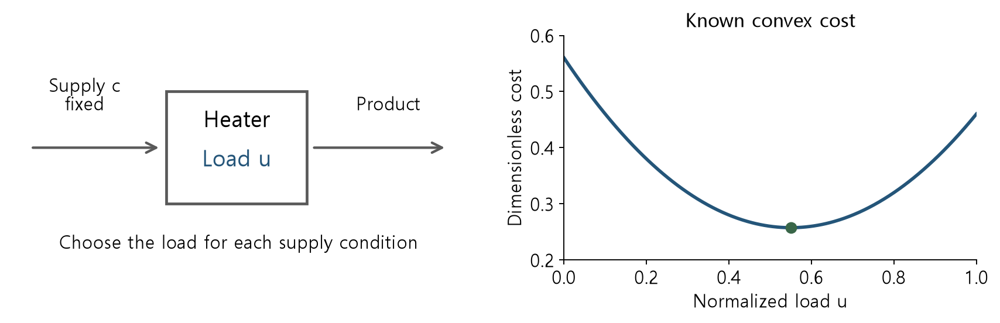
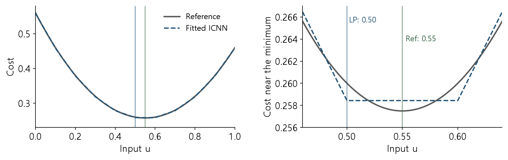
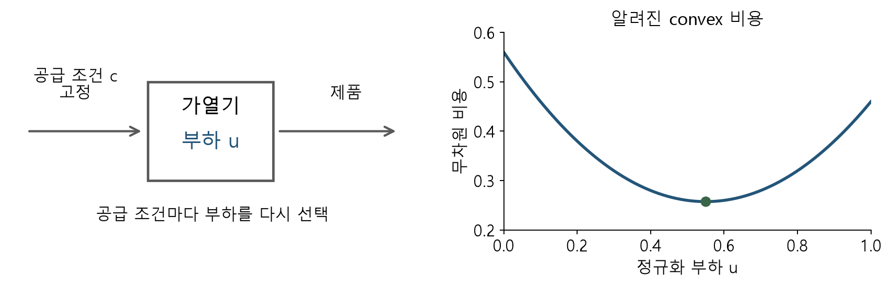
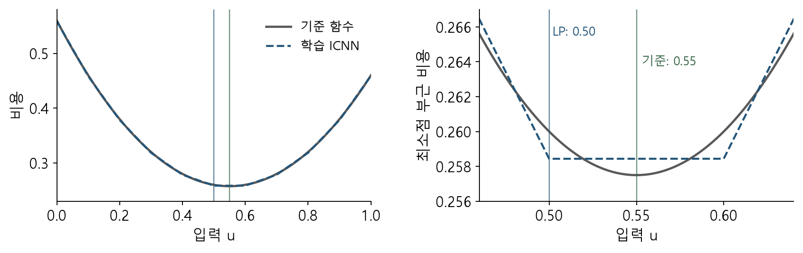

## Utility cost models and repeated operating decisions

A changing supply condition requires a new heating-load decision. When a neural network predicts the cost curve, its structure also affects the optimization used to select the load.

<figure></figure>

We will preserve convex cost structure while selecting the load.

<!-- lecture-page -->

## Model choice and optimization formulations

Weeks 5 and 6 represented a fitted general ReLU network exactly as an MILP. This week imposes convexity in selected inputs during model design.

We begin with a known convex cost. Reactor concentrations and yields are not assumed convex.

Structural restrictions reduce the function class, so evaluate prediction error together with the resulting decisions.

<!-- lecture-page -->

## Learning objectives and deliverables

1. Separate decisions from fixed context and check ICNN sign conditions.
2. Explain objective-value equivalence and the conditions for a ReLU epigraph LP.
3. Calculate counterexamples involving inequality direction, negative weights, and variable context.
4. Validate a small fitted ICNN decision by forward evaluation and a reference function.

<!-- lecture-page -->

## Decision variables and fixed context

Choose a normalized heating load u, while fixing measured supply composition or ambient conditions c. Freeze model parameters θ before optimization.

<math display="block"><mtable columnalign="left"><mtr><mtd><mrow><msub><mi mathvariant="normal">min</mi><mrow><mi>u</mi><mo>∈</mo><mi>U</mi></mrow></msub><msub><mi>f</mi><mrow><mi>θ</mi></mrow></msub><mo>(</mo><mi>u</mi><mo>;</mo><mi>c</mi><mo>)</mo></mrow></mtd></mtr><mtr><mtd><mrow><mi>U</mi><mo>=</mo><mo>{</mo><mi>u</mi><mo>:</mo><mi>G</mi><mi>u</mi><mo>≤</mo><mi>r</mi><mo>}</mo><mo>,</mo><mi>c</mi><mo>=</mo><msub><mi>c</mi><mrow><mi>o</mi><mi>b</mi><mi>s</mi></mrow></msub></mrow></mtd></mtr></mtable></math>

Convexity here concerns u. It does not establish convexity in c or θ.

<!-- lecture-page -->

## Convex functions and sublevel sets

A convex function lies below the line segment joining two function values.

<math display="block"><mtable columnalign="left"><mtr><mtd><mrow><mi>f</mi><mo>(</mo><mi>λ</mi><mi>u</mi><mo>+</mo><mo>(</mo><mn>1</mn><mo>−</mo><mi>λ</mi><mo>)</mo><mi>v</mi><mo>)</mo><mo>≤</mo><mi>λ</mi><mi>f</mi><mo>(</mo><mi>u</mi><mo>)</mo><mo>+</mo><mo>(</mo><mn>1</mn><mo>−</mo><mi>λ</mi><mo>)</mo><mi>f</mi><mo>(</mo><mi>v</mi><mo>)</mo></mrow></mtd></mtr><mtr><mtd><mrow><mn>0</mn><mo>≤</mo><mi>λ</mi><mo>≤</mo><mn>1</mn></mrow></mtd></mtr></mtable></math>

For convex f, the constraint f(u) ≤ b defines a convex set. The reverse inequality generally does not. This distinction determines valid LP uses.

[Boyd and Vandenberghe, Convex Optimization, §§3.1-3.2 and 4.1-4.3](https://web.stanford.edu/~boyd/cvxbook/bv_cvxbook.pdf)

<!-- lecture-page -->

## ICNN input connections and sign conditions

<math display="block"><mtable columnalign="left"><mtr><mtd><mrow><msub><mi>h</mi><mrow><mn>0</mn></mrow></msub><mo>=</mo><mn>0</mn></mrow></mtd></mtr><mtr><mtd><mrow><msub><mi>h</mi><mrow><mi>k</mi></mrow></msub><mo>=</mo><mi mathvariant="normal">ReLU</mi><mo>(</mo><msub><mi>W</mi><mrow><mi>k</mi></mrow></msub><msub><mi>h</mi><mrow><mi>k</mi><mo>−</mo><mn>1</mn></mrow></msub><mo>+</mo><msub><mi>A</mi><mrow><mi>k</mi></mrow></msub><mi>u</mi><mo>+</mo><msub><mi>b</mi><mrow><mi>k</mi></mrow></msub><mo>)</mo></mrow></mtd></mtr><mtr><mtd><mrow><mi>f</mi><mo>(</mo><mi>u</mi><mo>)</mo><mo>=</mo><msup><mi>a</mi><mrow><mi>T</mi></mrow></msup><mi>u</mi><mo>+</mo><mi>d</mi><mo>+</mo><msup><mi>w</mi><mrow><mi>T</mi></mrow></msup><msub><mi>h</mi><mrow><mi>K</mi></mrow></msub></mrow></mtd></mtr></mtable></math>

Constrain every entry of W and w to be nonnegative. Direct input weights A and a, and biases, may have either sign.

ReLU is convex and nondecreasing. These conditions preserve convexity in the inputs through the layers and output.

[Amos, Xu and Kolter, Input Convex Neural Networks, ICML 2017, pp. 146-155](https://proceedings.mlr.press/v70/amos17b.html)

<!-- lecture-page -->

## Layerwise convexity derivation

The first layer is a maximum of an affine function and zero, so it is convex. Assume every component of the previous layer is convex.

With W ≥ 0, their weighted sum is convex; adding an affine input connection preserves this property. Applying convex, nondecreasing ReLU preserves it again.

The output condition w ≥ 0 serves the same purpose. Negative slopes in direct input connections remain affine and do not break the argument.

<!-- lecture-page -->

## Negative weights and input convexity

Negative weights on hidden activations remove the sufficient condition.

<math display="block"><mtable columnalign="left"><mtr><mtd><mrow><mi>f</mi><mo>(</mo><mi>u</mi><mo>)</mo><mo>=</mo><mo>−</mo><mi mathvariant="normal">ReLU</mi><mo>(</mo><mi>u</mi><mo>)</mo><mo>,</mo><mo>−</mo><mn>1</mn><mo>≤</mo><mi>u</mi><mo>≤</mo><mn>1</mn></mrow></mtd></mtr><mtr><mtd><mrow><mi>f</mi><mo>(</mo><mn>0</mn><mo>)</mo><mo>=</mo><mn>0</mn><mo>&gt;</mo><mo>(</mo><mi>f</mi><mo>(</mo><mo>−</mo><mn>1</mn><mo>)</mo><mo>+</mo><mi>f</mi><mo>(</mo><mn>1</mn><mo>)</mo><mo>)</mo><mo>/</mo><mn>2</mn><mo>=</mo><mo>−</mo><mn>.5</mn></mrow></mtd></mtr></mtable></math>

Direct input weights need not be nonnegative: ReLU(−u + 0.4) is still convex. Identify which connection each restricted weight belongs to.

<!-- lecture-page -->

## Sign constraints during training

After a gradient update, project W to max(W, 0), or parameterize W = softplus(V) using free parameters V. Apply the same rule to output weights w.

Here softplus parameterizes positive weights. Hidden activations remain ReLU during inference.

Inspect the actual fitted weights. Training a general deep ICNN in its parameters is nonlinear and nonconvex.

<!-- lecture-page -->

## ReLU graphs and epigraphs

<math display="block"><mtable columnalign="left"><mtr><mtd><mrow><mi>h</mi><mo>=</mo><mi mathvariant="normal">ReLU</mi><mo>(</mo><mi>s</mi><mo>)</mo><mo>=</mo><mi mathvariant="normal">max</mi><mo>(</mo><mn>0</mn><mo>,</mo><mi>s</mi><mo>)</mo></mrow></mtd></mtr><mtr><mtd><mrow><mi>h</mi><mo>≥</mo><mn>0</mn><mo>,</mo><mi>h</mi><mo>≥</mo><mi>s</mi></mrow></mtd></mtr></mtable></math>

The two inequalities describe the region above ReLU. They allow h = 10 at s = 0, so they do not represent the graph equality itself.

To use these lower bounds in an LP, it must be possible to reduce the auxiliary activations to the actual outputs, and the objective and remaining constraints must permit that reduction.

<!-- lecture-page -->

## An extended LP for a ReLU ICNN

Use these constraints for a finite ReLU network with frozen weights.

<math display="block"><mtable columnalign="left"><mtr><mtd><mrow><msub><mi>h</mi><mrow><mi>k</mi></mrow></msub><mo>≥</mo><mn>0</mn></mrow></mtd></mtr><mtr><mtd><mrow><msub><mi>h</mi><mrow><mi>k</mi></mrow></msub><mo>≥</mo><msub><mi>W</mi><mrow><mi>k</mi></mrow></msub><msub><mi>h</mi><mrow><mi>k</mi><mo>−</mo><mn>1</mn></mrow></msub><mo>+</mo><msub><mi>A</mi><mrow><mi>k</mi></mrow></msub><mi>u</mi><mo>+</mo><msub><mi>b</mi><mrow><mi>k</mi></mrow></msub></mrow></mtd></mtr><mtr><mtd><mrow><mi>t</mi><mo>≥</mo><msup><mi>a</mi><mrow><mi>T</mi></mrow></msup><mi>u</mi><mo>+</mo><mi>d</mi><mo>+</mo><msup><mi>w</mi><mrow><mi>T</mi></mrow></msup><msub><mi>h</mi><mrow><mi>K</mi></mrow></msub></mrow></mtd></mtr></mtable></math>

Add Gu ≤ r and minimize t. With W, w ≥ 0 and linear remaining expressions, this is an LP without binary variables.

Replacing the activation by softplus can preserve convexity, but not an exact representation by these finitely many linear constraints.

<!-- lecture-page -->

## Forward recovery and objective-value equivalence

At fixed u, a feasible first-layer h dominates the actual ReLU output. Induction using W ≥ 0 gives the same result at every layer, hence t ≥ f(u).

Conversely, the true forward activations with t = f(u) satisfy every constraint. These two inclusions establish the exact epigraph.

The optimum of min t agrees with the objective at the selected u. Auxiliary variables that do not affect the output may remain slack even at an optimum.

<!-- lecture-page -->

## Applicability by output use

<table><thead><tr><th style="font-size:clamp(15px,1.7cqw,22px)">Output use</th><th style="font-size:clamp(15px,1.7cqw,22px)">Assessment</th></tr></thead><tbody><tr><td style="font-size:clamp(15px,1.7cqw,22px)">min f(u)</td><td style="font-size:clamp(15px,1.7cqw,22px)">Use an epigraph objective</td></tr><tr><td style="font-size:clamp(15px,1.7cqw,22px)">f(u) ≤ b</td><td style="font-size:clamp(15px,1.7cqw,22px)">Adding t ≤ b gives the exact input feasible set</td></tr><tr><td style="font-size:clamp(15px,1.7cqw,22px)">f(u) ≥ b</td><td style="font-size:clamp(15px,1.7cqw,22px)">Adding only t ≥ b does not enforce a lower bound on the true output</td></tr><tr><td style="font-size:clamp(15px,1.7cqw,22px)">y = f(u)</td><td style="font-size:clamp(15px,1.7cqw,22px)">The output graph equality is generally nonconvex</td></tr><tr><td style="font-size:clamp(15px,1.7cqw,22px)">max f(u)</td><td style="font-size:clamp(15px,1.7cqw,22px)">The same LP argument does not cover convex maximization</td></tr></tbody></table>

Also inspect any other constraints that favor larger h or t.

<!-- lecture-page -->

## A two-hinge cost model for hand calculation

<math display="block"><mtable columnalign="left"><mtr><mtd><mrow><mi>f</mi><mo>(</mo><mi>u</mi><mo>)</mo><mo>=</mo><mn>.4</mn><mo>−</mo><mn>.6</mn><mi>u</mi><mo>+</mo><msub><mi>h</mi><mrow><mn>1</mn></mrow></msub><mo>+</mo><mn>.5</mn><msub><mi>h</mi><mrow><mn>2</mn></mrow></msub></mrow></mtd></mtr><mtr><mtd><mrow><msub><mi>h</mi><mrow><mn>1</mn></mrow></msub><mo>=</mo><mi mathvariant="normal">ReLU</mi><mo>(</mo><mi>u</mi><mo>−</mo><mn>.4</mn><mo>)</mo><mo>,</mo><msub><mi>h</mi><mrow><mn>2</mn></mrow></msub><mo>=</mo><mi mathvariant="normal">ReLU</mi><mo>(</mo><mi>u</mi><mo>−</mo><mn>.7</mn><mo>)</mo></mrow></mtd></mtr><mtr><mtd><mrow><mn>0</mn><mo>≤</mo><mi>u</mi><mo>≤</mo><mn>1</mn></mrow></mtd></mtr></mtable></math>

This dimensionless cost example supports direct numerical checks. Its successive slopes are −0.6, 0.4, and 0.9.

The minimum is at the first slope change, u = 0.4, with f(0.4) = 0.16.

<!-- lecture-page -->

## The hand model LP and a cost cap

<math display="block"><mtable columnalign="left"><mtr><mtd><mrow><msub><mi mathvariant="normal">min</mi><mrow><mi>u</mi><mo>,</mo><mi>h</mi></mrow></msub><mn>.4</mn><mo>−</mo><mn>.6</mn><mi>u</mi><mo>+</mo><msub><mi>h</mi><mrow><mn>1</mn></mrow></msub><mo>+</mo><mn>.5</mn><msub><mi>h</mi><mrow><mn>2</mn></mrow></msub></mrow></mtd></mtr><mtr><mtd><mrow><msub><mi>h</mi><mrow><mn>1</mn></mrow></msub><mo>≥</mo><mn>0</mn><mo>,</mo><msub><mi>h</mi><mrow><mn>1</mn></mrow></msub><mo>≥</mo><mi>u</mi><mo>−</mo><mn>.4</mn></mrow></mtd></mtr><mtr><mtd><mrow><msub><mi>h</mi><mrow><mn>2</mn></mrow></msub><mo>≥</mo><mn>0</mn><mo>,</mo><msub><mi>h</mi><mrow><mn>2</mn></mrow></msub><mo>≥</mo><mi>u</mi><mo>−</mo><mn>.7</mn><mo>,</mo><mn>0</mn><mo>≤</mo><mi>u</mi><mo>≤</mo><mn>1</mn></mrow></mtd></mtr></mtable></math>

A cost cap of 0.25 leaves the feasible input interval [0.25, 0.625]. Bound the affine output expression above to obtain this interval in the LP.

The lab checks the minimum value 0.16 and forward agreement.

<!-- lecture-page -->

## A counterexample for an output lower bound

On 0 ≤ u ≤ 1, let f(u) = ReLU(u) and minimize u subject to f(u) ≥ 0.8. The true optimum is u = 0.8.

<math display="block"><mtable columnalign="left"><mtr><mtd><mrow><mi>h</mi><mo>≥</mo><mi>u</mi><mo>,</mo><mi>h</mi><mo>≥</mo><mn>0</mn><mo>,</mo><mi>h</mi><mo>≥</mo><mn>.8</mn></mrow></mtd></mtr></mtable></math>

The relaxation permits u = 0, h = 0.8. An inflated auxiliary variable lowers the cost. A small MIP gap or an LP optimal status cannot detect this modeling error.

<!-- lecture-page -->

## Counterexamples for output rewards and graph equalities

Minimizing −h for the same ReLU makes the epigraph LP unbounded when h has no upper bound. The actual f(u) lies in [0, 1], and min −f(u) = −1.

For f(u) = &#124;u&#124;, graph points (−1, 1) and (1, 1) have midpoint (0, 1), which is not on the graph.

Transferring cost-epigraph equivalence directly to concentration equalities or output rewards changes the problem.

<!-- lecture-page -->

## PICNNs and fixed context

A PICNN imposes convexity on only part of its input. The path processing supply context c may be nonlinear, while the decision path in u must satisfy the required sign conditions after c is fixed.

The next page uses a sufficient form in which context determines layer coefficients. The paper’s gated construction can also be interpreted this way at fixed context.

[Amos, Xu and Kolter, Input Convex Neural Networks, ICML 2017, pp. 146-155](https://proceedings.mlr.press/v70/amos17b.html)

<!-- lecture-page -->

## Conditional coefficients and LP construction

<math display="block"><mtable columnalign="left"><mtr><mtd><mrow><msub><mi>h</mi><mrow><mi>k</mi></mrow></msub><mo>=</mo><mi mathvariant="normal">ReLU</mi><mo>(</mo><msub><mi>W</mi><mrow><mi>k</mi></mrow></msub><mo>(</mo><mi>c</mi><mo>)</mo><msub><mi>h</mi><mrow><mi>k</mi><mo>−</mo><mn>1</mn></mrow></msub><mo>+</mo><msub><mi>A</mi><mrow><mi>k</mi></mrow></msub><mo>(</mo><mi>c</mi><mo>)</mo><mi>u</mi><mo>+</mo><msub><mi>b</mi><mrow><mi>k</mi></mrow></msub><mo>(</mo><mi>c</mi><mo>)</mo><mo>)</mo></mrow></mtd></mtr><mtr><mtd><mrow><msub><mi>W</mi><mrow><mi>k</mi></mrow></msub><mo>(</mo><mi>c</mi><mo>)</mo><mo>≥</mo><mn>0</mn><mo>,</mo><mi>w</mi><mo>(</mo><mi>c</mi><mo>)</mo><mo>≥</mo><mn>0</mn></mrow></mtd></mtr></mtable></math>

Evaluate the context path once at observed c, then freeze its coefficients. With linear remaining decision expressions and constraints, construct the ReLU epigraph LP.

Optimizing c as well can introduce nonlinear products W(c)h or A(c)u. Fixed-context results do not imply joint convexity or an LP.

<!-- lecture-page -->

## Conditional versus joint convexity

<math display="block"><mtable columnalign="left"><mtr><mtd><mrow><mi>f</mi><mo>(</mo><mi>u</mi><mo>;</mo><mi>c</mi><mo>)</mo><mo>=</mo><mo>&#124;</mo><mi>u</mi><mo>−</mo><mi>c</mi><mo>&#124;</mo><mo>−</mo><mn>.1</mn><msup><mi>c</mi><mrow><mn>2</mn></mrow></msup></mrow></mtd></mtr><mtr><mtd><mrow><mn>0</mn><mo>≤</mo><mi>u</mi><mo>≤</mo><mn>1</mn><mo>,</mo><mn>0</mn><mo>≤</mo><mi>c</mi><mo>≤</mo><mn>1</mn></mrow></mtd></mtr></mtable></math>

At fixed c, the optimum is u = c. The lab solves separate LPs for c = 0.2, 0.5, and 0.8.

Along u = c, f = −0.1c². The endpoint average is −0.05 but the midpoint value is −0.025, violating joint convexity.

<!-- lecture-page -->

## Fitting a known convex reference function

<math display="block"><mtable columnalign="left"><mtr><mtd><mrow><mi>q</mi><mo>(</mo><mi>u</mi><mo>)</mo><mo>=</mo><mo>(</mo><mi>u</mi><mo>−</mo><mn>.6</mn><msup><mo>)</mo><mrow><mn>2</mn></mrow></msup><mo>+</mo><mn>.1</mn><mi>u</mi><mo>+</mo><mn>.2</mn></mrow></mtd></mtr><mtr><mtd><mrow><mi>f</mi><mo>(</mo><mi>u</mi><mo>)</mo><mo>=</mo><mi>b</mi><mo>+</mo><mi>a</mi><mi>u</mi><mo>+</mo><msup><msub><mo>∑</mo><mrow><mi>j</mi><mo>=</mo><mn>1</mn></mrow></msub><mrow><mn>9</mn></mrow></msup><msub><mi>w</mi><mrow><mi>j</mi></mrow></msub><mi mathvariant="normal">ReLU</mi><mo>(</mo><mi>u</mi><mo>−</mo><msub><mi>κ</mi><mrow><mi>j</mi></mrow></msub><mo>)</mo></mrow></mtd></mtr><mtr><mtd><mrow><msub><mi>κ</mi><mrow><mi>j</mi></mrow></msub><mo>=</mo><mn>.1</mn><mi>j</mi><mo>,</mo><msub><mi>w</mi><mrow><mi>j</mi></mrow></msub><mo>≥</mo><mn>0</mn></mrow></mtd></mtr></mtable></math>

Fit coefficients at 41 evenly spaced inputs and evaluate at 200 separate midpoint inputs. With fixed knots, this lab uses bounded linear least squares.

This shallow ICNN with fixed knots is a special case with convex training. The conclusion does not extend to general deep-ICNN training.

<!-- lecture-page -->

## Fitted curve and selected load

<figure></figure>

Independent-evaluation RMSE is 0.000760. The LP selects u = 0.50, while the reference minimum is at u = 0.55.

The reference cost difference is 0.0025. Close prediction curves can still have different minimizers.

<!-- lecture-page -->

## Checks on an LP result

1. Save the input domain, context, scaling, and model weights.
2. Check W and w signs, objective direction, and every use of outputs.
3. Evaluate the original network at the chosen u and compare with the LP objective.
4. Separately evaluate the reference objective and constraints.

The fitted-model LP objective is 0.258437, while the reference cost is 0.260000. Their difference is surrogate error.

<!-- lecture-page -->

## Choosing a model structure

<table><thead><tr><th style="font-size:clamp(15px,1.7cqw,22px)">Target and conditions</th><th style="font-size:clamp(15px,1.7cqw,22px)">Approach to examine</th></tr></thead><tbody><tr><td style="font-size:clamp(15px,1.7cqw,22px)">Known convex cost minimization</td><td style="font-size:clamp(15px,1.7cqw,22px)">ICNN or fixed-context PICNN</td></tr><tr><td style="font-size:clamp(15px,1.7cqw,22px)">ReLU, linear output, linear outer constraints</td><td style="font-size:clamp(15px,1.7cqw,22px)">Epigraph LP after checking its conditions</td></tr><tr><td style="font-size:clamp(15px,1.7cqw,22px)">Concentration equalities or nonconvex response</td><td style="font-size:clamp(15px,1.7cqw,22px)">General surrogate with an appropriate NLP/MILP</td></tr><tr><td style="font-size:clamp(15px,1.7cqw,22px)">Weak evidence for convexity</td><td style="font-size:clamp(15px,1.7cqw,22px)">Compare structural prediction bias and decision errors</td></tr></tbody></table>

<!-- lecture-page -->

## Running the lab and checking outputs

```bash
python -m pip install -r requirements.txt
python week07_lab.py --output-dir my-results
```

Extract the code bundle before running. It writes results.json, fitted coefficients, training.csv, and heldout.csv.

Automatic checks cover the hand optimum 0.16, fitted sign conditions, LP/forward agreement, the output-lower-bound counterexample, and the unbounded example. The notebook runs the same functions in stages.

<!-- lecture-page -->

## Assignment: equivalence conditions and decision error

1. Add a cost cap of 0.25 to the two-hinge model and calculate both endpoints of its feasible interval.
2. Run the output-lower-bound counterexample and record the falsely allowed u and its true output.
3. Change fitted knot spacing from 0.1 to 0.05; compare prediction error and reference decision loss.
4. Explain why c is fixed and which output uses your formulation permits.

The companion provides derivations and short answer checks.

<!-- lecture-page -->

## Companion and primary sources

The [Week 7 companion](/courses/surrogate-models/week-07-reading/) works through epigraph equivalence, LP matrices, sign-constrained fitting, and counterexamples.

[Amos, Xu and Kolter, Input Convex Neural Networks, ICML 2017, pp. 146-155](https://proceedings.mlr.press/v70/amos17b.html)

[Boyd and Vandenberghe, Convex Optimization, §§3.1-3.2 and 4.1-4.3](https://web.stanford.edu/~boyd/cvxbook/bv_cvxbook.pdf)

[SciPy bounded least squares](https://docs.scipy.org/doc/scipy/reference/generated/scipy.optimize.lsq_linear.html) · [SciPy HiGHS LP interface](https://docs.scipy.org/doc/scipy/reference/generated/scipy.optimize.linprog.html)

<!-- ko -->

## 유틸리티 비용 모델과 반복 운전 선택

공급 조건이 바뀔 때마다 가열 부하를 다시 정해야 합니다. 비용 곡선을 신경망으로 학습하면 운전 조건을 찾는 계산도 모델 구조에 따라 달라집니다.

<figure></figure>

비용의 convex 구조를 유지하면서 부하를 선택하는 방법을 다뤄봅니다.

<!-- lecture-page -->

## 모델 선택과 정식화의 연결

5·6주차에서는 학습된 일반 ReLU 네트워크를 MILP로 정확히 표현했습니다. 이번 주에는 학습 단계에서 입력에 대한 convexity를 부여합니다.

알려진 convex 비용을 먼저 다룹니다. 반응기 농도나 수율이 convex라는 가정은 하지 않습니다.

구조 제약을 추가하면 표현할 수 있는 함수가 줄어들므로, 예측 오차와 의사결정 결과를 함께 확인합니다.

<!-- lecture-page -->

## 학습 목표와 제출 항목

1. 결정변수와 고정 context를 구분하고 ICNN의 부호 조건을 확인합니다.
2. ReLU epigraph LP의 목적값 동치성과 적용 조건을 설명합니다.
3. 부등식 방향·음의 가중치·가변 context에 대한 반례를 계산합니다.
4. 학습한 작은 ICNN의 LP 해를 forward 계산과 기준 함수로 검증합니다.

<!-- lecture-page -->

## 결정변수와 고정 context

정규화한 가열 부하 u를 선택하고, 공급 조성·외기 조건 c는 측정한 값으로 고정합니다. 모델 매개변수 θ도 최적화 전에 고정합니다.

<math display="block"><mtable columnalign="left"><mtr><mtd><mrow><msub><mi mathvariant="normal">min</mi><mrow><mi>u</mi><mo>∈</mo><mi>U</mi></mrow></msub><msub><mi>f</mi><mrow><mi>θ</mi></mrow></msub><mo>(</mo><mi>u</mi><mo>;</mo><mi>c</mi><mo>)</mo></mrow></mtd></mtr><mtr><mtd><mrow><mi>U</mi><mo>=</mo><mo>{</mo><mi>u</mi><mo>:</mo><mi>G</mi><mi>u</mi><mo>≤</mo><mi>r</mi><mo>}</mo><mo>,</mo><mi>c</mi><mo>=</mo><msub><mi>c</mi><mrow><mi>o</mi><mi>b</mi><mi>s</mi></mrow></msub></mrow></mtd></mtr></mtable></math>

여기서 convexity는 u에 관한 성질입니다. c나 θ에 대해서도 convex라고 결론 내릴 수는 없습니다.

<!-- lecture-page -->

## Convex 함수와 sublevel set

두 입력 사이의 함수값이 두 함수값을 잇는 선분보다 높지 않으면 convex입니다.

<math display="block"><mtable columnalign="left"><mtr><mtd><mrow><mi>f</mi><mo>(</mo><mi>λ</mi><mi>u</mi><mo>+</mo><mo>(</mo><mn>1</mn><mo>−</mo><mi>λ</mi><mo>)</mo><mi>v</mi><mo>)</mo><mo>≤</mo><mi>λ</mi><mi>f</mi><mo>(</mo><mi>u</mi><mo>)</mo><mo>+</mo><mo>(</mo><mn>1</mn><mo>−</mo><mi>λ</mi><mo>)</mo><mi>f</mi><mo>(</mo><mi>v</mi><mo>)</mo></mrow></mtd></mtr><mtr><mtd><mrow><mn>0</mn><mo>≤</mo><mi>λ</mi><mo>≤</mo><mn>1</mn></mrow></mtd></mtr></mtable></math>

Convex f에 대한 f(u) ≤ b는 convex 영역을 만듭니다. f(u) ≥ b는 일반적으로 그렇지 않습니다. 이 방향 차이가 LP 사용 조건에 반영됩니다.

[Boyd and Vandenberghe, Convex Optimization, §§3.1-3.2 and 4.1-4.3](https://web.stanford.edu/~boyd/cvxbook/bv_cvxbook.pdf)

<!-- lecture-page -->

## ICNN의 입력 연결과 부호 조건

<math display="block"><mtable columnalign="left"><mtr><mtd><mrow><msub><mi>h</mi><mrow><mn>0</mn></mrow></msub><mo>=</mo><mn>0</mn></mrow></mtd></mtr><mtr><mtd><mrow><msub><mi>h</mi><mrow><mi>k</mi></mrow></msub><mo>=</mo><mi mathvariant="normal">ReLU</mi><mo>(</mo><msub><mi>W</mi><mrow><mi>k</mi></mrow></msub><msub><mi>h</mi><mrow><mi>k</mi><mo>−</mo><mn>1</mn></mrow></msub><mo>+</mo><msub><mi>A</mi><mrow><mi>k</mi></mrow></msub><mi>u</mi><mo>+</mo><msub><mi>b</mi><mrow><mi>k</mi></mrow></msub><mo>)</mo></mrow></mtd></mtr><mtr><mtd><mrow><mi>f</mi><mo>(</mo><mi>u</mi><mo>)</mo><mo>=</mo><msup><mi>a</mi><mrow><mi>T</mi></mrow></msup><mi>u</mi><mo>+</mo><mi>d</mi><mo>+</mo><msup><mi>w</mi><mrow><mi>T</mi></mrow></msup><msub><mi>h</mi><mrow><mi>K</mi></mrow></msub></mrow></mtd></mtr></mtable></math>

W와 w의 모든 원소를 0 이상으로 제한합니다. 입력에서 직접 들어오는 A와 a, bias의 부호는 제한하지 않습니다.

ReLU는 convex이고 비감소합니다. 이 조건으로 각 층과 출력의 입력 convexity를 유지합니다.

[Amos, Xu and Kolter, Input Convex Neural Networks, ICML 2017, pp. 146-155](https://proceedings.mlr.press/v70/amos17b.html)

<!-- lecture-page -->

## 층별 convexity 유도

첫 층은 affine 함수와 0의 최댓값이므로 convex입니다. 이전 층의 성분들이 convex라고 가정합니다.

W ≥ 0이면 그 성분의 가중합도 convex이고, affine 입력 연결을 더해도 유지됩니다. 여기에 convex·비감소 ReLU를 적용합니다.

출력의 w ≥ 0도 같은 역할을 합니다. 입력 연결의 음의 기울기는 affine 항이므로 이 논증을 깨지 않습니다.

<!-- lecture-page -->

## 음의 가중치와 입력 convexity

은닉 출력에 음의 가중치를 허용하면 위의 충분조건이 사라집니다.

<math display="block"><mtable columnalign="left"><mtr><mtd><mrow><mi>f</mi><mo>(</mo><mi>u</mi><mo>)</mo><mo>=</mo><mo>−</mo><mi mathvariant="normal">ReLU</mi><mo>(</mo><mi>u</mi><mo>)</mo><mo>,</mo><mo>−</mo><mn>1</mn><mo>≤</mo><mi>u</mi><mo>≤</mo><mn>1</mn></mrow></mtd></mtr><mtr><mtd><mrow><mi>f</mi><mo>(</mo><mn>0</mn><mo>)</mo><mo>=</mo><mn>0</mn><mo>&gt;</mo><mo>(</mo><mi>f</mi><mo>(</mo><mo>−</mo><mn>1</mn><mo>)</mo><mo>+</mo><mi>f</mi><mo>(</mo><mn>1</mn><mo>)</mo><mo>)</mo><mo>/</mo><mn>2</mn><mo>=</mo><mo>−</mo><mn>.5</mn></mrow></mtd></mtr></mtable></math>

음의 입력 연결을 금지할 필요는 없습니다. 예를 들어 ReLU(−u + 0.4)는 여전히 convex입니다. 제한하는 가중치가 어느 연결에 있는지 확인합니다.

<!-- lecture-page -->

## 학습 중 부호 제약

Gradient 갱신 뒤 W를 max(W, 0)으로 투영하거나, 자유 매개변수 V에서 W = softplus(V)를 계산할 수 있습니다. 출력 가중치 w에도 적용합니다.

여기서 softplus는 가중치를 양수로 만드는 매개화입니다. 추론할 때 은닉 활성화는 ReLU로 유지합니다.

학습을 마치면 가중치의 부호를 검사합니다. 일반적인 깊은 ICNN의 매개변수 학습은 비선형·비볼록 문제입니다.

<!-- lecture-page -->

## ReLU 그래프와 epigraph

<math display="block"><mtable columnalign="left"><mtr><mtd><mrow><mi>h</mi><mo>=</mo><mi mathvariant="normal">ReLU</mi><mo>(</mo><mi>s</mi><mo>)</mo><mo>=</mo><mi mathvariant="normal">max</mi><mo>(</mo><mn>0</mn><mo>,</mo><mi>s</mi><mo>)</mo></mrow></mtd></mtr><mtr><mtd><mrow><mi>h</mi><mo>≥</mo><mn>0</mn><mo>,</mo><mi>h</mi><mo>≥</mo><mi>s</mi></mrow></mtd></mtr></mtable></math>

두 부등식은 ReLU 위쪽 영역을 표현합니다. s = 0에서 h = 10도 허용하므로 그래프 등식 자체와 같지는 않습니다.

이 하한 제약을 LP에 사용하려면 보조변수를 실제 출력으로 줄일 수 있어야 하며, 목적함수와 나머지 제약도 그 방향을 허용해야 합니다.

<!-- lecture-page -->

## ReLU ICNN의 확장 LP

유한한 ReLU 네트워크와 고정된 가중치에 다음 제약을 사용합니다.

<math display="block"><mtable columnalign="left"><mtr><mtd><mrow><msub><mi>h</mi><mrow><mi>k</mi></mrow></msub><mo>≥</mo><mn>0</mn></mrow></mtd></mtr><mtr><mtd><mrow><msub><mi>h</mi><mrow><mi>k</mi></mrow></msub><mo>≥</mo><msub><mi>W</mi><mrow><mi>k</mi></mrow></msub><msub><mi>h</mi><mrow><mi>k</mi><mo>−</mo><mn>1</mn></mrow></msub><mo>+</mo><msub><mi>A</mi><mrow><mi>k</mi></mrow></msub><mi>u</mi><mo>+</mo><msub><mi>b</mi><mrow><mi>k</mi></mrow></msub></mrow></mtd></mtr><mtr><mtd><mrow><mi>t</mi><mo>≥</mo><msup><mi>a</mi><mrow><mi>T</mi></mrow></msup><mi>u</mi><mo>+</mo><mi>d</mi><mo>+</mo><msup><mi>w</mi><mrow><mi>T</mi></mrow></msup><msub><mi>h</mi><mrow><mi>K</mi></mrow></msub></mrow></mtd></mtr></mtable></math>

입력 제약 Gu ≤ r를 추가하고 t를 최소화합니다. W, w ≥ 0이고 나머지 식도 선형이면 이진변수 없이 LP가 됩니다.

활성화를 softplus로 바꾸면 convexity는 유지할 수 있어도 이 유한한 선형 제약식으로 정확히 표현되지는 않습니다.

<!-- lecture-page -->

## Forward 복원과 목적값 동치성

u를 고정하면 첫 층의 허용 h는 실제 ReLU 출력 이상입니다. W ≥ 0을 사용해 층별로 반복하면 모든 h가 실제 출력 이상이 됩니다. 따라서 t ≥ f(u)입니다.

반대로 실제 forward 값을 h에 넣고 t = f(u)로 두면 모든 제약을 만족합니다. 이 두 포함관계가 epigraph의 정확성을 보입니다.

min t의 최적값과 선택한 u의 목적값이 일치합니다. 출력에 영향을 주지 않는 보조변수는 최적해에서도 slack을 가질 수 있습니다.

<!-- lecture-page -->

## 출력 사용 방식에 따른 적용 범위

<table><thead><tr><th style="font-size:clamp(15px,1.7cqw,22px)">사용 방식</th><th style="font-size:clamp(15px,1.7cqw,22px)">판단</th></tr></thead><tbody><tr><td style="font-size:clamp(15px,1.7cqw,22px)">min f(u)</td><td style="font-size:clamp(15px,1.7cqw,22px)">epigraph 목적함수로 표현</td></tr><tr><td style="font-size:clamp(15px,1.7cqw,22px)">f(u) ≤ b</td><td style="font-size:clamp(15px,1.7cqw,22px)">t ≤ b를 추가하면 정확한 입력 feasible set</td></tr><tr><td style="font-size:clamp(15px,1.7cqw,22px)">f(u) ≥ b</td><td style="font-size:clamp(15px,1.7cqw,22px)">t ≥ b만으로는 실제 출력 하한을 강제하지 못함</td></tr><tr><td style="font-size:clamp(15px,1.7cqw,22px)">y = f(u)</td><td style="font-size:clamp(15px,1.7cqw,22px)">출력 그래프 등식은 일반적으로 비convex</td></tr><tr><td style="font-size:clamp(15px,1.7cqw,22px)">max f(u)</td><td style="font-size:clamp(15px,1.7cqw,22px)">convex 함수 최대화에 같은 LP 논증을 적용할 수 없음</td></tr></tbody></table>

다른 제약이 h나 t를 큰 쪽으로 밀어 올리는 경우도 다시 확인합니다.

<!-- lecture-page -->

## 손 계산용 두 hinge 비용 모델

<math display="block"><mtable columnalign="left"><mtr><mtd><mrow><mi>f</mi><mo>(</mo><mi>u</mi><mo>)</mo><mo>=</mo><mn>.4</mn><mo>−</mo><mn>.6</mn><mi>u</mi><mo>+</mo><msub><mi>h</mi><mrow><mn>1</mn></mrow></msub><mo>+</mo><mn>.5</mn><msub><mi>h</mi><mrow><mn>2</mn></mrow></msub></mrow></mtd></mtr><mtr><mtd><mrow><msub><mi>h</mi><mrow><mn>1</mn></mrow></msub><mo>=</mo><mi mathvariant="normal">ReLU</mi><mo>(</mo><mi>u</mi><mo>−</mo><mn>.4</mn><mo>)</mo><mo>,</mo><msub><mi>h</mi><mrow><mn>2</mn></mrow></msub><mo>=</mo><mi mathvariant="normal">ReLU</mi><mo>(</mo><mi>u</mi><mo>−</mo><mn>.7</mn><mo>)</mo></mrow></mtd></mtr><mtr><mtd><mrow><mn>0</mn><mo>≤</mo><mi>u</mi><mo>≤</mo><mn>1</mn></mrow></mtd></mtr></mtable></math>

이 함수는 수치를 직접 확인하는 무차원 비용 예제입니다. 구간별 기울기는 −0.6, 0.4, 0.9로 증가합니다.

최소점은 첫 번째 기울기 전환점 u = 0.4이고, f(0.4) = 0.16입니다.

<!-- lecture-page -->

## 손 계산 모델의 LP와 비용 상한

<math display="block"><mtable columnalign="left"><mtr><mtd><mrow><msub><mi mathvariant="normal">min</mi><mrow><mi>u</mi><mo>,</mo><mi>h</mi></mrow></msub><mn>.4</mn><mo>−</mo><mn>.6</mn><mi>u</mi><mo>+</mo><msub><mi>h</mi><mrow><mn>1</mn></mrow></msub><mo>+</mo><mn>.5</mn><msub><mi>h</mi><mrow><mn>2</mn></mrow></msub></mrow></mtd></mtr><mtr><mtd><mrow><msub><mi>h</mi><mrow><mn>1</mn></mrow></msub><mo>≥</mo><mn>0</mn><mo>,</mo><msub><mi>h</mi><mrow><mn>1</mn></mrow></msub><mo>≥</mo><mi>u</mi><mo>−</mo><mn>.4</mn></mrow></mtd></mtr><mtr><mtd><mrow><msub><mi>h</mi><mrow><mn>2</mn></mrow></msub><mo>≥</mo><mn>0</mn><mo>,</mo><msub><mi>h</mi><mrow><mn>2</mn></mrow></msub><mo>≥</mo><mi>u</mi><mo>−</mo><mn>.7</mn><mo>,</mo><mn>0</mn><mo>≤</mo><mi>u</mi><mo>≤</mo><mn>1</mn></mrow></mtd></mtr></mtable></math>

비용 상한 0.25를 추가하면 feasible 입력은 [0.25, 0.625]입니다. 같은 LP의 출력 affine 식에 상한을 걸어 이 구간을 얻습니다.

실습은 최소 목적값 0.16과 forward 일치를 검사합니다.

<!-- lecture-page -->

## 출력 하한 제약의 반례

0 ≤ u ≤ 1에서 f(u) = ReLU(u)라 두고 f(u) ≥ 0.8을 만족하며 u를 최소화합니다. 실제 최적점은 u = 0.8입니다.

<math display="block"><mtable columnalign="left"><mtr><mtd><mrow><mi>h</mi><mo>≥</mo><mi>u</mi><mo>,</mo><mi>h</mi><mo>≥</mo><mn>0</mn><mo>,</mo><mi>h</mi><mo>≥</mo><mn>.8</mn></mrow></mtd></mtr></mtable></math>

이 완화에서는 u = 0, h = 0.8이 허용됩니다. 비용을 줄이려고 보조변수를 부풀린 결과입니다. 작은 MIP gap이나 LP optimal 종료 상태로 이 모델링 오류를 발견할 수는 없습니다.

<!-- lecture-page -->

## 출력 보상과 그래프 등식의 반례

같은 ReLU에서 −h를 최소화하면 h의 상한이 없는 epigraph LP는 unbounded입니다. 실제 f(u)는 [0, 1]에 있어 min −f(u) = −1입니다.

또한 f(u) = &#124;u&#124;의 그래프 위에 있는 (−1, 1), (1, 1)의 중점 (0, 1)은 그래프에 없습니다.

비용 epigraph의 동치성을 농도 등식이나 출력 보상에 그대로 옮기면 문제가 달라집니다.

<!-- lecture-page -->

## PICNN과 고정 context

PICNN은 일부 입력에만 convexity를 부여합니다. 공급 조건 c를 처리하는 경로는 비선형이어도, c를 고정한 뒤 결정변수 u의 경로가 필요한 부호 조건을 만족해야 합니다.

다음 페이지는 context가 층의 계수를 결정하는 충분조건 형태를 사용합니다. 원 논문의 gate 구조도 고정 context에서 이 관점으로 해석할 수 있습니다.

[Amos, Xu and Kolter, Input Convex Neural Networks, ICML 2017, pp. 146-155](https://proceedings.mlr.press/v70/amos17b.html)

<!-- lecture-page -->

## 조건부 계수와 LP 구성

<math display="block"><mtable columnalign="left"><mtr><mtd><mrow><msub><mi>h</mi><mrow><mi>k</mi></mrow></msub><mo>=</mo><mi mathvariant="normal">ReLU</mi><mo>(</mo><msub><mi>W</mi><mrow><mi>k</mi></mrow></msub><mo>(</mo><mi>c</mi><mo>)</mo><msub><mi>h</mi><mrow><mi>k</mi><mo>−</mo><mn>1</mn></mrow></msub><mo>+</mo><msub><mi>A</mi><mrow><mi>k</mi></mrow></msub><mo>(</mo><mi>c</mi><mo>)</mo><mi>u</mi><mo>+</mo><msub><mi>b</mi><mrow><mi>k</mi></mrow></msub><mo>(</mo><mi>c</mi><mo>)</mo><mo>)</mo></mrow></mtd></mtr><mtr><mtd><mrow><msub><mi>W</mi><mrow><mi>k</mi></mrow></msub><mo>(</mo><mi>c</mi><mo>)</mo><mo>≥</mo><mn>0</mn><mo>,</mo><mi>w</mi><mo>(</mo><mi>c</mi><mo>)</mo><mo>≥</mo><mn>0</mn></mrow></mtd></mtr></mtable></math>

관측 c를 context 경로에 한 번 넣어 계수를 계산한 뒤 고정합니다. 나머지 결정변수와 제약이 선형이면 ReLU epigraph를 LP로 구성합니다.

c도 최적화하면 W(c)h나 A(c)u가 비선형 결합이 될 수 있습니다. 고정 context의 결론이 공동 최적화로 이어지지는 않습니다.

<!-- lecture-page -->

## 조건부 convexity와 공동 convexity

<math display="block"><mtable columnalign="left"><mtr><mtd><mrow><mi>f</mi><mo>(</mo><mi>u</mi><mo>;</mo><mi>c</mi><mo>)</mo><mo>=</mo><mo>&#124;</mo><mi>u</mi><mo>−</mo><mi>c</mi><mo>&#124;</mo><mo>−</mo><mn>.1</mn><msup><mi>c</mi><mrow><mn>2</mn></mrow></msup></mrow></mtd></mtr><mtr><mtd><mrow><mn>0</mn><mo>≤</mo><mi>u</mi><mo>≤</mo><mn>1</mn><mo>,</mo><mn>0</mn><mo>≤</mo><mi>c</mi><mo>≤</mo><mn>1</mn></mrow></mtd></mtr></mtable></math>

고정 c에서 최적점은 u = c입니다. 실습은 c = 0.2, 0.5, 0.8에 대한 LP를 각각 풉니다.

u = c인 선 위에서는 f = −0.1c²입니다. 끝점 함수값의 평균은 −0.05인데 중점 값은 −0.025이므로 공동 convexity 조건을 위반합니다.

<!-- lecture-page -->

## 알려진 convex 함수를 이용한 학습

<math display="block"><mtable columnalign="left"><mtr><mtd><mrow><mi>q</mi><mo>(</mo><mi>u</mi><mo>)</mo><mo>=</mo><mo>(</mo><mi>u</mi><mo>−</mo><mn>.6</mn><msup><mo>)</mo><mrow><mn>2</mn></mrow></msup><mo>+</mo><mn>.1</mn><mi>u</mi><mo>+</mo><mn>.2</mn></mrow></mtd></mtr><mtr><mtd><mrow><mi>f</mi><mo>(</mo><mi>u</mi><mo>)</mo><mo>=</mo><mi>b</mi><mo>+</mo><mi>a</mi><mi>u</mi><mo>+</mo><msup><msub><mo>∑</mo><mrow><mi>j</mi><mo>=</mo><mn>1</mn></mrow></msub><mrow><mn>9</mn></mrow></msup><msub><mi>w</mi><mrow><mi>j</mi></mrow></msub><mi mathvariant="normal">ReLU</mi><mo>(</mo><mi>u</mi><mo>−</mo><msub><mi>κ</mi><mrow><mi>j</mi></mrow></msub><mo>)</mo></mrow></mtd></mtr><mtr><mtd><mrow><msub><mi>κ</mi><mrow><mi>j</mi></mrow></msub><mo>=</mo><mn>.1</mn><mi>j</mi><mo>,</mo><msub><mi>w</mi><mrow><mi>j</mi></mrow></msub><mo>≥</mo><mn>0</mn></mrow></mtd></mtr></mtable></math>

41개 균등 입력에서 계수를 학습하고 별도의 200개 중간 지점에서 평가합니다. Knot을 고정했으므로 이 실습의 학습은 bound가 있는 선형 least squares입니다.

고정 knot을 사용하는 이 얕은 ICNN은 convex 학습이 가능한 특수한 경우입니다. 깊은 ICNN의 일반적인 학습에는 이 결론을 적용할 수 없습니다.

<!-- lecture-page -->

## 학습 곡선과 선택한 부하

<figure></figure>

독립 평가 RMSE는 0.000760입니다. LP는 u = 0.50을 선택하고, 기준 함수의 최소점은 u = 0.55입니다.

두 점 사이의 기준 비용 차이는 0.0025입니다. 예측 곡선이 가까워도 최소점 위치는 달라질 수 있습니다.

<!-- lecture-page -->

## LP 결과의 검증 항목

1. 입력 domain, context, scaling, 모델 가중치를 저장합니다.
2. W와 w의 부호, 목적함수 방향, 모든 출력 사용 위치를 확인합니다.
3. 선택한 u를 원래 네트워크에 넣어 LP 목적값과 비교합니다.
4. 기준 함수의 목적값·제약을 따로 계산합니다.

실습에서 학습 모델의 LP 목적값은 0.258437이고 기준 비용은 0.260000입니다. 이 차이는 서로게이트 오차입니다.

<!-- lecture-page -->

## 모델 구조의 선택 기준

<table><thead><tr><th style="font-size:clamp(15px,1.7cqw,22px)">대상과 조건</th><th style="font-size:clamp(15px,1.7cqw,22px)">검토할 접근</th></tr></thead><tbody><tr><td style="font-size:clamp(15px,1.7cqw,22px)">알려진 convex 비용의 최소화</td><td style="font-size:clamp(15px,1.7cqw,22px)">ICNN 또는 고정-context PICNN</td></tr><tr><td style="font-size:clamp(15px,1.7cqw,22px)">ReLU·선형 출력·선형 외부 제약</td><td style="font-size:clamp(15px,1.7cqw,22px)">조건을 확인한 epigraph LP</td></tr><tr><td style="font-size:clamp(15px,1.7cqw,22px)">농도 등식·복잡한 비convex 응답</td><td style="font-size:clamp(15px,1.7cqw,22px)">일반 서로게이트와 적절한 NLP/MILP</td></tr><tr><td style="font-size:clamp(15px,1.7cqw,22px)">Convexity 근거가 약한 데이터</td><td style="font-size:clamp(15px,1.7cqw,22px)">구조 제약의 예측 편향과 결정 오차 비교</td></tr></tbody></table>

<!-- lecture-page -->

## 실습 실행과 확인 결과

```bash
python -m pip install -r requirements.txt
python week07_lab.py --output-dir my-results
```

코드 묶음을 풀어 실행합니다. results.json, 학습 계수, training.csv와 heldout.csv를 저장합니다.

손 계산 최적값 0.16, 학습 모델의 부호 조건, LP·forward 일치, 출력 하한 반례와 unbounded 반례를 자동 검사합니다. Notebook에는 같은 함수를 단계별로 실행하는 셀이 있습니다.

<!-- lecture-page -->

## 과제: 동치성 조건과 의사결정 오차

1. 두 hinge 모델에 비용 상한 0.25를 추가하고 feasible 구간의 양 끝을 계산합니다.
2. 출력 하한 반례를 실행하고 잘못 허용된 u와 실제 출력을 기록합니다.
3. 학습 모델의 knot 간격을 0.1에서 0.05로 바꿔 예측 오차와 기준 비용 손실을 비교합니다.
4. c를 고정해야 하는 이유와 현재 모델에 허용된 출력 사용 방식을 설명합니다.

읽기자료에서 유도 과정과 짧은 답을 확인합니다.

<!-- lecture-page -->

## 해설 자료와 원문

[7주차 해설과 연습](/courses/surrogate-models/week-07-reading/)에서 epigraph 동치성 증명, LP 행렬, 부호 제약 학습과 반례를 계산합니다.

[Amos, Xu and Kolter, Input Convex Neural Networks, ICML 2017, pp. 146-155](https://proceedings.mlr.press/v70/amos17b.html)

[Boyd and Vandenberghe, Convex Optimization, §§3.1-3.2 and 4.1-4.3](https://web.stanford.edu/~boyd/cvxbook/bv_cvxbook.pdf)

[SciPy bounded least squares](https://docs.scipy.org/doc/scipy/reference/generated/scipy.optimize.lsq_linear.html) · [SciPy HiGHS LP interface](https://docs.scipy.org/doc/scipy/reference/generated/scipy.optimize.linprog.html)
