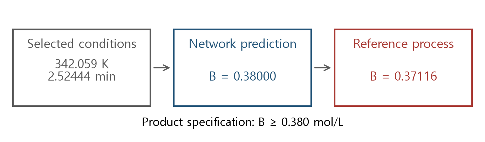
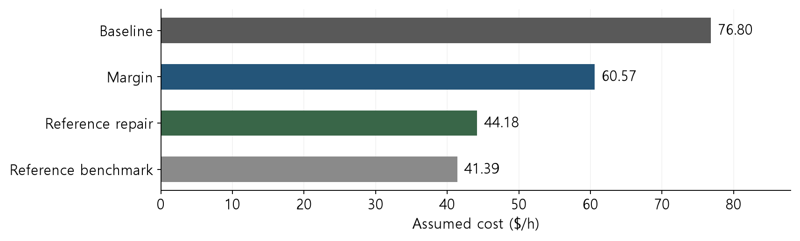
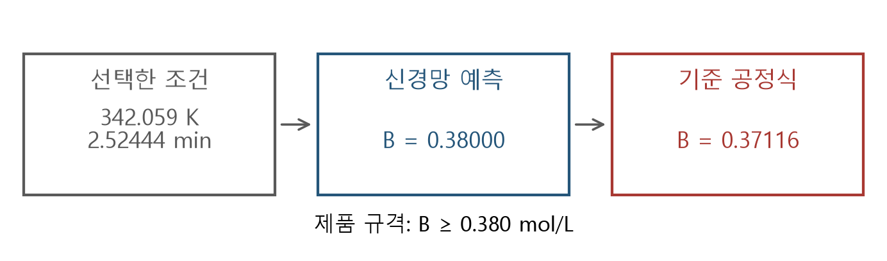
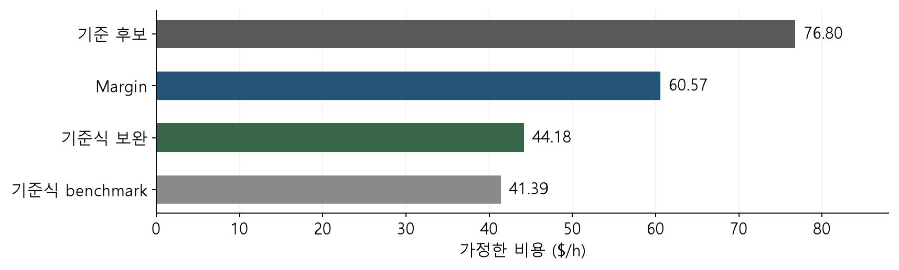

## Product specifications and revalidation of an optimum

The optimized product concentration meets the specification of 0.380 mol/L. Yet the process equations give 0.371 mol/L at the same conditions. Should this candidate be accepted?

<figure></figure>

Revalidate the selected conditions, choose an acceptable candidate, and identify the next useful data.

<!-- lecture-page -->

## Prediction validation and decision validation

Average error on independent evaluation data summarizes predictive quality across an input region. Optimization selects a few points with low cost, often near constraint boundaries.

Recompute product specifications, physical consistency, and cost at those decisions. Separately check whether the solver correctly represented the fitted model.

This week: these distinctions with the unchanged frozen network from Week 6.

### Learning objectives and final report

1. Prediction error, formulation error, and process constraint violation
2. Cost comparison among candidates feasible in the reference process model
3. Revalidation after margins and local data correction
4. Reproducible records of models, data, solvers, and candidate selection

Final report: accepted candidate, rejection reasons, remaining checks, and additional data locations.

<!-- lecture-page -->

## Reactor assumptions and variables

Reference process: ideal steady-state isothermal CSTR; consecutive first-order reactions A → B → C. Feed concentrations: A 1.2 mol/L, B and C zero. Constant density and flow.

Temperature T spans 310-350 K and residence time τ spans 2-10 min. At fixed F = 1 L/min, V = Fτ, so τ is also a reactor-sizing decision.

Changing τ in an existing fixed-size vessel requires changing flow or another condition. That requires a revised cost and process formulation.

<!-- lecture-page -->

## Temperature-dependent reaction rates

<math display="block"><mtable columnalign="left"><mtr><mtd><mrow><msub><mi>k</mi><mrow><mn>1</mn></mrow></msub><mo>(</mo><mi>T</mi><mo>)</mo><mo>=</mo><mn>.2</mn><mi mathvariant="normal">exp</mi><mo>[</mo><mfrac><mrow><mn>40000</mn></mrow><mrow><mn>8.314</mn></mrow></mfrac><mo>(</mo><mfrac><mrow><mn>1</mn></mrow><mrow><mn>330</mn></mrow></mfrac><mo>−</mo><mfrac><mrow><mn>1</mn></mrow><mrow><mi>T</mi></mrow></mfrac><mo>)</mo><mo>]</mo></mrow></mtd></mtr><mtr><mtd><mrow><msub><mi>k</mi><mrow><mn>2</mn></mrow></msub><mo>(</mo><mi>T</mi><mo>)</mo><mo>=</mo><mn>.1</mn><mi mathvariant="normal">exp</mi><mo>[</mo><mfrac><mrow><mn>50000</mn></mrow><mrow><mn>8.314</mn></mrow></mfrac><mo>(</mo><mfrac><mrow><mn>1</mn></mrow><mrow><mn>330</mn></mrow></mfrac><mo>−</mo><mfrac><mrow><mn>1</mn></mrow><mrow><mi>T</mi></mrow></mfrac><mo>)</mo><mo>]</mo></mrow></mtd></mtr></mtable></math>

Rate constants have units min⁻¹, activation energies are J/mol, and R = 8.314 J/(mol·K). At 330 K, k₁ = 0.2 and k₂ = 0.1.

Temperature is externally maintained; this model includes no energy balance or cooling-capacity limit.

Unlike the 6000 K and 5000 K sensitivities in Weeks 1–4, this reference uses E/R=40000/8.314 and 50000/8.314 K. Rates agree at 330 K but differ elsewhere. Revalidate the Week 6 weights with the reference used in Weeks 6–8.

<!-- lecture-page -->

## Reference process equations and product specifications

<math display="block"><mtable columnalign="left"><mtr><mtd><mrow><msub><mi>C</mi><mrow><mi>A</mi></mrow></msub><mo>=</mo><mfrac><mrow><mn>1.2</mn></mrow><mrow><mn>1</mn><mo>+</mo><msub><mi>k</mi><mrow><mn>1</mn></mrow></msub><mi>τ</mi></mrow></mfrac></mrow></mtd></mtr><mtr><mtd><mrow><msub><mi>C</mi><mrow><mi>B</mi></mrow></msub><mo>=</mo><mfrac><mrow><msub><mi>k</mi><mrow><mn>1</mn></mrow></msub><mi>τ</mi><msub><mi>C</mi><mrow><mi>A</mi></mrow></msub></mrow><mrow><mn>1</mn><mo>+</mo><msub><mi>k</mi><mrow><mn>2</mn></mrow></msub><mi>τ</mi></mrow></mfrac><mo>,</mo><msub><mi>C</mi><mrow><mi>C</mi></mrow></msub><mo>=</mo><msub><mi>k</mi><mrow><mn>2</mn></mrow></msub><mi>τ</mi><msub><mi>C</mi><mrow><mi>B</mi></mrow></msub></mrow></mtd></mtr></mtable></math>

Specifications are <math><msub><mi>C</mi><mrow><mi>B</mi></mrow></msub></math> ≥ 0.38 and <math><msub><mi>C</mi><mrow><mi>C</mi></mrow></msub></math> ≤ 0.25 mol/L. Concentrations must be nonnegative and sum to 1.2 mol/L.

Revalidation with these equations is conditional on their assumptions. Actual equipment requires additional checks on dynamics, heat management, measurement error, and other operating limits.

Calculate A first, then balance B formation against its outflow and onward reaction. C follows from formation out of B. Use this sequence at the identical T,τ when comparing the network with the reference process.

<!-- lecture-page -->

## Cost criterion and comparison baseline

<math display="block"><mtable columnalign="left"><mtr><mtd><mrow><mi>J</mi><mo>(</mo><mi>T</mi><mo>,</mo><mi>τ</mi><mo>)</mo><mo>=</mo><mn>12</mn><mi>τ</mi><mo>+</mo><mn>.24</mn><mo>(</mo><mi>T</mi><mo>−</mo><mn>310</mn><mo>)</mo></mrow></mtd></mtr></mtable></math>

J is measured in $/h. Assume a volume cost of 12 $/(L·h) and, at fixed flow, a heating coefficient of 0.24 $/(K·h). With F = 1, the volume term becomes 12τ.

This cost compares designs meeting product specifications. It includes neither sales revenue nor actual equipment quotations.

Baseline: T = 330 K, τ = 6 min; cost 76.80 $/h.

At flow 1 L/min, τ=6 min means volume 6 L. Volume cost is 12×6=72 $/h and temperature cost is 0.24×(330−310)=4.8 $/h, totaling 76.8 $/h. This baseline is checked for specifications as well as cost.

<!-- lecture-page -->

## The surrogate optimization problem

<math display="block"><mtable columnalign="left"><mtr><mtd><mrow><msub><mi mathvariant="normal">min</mi><mrow><mi>T</mi><mo>,</mo><mi>τ</mi></mrow></msub><mi>J</mi><mo>(</mo><mi>T</mi><mo>,</mo><mi>τ</mi><mo>)</mo></mrow></mtd></mtr><mtr><mtd><mrow><mi>Ĉ</mi><mo>=</mo><msub><mi>f</mi><mrow><mi>θ</mi></mrow></msub><mo>(</mo><mi>T</mi><mo>,</mo><mi>τ</mi><mo>)</mo></mrow></mtd></mtr><mtr><mtd><mrow><msub><mi>Ĉ</mi><mrow><mi>B</mi></mrow></msub><mo>≥</mo><mn>.38</mn><mo>,</mo><msub><mi>Ĉ</mi><mrow><mi>C</mi></mrow></msub><mo>≤</mo><mn>.25</mn><mo>,</mo><mi>Ĉ</mi><mo>≥</mo><mn>0</mn></mrow></mtd></mtr></mtable></math>

Input bounds and scaling match Week 6. The objective is twelve times the Week 6 cost index, so the unadjusted model has the same optimal input.

Use the ReLU MILP from Weeks 5 and 6. The Week 7 cost-epigraph LP does not automatically apply to concentration constraints.

Multiplying every objective value by positive 12 preserves ranking, so the optimal input matches Week 6 while the cost unit changes. Specifications are imposed on network predictions; that ranking alone does not establish feasible costs for the reference process.

<!-- lecture-page -->

## Separating errors from termination status

<table><thead><tr><th style="font-size:clamp(15px,1.7cqw,22px)">Check</th><th style="font-size:clamp(15px,1.7cqw,22px)">Quantities compared</th></tr></thead><tbody><tr><td style="font-size:clamp(15px,1.7cqw,22px)">Formulation error</td><td style="font-size:clamp(15px,1.7cqw,22px)">MILP output and network forward output at the same input</td></tr><tr><td style="font-size:clamp(15px,1.7cqw,22px)">Prediction error</td><td style="font-size:clamp(15px,1.7cqw,22px)">Network output and reference process output</td></tr><tr><td style="font-size:clamp(15px,1.7cqw,22px)">Constraint violation</td><td style="font-size:clamp(15px,1.7cqw,22px)">Reference output and product specifications</td></tr><tr><td style="font-size:clamp(15px,1.7cqw,22px)">Optimization gap</td><td style="font-size:clamp(15px,1.7cqw,22px)">Incumbent and valid bound for the fitted model</td></tr></tbody></table>

The unadjusted solve has MILP/forward disagreement below 10⁻¹² mol/L. Its reference product concentration still misses the specification.

<!-- lecture-page -->

## Average prediction error and decision-point error

Generate 997 inputs uniformly over the full box, separately from training. RMSE is 0.00535 for A, 0.00439 for B, and 0.00527 for C, in mol/L.

At the optimized candidate, B is overpredicted by 0.00884 mol/L. Since its prediction lies exactly on the specification boundary, this error causes a violation.

Report error at the optimized candidate alongside independent average error so that specification violations at the selected point are visible.

Optimization can reduce cost by reducing specification slack until predicted B touches its lower bound. At that point even a small overprediction causes violation. Evaluate the selected point’s error direction and slack separately from domain-average RMSE.

<!-- lecture-page -->

## Reference revalidation of the unadjusted candidate

<table><thead><tr><th style="font-size:clamp(15px,1.7cqw,22px)">Quantity</th><th style="font-size:clamp(15px,1.7cqw,22px)">Value</th></tr></thead><tbody><tr><td style="font-size:clamp(15px,1.7cqw,22px)">T / τ</td><td style="font-size:clamp(15px,1.7cqw,22px)">342.0593 K / 2.52444 min</td></tr><tr><td style="font-size:clamp(15px,1.7cqw,22px)">Predicted B / reference B</td><td style="font-size:clamp(15px,1.7cqw,22px)">0.380000 / 0.371157 mol/L</td></tr><tr><td style="font-size:clamp(15px,1.7cqw,22px)">Reference C</td><td style="font-size:clamp(15px,1.7cqw,22px)">0.178136 mol/L</td></tr><tr><td style="font-size:clamp(15px,1.7cqw,22px)">B shortfall</td><td style="font-size:clamp(15px,1.7cqw,22px)">0.008843 mol/L</td></tr><tr><td style="font-size:clamp(15px,1.7cqw,22px)">Calculated cost</td><td style="font-size:clamp(15px,1.7cqw,22px)">37.9875 $/h</td></tr></tbody></table>

Reject this candidate because it violates the product specification. Its lower cost does not make it an improvement over a feasible baseline.

Predicted B slack is zero and overprediction is 0.008843, so reference slack is −0.008843. C retains slack 0.25−0.178136=0.071864 mol/L. Failure of even one required specification rejects the candidate.

<!-- lecture-page -->

## Input domain and data support

A candidate inside the training box can still have large error if nearby data are sparse or the response varies rapidly. Being inside the box alone does not guarantee accurate interpolation.

Inspect input ranges, scaled coordinates, distances to nearby training points, and errors near boundaries. An expanded optimization domain needs separate model validation.

Recompute valid formulation bounds for the new domain as well.

<!-- lecture-page -->

## Physical consistency and product feasibility

<math display="block"><mtable columnalign="left"><mtr><mtd><mrow><msub><mi>r</mi><mrow><mi>b</mi><mi>a</mi><mi>l</mi></mrow></msub><mo>=</mo><mo>&#124;</mo><msub><mi>Ĉ</mi><mrow><mi>A</mi></mrow></msub><mo>+</mo><msub><mi>Ĉ</mi><mrow><mi>B</mi></mrow></msub><mo>+</mo><msub><mi>Ĉ</mi><mrow><mi>C</mi></mrow></msub><mo>−</mo><mn>1.2</mn><mo>&#124;</mo></mrow></mtd></mtr><mtr><mtd><mrow><msub><mi>v</mi><mrow><mi>B</mi></mrow></msub><mo>=</mo><mi mathvariant="normal">max</mi><mo>(</mo><mn>0</mn><mo>,</mo><mn>.38</mn><mo>−</mo><msub><mi>C</mi><mrow><mi>B</mi></mrow></msub><mo>)</mo></mrow></mtd></mtr><mtr><mtd><mrow><msub><mi>v</mi><mrow><mi>C</mi></mrow></msub><mo>=</mo><mi mathvariant="normal">max</mi><mo>(</mo><mn>0</mn><mo>,</mo><msub><mi>C</mi><mrow><mi>C</mi></mrow></msub><mo>−</mo><mn>.25</mn><mo>)</mo></mrow></mtd></mtr></mtable></math>

Record the concentration sum, negative concentrations, and product specifications separately. An exact sum can coexist with low B; positive concentrations can coexist with excessive C.

The Week 4 equality projection enforces its specified linear equality. It does not guarantee product specifications or accurate nonlinear process responses.

<!-- lecture-page -->

## Margins from one-sided errors

<math display="block"><mtable columnalign="left"><mtr><mtd><mrow><msub><mi>Ĉ</mi><mrow><mi>B</mi></mrow></msub><mo>≥</mo><mn>.38</mn><mo>+</mo><msub><mi>δ</mi><mrow><mi>B</mi></mrow></msub></mrow></mtd></mtr><mtr><mtd><mrow><msub><mi>Ĉ</mi><mrow><mi>C</mi></mrow></msub><mo>≤</mo><mn>.25</mn><mo>−</mo><msub><mi>δ</mi><mrow><mi>C</mi></mrow></msub></mrow></mtd></mtr></mtable></math>

Overprediction of B and underprediction of C are the adverse directions. A separate calibration grid gives <math><msub><mi>δ</mi><mrow><mi>B</mi></mrow></msub></math> = 0.02130 and <math><msub><mi>δ</mi><mrow><mi>C</mi></mrow></msub></math> = 0.01305 mol/L.

These are maxima observed at 961 points, not proven bounds over the continuous domain. Reevaluate the new candidate with the process equations.

B has a lower requirement, so guard against the model predicting too much. C has an upper limit, so guard against predicting too little. Opposite inequality directions explain why one margin is added and the other subtracted.

<!-- lecture-page -->

## Calculating one-sided margins

Define e=prediction−reference. Positive e is adverse for B; negative e is adverse for C.

| Quantity | B lower limit | C upper limit |
| --- | --- | --- |
| Original specification | Reference B≥0.38 | Reference C≤0.25 |
| Applied margin | δ_B=0.02130 | δ_C=0.01305 |
| Required prediction | B̂≥0.40130 | Ĉ≤0.23695 |
| At the assumed error limit | 0.40130−0.02130=0.38 | 0.23695+0.01305=0.25 |

The last row applies when the error limit holds at that input. The maximum over 961 calibration points does not prove a bound at every unseen point. Reevaluate the next candidate with the reference process even after adding margins.

<!-- lecture-page -->

## Cost and specifications of the margin candidate

<table><thead><tr><th style="font-size:clamp(15px,1.7cqw,22px)">Quantity</th><th style="font-size:clamp(15px,1.7cqw,22px)">Result</th></tr></thead><tbody><tr><td style="font-size:clamp(15px,1.7cqw,22px)">T / τ</td><td style="font-size:clamp(15px,1.7cqw,22px)">329.1148 K / 4.66529 min</td></tr><tr><td style="font-size:clamp(15px,1.7cqw,22px)">Reference B / C</td><td style="font-size:clamp(15px,1.7cqw,22px)">0.392935 / 0.174547 mol/L</td></tr><tr><td style="font-size:clamp(15px,1.7cqw,22px)">Reference feasibility</td><td style="font-size:clamp(15px,1.7cqw,22px)">Specifications met</td></tr><tr><td style="font-size:clamp(15px,1.7cqw,22px)">Cost</td><td style="font-size:clamp(15px,1.7cqw,22px)">60.5710 $/h</td></tr><tr><td style="font-size:clamp(15px,1.7cqw,22px)">Savings versus baseline</td><td style="font-size:clamp(15px,1.7cqw,22px)">16.2290 $/h</td></tr></tbody></table>

Using a large error observed anywhere in the domain as a margin can be costly in some regions. Compare the margin with error at the actual selected point.

Savings from the baseline are 76.8000−60.5710=16.2290 $/h. First confirm positive reference slacks: 0.012935 for B and 0.075453 mol/L for C; then report the savings.

<!-- lecture-page -->

## Choosing additional data locations

Form a 3 × 3 grid around the unadjusted candidate using offsets −0.06, 0, +0.06 on each scaled axis. Clip to the original input box and obtain nine reference outputs.

Local residual correction: these data, separate from the 997 final-evaluation inputs

Choose points to examine constraint boundaries, the current candidate, and error direction. For physical experiments, include accessible conditions and experimental costs.

<!-- lecture-page -->

## A local residual model and restricted domain

<math display="block"><mtable columnalign="left"><mtr><mtd><mrow><msub><mi>x</mi><mrow><mn>1</mn></mrow></msub><mo>=</mo><mfrac><mrow><mi>T</mi><mo>−</mo><mn>310</mn></mrow><mrow><mn>40</mn></mrow></mfrac><mo>,</mo><msub><mi>x</mi><mrow><mn>2</mn></mrow></msub><mo>=</mo><mfrac><mrow><mi>τ</mi><mo>−</mo><mn>2</mn></mrow><mrow><mn>8</mn></mrow></mfrac></mrow></mtd></mtr><mtr><mtd><mrow><msup><mi>C</mi><mrow><mi>c</mi><mi>o</mi><mi>r</mi><mi>r</mi></mrow></msup><mo>(</mo><mi>x</mi><mo>)</mo><mo>=</mo><msub><mi>f</mi><mrow><mi>θ</mi></mrow></msub><mo>(</mo><mi>x</mi><mo>)</mo><mo>+</mo><msub><mi>β</mi><mrow><mn>0</mn></mrow></msub><mo>+</mo><msub><mi>β</mi><mrow><mn>1</mn></mrow></msub><msub><mi>x</mi><mrow><mn>1</mn></mrow></msub><mo>+</mo><msub><mi>β</mi><mrow><mn>2</mn></mrow></msub><msub><mi>x</mi><mrow><mn>2</mn></mrow></msub></mrow></mtd></mtr></mtable></math>

Fit an affine model to reference-minus-prediction residuals at the nine points. Restrict optimization to their bounding box and apply a 0.002 mol/L margin to both product constraints.

This margin is heuristic. Affine correction preserves the MILP structure but provides no uniform bound on residual error.

The correction target is reference minus prediction. At a point overpredicting B by 0.008843, the desired correction is −0.008843. Reversing the sign would raise an already inflated prediction; check corrected output explicitly at one point.

<!-- lecture-page -->

## Local-data coordinates and the regression matrix

Candidate (342.0593 K,2.52444 min) has scaled coordinates [(342.0593−310)/40,(2.52444−2)/8]≈[0.80148,0.06556].

| Axis | Scaled offset | Physical offset |
| --- | --- | --- |
| Temperature | ±0.06 | ±2.4 K |
| Residence time | ±0.06 | ±0.48 min |

```python
design = np.column_stack((np.ones(len(x_local)), x_local))
residual = reference_y - network_y
beta = np.linalg.lstsq(design, residual, rcond=None)[0]
corrected_y = network_y + design @ beta
```

For nine inputs, design is (9,3), the three-component residual is (9,3), and beta is (3,3). Multiplying a row [1,x₁,x₂] by beta gives three corrections. Restrict the next optimization to the fitted region and check remaining error at the new candidate.

<!-- lecture-page -->

## Failed revalidation after local correction

<table><thead><tr><th style="font-size:clamp(15px,1.7cqw,22px)">Quantity</th><th style="font-size:clamp(15px,1.7cqw,22px)">Result</th></tr></thead><tbody><tr><td style="font-size:clamp(15px,1.7cqw,22px)">T / τ</td><td style="font-size:clamp(15px,1.7cqw,22px)">339.8152 K / 2.87093 min</td></tr><tr><td style="font-size:clamp(15px,1.7cqw,22px)">Corrected prediction B</td><td style="font-size:clamp(15px,1.7cqw,22px)">0.382000 mol/L</td></tr><tr><td style="font-size:clamp(15px,1.7cqw,22px)">Reference B</td><td style="font-size:clamp(15px,1.7cqw,22px)">0.376820 mol/L</td></tr><tr><td style="font-size:clamp(15px,1.7cqw,22px)">B shortfall</td><td style="font-size:clamp(15px,1.7cqw,22px)">0.003180 mol/L</td></tr><tr><td style="font-size:clamp(15px,1.7cqw,22px)">Cost</td><td style="font-size:clamp(15px,1.7cqw,22px)">41.6069 $/h</td></tr></tbody></table>

Reject this candidate despite nine new data points and a restricted local domain. Its corrected-model error exceeds the 0.002 margin.

The new residual at the candidate becomes useful follow-up data. Do not report the rejected candidate’s cost as achieved savings.

The corrected model predicts 0.382 while the reference gives 0.376820. Subtracting the reserved margin 0.002 from error 0.005180 leaves shortfall 0.003180. Adding data does not by itself establish that remaining error lies within the margin.

<!-- lecture-page -->

## Repairing a candidate with the reference process equations

Because this reference model is inexpensive, fix T = 339.8152 K and directly calculate the smaller τ satisfying B = 0.382. Use the original input range, without the local-correction box restriction.

At τ = 3.08559 min, reference C is 0.199530 mol/L and cost is 44.1828 $/h. All original specifications are met.

Specification feasibility of this candidate is checked directly with the reference equations; it lies outside any guarantee supplied by the local correction model.

<!-- lecture-page -->

## From the B specification to a quadratic in residence time

At fixed temperature, k₁ and k₂ are numbers. Set B to target b and multiply by the positive concentration denominator.

| Step | Relation |
| --- | --- |
| Set B=b | 1.2k₁τ=b(1+k₁τ)(1+k₂τ) |
| Expand denominator | 1.2k₁τ=b[1+(k₁+k₂)τ+k₁k₂τ²] |
| Collect terms | bk₁k₂τ²+[b(k₁+k₂)−1.2k₁]τ+b=0 |

At 330 K and b=0.4, this is 0.008τ²−0.12τ+0.4=0. Dividing by 0.008 gives (τ−5)(τ−10)=0. B≥0.4 holds between the roots, [5,10].

At fixed temperature, cost increases with τ, so check 5 min first. It gives C=0.1×5×0.4=0.2≤0.25. At 10 min, C=0.4 violates the cap; the B condition alone is insufficient.

<!-- lecture-page -->

## Computing the smaller root and revalidating the candidate

At T=339.8152 K and b=0.382, calculate a=bk₁k₂ and d=b(k₁+k₂)−1.2k₁. A negative discriminant means there is no real residence time with B=b at this temperature.

```python
k1 = 0.2 * np.exp(40000 / 8.314 * (1/330 - 1/T))
k2 = 0.1 * np.exp(50000 / 8.314 * (1/330 - 1/T))
a = b * k1 * k2
d = b * (k1 + k2) - 1.2 * k1
disc = d*d - 4*a*b
tau = 2*b / (-d + np.sqrt(disc))
```

Here k₁≈0.3047, k₂≈0.1693/min and τ≈3.08559 min. This smaller-root formula uses a>0,d<0,disc≥0. Check the original τ bounds and reference B,C for each candidate.

Reference C≈0.199530<0.25 and cost is 12×3.08559+0.24×(339.8152−310)≈44.1828 $/h. Savings from the original baseline are 76.8−44.1828=32.6172 $/h.

<!-- lecture-page -->

## Reference-model optimization for comparison

At each T, solve the quadratic equation for the smaller τ giving B = 0.38. Check τ bounds and the C specification, then use 4,001 temperature grid points and a scalar search near the best grid point.

Comparison candidate: T = 344.9116 K, τ = 2.75110 min; cost 41.3920 $/h.

This supplies a feasible benchmark, not a certified global bound over the continuous domain. Report cost differences as observed benchmark differences.

At fixed temperature, cost increases with τ, so first inspect the smallest τ satisfying the B lower limit. Residence-time bounds and the C limit still apply. The smaller root at an arbitrary temperature is not automatically feasible.

<!-- lecture-page -->

## Reference process results by candidate

<table><thead><tr><th style="font-size:clamp(15px,1.7cqw,22px)">Candidate</th><th style="font-size:clamp(15px,1.7cqw,22px)">B (mol/L)</th><th style="font-size:clamp(15px,1.7cqw,22px)">Cost ($/h)</th><th style="font-size:clamp(15px,1.7cqw,22px)">Specs</th></tr></thead><tbody><tr><td style="font-size:clamp(15px,1.7cqw,22px)">Baseline</td><td style="font-size:clamp(15px,1.7cqw,22px)">0.40909</td><td style="font-size:clamp(15px,1.7cqw,22px)">76.800</td><td style="font-size:clamp(15px,1.7cqw,22px)">Met</td></tr><tr><td style="font-size:clamp(15px,1.7cqw,22px)">Unadjusted MILP</td><td style="font-size:clamp(15px,1.7cqw,22px)">0.37116</td><td style="font-size:clamp(15px,1.7cqw,22px)">37.988</td><td style="font-size:clamp(15px,1.7cqw,22px)">Violated</td></tr><tr><td style="font-size:clamp(15px,1.7cqw,22px)">Margin MILP</td><td style="font-size:clamp(15px,1.7cqw,22px)">0.39293</td><td style="font-size:clamp(15px,1.7cqw,22px)">60.571</td><td style="font-size:clamp(15px,1.7cqw,22px)">Met</td></tr><tr><td style="font-size:clamp(15px,1.7cqw,22px)">Local correction</td><td style="font-size:clamp(15px,1.7cqw,22px)">0.37682</td><td style="font-size:clamp(15px,1.7cqw,22px)">41.607</td><td style="font-size:clamp(15px,1.7cqw,22px)">Violated</td></tr><tr><td style="font-size:clamp(15px,1.7cqw,22px)">Reference repair</td><td style="font-size:clamp(15px,1.7cqw,22px)">0.38200</td><td style="font-size:clamp(15px,1.7cqw,22px)">44.183</td><td style="font-size:clamp(15px,1.7cqw,22px)">Met</td></tr><tr><td style="font-size:clamp(15px,1.7cqw,22px)">Reference benchmark</td><td style="font-size:clamp(15px,1.7cqw,22px)">0.38000</td><td style="font-size:clamp(15px,1.7cqw,22px)">41.392</td><td style="font-size:clamp(15px,1.7cqw,22px)">Met</td></tr></tbody></table>

Every B value uses the same reference process equations. Specification checks include B, C, nonnegative concentrations, and the concentration sum.

Check each row using its complete reference composition. Although the table displays B, also evaluate C, the sum, and nonnegativity. A failed row’s low cost is excluded from rankings of feasible savings.

<!-- lecture-page -->

## Cost comparison among feasible candidates

<figure></figure>

The reference-repaired candidate costs 32.6172 $/h less than the initial baseline, with an observed benchmark difference of 2.7908 $/h.

All values depend on the assumed cost coefficients. Record reference evaluations, model training, and optimization time separately.

Subtracting benchmark 41.3920 from repaired-candidate cost 44.1828 gives 2.7908 $/h. This compares two checked candidates. Without a proof that the benchmark is globally optimal, it is not certified regret relative to the global optimum.

<!-- lecture-page -->

## Iteration procedure and acceptance criteria

1. Fix the fitted model, domain, context, specifications, and cost.
2. Obtain a candidate and check forward agreement and solver termination.
3. Check original constraints with the reference equations. On failure, retain a feasible incumbent.
4. Add data, revise the model or region, and revalidate the next candidate.

Convergence of trust-region methods requires conditions on model accuracy and acceptance rules. Those conditions have not been established for this local correction procedure, so convergence is not guaranteed.

[Alexandrov, Dennis, Lewis and Torczon, A trust-region framework for managing the use of approximation models in optimization (1998), author manuscript](https://www.cs.wm.edu/~va/research/adlt.pdf)

<!-- lecture-page -->

## Reproducibility items in the final report

<table><thead><tr><th style="font-size:clamp(15px,1.7cqw,22px)">Category</th><th style="font-size:clamp(15px,1.7cqw,22px)">Record</th></tr></thead><tbody><tr><td style="font-size:clamp(15px,1.7cqw,22px)">Model/data</td><td style="font-size:clamp(15px,1.7cqw,22px)">Frozen-weight hash, scaling, training/calibration/evaluation/update data</td></tr><tr><td style="font-size:clamp(15px,1.7cqw,22px)">Problem</td><td style="font-size:clamp(15px,1.7cqw,22px)">Input bounds, fixed context, units, objective, and constraints</td></tr><tr><td style="font-size:clamp(15px,1.7cqw,22px)">Computation</td><td style="font-size:clamp(15px,1.7cqw,22px)">Solver/version/status/gap/time and forward error</td></tr><tr><td style="font-size:clamp(15px,1.7cqw,22px)">Decision</td><td style="font-size:clamp(15px,1.7cqw,22px)">Reference output, violations, cost, and acceptance by candidate</td></tr><tr><td style="font-size:clamp(15px,1.7cqw,22px)">Remaining checks</td><td style="font-size:clamp(15px,1.7cqw,22px)">Reference assumptions, dynamics, heat management, and experiments</td></tr></tbody></table>

<!-- lecture-page -->

## Running the lab and report assignment

```bash
python -m pip install -r requirements.txt
python week08_lab.py --output-dir my-results
```

The bundle includes the frozen Week 6 network and required calculation functions. It saves a results JSON, candidate-comparison CSV, independent evaluation data, and nine update points.

Change a margin or local-grid width once, then revalidate the new candidate against the original specifications. Record data count and cost and explain acceptance or rejection.

<!-- lecture-page -->

## Companion and primary sources

[Week 8 companion](/courses/surrogate-models/week-08-reading/)

[Week 6 lecture](/courses/surrogate-models/week-06/) · [Week 6 model and executable lab](/assets/courses/surrogate-models/week-06/week06_lab.py)

[Alexandrov, Dennis, Lewis and Torczon, A trust-region framework for managing the use of approximation models in optimization (1998), author manuscript](https://www.cs.wm.edu/~va/research/adlt.pdf)

[OMLT: Ceccon et al., JMLR 23(349), 2022](https://jmlr.org/papers/v23/22-0277.html) · [HiGHS](https://highs.dev/)

<!-- ko -->

## 제품 규격과 최적 조건의 재검증

최적화 결과의 제품 농도는 규격 0.380 mol/L를 맞췄습니다. 그런데 같은 조건을 공정식에 넣으면 0.371 mol/L가 나옵니다. 이 조건을 채택해도 될까요?

<figure></figure>

선택한 조건을 재검증하고, 채택할 후보와 다음에 계산할 데이터를 결정합니다.

<!-- lecture-page -->

## 예측 검증과 의사결정 검증

독립 평가 데이터의 평균 오차는 입력 영역 전반의 예측 품질을 요약합니다. 최적화는 그중 비용이 낮고 제약 경계에 가까운 일부 지점을 선택

따라서 선택 지점에서 제품 규격, 물리적 일관성, 비용을 다시 계산합니다. Solver가 학습 모델을 정확히 풀었는지도 별도로 검사합니다.

이번 주에는 6주차의 고정 네트워크를 그대로 사용해 이 차이를 추적합니다.

### 학습 목표와 최종 보고서

1. 예측 오차, 정식화 오차, 공정 제약 위반을 구분
2. 기준 공정 모델에서 feasible한 후보의 비용을 비교
3. Margin과 국소 데이터 보정의 효과를 재검증
4. 모델·데이터·solver·후보 선택을 재현 가능한 기록으로 남깁니다.

최종 보고서는 채택한 후보, 기각한 이유, 남은 검증 항목과 추가 데이터 위치를 포함합니다.

<!-- lecture-page -->

## 반응기 모델의 가정과 변수

기준 공정: A → B → C의 연속 1차 반응, 이상적인 정상상태 등온 CSTR. 유입 농도: A 1.2 mol/L, B·C 0. 밀도·유량: 일정

온도 T는 310-350 K, 체류시간 τ는 2-10 min입니다. 유량 F = 1 L/min를 고정하므로 V = Fτ이고, τ는 반응기 크기도 바꾸는 설계변수입니다.

이미 크기가 정해진 설비에서 τ를 바꾸려면 유량 등 다른 조건을 바꿔야 합니다. 그 경우 비용식과 공정 문제를 다시 정합니다.

<!-- lecture-page -->

## 온도에 따른 반응속도

<math display="block"><mtable columnalign="left"><mtr><mtd><mrow><msub><mi>k</mi><mrow><mn>1</mn></mrow></msub><mo>(</mo><mi>T</mi><mo>)</mo><mo>=</mo><mn>.2</mn><mi mathvariant="normal">exp</mi><mo>[</mo><mfrac><mrow><mn>40000</mn></mrow><mrow><mn>8.314</mn></mrow></mfrac><mo>(</mo><mfrac><mrow><mn>1</mn></mrow><mrow><mn>330</mn></mrow></mfrac><mo>−</mo><mfrac><mrow><mn>1</mn></mrow><mrow><mi>T</mi></mrow></mfrac><mo>)</mo><mo>]</mo></mrow></mtd></mtr><mtr><mtd><mrow><msub><mi>k</mi><mrow><mn>2</mn></mrow></msub><mo>(</mo><mi>T</mi><mo>)</mo><mo>=</mo><mn>.1</mn><mi mathvariant="normal">exp</mi><mo>[</mo><mfrac><mrow><mn>50000</mn></mrow><mrow><mn>8.314</mn></mrow></mfrac><mo>(</mo><mfrac><mrow><mn>1</mn></mrow><mrow><mn>330</mn></mrow></mfrac><mo>−</mo><mfrac><mrow><mn>1</mn></mrow><mrow><mi>T</mi></mrow></mfrac><mo>)</mo><mo>]</mo></mrow></mtd></mtr></mtable></math>

k의 단위는 min⁻¹, 활성화에너지는 J/mol, R = 8.314 J/(mol·K). 330 K에서 k₁ = 0.2, k₂ = 0.1

온도는 외부에서 유지된다고 가정하며 에너지 수지나 냉각 한계는 이 모델에 포함하지 않습니다.

1~4주차의 온도 민감도 6000 K,5000 K와 달리 이번 기준식은 E/R=40000/8.314,50000/8.314 K를 사용합니다. 330 K에서는 두 모델의 기준 속도가 같지만 다른 온도에서는 다릅니다. 6주차 가중치를 사용할 때는 6~8주차 기준식으로 재검증합니다.

<!-- lecture-page -->

## 기준 공정식과 제품 규격

<math display="block"><mtable columnalign="left"><mtr><mtd><mrow><msub><mi>C</mi><mrow><mi>A</mi></mrow></msub><mo>=</mo><mfrac><mrow><mn>1.2</mn></mrow><mrow><mn>1</mn><mo>+</mo><msub><mi>k</mi><mrow><mn>1</mn></mrow></msub><mi>τ</mi></mrow></mfrac></mrow></mtd></mtr><mtr><mtd><mrow><msub><mi>C</mi><mrow><mi>B</mi></mrow></msub><mo>=</mo><mfrac><mrow><msub><mi>k</mi><mrow><mn>1</mn></mrow></msub><mi>τ</mi><msub><mi>C</mi><mrow><mi>A</mi></mrow></msub></mrow><mrow><mn>1</mn><mo>+</mo><msub><mi>k</mi><mrow><mn>2</mn></mrow></msub><mi>τ</mi></mrow></mfrac><mo>,</mo><msub><mi>C</mi><mrow><mi>C</mi></mrow></msub><mo>=</mo><msub><mi>k</mi><mrow><mn>2</mn></mrow></msub><mi>τ</mi><msub><mi>C</mi><mrow><mi>B</mi></mrow></msub></mrow></mtd></mtr></mtable></math>

규격은 <math><msub><mi>C</mi><mrow><mi>B</mi></mrow></msub></math> ≥ 0.38, <math><msub><mi>C</mi><mrow><mi>C</mi></mrow></msub></math> ≤ 0.25 mol/L. 모든 농도는 0 이상이고 합은 1.2 mol/L여야 합니다.

이 공정식으로 재검증한 결과는 해당 가정 아래의 계산입니다. 실제 설비에서는 동특성·열관리·계측 오차 등 추가 조건을 확인해야 합니다.

A를 먼저 구한 뒤 A에서 B로 넘어간 양과 B의 유출·추가 반응을 계산합니다. C는 B에서 생성된 양으로 정해집니다. 같은 T,τ에 이 순서를 적용해야 신경망과 기준 공정의 차이를 비교할 수 있습니다.

<!-- lecture-page -->

## 비용 기준과 비교 대상

<math display="block"><mtable columnalign="left"><mtr><mtd><mrow><mi>J</mi><mo>(</mo><mi>T</mi><mo>,</mo><mi>τ</mi><mo>)</mo><mo>=</mo><mn>12</mn><mi>τ</mi><mo>+</mo><mn>.24</mn><mo>(</mo><mi>T</mi><mo>−</mo><mn>310</mn><mo>)</mo></mrow></mtd></mtr></mtable></math>

J의 단위는 $/h입니다. 부피 비용은 12 $/(L·h), 가열 비용 계수는 고정 유량에서 0.24 $/(K·h)로 가정합니다. F = 1이므로 부피 항을 12τ로 계산합니다.

이 비용은 제품 규격을 만족하는 설계의 비교용입니다. 판매 수익과 실제 설비 견적은 포함하지 않습니다.

기준 후보: T = 330 K, τ = 6 min. 비용: 76.80 $/h

유량 1 L/min에서 τ=6 min은 부피 6 L입니다. 부피 비용 12×6=72 $/h, 온도 비용 0.24×(330−310)=4.8 $/h를 더하면 76.8 $/h입니다. 이 기준안은 비용뿐 아니라 제품 규격도 확인된 비교 출발점입니다.

<!-- lecture-page -->

## 서로게이트 최적화 문제

<math display="block"><mtable columnalign="left"><mtr><mtd><mrow><msub><mi mathvariant="normal">min</mi><mrow><mi>T</mi><mo>,</mo><mi>τ</mi></mrow></msub><mi>J</mi><mo>(</mo><mi>T</mi><mo>,</mo><mi>τ</mi><mo>)</mo></mrow></mtd></mtr><mtr><mtd><mrow><mi>Ĉ</mi><mo>=</mo><msub><mi>f</mi><mrow><mi>θ</mi></mrow></msub><mo>(</mo><mi>T</mi><mo>,</mo><mi>τ</mi><mo>)</mo></mrow></mtd></mtr><mtr><mtd><mrow><msub><mi>Ĉ</mi><mrow><mi>B</mi></mrow></msub><mo>≥</mo><mn>.38</mn><mo>,</mo><msub><mi>Ĉ</mi><mrow><mi>C</mi></mrow></msub><mo>≤</mo><mn>.25</mn><mo>,</mo><mi>Ĉ</mi><mo>≥</mo><mn>0</mn></mrow></mtd></mtr></mtable></math>

입력 범위와 scaling은 6주차 모델과 같습니다. 목적함수는 6주차 비용 지표의 12배이므로 무보정 모델의 최적 입력도 같습니다.

5·6주차의 ReLU MILP를 사용합니다. 농도 제약에는 7주차 비용 epigraph LP를 자동으로 적용하지 않습니다.

모든 후보의 목적값에 양수 12를 곱하면 비용 순서는 유지됩니다. 그래서 6주차와 최적 입력이 같고 비용 단위만 바뀝니다. 제품 규격은 신경망 예측에 걸려 있으므로 그 순서가 실제 가능해의 비용 순서를 보장하지는 않습니다.

<!-- lecture-page -->

## 오차와 종료 상태의 구분

<table><thead><tr><th style="font-size:clamp(15px,1.7cqw,22px)">검사</th><th style="font-size:clamp(15px,1.7cqw,22px)">비교 대상</th></tr></thead><tbody><tr><td style="font-size:clamp(15px,1.7cqw,22px)">정식화 오차</td><td style="font-size:clamp(15px,1.7cqw,22px)">MILP 출력과 같은 입력의 신경망 forward 출력</td></tr><tr><td style="font-size:clamp(15px,1.7cqw,22px)">예측 오차</td><td style="font-size:clamp(15px,1.7cqw,22px)">신경망 출력과 기준 공정 출력</td></tr><tr><td style="font-size:clamp(15px,1.7cqw,22px)">제약 위반</td><td style="font-size:clamp(15px,1.7cqw,22px)">기준 공정 출력과 제품 규격</td></tr><tr><td style="font-size:clamp(15px,1.7cqw,22px)">최적화 gap</td><td style="font-size:clamp(15px,1.7cqw,22px)">학습 모델의 incumbent와 유효 bound</td></tr></tbody></table>

이번 무보정 풀이의 MILP·forward 차이는 10⁻¹² mol/L보다 작습니다. 그래도 기준 공정의 제품 농도는 규격에 못 미칩니다.

<!-- lecture-page -->

## 평균 예측 오차와 선택 지점 오차

학습에 사용하지 않은 997개 입력을 전체 box에서 균등하게 생성했습니다. RMSE는 A 0.00535, B 0.00439, C 0.00527 mol/L입니다.

최적 후보에서는 B를 0.00884 mol/L 높게 예측합니다. B의 예측값이 바로 규격 경계에 있으므로 이 정도의 오차도 위반으로 이어집니다.

최적 후보에서의 오차와 독립 평가 평균을 함께 보고해야 선택 지점의 규격 위반을 놓치지 않습니다.

최적화는 규격 여유를 줄여 비용을 낮추는 경향이 있어 예측 B가 하한에 닿습니다. 그 점에서는 작은 과대 예측도 바로 규격 위반이 됩니다. 전체 영역 평균 RMSE와 별개로 선택점의 오차 방향과 규격 여유를 계산합니다.

<!-- lecture-page -->

## 무보정 후보의 기준 공정 재검증

<table><thead><tr><th style="font-size:clamp(15px,1.7cqw,22px)">항목</th><th style="font-size:clamp(15px,1.7cqw,22px)">값</th></tr></thead><tbody><tr><td style="font-size:clamp(15px,1.7cqw,22px)">T / τ</td><td style="font-size:clamp(15px,1.7cqw,22px)">342.0593 K / 2.52444 min</td></tr><tr><td style="font-size:clamp(15px,1.7cqw,22px)">예측 B / 기준 B</td><td style="font-size:clamp(15px,1.7cqw,22px)">0.380000 / 0.371157 mol/L</td></tr><tr><td style="font-size:clamp(15px,1.7cqw,22px)">기준 C</td><td style="font-size:clamp(15px,1.7cqw,22px)">0.178136 mol/L</td></tr><tr><td style="font-size:clamp(15px,1.7cqw,22px)">B 규격 부족량</td><td style="font-size:clamp(15px,1.7cqw,22px)">0.008843 mol/L</td></tr><tr><td style="font-size:clamp(15px,1.7cqw,22px)">계산 비용</td><td style="font-size:clamp(15px,1.7cqw,22px)">37.9875 $/h</td></tr></tbody></table>

이 후보는 제품 규격을 위반하므로 채택 목록에서 제외합니다. 비용이 낮다는 이유로 feasible 기준 후보보다 낫다고 평가하지 않습니다.

B 하한에서 예측 여유가 0인데 과대 예측이 0.008843이므로 실제 여유는 −0.008843입니다. C는 0.25−0.178136=0.071864 mol/L의 여유가 남습니다. 한 규격만 실패해도 후보 전체는 받아들일 수 없습니다.

<!-- lecture-page -->

## 입력 영역과 데이터 지원

후보가 training box 안에 있어도 주변 데이터가 적거나 응답이 빠르게 변하면 오차가 커질 수 있습니다. Box 내부라는 사실만으로 내삽의 정확성을 보장하지는 않습니다.

입력별 범위, 정규화 좌표, 가까운 학습점까지의 거리와 경계 부근 오차를 확인. 범위를 넓힌 최적화는 별도의 모델 검증이 필요합니다.

정식화의 유효 bounds도 새 영역에 맞게 다시 계산

<!-- lecture-page -->

## 물리적 일관성과 제품 feasibility

<math display="block"><mtable columnalign="left"><mtr><mtd><mrow><msub><mi>r</mi><mrow><mi>b</mi><mi>a</mi><mi>l</mi></mrow></msub><mo>=</mo><mo>&#124;</mo><msub><mi>Ĉ</mi><mrow><mi>A</mi></mrow></msub><mo>+</mo><msub><mi>Ĉ</mi><mrow><mi>B</mi></mrow></msub><mo>+</mo><msub><mi>Ĉ</mi><mrow><mi>C</mi></mrow></msub><mo>−</mo><mn>1.2</mn><mo>&#124;</mo></mrow></mtd></mtr><mtr><mtd><mrow><msub><mi>v</mi><mrow><mi>B</mi></mrow></msub><mo>=</mo><mi mathvariant="normal">max</mi><mo>(</mo><mn>0</mn><mo>,</mo><mn>.38</mn><mo>−</mo><msub><mi>C</mi><mrow><mi>B</mi></mrow></msub><mo>)</mo></mrow></mtd></mtr><mtr><mtd><mrow><msub><mi>v</mi><mrow><mi>C</mi></mrow></msub><mo>=</mo><mi mathvariant="normal">max</mi><mo>(</mo><mn>0</mn><mo>,</mo><msub><mi>C</mi><mrow><mi>C</mi></mrow></msub><mo>−</mo><mn>.25</mn><mo>)</mo></mrow></mtd></mtr></mtable></math>

농도 합, 음의 농도와 제품 규격을 따로 기록합니다. 합이 정확해도 B가 낮을 수 있고, 모든 농도가 양수여도 C 규격을 넘을 수 있습니다.

4주차의 등식 projection은 지정된 선형 등식을 맞춥니다. 제품 규격이나 비선형 공정 응답의 정확성까지 보장하지는 않습니다.

<!-- lecture-page -->

## 한쪽 방향 오차를 이용한 margin

<math display="block"><mtable columnalign="left"><mtr><mtd><mrow><msub><mi>Ĉ</mi><mrow><mi>B</mi></mrow></msub><mo>≥</mo><mn>.38</mn><mo>+</mo><msub><mi>δ</mi><mrow><mi>B</mi></mrow></msub></mrow></mtd></mtr><mtr><mtd><mrow><msub><mi>Ĉ</mi><mrow><mi>C</mi></mrow></msub><mo>≤</mo><mn>.25</mn><mo>−</mo><msub><mi>δ</mi><mrow><mi>C</mi></mrow></msub></mrow></mtd></mtr></mtable></math>

규격 위반 위험 방향: B 과대예측, C 과소예측. 별도 calibration grid의 오차로 <math><msub><mi>δ</mi><mrow><mi>B</mi></mrow></msub></math> = 0.02130, <math><msub><mi>δ</mi><mrow><mi>C</mi></mrow></msub></math> = 0.01305 mol/L를 계산

961개 점에서 관측한 최대 오차입니다. 전체 연속 영역의 오차 상한을 증명한 값은 아니므로 새 후보를 다시 공정식에 넣습니다.

B는 많이 나와야 하므로 모델이 실제보다 높게 말하는 오차를 막아야 합니다. C는 적게 나와야 하므로 모델이 실제보다 낮게 말하는 오차를 막아야 합니다. 두 규격의 방향이 달라 margin을 더하는 쪽과 빼는 쪽도 달라집니다.

<!-- lecture-page -->

## 한쪽 방향 margin의 계산

오차를 e=예측−기준으로 정의합니다. B에서는 e가 양수일 때, C에서는 e가 음수일 때 위험한 방향입니다.

| 항목 | B 하한 | C 상한 |
| --- | --- | --- |
| 원래 규격 | 기준 B≥0.38 | 기준 C≤0.25 |
| 적용 margin | δ_B=0.02130 | δ_C=0.01305 |
| 예측에 요구할 값 | B̂≥0.40130 | Ĉ≤0.23695 |
| 오차가 가정한 한계일 때 | 0.40130−0.02130=0.38 | 0.23695+0.01305=0.25 |

이 마지막 행은 오차 한계가 그 입력에서 성립할 때의 계산입니다. calibration 961점의 최대값은 보지 않은 모든 점의 한계를 증명하지 않습니다. 그래서 margin을 넣은 다음 후보도 기준 공정으로 다시 계산합니다.

<!-- lecture-page -->

## Margin 후보의 비용과 규격

<table><thead><tr><th style="font-size:clamp(15px,1.7cqw,22px)">항목</th><th style="font-size:clamp(15px,1.7cqw,22px)">결과</th></tr></thead><tbody><tr><td style="font-size:clamp(15px,1.7cqw,22px)">T / τ</td><td style="font-size:clamp(15px,1.7cqw,22px)">329.1148 K / 4.66529 min</td></tr><tr><td style="font-size:clamp(15px,1.7cqw,22px)">기준 B / C</td><td style="font-size:clamp(15px,1.7cqw,22px)">0.392935 / 0.174547 mol/L</td></tr><tr><td style="font-size:clamp(15px,1.7cqw,22px)">기준 공정 feasibility</td><td style="font-size:clamp(15px,1.7cqw,22px)">규격 충족</td></tr><tr><td style="font-size:clamp(15px,1.7cqw,22px)">비용</td><td style="font-size:clamp(15px,1.7cqw,22px)">60.5710 $/h</td></tr><tr><td style="font-size:clamp(15px,1.7cqw,22px)">기준 후보 대비 절감</td><td style="font-size:clamp(15px,1.7cqw,22px)">16.2290 $/h</td></tr></tbody></table>

전체 영역의 큰 오차를 margin으로 사용하면 일부 지역에서는 비용을 많이 늘릴 수 있습니다. Margin 크기와 실제 선택 지점의 오차를 함께 비교합니다.

기준안과 비교한 절감은 76.8000−60.5710=16.2290 $/h입니다. B 여유 0.012935, C 여유 0.075453 mol/L가 모두 양수인지 먼저 확인한 뒤 절감을 계산합니다.

<!-- lecture-page -->

## 추가 데이터 위치의 선택

무보정 후보 주변의 정규화 좌표에서 각 축으로 −0.06, 0, +0.06을 이동한 3 × 3 격자를 계산. 원래 입력 box로 잘라낸 뒤 공정 출력 9개를 얻습니다.

데이터 용도: 후보 주변의 잔차 보정. 최종 평가용 997개 입력과 별도 구성

새 점은 제약 경계·현재 후보·오차 방향을 확인하도록 고릅니다. 실제 실험이라면 접근 가능한 조건과 실험 비용도 제한에 포함합니다.

<!-- lecture-page -->

## 국소 잔차 모델과 제한 영역

<math display="block"><mtable columnalign="left"><mtr><mtd><mrow><msub><mi>x</mi><mrow><mn>1</mn></mrow></msub><mo>=</mo><mfrac><mrow><mi>T</mi><mo>−</mo><mn>310</mn></mrow><mrow><mn>40</mn></mrow></mfrac><mo>,</mo><msub><mi>x</mi><mrow><mn>2</mn></mrow></msub><mo>=</mo><mfrac><mrow><mi>τ</mi><mo>−</mo><mn>2</mn></mrow><mrow><mn>8</mn></mrow></mfrac></mrow></mtd></mtr><mtr><mtd><mrow><msup><mi>C</mi><mrow><mi>c</mi><mi>o</mi><mi>r</mi><mi>r</mi></mrow></msup><mo>(</mo><mi>x</mi><mo>)</mo><mo>=</mo><msub><mi>f</mi><mrow><mi>θ</mi></mrow></msub><mo>(</mo><mi>x</mi><mo>)</mo><mo>+</mo><msub><mi>β</mi><mrow><mn>0</mn></mrow></msub><mo>+</mo><msub><mi>β</mi><mrow><mn>1</mn></mrow></msub><msub><mi>x</mi><mrow><mn>1</mn></mrow></msub><mo>+</mo><msub><mi>β</mi><mrow><mn>2</mn></mrow></msub><msub><mi>x</mi><mrow><mn>2</mn></mrow></msub></mrow></mtd></mtr></mtable></math>

9개 점의 기준 출력과 예측 출력 차이에 affine 모델을 맞춥니다. 최적화 입력은 그 격자의 box로 제한하고, 양쪽 제품 제약에 0.002 mol/L margin을 사용

이 margin은 휴리스틱 값입니다. Affine 보정은 MILP 구조를 유지하지만 잔차의 균일한 오차 상한을 제공하지는 않습니다.

보정값은 기준−예측입니다. 모델이 B를 0.008843 높게 예측한 점에서는 보정 방향이 −0.008843입니다. 부호를 반대로 두면 이미 높은 B 예측을 더 올리므로, 한 점에서 보정 전후 출력을 직접 확인합니다.

<!-- lecture-page -->

## 국소 데이터의 좌표와 회귀 행렬

후보 (342.0593 K,2.52444 min)의 scaled 좌표는 [(342.0593−310)/40,(2.52444−2)/8]≈[0.80148,0.06556]입니다.

| 축 | scaled offset | 물리 단위 offset |
| --- | --- | --- |
| 온도 | ±0.06 | ±2.4 K |
| 체류시간 | ±0.06 | ±0.48 min |

```python
design = np.column_stack((np.ones(len(x_local)), x_local))
residual = reference_y - network_y
beta = np.linalg.lstsq(design, residual, rcond=None)[0]
corrected_y = network_y + design @ beta
```

9개 입력의 design은 (9,3), 세 성분 residual도 (9,3), beta는 (3,3)입니다. design의 한 행 [1,x₁,x₂]와 beta를 곱하면 세 성분의 보정값이 나옵니다. 이 회귀가 본 범위 안으로 다음 최적화 영역을 제한하되, 남은 오차는 새 후보에서 확인합니다.

<!-- lecture-page -->

## 국소 보정 후보의 재검증 실패

<table><thead><tr><th style="font-size:clamp(15px,1.7cqw,22px)">항목</th><th style="font-size:clamp(15px,1.7cqw,22px)">결과</th></tr></thead><tbody><tr><td style="font-size:clamp(15px,1.7cqw,22px)">T / τ</td><td style="font-size:clamp(15px,1.7cqw,22px)">339.8152 K / 2.87093 min</td></tr><tr><td style="font-size:clamp(15px,1.7cqw,22px)">보정 예측 B</td><td style="font-size:clamp(15px,1.7cqw,22px)">0.382000 mol/L</td></tr><tr><td style="font-size:clamp(15px,1.7cqw,22px)">기준 B</td><td style="font-size:clamp(15px,1.7cqw,22px)">0.376820 mol/L</td></tr><tr><td style="font-size:clamp(15px,1.7cqw,22px)">B 규격 부족량</td><td style="font-size:clamp(15px,1.7cqw,22px)">0.003180 mol/L</td></tr><tr><td style="font-size:clamp(15px,1.7cqw,22px)">비용</td><td style="font-size:clamp(15px,1.7cqw,22px)">41.6069 $/h</td></tr></tbody></table>

새 데이터 9개와 국소 영역 제한을 적용했어도 이 후보는 기각합니다. 보정 후의 오차가 margin 0.002보다 큽니다.

후보 지점의 새 잔차는 다음 보완 데이터가 됩니다. 기각된 후보의 비용을 실현한 절감액으로 보고하지 않습니다.

보정 모델은 0.382를 예측했지만 실제는 0.376820입니다. 오차 0.005180에서 확보한 여유 0.002를 빼면 부족량 0.003180이 남습니다. 새 데이터를 넣었다는 사실만으로 오차가 margin 안에 들어왔다고 가정할 수 없습니다.

<!-- lecture-page -->

## 기준 공정식을 이용한 후보 보완

기준식이 저렴하게 계산되는 이 예제에서는 T = 339.8152 K를 고정하고, B = 0.382를 만족하는 작은 쪽 τ를 직접 계산합니다. 원래 전체 입력 범위에서 계산하며 국소 보정 box에 묶지 않습니다.

τ = 3.08559 min에서 기준 C는 0.199530 mol/L이고 비용은 44.1828 $/h. 원래 규격을 모두 만족합니다.

이 후보의 규격 충족은 기준식으로 직접 확인한 결과이며, 국소 보정 모델의 보장 범위에는 포함되지 않습니다.

<!-- lecture-page -->

## B 규격에서 체류시간 이차식으로

온도를 고정하면 k₁,k₂가 숫자로 정해집니다. 목표 B 농도를 b라 두고 농도식의 양의 분모를 곱합니다.

| 순서 | 관계식 |
| --- | --- |
| B=b | 1.2k₁τ=b(1+k₁τ)(1+k₂τ) |
| 분모 전개 | 1.2k₁τ=b[1+(k₁+k₂)τ+k₁k₂τ²] |
| 한쪽으로 모으기 | bk₁k₂τ²+[b(k₁+k₂)−1.2k₁]τ+b=0 |

330 K에서 b=0.4이면 0.008τ²−0.12τ+0.4=0이고, 0.008로 나누면 (τ−5)(τ−10)=0입니다. B≥0.4는 두 근 사이 [5,10]에서 성립합니다.

비용은 같은 온도에서 τ가 작을수록 낮으므로 5분을 먼저 확인합니다. 이때 C=0.1×5×0.4=0.2≤0.25입니다. 10분에서는 C=0.4로 상한을 위반하므로 B 조건만으로는 부족합니다.

<!-- lecture-page -->

## 작은 근의 계산과 후보 재검증

T=339.8152 K, b=0.382에서 a=bk₁k₂, d=b(k₁+k₂)−1.2k₁을 계산합니다. 판별식이 음수이면 이 온도에서 B=b인 실수 체류시간이 없습니다.

```python
k1 = 0.2 * np.exp(40000 / 8.314 * (1/330 - 1/T))
k2 = 0.1 * np.exp(50000 / 8.314 * (1/330 - 1/T))
a = b * k1 * k2
d = b * (k1 + k2) - 1.2 * k1
disc = d*d - 4*a*b
tau = 2*b / (-d + np.sqrt(disc))
```

이 경우 k₁≈0.3047, k₂≈0.1693/min이고 τ≈3.08559 min입니다. 작은 근 식은 a>0,d<0,disc≥0인 경우를 사용합니다. 후보마다 원래 τ 범위와 기준 B,C를 다시 검사합니다.

기준 C≈0.199530<0.25이며 비용은 12×3.08559+0.24×(339.8152−310)≈44.1828 $/h입니다. 초기 기준안 대비 절감은 76.8−44.1828=32.6172 $/h입니다.

<!-- lecture-page -->

## 기준 공정의 비교용 최적화

각 T에서 B = 0.38의 작은 쪽 τ를 이차방정식으로 구합니다. τ 범위와 C 규격을 확인한 뒤, 4,001개 온도 격자와 최선 격자점 주변의 1차원 탐색을 사용

비교용 후보: T = 344.9116 K, τ = 2.75110 min. 비용: 41.3920 $/h

이 계산은 feasible benchmark를 제공합니다. 연속 전체 영역의 전역 최적값에 대한 인증된 bound는 아니므로, 비용 차이를 관측된 benchmark 차이로 보고합니다.

온도 하나를 고정하면 비용은 τ에 대해 증가하므로 B 하한을 만족하는 가장 작은 τ부터 검사합니다. 다만 τ의 상하한과 C 규격이 남아 있습니다. 모든 온도의 작은 근이 곧 가능해인 것은 아닙니다.

<!-- lecture-page -->

## 후보별 기준 공정 결과

<table><thead><tr><th style="font-size:clamp(15px,1.7cqw,22px)">후보</th><th style="font-size:clamp(15px,1.7cqw,22px)">B (mol/L)</th><th style="font-size:clamp(15px,1.7cqw,22px)">비용 ($/h)</th><th style="font-size:clamp(15px,1.7cqw,22px)">규격</th></tr></thead><tbody><tr><td style="font-size:clamp(15px,1.7cqw,22px)">기준 후보</td><td style="font-size:clamp(15px,1.7cqw,22px)">0.40909</td><td style="font-size:clamp(15px,1.7cqw,22px)">76.800</td><td style="font-size:clamp(15px,1.7cqw,22px)">충족</td></tr><tr><td style="font-size:clamp(15px,1.7cqw,22px)">무보정 MILP</td><td style="font-size:clamp(15px,1.7cqw,22px)">0.37116</td><td style="font-size:clamp(15px,1.7cqw,22px)">37.988</td><td style="font-size:clamp(15px,1.7cqw,22px)">위반</td></tr><tr><td style="font-size:clamp(15px,1.7cqw,22px)">Margin MILP</td><td style="font-size:clamp(15px,1.7cqw,22px)">0.39293</td><td style="font-size:clamp(15px,1.7cqw,22px)">60.571</td><td style="font-size:clamp(15px,1.7cqw,22px)">충족</td></tr><tr><td style="font-size:clamp(15px,1.7cqw,22px)">국소 보정</td><td style="font-size:clamp(15px,1.7cqw,22px)">0.37682</td><td style="font-size:clamp(15px,1.7cqw,22px)">41.607</td><td style="font-size:clamp(15px,1.7cqw,22px)">위반</td></tr><tr><td style="font-size:clamp(15px,1.7cqw,22px)">기준식 보완</td><td style="font-size:clamp(15px,1.7cqw,22px)">0.38200</td><td style="font-size:clamp(15px,1.7cqw,22px)">44.183</td><td style="font-size:clamp(15px,1.7cqw,22px)">충족</td></tr><tr><td style="font-size:clamp(15px,1.7cqw,22px)">기준식 benchmark</td><td style="font-size:clamp(15px,1.7cqw,22px)">0.38000</td><td style="font-size:clamp(15px,1.7cqw,22px)">41.392</td><td style="font-size:clamp(15px,1.7cqw,22px)">충족</td></tr></tbody></table>

표의 B는 모두 같은 기준 공정식으로 계산했습니다. 규격은 B·C·비음수 농도·농도 합을 함께 확인했습니다.

각 행의 규격 검사는 그 행의 기준 농도 전체를 사용합니다. B만 표에 보여도 C와 농도 합·비음수 조건을 함께 검사합니다. 실패한 행의 낮은 비용은 가능한 절감액 순위에 포함하지 않습니다.

<!-- lecture-page -->

## Feasible 후보의 비용 비교

<figure></figure>

기준식 보완 후보는 초기 기준 후보보다 32.6172 $/h 낮습니다. 비교용 benchmark와의 차이는 2.7908 $/h

모든 값은 가정한 비용 계수에 대한 계산입니다. 기준식 호출 비용과 모델 학습·최적화 시간을 별도로 기록합니다.

기준 보완안 44.1828에서 비교 후보 41.3920을 빼면 2.7908 $/h입니다. 이 값은 두 확인된 후보 사이의 비용 차이입니다. 비교 후보가 전역 최적이라고 증명되지 않았으므로 전역 최적 대비 regret으로 이름 붙이지 않습니다.

<!-- lecture-page -->

## 반복 절차와 채택 기준

1. 학습 모델·domain·context·제품 규격·비용을 고정
2. 후보를 구하고 forward 일치와 solver 종료 상태를 검사
3. 기준 공정식에서 원래 제약을 확인합니다. 실패하면 feasible 기준 후보를 유지합니다.
4. 추가 데이터를 얻어 모델이나 영역을 조정한 뒤 새 후보를 재검증

Trust-region 방법의 수렴에는 모델 정확도와 수락 규칙 등의 조건이 필요합니다. 이번 국소 보정 절차에서는 이 조건을 확인하지 않았으므로 수렴을 보장하지 않습니다.

[Alexandrov, Dennis, Lewis and Torczon, A trust-region framework for managing the use of approximation models in optimization (1998), author manuscript](https://www.cs.wm.edu/~va/research/adlt.pdf)

<!-- lecture-page -->

## 최종 보고서의 재현 항목

<table><thead><tr><th style="font-size:clamp(15px,1.7cqw,22px)">구분</th><th style="font-size:clamp(15px,1.7cqw,22px)">기록</th></tr></thead><tbody><tr><td style="font-size:clamp(15px,1.7cqw,22px)">모델·데이터</td><td style="font-size:clamp(15px,1.7cqw,22px)">동결 가중치 hash, scaling, 학습·calibration·평가·보완 데이터</td></tr><tr><td style="font-size:clamp(15px,1.7cqw,22px)">문제</td><td style="font-size:clamp(15px,1.7cqw,22px)">입력 범위, 고정 context, 단위, 목적함수와 제약</td></tr><tr><td style="font-size:clamp(15px,1.7cqw,22px)">계산</td><td style="font-size:clamp(15px,1.7cqw,22px)">Solver·버전·종료 상태·gap·시간·forward 오차</td></tr><tr><td style="font-size:clamp(15px,1.7cqw,22px)">결정</td><td style="font-size:clamp(15px,1.7cqw,22px)">후보별 기준 출력·위반량·비용·채택 여부</td></tr><tr><td style="font-size:clamp(15px,1.7cqw,22px)">남은 검증</td><td style="font-size:clamp(15px,1.7cqw,22px)">기준 모델 가정, 동특성·열관리·실험 검증 필요 항목</td></tr></tbody></table>

<!-- lecture-page -->

## 실습 실행과 보고 과제

```bash
python -m pip install -r requirements.txt
python week08_lab.py --output-dir my-results
```

코드 묶음은 6주차의 고정 네트워크와 필요한 계산 함수를 포함합니다. 결과 JSON, 후보 비교 CSV, 독립 평가 데이터와 보완 데이터 9개를 저장

Margin 또는 국소 격자 폭을 한 번 변경해 새 후보를 계산하고, 원래 규격으로 재검증합니다. 데이터 수와 비용을 기록하고 채택·기각 이유를 설명합니다.

<!-- lecture-page -->

## 해설 자료와 원문

[8주차 해설과 연습](/courses/surrogate-models/week-08-reading/)에서 정상상태 수지, margin의 방향, 기준식 후보 계산과 비용 비교를 유도합니다.

[6주차 강의](/courses/surrogate-models/week-06/) · [6주차 실행 모델](/assets/courses/surrogate-models/week-06/week06_lab.py)

[Alexandrov, Dennis, Lewis and Torczon, A trust-region framework for managing the use of approximation models in optimization (1998), author manuscript](https://www.cs.wm.edu/~va/research/adlt.pdf)

[OMLT: Ceccon et al., JMLR 23(349), 2022](https://jmlr.org/papers/v23/22-0277.html) · [HiGHS](https://highs.dev/)
